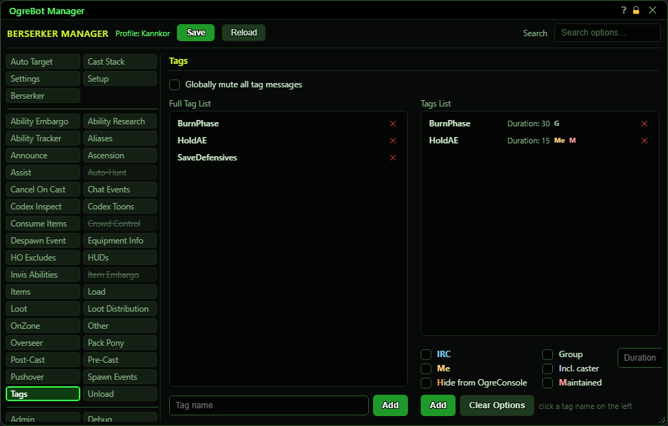

# Tags

**OgreBot is in beta testing.** Looking for OgreBot Classic? [Click here](../../index.md).

Tags let one bot's cast switch other abilities off or on for a while, across all your bots. On the Cast Stack you give an ability an Embargo tag (it is blocked while the tag is on) or an Allow tag (it may only fire while the tag is on). When the bot casts an ability that carries a tag, the tag turns on, on this bot and on your other bots in the same relay group, for the time set here (a Cast Stack row set to 'Listen Only' never turns its tag on, and one set to 'Trigger Only' is not held back by it). This tab is where each tag is defined. The left list holds your tag names: type a name under it and press Add. Click a name to pick it, set its duration and options on the right, and press Add to put it in the Tags List. A tag that is not in the Tags List never turns on.

| Option | What it does | Default |
|---|---|---|
| **Full Tag List** | Your tag names, sorted A-Z. Click a name to pick it for the Tags List on the right. Double-click a name to rename it, and click X to delete it. *A name here does nothing until it is also added to the Tags List. Renaming it here does not rename it in the Tags List.* | empty |
| **Tags List** | The tags that are actually defined, with their duration and options. Click a row to edit it and click X to delete it. *Only tags in this list can turn on.* | empty |

## Top of tab

| Control | What it does | Default |
|---|---|---|
| **Globally mute all tag messages** | **Not active yet.** In the old bot it hid the tag lines in OgreConsole. | off |

## Full Tag List (left)

| Control | What it does | Default |
|---|---|---|
| **Tag name** | Type a new tag name here. Use the same name you put in the Embargo tag or Allow tag box on the Cast Stack. | empty |
| **Add** | Adds the typed name to the Full Tag List. While you are renaming a name this reads Update. |  |

## Tags List (right)

| Control | What it does | Default |
|---|---|---|
| **Duration** | How many seconds the tag stays on after the ability is cast. Leave it blank to use the ability's own duration. *Items need a number here.* | blank (the ability's own duration) |
| **IRC** | **Not active yet.** In the old bot it also sent the tag over IRC. | off |
| **Group** | The tag only turns on for bots in the caster's own group, instead of every bot in your relay group. | off |
| **Me** | The tag only turns on for the character who cast the ability. Your other bots are not told. | off |
| **Incl. caster** | **Not active yet.** In the old bot it added the caster's name and the ability to the tag message. | off |
| **Hide from OgreConsole** | **Not active yet.** In the old bot it kept the tag message out of OgreConsole. | off |
| **Maintained** | The tag stays on while the caster still has the buff in their maintained list, and turns off for every bot as soon as it drops. The duration is then only a safety limit. *Any rank of the ability counts. For an item it is the buff the item puts on you when you use it.* | off |
| **Add** | Adds the picked tag name, with the duration and ticks you set, to the Tags List. While you are editing a row this reads Update and saves your changes. |  |
| **Clear Options** | Unticks every option. Ticks otherwise carry over to the next tag you add. |  |

## Good to know

- A tag used on the Cast Stack but missing from the Tags List (or typed differently) never turns on. The match ignores upper and lower case.
- Leave Duration blank to use the ability's own duration. An item has no duration of its own, so an item that sets a tag must have a Duration here or the tag does not turn on.
- Two bots can hold the same tag at once; it stays on until the last one runs out.
- Only three options change anything: Group, Me and Maintained. IRC, Incl. caster and Hide from OgreConsole are shown for your information - the bot saves them but does not act on them (by design).
- The ticks stay ticked for the next tag you add. Use Clear Options to untick them.
- Press Save at the top to keep your changes for next time.
- Changes to the Tags List are used straight away. Press Save at the top to keep them for next time.

