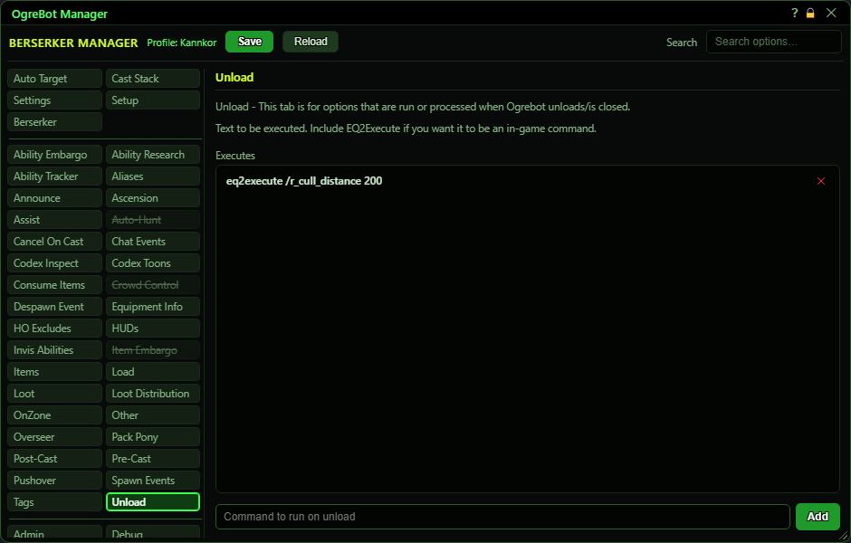

# Unload

**OgreBot is in beta testing.** Looking for OgreBot Classic? [Click here](../../index.md).

Unload is a list of commands the bot runs, top to bottom, when OgreBot closes. That is the X on the OgreBot window or its mini toolbar, or `ogre end bot`. It also happens when you camp to another character in the same game window, because OgreBot closes and reopens for the new character.

| Option | What it does | Default |
|---|---|---|
| **Executes** | Commands the bot runs, top to bottom, when OgreBot closes. Switched-off lines are skipped. *Also runs when you swap to another character in the same game window.* | empty |

## Executes

| Control | What it does | Default |
|---|---|---|
| **Command to run on unload** | Type a console command here. Put `eq2execute` in front of an in-game slash command. Press Enter or Add to put it on the list. *Commas and ] are removed when you add the line.* | empty |
| **Add** | Adds the typed command to the end of the list. It is not run now, only when OgreBot closes. |  |

## Good to know

- The list takes console commands. To run an in-game slash command, start the line with `eq2execute`.
- Unlike the Load tab, a command you add here is NOT run when you add it. It only runs when OgreBot closes.
- Commas and ] are removed from a command when you add it. A line that needs them will not run as typed.
- Double-click a line to switch it off without deleting it. Drag a row to change the order. The x removes it.

