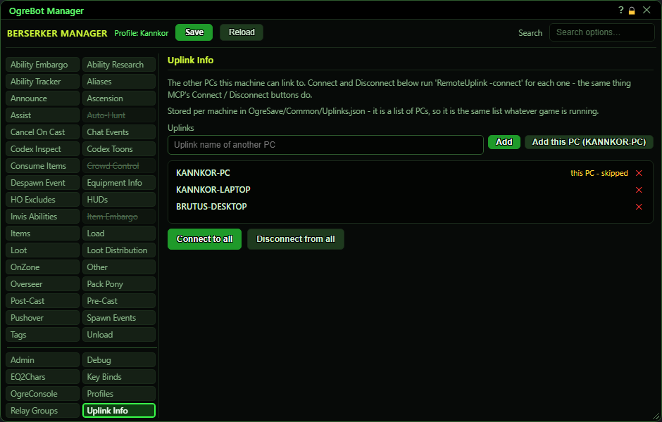

# Uplink Info

**OgreBot is in beta testing.** Looking for OgreBot Classic? [Click here](../../index.md).

Uplink Info is the list of your other PCs. InnerSpace can link PCs together (each PC's InnerSpace is an 'uplink'), so your characters on different PCs can talk to each other. 'Connect to all' links this PC to every PC on the list; 'Disconnect from all' drops those links. MCP's Connect and Disconnect buttons use this same list. The list belongs to the PC, not to a character, and is saved as soon as you change it.

| Option | What it does | Default |
|---|---|---|
| **Uplinks** | The PCs this PC can link to. The row for this PC is marked 'this PC - skipped'. | empty |
| **Connect to all** | Links this PC to every other PC on the list, one after another. Same as MCP's Connect button. *Does nothing if the list is empty or holds only this PC.* |  |
| **Disconnect from all** | Drops the link from this PC to every other PC on the list. Same as MCP's Disconnect button. |  |

## Uplinks

| Control | What it does | Default |
|---|---|---|
| **Uplink name of another PC** | Type another PC's uplink name, then press Add or Enter. | empty |
| **Add** | Adds the typed name to the list and saves it at once. A name already on the list is refused. |  |
| **Add this PC** | Adds this PC's own uplink name to the list. The button shows the name once it is known. |  |
| **x (remove this PC from the list)** | Takes that PC off the list and saves at once. It does not disconnect it. |  |

## Good to know

- Names must be each PC's InnerSpace uplink name, exactly. 'Add this PC' fills in this PC's name for you, so running it once on each PC and copying the names is the easy way.
- This PC is always skipped when connecting, so it is fine to keep the same list on every PC.
- The list is saved in Scripts\OgreSave\Common\Uplinks.json, shared by every game on this PC.
- If several of your characters on this PC press Connect at almost the same moment (for example from an MCP button sent to all), only the first one does it; the rest are ignored for 3 seconds.

