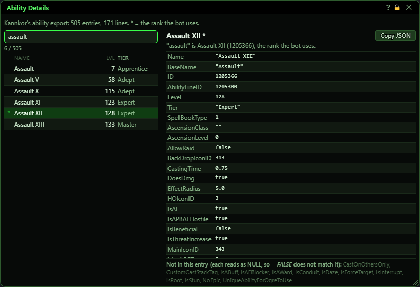
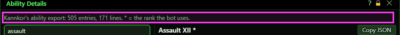
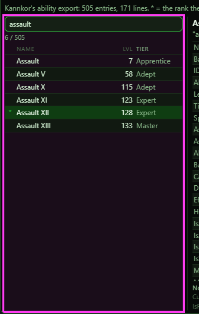
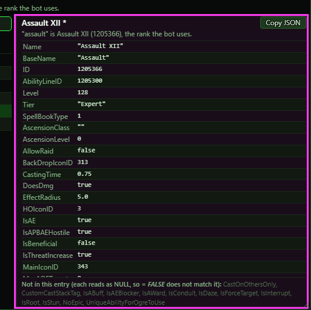
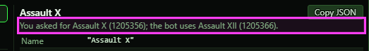
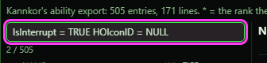
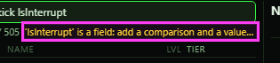
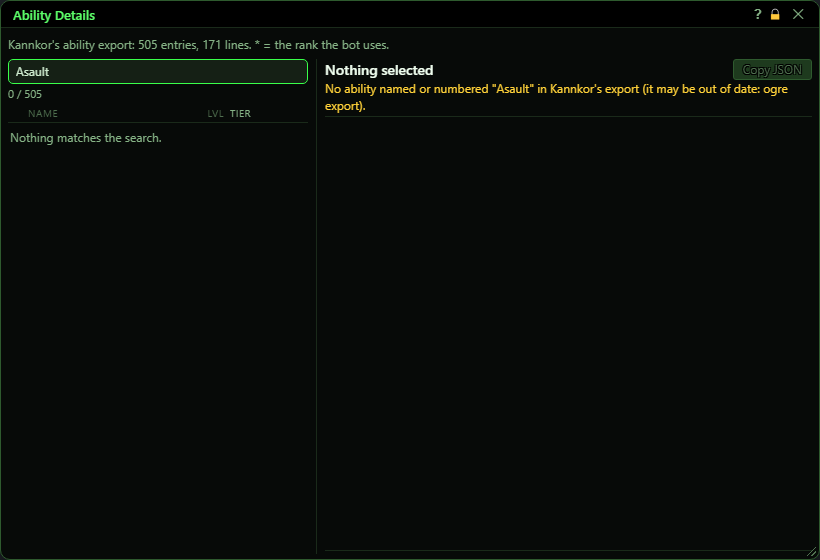
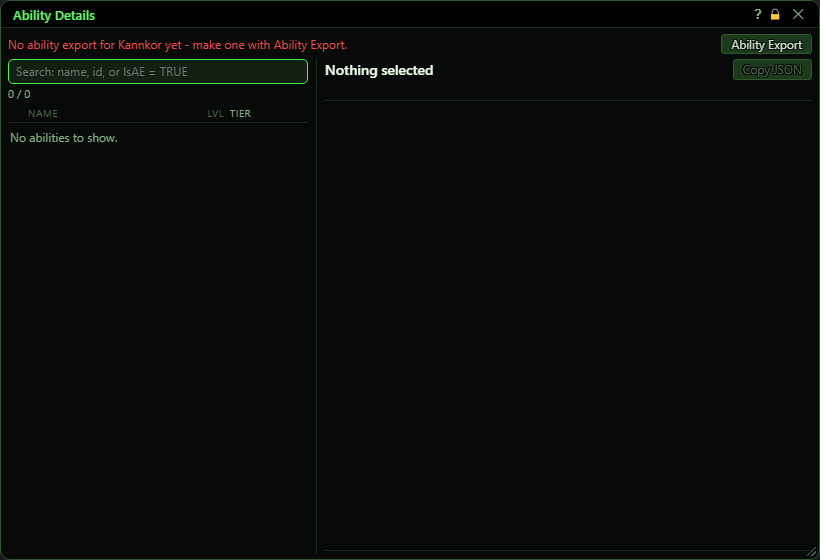

# Ability Details

**OgreBot is in beta testing.** Looking for OgreBot Classic? [Click here](../../index.md).

> **:bulb: In game - the ? button on this window says**
>
> Shows everything your ability export holds about each of your abilities. Use it to answer "why won't the bot cast this?"
>
> **What you can do here**
>
> - **Search** - type part of a name, an ID, or a test such as `IsInterrupt = TRUE` or `HOIconID = NULL`. Everything you type must match.
> - **Click a row** to see every field of that ability on the right. The `*` marks the rank the bot uses.
> - **Copy JSON** copies the whole entry. Right-click a field to copy its value or a search test for it.
> - `ogre abilitydetails <name or id>` opens the window on that ability.
>
> **Good to know**
>
> - The export leaves out flags that are false, so `IsAE = FALSE` matches nothing - use `IsAE != TRUE`. The footer lists the fields an entry does not have.
> - The window only reads your export. If an ability is missing, make a new export with `ogre export`.

**Open it:** Type `ogre abilitydetails`, or `ogre abilitydetails <name or id>` to open it on one ability (for example `ogre abilitydetails Assault` or `ogre abilitydetails Assault X`). A script opens it with `OgreBotAPI.Abilities:AbilityDetails[<forwho>,"<name or id>"]`. `ogre end abilitydetails` closes it.

## What it is for

Shows everything your ability export holds about each of your abilities: every rank of every line, and every field of the one you pick. It is the place to look when the bot will not cast something, or casts a different rank than you expected. The window only reads your export file - it never asks the game - so what you see is exactly what the bot works from. If OgreBot is not open yet, the window reads your export itself; it never changes it.

## The status line

Whose export this is, how many entries it holds (every rank of every ability) and how many ability lines that makes. The `*` in the list marks the rank the bot uses for each line - the highest rank your level allows. It turns red when there is no export for this character yet, or when the export is too old for the bot, and an **Ability Export** button appears.

| Control | What it does |
|---|---|
| **Ability Export** | Opens the Ability Export window, where you make a fresh export. Shown only when there is no export or it is out of date. *When the export finishes the window shows the new one by itself.* |

## Search and the list

Every ability in your export, sorted by name with each line's ranks together, lowest level first. Lvl and Tier are the rank's level and spell tier. The count under the search box shows how many match out of the total.

| Control | What it does |
|---|---|
| **Search** | Filters the list as you type. Words match the ability's name. A number matches its ID or its line ID (and names with that number in them). A test such as `IsInterrupt = TRUE`, `HOIconID = NULL` or `Level >= 100` checks a field, exactly the way CastVia and TypeID check it. Everything you type must match. *A field name typed without a comparison and a value is shown in orange under the box and ignored until you finish it.* |
| **Click a row** | Shows every field of that rank on the right. |
| **Right-click a row** | Copy name or Copy ID of that rank. |

## The selected ability

Every field the export holds for that rank, exactly as written: the name, IDs, level and tier first, then the rest A to Z, then the effect lines in order. The footer lists the fields this entry does NOT have. The export leaves a flag out when it is false, so those fields read as NULL - that is why `IsAE = FALSE` matches nothing. Use `IsAE != TRUE` instead.

| Control | What it does |
|---|---|
| **Copy JSON** | Copies the whole entry, in the same order as the window shows it. |
| **Right-click a field** | Copy value copies the value. Copy as a search term copies `Field = value`, which you can paste into the search box to find every ability with the same value. |
| **Title bar close (X)** | Closes the window. Same as `ogre end abilitydetails`. |

## Opening it on one ability

`ogre abilitydetails Assault` (the ability's own name, no rank) selects the rank the bot uses. A specific rank's full name (`Assault X`) or an ID selects exactly that rank, and the line under its name says which rank the bot uses instead. Either way the search is filled in with the ability's name, so all its ranks are listed. If nothing matches, nothing is selected, the line says so in orange and the console says it too.

## What the window shows

- `*` in the list and after the selected name: the rank the bot uses for that line (the highest rank your level allows).
- The orange line under the search box: a test you have not finished (a field name with no comparison or no value). It does not filter until it is complete.
- Status line '(Loaded by this window - OgreBot is not open.)': OgreBot has not been opened, so the window read your export itself. OgreBot reads it again when it opens.

## Good to know

- The window shows your own character's export only.
- It shows the export, not the game. An ability you trained after your last export is not in it - make a new export with `ogre export`.
- The export leaves out flags that are false. Test them with `!= TRUE` (or `= NULL`), not `= FALSE`.
- Typing a field name such as `Level` on its own starts a test, not a name search.

## Other states

 

 

A finished test in the search box, an unfinished one (shown in orange and ignored), a name that matches nothing, and a character with no export yet.

