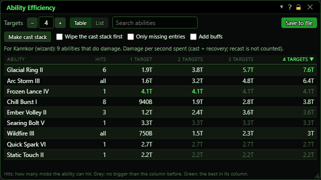
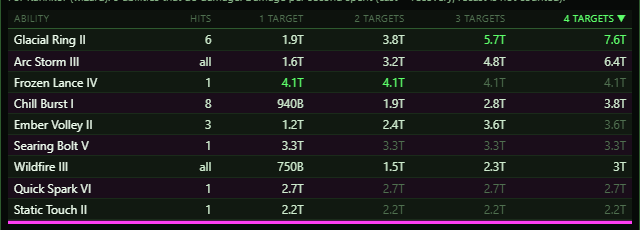
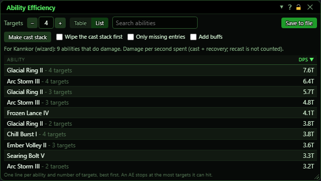

# Ability Efficiency

**OgreBot is in beta testing.** Looking for OgreBot Classic? [Click here](../../index.md).

> **:bulb: In game - the ? button on this window says**
>
> Shows each of your damaging abilities as damage per second spent (cast plus recovery), at 1 target and up to the number in **Targets**. Use it to see at how many targets an AE starts to beat your single-target abilities.
>
> **What you can do here**
>
> - **Table / List** - the Table has one column per number of targets. The List has one line per ability and number of targets, best first, so an AE shows up once for each count: use it to order a cast stack.
> - **Targets** - how many targets to show (1 to 20). Use **-** and **+**, or type a number and press Enter. Your choice is kept for next time.
> - **Click a heading** to sort by it, highest first (Ability: A to Z). Click it again to turn the order round.
> - **Search abilities** - show only the abilities whose name contains what you type.
> - **Save to file** - writes what is on screen, table or list, to a text file. The path is shown under it.
> - **Make cast stack** - adds the List's lines to this character's OgreBot cast stack, best first, between **Ogre AE start** and **Ogre AE end** separators. An AE line such as "4 targets" becomes an entry with **# of mobs** 4.
>   - **Wipe the cast stack first** empties it before adding. **Only missing entries** skips what it already has.
>   - **Add buffs** also adds every buff that never runs out, as NonCombatBuff. Group and raid buffs and your own class buffs are switched on. Of your two stances, a fighter gets the defensive one switched on and everyone else the offensive one; the other is added switched off.
>   - Concentration buffs, clickies (AA and item buffs), Infusions, familiars and illusions are added switched off, each kind under its own separator: switch on the ones you want and remove the rest. Ascension abilities, conduits and a channeler's construct parts are never added.
>   - Add buffs needs an ability export made after this update: if yours is older, it asks you to type `ogre export` first.
>   - It changes the cast stack in OgreBot right away, but nothing is saved until you press **Save** in OgreBot.
>
> **Good to know**
>
> - **Hits** is how many mobs the ability can hit: 1, a number, or **all**. An AE stops growing at its number, and a single-target ability shows the same value in every column.
> - Grey numbers did not grow from the column before. Green is the best in its column.
> - The numbers come from your ability export, from the damage written in each description. Crits, procs, buffs and recast time are not counted.
> - Make cast stack only adds damage abilities and buffs: heals, cures and debuffs are still yours to add.
> - In the List, an AE stops at the most targets it can hit, so it is never listed twice with the same number.
> - `ogre ae -nogui` writes the file without opening the window. `ogre ae -targets 6` opens it at 6, and `ogre ae -list` in the List; add `-list` to `-nogui` for a list file.

**Open it:** Type `ogre ae`. `ogre ae -targets 6` opens it with 6 targets and `ogre ae -list` opens it in the List. `ogre end ae` (or the window's X) closes it. `ogre ae -nogui` writes the report file without opening the window; add `-list` for the list layout.

## What it is for

This window lists every ability you have that does damage, with its damage per second spent: the damage written in the ability's description, divided by its cast time plus recovery time. The Table has one column for each number of targets, from 1 up to the number in Targets, so you can see at how many targets an AE starts to beat your single-target abilities. The List has one line per ability and number of targets, best first, which is the order to build a cast stack in. It is a planning tool: it reads your ability export and changes nothing.

## Targets, search and saving

The line under these shows whose abilities they are and how many there are.

| Control | What it does | Default |
|---|---|---|
| **Targets** | How many targets to show, from 1 to 20: the Table's columns, or how far the List goes. Use - and +, or type a number and press Enter. *Kept for this PC. `ogre ae -targets <n>` opens the window at n without changing what is kept.* | 4 |
| **Table / List** | Table: one row per ability, one column per number of targets. List: one line per ability and number of targets, best first, so an AE appears once for each count ("Arc Storm III - 4 targets") between your single-target abilities. *Kept for this PC with Targets. In the List an AE stops at the most targets it can hit, so the same number never repeats.* | Table |
| **Search abilities** | Shows only the abilities whose name contains what you type, in any case. |  |
| **Save to file** | Writes what is on screen, table or list, to a text file with your Targets. The path is shown under it. *File: Scripts/OgreSave/EQ2/OgreBot/AbilityEfficiency/<name>_<class>_<server>_AbilityEfficiency.txt. The same file as `ogre ae -nogui -targets <n>`, or with `-list` for the list layout.* |  |

## Make cast stack

Adds the List's lines to this character's OgreBot cast stack, best first, at the window's Targets, between two separators: Ogre AE start and Ogre AE end. They go just above a switched-on End of cast stack line, or at the bottom. The cast stack changes in OgreBot at once; nothing is saved until you press Save in OgreBot (Reload there throws it away).

| Control | What it does | Default |
|---|---|---|
| **Make cast stack** | Adds the lines. Each is a CA entry; an AE line such as 'Arc Storm III - 4 targets' gets # of mobs 4, so it only fires with that many mobs, and its 1-target line has no #. The line under the window says how many were added. *Needs OgreBot loaded on this character: the cast stack is part of its profile.* |  |
| **Wipe the cast stack first** | Empties the whole cast stack before adding, separators and all. *Greys out Only missing entries.* | off |
| **Only missing entries** | Skips a line the cast stack already has: the same ability with the same # of mobs (none and 1 count as the same), whatever its Type. A buff is skipped by name. | off |
| **Add buffs** | Also adds every buff that never runs out, as NonCombatBuff, after the damage lines, sorted by level. Switched on: group and raid buffs (Buffs) and your class's own self buffs (Self buffs). Stances: a fighter's defensive stance is switched on and the offensive one off; for everyone else it is the other way round. Switched off, each kind under its own separator: Concentration buffs, Other self buffs (AA and item clickies), Mercenary / Familiar / Mount Infusions, Familiars and Illusions. *Never added: ascension abilities, channeler conduits and a channeler's construct parts. The switched-off kinds are off because nothing in the export says which of a kind is better, and two that replace each other would be cast over each other. It needs an ability export made after this update (it marks the stances); with an older one it asks you to type `ogre export`.* | off |

## The table

Click a heading to sort by that column, highest first; click it again to turn the order round. Ability sorts A to Z.

## The List

One line per ability and number of targets, best first. A single-target ability is one line; an AE is one line for each count up to Targets or the most it can hit. Click DPS to turn the order round, or Ability to sort A to Z.

## What the window shows

- Ability: the ability's full name, with its rank.
- Hits: how many mobs the ability can hit - 1, a number, or 'all' for an AE or encounter nuke with no limit.
- 1 target, 2 targets, ...: the damage per second spent with that many mobs there. An AE grows with each target until its Hits number and then stays the same; a single-target ability shows the same value in every column.
- List: the ability, ' - n targets' for an AE, and its damage per second with that many mobs there.
- Grey numbers did not grow from the column before. Green is the best in its column.
- Numbers are whole under 1,000, then K, M, B and T with one decimal (1.9T); past 999.9T they are written like 2.5E15.

## Good to know

- The numbers come from the damage written in each ability's description. Crits, procs, buffs and the time an ability waits on its recast are not counted.
- It needs your ability export: load OgreBot on the character, or type `ogre export`. Without one the window says so and Save to file is off.
- Without -targets, `ogre ae -nogui` writes the same two-column file classic OgreBot's `ae` did.
- Make cast stack only adds damage abilities and buffs. Heals, cures and debuffs are still yours to add, and nothing is kept until you press Save in OgreBot.

