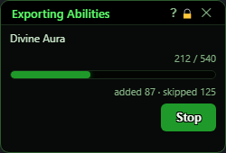
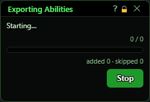
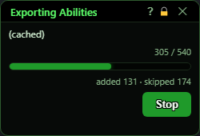
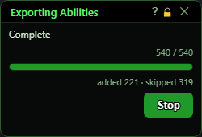

# Exporting Abilities

**OgreBot is in beta testing.** Looking for OgreBot Classic? [Click here](../../index.md).

> **:bulb: In game - the ? button on this window says**
>
> Shows the progress of an ability export. It opens by itself when an export starts and closes by itself when it ends.
>
> **What you can do here**
>
> - **Watch progress**: the ability being read, how many of your abilities have been looked at, and how many were kept or skipped.
> - **Stop** ends the export; the Ability Export window comes back if it was open. Closing this window ends the export and closes the Ability Export window too, the same as `ogre end export`.
>
> **Good to know**
>
> - Stopping writes nothing - your old ability file is left as it was.
> - On a tradeskill export the Examine window opens and closes for each ability. Leave the game window alone until it finishes.

**Open it:** Opens by itself when an ability export starts - from Run export in the Ability Export window, or `ogre export -start`. It closes by itself shortly after the export ends.

## What it is for

A small progress window for an ability export. It shows which ability is being read, how far through the list the export is, and how many abilities were kept or skipped. It is the only way to see (and stop) an export while it runs - the big Ability Export window steps aside until the export ends.

## Progress

Top line: the ability being read right now. It says '(cached)' for an ability the export already knows it would skip, so it is not looked up again, and 'Complete' on the last frame.

| Control | What it does |
|---|---|
| **Stop** | Stops the export. Nothing is written - your old file stays as it was - and OgreBot does not reload its abilities. If the big Ability Export window stepped aside for the export, it comes back. |
| **Title bar close (X)** | Closing this window stops the export, like Stop, and closes the Ability Export window too (the same as `ogre end export`). *The window closes itself about a second and a half after a finished export - that does not stop anything.* |

## What the window shows

- Top line: the ability being read, '(cached)' for one the export skips without a lookup, 'Starting…' before the first one, and 'Complete' at the end.
- n / total: abilities looked at so far out of all the abilities in your knowledge book.
- The bar: the same progress as a percentage.
- added · skipped: how many abilities this run kept for the file, and how many it passed over (passives, wrong tier or level, not in your selection, and so on). With 'Only abilities I don't have yet', the ones already in your file count as skipped - they stay in the file.

## Good to know

- The count is every ability in your knowledge book, not just the ones that end up in the file - most exports skip a lot of them.
- On a tradeskill export the game's Examine window flickers open and shut for each tradeskill ability. Leave the game window alone until it finishes.
- When the export finishes, OgreBot reloads your abilities and cast stack from the new file (unless you ticked 'Don't reload OgreBot when finished' or ran a dry run).

  

Left to right: just opened, skipping a cached ability, and the final frame.
