# Analysis

**OgreBot is in beta testing.** Looking for OgreBot Classic? [Click here](../../index.md).

> **:bulb: In game - the ? button on this window says**
>
> Watches NPCs during an encounter and records every change to them, so you can see what else changed at the moment something happened. It only watches; it never changes what the bot does.
>
> **What you can do here**
>
> - **Monitor**: add actors (**+ Target**, or **+ Cursor** and put the mouse on one within 3 seconds), turn **Monitoring** on, then click a moment in Timestamps to see everything that changed then. The x on an actor stops watching just that one.
> - **Scan**: build terms (type a detail name - it suggests them - pick how to compare, add a value), then **Scan**. Click a result to see all its details; Ctrl+click a second to compare the two. **+ Target** / **+ Cursor** put one actor in the results. **monitor** on a result sends it to the Monitor tab.
> - **Events**: logs of announcements, spawns, chat and other game events. **Search the log** finds lines already recorded; **Record only lines containing** limits what is recorded from now on.
> - **Sessions**: save what you recorded to a file, or load an earlier one.
>
> **Good to know**
>
> - Tick **Keep previous results** to add to the results instead of replacing them. **Add new spawns that match** adds actors as they appear.
> - Pin a detail (the diamond) to show it as a column on every result.
> - Right-click any line to copy it, copy all of an actor's details, or remove it. The x on a result or an actor removes just that one.
> - Closing the window does not stop monitoring. Use `ogre end analysis`.
> - **Taps** turns the event logs on and off.

**Open it:** Type `ogre analysis` (or `ogre anal`). `ogre end analysis` turns monitoring off (it does not close the window or stop the event logs).

[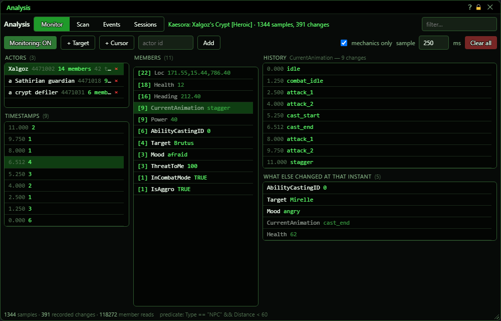](../assets/analysis/window.png "Click for full size")

## What it is for

A tool for working out how an encounter behaves. You pick a few NPCs and it records every change to them - health, animation, target, mood and over 80 other details - several times a second, so you can see exactly what else changed at the moment something happened. It can also take a snapshot of many NPCs at once and compare two of them side by side, and log announcements, spawns, chat and other game events. Nothing here changes what the bot does; it only watches and records.

## Tabs and filter

Next to the tabs: the zone, scan progress while a scan runs, and the number of samples and changes while monitoring is on.

[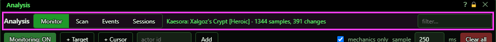](../assets/analysis/header.png "Click for full size")

| Control | What it does | Default |
|---|---|---|
| **Monitor / Scan / Events / Sessions** | Switches the page shown. *The window remembers the tab while the game is running.* | Monitor |
| **filter… (placeholder)** | Narrows what is listed: on Monitor it filters the Members list by name, on Scan the results by name or type, on Events the log lines. Not case-sensitive. Display only. *Does not filter the Actors or Timestamps lists.* | empty |
| **Title bar close (X)** | Closes the window. Monitoring and the event logs keep running in the background. *Turn Monitoring off first if you are done, or type `ogre end analysis`.* |  |

## Monitor - buttons

[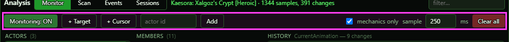](../assets/analysis/monitor-bar.png "Click for full size")

| Control | What it does | Default |
|---|---|---|
| **Monitoring: ON / Monitoring: off** | Starts or stops recording the actors in the Actors list. While on, each one is read at the sample rate and every change is kept. *Adding actors does not turn this on - press it after adding them.* | off |
| **+ Target** | Adds your current target to the Actors list. *Up to 24 actors. With no target, or one already listed, the window says so in its warning line.* |  |
| **+ Cursor** | Starts a 3-second countdown on the button ("Hover the actor... 3"); put the mouse on an actor, and when it ends that actor is added to the Actors list. *If nothing is under the mouse when the countdown ends, the window says so.* |  |
| **actor id (placeholder) + Add** | Adds an actor by its ID number. | empty |
| **mechanics only** | Hides the always-changing details (location, heading, health, animation and the like) from the Timestamps list, so it shows only moments when something meaningful changed. Display only. | on |
| **sample … ms** | How often each monitored actor is read, in milliseconds. Lower = finer detail. *A plain text box: type a whole number from 100 to 10000 and press Enter or click away. Anything else puts the box back to the rate in use.* | 250 ms |
| **x on an actor row** | Stops watching just that actor. What was recorded for it is dropped with it. |  |
| **Clear all** | Removes every actor from the Actors list, with everything recorded for them. *No confirmation. Export on the Sessions tab first if you want to keep it.* |  |

## Monitor - the four lists

Work from left to right: pick an actor, then a detail or a moment.

[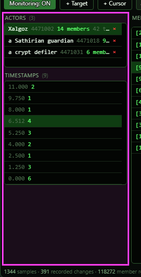](../assets/analysis/monitor-left.png "Click for full size")

| Control | What it does |
|---|---|
| **Click an actor (Actors list)** | Selects that actor. Its details fill the Members list and its moments fill Timestamps. |
| **Click a detail (Members list)** | Shows every value that detail has had, with the time, in the History list. |
| **Click a moment (Timestamps list)** | Fills 'What else changed at that instant' with every detail that changed at that moment. This is the main use of the tool - for example, what the NPC's animation and target were when it started a cast. |
| **Right-click an actor or any line** | Copy this line; on an actor, Stop watching it. |

## Scan

Takes a snapshot of every actor that matches your terms - over 80 details each. Click a result to see all its details; Ctrl+click a second result to compare the two. Send any result to the Monitor tab.

[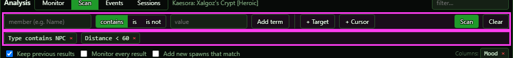](../assets/analysis/scan-bar.png "Click for full size")

| Control | What it does | Default |
|---|---|---|
| **member (e.g. Name) (placeholder)** | The detail to match on. As you type, a list of matching details appears with their kind (text, number, yes/no); click one, or use the arrow keys and Enter. | empty |
| **contains / is / is not, = < > ≤ ≥ ≠, or TRUE / FALSE** | How to compare, offered to suit the detail: text matches by contains (any case), is, or is not; numbers by = < > ≤ ≥ ≠; a yes/no detail is just TRUE or FALSE, with no value box. | contains for text, = for numbers, TRUE for yes/no |
| **value (placeholder)** | The value to compare against, for example guard or 60. Enter adds the term. | empty |
| **Add term** | Adds the term to the list below the bar. All terms must match (they are combined with AND). |  |
| **× (on a term)** | Removes that term. |  |
| **+ Target** | Puts your current target in the results and shows its details, without changing the terms. |  |
| **+ Cursor** | Starts a 3-second countdown; the actor under the mouse when it ends goes in the results. |  |
| **Scan / Scan EVERYTHING** | Runs the scan. With no terms the button turns red and reads 'Scan EVERYTHING' - pressing it snapshots every actor in the zone. *If the scan cannot run, the window says why: the zone has only just loaded (try again in a moment) or a term does not work.* |  |
| **Clear** | Empties the results. |  |
| **Keep previous results** | A scan adds to the results instead of replacing them. An actor already listed is updated. | off |
| **Monitor every result** | Every actor a scan finds is also added to the Monitor tab (up to 24). | off |
| **Add new spawns that match** | An actor that spawns and matches the terms joins the results about 2 seconds later. | off |
| **Click a result / Ctrl+click a second** | A click shows every detail of that result on the right. Ctrl+click (or Shift+click) another result compares the two, showing only the details that differ. *The results line shows name, ID, type, level, health and distance, plus any columns you pinned. A line marked monitored is on the Monitor tab. Underneath the count, the window says how many actors could not be read (they despawned during the scan).* |  |
| **monitor / × (on a result)** | monitor sends that actor to the Monitor tab; × removes it from the results. |  |
| **Monitor all** | Sends every result to the Monitor tab, up to 24. |  |
| **Refresh / Monitor (above the details)** | Refresh reads that actor again now. Monitor sends it to the Monitor tab. The line also says how long ago it was read, and 'no longer here' if it has gone. |  |
| **filter members… + show empty** | Narrows the details shown by name or value. Empty details (blank, 0, FALSE) are hidden unless show empty is ticked. | show empty off |
| **◇ / ◆ (on a detail)** | Shows that detail as a column on every result line (◆ = shown). The columns are listed on the bar above the results, each with an × to remove it. |  |
| **Stop comparing** | Goes back from a comparison to the selected result's details. |  |
| **Right-click a result or a detail** | Copy this line, Copy all its details (every detail of that result, one per line), Monitor it, or Remove from the results. |  |

## Events

Seven logs of game events: announce (big on-screen messages), despawn, spawn, choice (choice-window text), reward (reward-window text), text (incoming text such as combat lines) and chat (chat lines, with speaker and channel). Each keeps its last 2000 lines.

[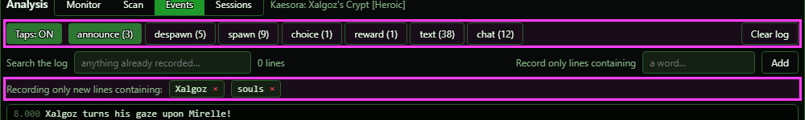](../assets/analysis/events-bar.png "Click for full size")

| Control | What it does | Default |
|---|---|---|
| **Taps: ON / Taps: off** | Switches the event logs on and off. It reads 'Taps: ON' while they are recording. | off (the button still says ON) |
| **announce / despawn / spawn / choice / reward / text / chat (n)** | Picks which log is shown below. The number is how many lines it holds. | announce |
| **Search the log** | Shows only the recorded lines that contain what you type (any case), searching everything already recorded in the log shown - use it any time, after the fact. The count beside it says how many lines match. *The same search as the filter box at the top of the other tabs (that box is hidden on this tab).* | empty |
| **Record only lines containing + Add** | From now on, a NEW line is recorded only if it contains one of these words (any case). It works before the fact: lines already in the log are not touched. Applies to all seven logs. *Lines already recorded are not removed.* | none (everything is recorded) |
| **× (on a filter)** | Removes that filter. |  |
| **Clear log** | Empties the log that is shown. The other logs are kept. |  |
| **Right-click a line** | Copy this line, or Copy all the lines shown (the log shown, with the search applied). |  |

## Sessions

[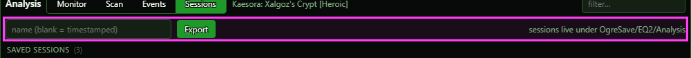](../assets/analysis/sessions-bar.png "Click for full size")

| Control | What it does | Default |
|---|---|---|
| **name (blank = timestamped) (placeholder)** | The name to save under. Leave blank for a name like session_2026-09-27_201455. | empty |
| **Export** | Saves the monitored actors (with everything recorded) and the scan results to a file in OgreSave/EQ2/Analysis. *The event logs are not saved. A file with the same name is overwritten.* |  |
| **Click a saved session** | Loads that file. It REPLACES the monitored actors and scan results you have now, and turns monitoring off. *No confirmation - export first if you want to keep what is on screen.* |  |

## What the window shows

- Actors: name, ID, how many details have changed, and 'ticks' = how many moments something changed.
- Members: [how many values recorded] detail name, latest value. Most-changed first. The always-changing details are dimmed.
- History: time since the bot was loaded (minutes:seconds.milliseconds) and the value. The same clock is used in Timestamps and the event logs. Only the latest 400 are shown.
- Timestamps: newest first - the time, and how many details changed at that moment.
- What else changed at that instant: detail and value for everything that changed at the picked moment (always-changing ones dimmed).
- Scan results: name, type, L level, health %, distance. A green left edge means that actor is also in your Monitor list.
- Diff: detail, first actor's value, second actor's value. '—' means that actor has no value for it.
- Red banner under the tabs: the last scan could not run (usually a misspelled detail name).
- Footer: total samples, recorded changes and detail reads, and the query the last scan used.

## Good to know

- Monitoring only reads actors the bot can currently see in the zone. If every list stays empty, the actor has despawned or the ID is from another zone - the window says so.
- Actor IDs are reused between zones, so a monitored ID from an old zone can point at a different actor now.
- Closing the window does not stop monitoring or the event logs.
- Turning monitoring or the event logs on (from anywhere) opens this window.
- Everything is kept in memory only until you Export it.
- Problems now show in the warning line under the tabs, not only in the console.
- The right-click menu's own Copy only copies text you have selected; use Copy this line (or the copy items under it) to copy a row.

### Scan tab

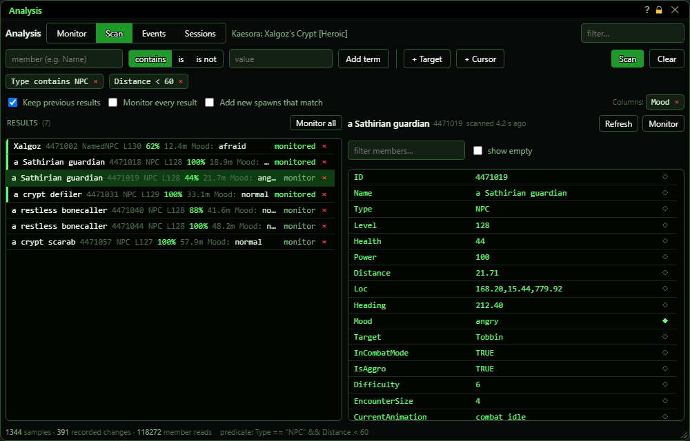

With no terms the Scan button turns red:

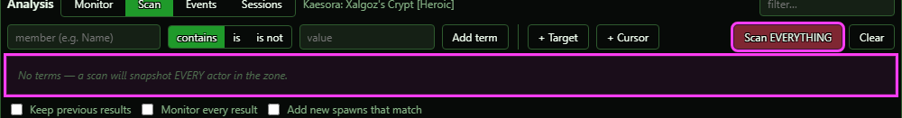

### Events tab

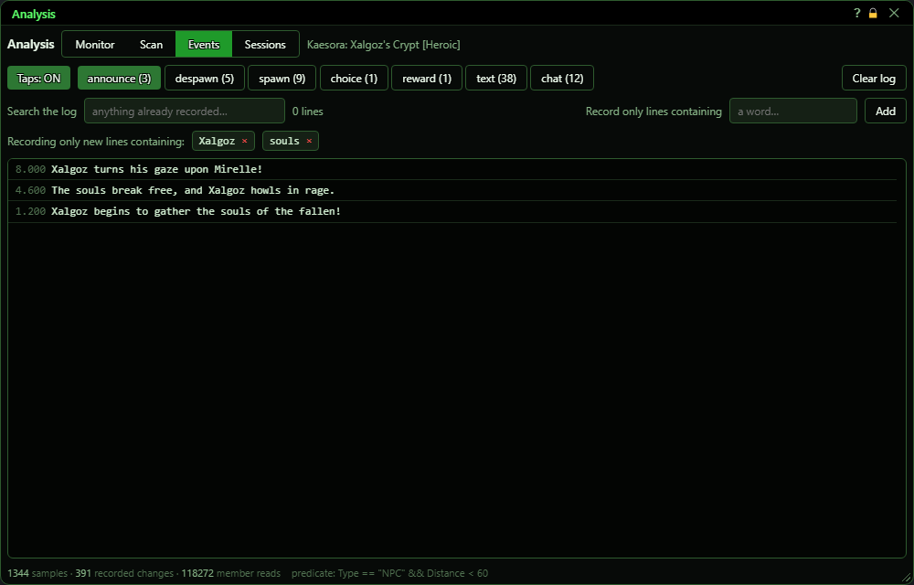

### Sessions tab

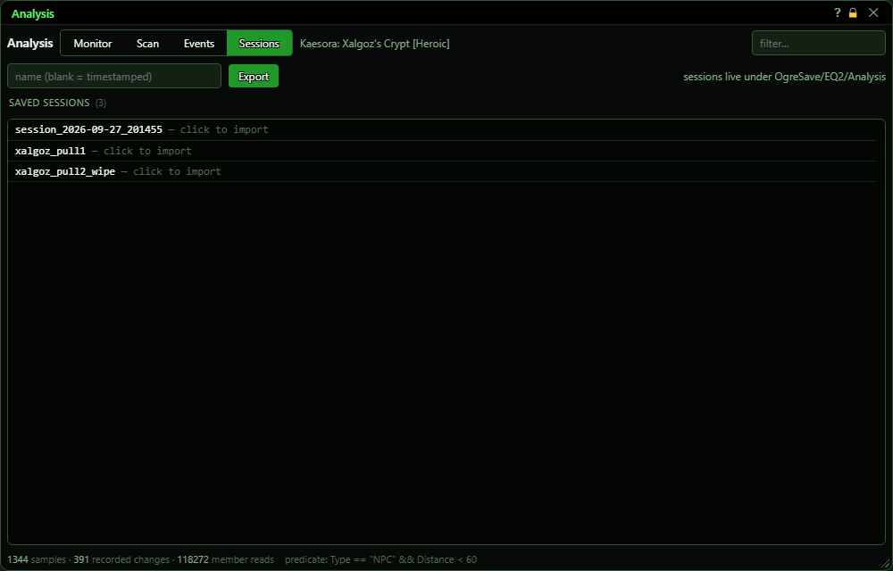

### Console commands

`ogreanalysis` also takes words for things the window cannot do: `monitor remove <id>`, `monitor list`, `taps on|off`, `rate <ms>`, `status`, `sessions`, `import <name>`.
