# Auto-Login

**OgreBot is in beta testing.** Looking for OgreBot Classic? [Click here](../../index.md).

> **:bulb: In game - the ? button on this window says**
>
> Builds auto-login profiles: which character goes into which session. Start makes your sessions match the profile and loads OgreBot on each character once it is in the world.
>
> **What you can do here**
>
> - **Profiles** - click one to open it. **+ New** starts a blank one; **Import** copies your old OgreBot profiles.
> - **Character rows** - pick the PC (ThisUplink, or another PC), the session (is1, is2, or any) and the character.
> - **Other PCs** - add another PC's uplink name so a row can put characters on it. Start connects to it and logs those characters in there.
> - **Settings** - the game to launch and the pauses between launches and logins (in tenths of a second).
> - **ISBoxer character sets** - if you launch with ISBoxer, pick the set for each PC. Start launches them first, then logs your characters into the sessions they opened, and launches only a session that is still missing. Leave a PC empty if it doesn't use ISBoxer.
> - **Save** the profile, **Delete** the one selected in the list, or make a **Desktop shortcut** that runs it.
> - **Start** runs the selected saved profile. Tick **Dry run** to only list what it would do.
>
> **Good to know**
>
> - Saving over an existing profile needs **Overwrite** ticked.
> - Start runs the saved profile, so Save first.
> - No passwords are stored; characters must be in your saved account list - on another PC, in that PC's list.
> - Another PC needs Ogre installed. One that can't be reached has its rows skipped.

**Open it:** Type `ogre autologin`. `ogre end autologin` closes it.

[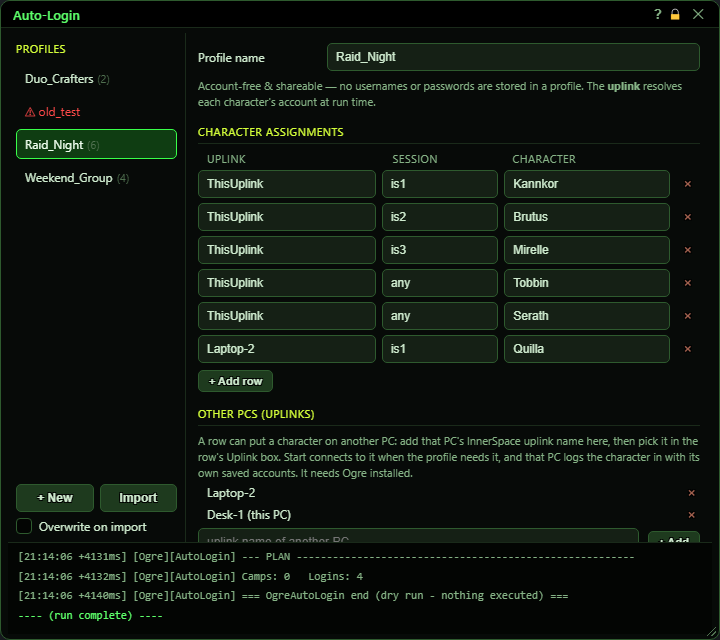](../assets/autologin/window.png "Click for full size")

## What it is for

Auto-Login builds **profiles**: a named list of which character goes into which InnerSpace session. Press **Start** and InnerSpace itself (the uplink, not the game window) makes your sessions match the profile: characters already in the right place are left alone, a wrong character is camped out, missing sessions are launched, and each character is logged in with a pause between logins. Once a character is in the world, OgreBot is loaded for it. Profiles hold no account names or passwords; those come from your saved account list when the profile runs, so a profile is safe to share.

## Profiles list

Your saved profiles, in name order. The number after a name is how many characters it has. A red name with a warning sign is a profile file that could not be read.

[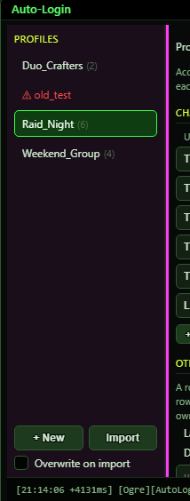](../assets/autologin/list.png "Click for full size")

| Control | What it does | Default |
|---|---|---|
| **Click a profile** | Opens that profile on the right so you can check it, change it, start it or delete it. *Clicking a red (broken) profile only shows why it could not be read, in the log at the bottom.* |  |
| **+ New** | Clears the right side for a brand new profile: no name, one character row (ThisUplink, any), and the default settings. *Nothing is saved until you click Save.* |  |
| **Import** | Copies your auto-login profiles from the old OgreBot into this window. It reads the old bot's AutoLoginProfiles.xml and AutoLoginSettings.xml (in Scripts\EQ2OgreCommon\OgreAutoLogin) and writes one new profile per old one. The log shows how many were written, skipped or failed. *The old bot's timing settings are copied into every imported profile. Characters not in your saved account list are counted as warnings but still imported.* |  |
| **Overwrite on import** | When ticked, Import replaces a profile you already have with the same name. When not ticked, those are skipped and your existing profile is kept. | off |

## Profile name

[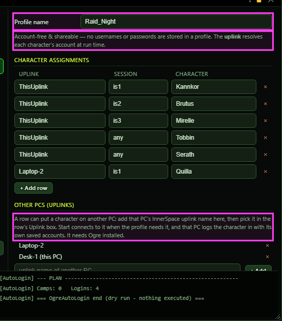](../assets/autologin/name.png "Click for full size")

| Control | What it does | Default |
|---|---|---|
| **Profile name** | The name of the profile. Save uses it. The file on disk is named after it, with anything that is not a letter or number turned into an underscore. *Spaces are fine. Renaming a saved profile and clicking Save moves it to the new name.* | empty |

## Character assignments

One row per character. Each field is pick-or-type: click it for a list, or type anything. Typing narrows the list.

[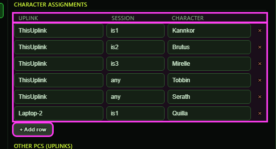](../assets/autologin/rows.png "Click for full size")

| Control | What it does | Default |
|---|---|---|
| **Uplink** | Which PC this character is logged in on. ThisUplink means "whichever PC runs the profile". To put a character on another PC, add that PC to Other PCs below and pick it here: Start connects to that PC, launches and logs in its sessions there. *The list offers ThisUplink plus the PCs in Other PCs (this PC itself is ThisUplink). That PC logs the character in with its own saved account list, and it needs Ogre installed.* | ThisUplink |
| **Session** | Which InnerSpace session the character must be in: is1, is2 and so on. "any" means any session is fine: if the character is already in the world somewhere it is left alone, otherwise a free session is used or a new one is launched. *The list offers any and is1 to is24. Left empty, it saves as any.* | any |
| **Character** | The character to log in. The list shows the characters in your saved account list. *A character that is not in your saved account list gets a warning when the profile runs, because its account cannot be looked up.* | empty |
| **x (remove row)** | Removes that character row. If it was the last row, a fresh empty row takes its place. *Not saved until you click Save.* |  |
| **+ Add row** | Adds another character row (Uplink ThisUplink, Session any, Character empty). |  |

## Other PCs (uplinks)

The other PCs a character row can name, by their InnerSpace uplink name. It is the same list as OgreBot's Uplink Info tab and the MCP's Connect button. When a profile has rows on another PC, Start connects to that PC if it is not connected yet, checks that its uplink answers, then launches, logs in and loads OgreBot on its sessions from this PC. A PC that cannot be reached has its rows skipped and the rest of the profile still runs.

[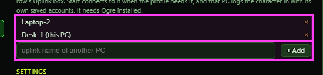](../assets/autologin/uplinks.png "Click for full size")

| Control | What it does | Default |
|---|---|---|
| **Uplink name** | Type the InnerSpace uplink name of another PC (in InnerSpace on that PC: its Remote name). | empty |
| **+ Add** | Adds the typed name to the list. The log says whether it was added. *The list is saved at once, for every profile on this PC.* |  |
| **x (remove PC)** | Takes that PC off the list. *Rows that name it keep the name; Start still tries to connect to it.* |  |

## Settings

Times are in tenths of a second: 150 means 15 seconds. The editor scrolls; these are below the character rows.

[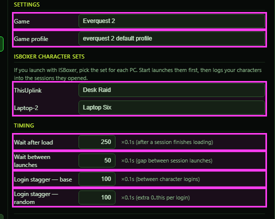](../assets/autologin/settings.png "Click for full size")

| Control | What it does | Default |
|---|---|---|
| **Game** | The InnerSpace game entry used when a new session has to be launched. The list comes from the games set up in InnerSpace. *Left empty, it saves as Everquest 2.* | Everquest 2 |
| **Game profile** | The InnerSpace game profile used when a new session has to be launched. The list shows the profiles of the game chosen above. | everquest 2 default profile |
| **ISBoxer character sets** | If you launch with ISBoxer, the character set to launch on each PC: one line for this PC (ThisUplink) and one for each other PC the rows name. Start launches every PC's set first (another PC's on that PC), then logs your characters into the sessions they opened, and launches only a session that is still missing. *Each list shows that PC's sets from ISBoxer. Leave a line empty for a PC that does not use ISBoxer. A PC whose last row is removed keeps no set.* | empty (no ISBoxer) |
| **Wait after load** | After new sessions are launched, how long to wait for them to load before logging anyone in. Only used when a session had to be launched. | 150 (15 seconds) |
| **Wait between launches** | The pause after each new session is launched, before the next one. | 50 (5 seconds) |
| **Login stagger - base** | The pause between one character's login and the next, so the server is not hit with every login at once. | 300 (30 seconds) |
| **Login stagger - random** | A random extra pause, up to this much, added to the base pause for each login. 0 turns the random part off. | 150 (up to 15 seconds) |

## Save, Delete, Shortcut and Start

At the opening window size these buttons are below the fold: scroll the right side down to reach Start.

[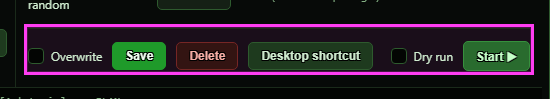](../assets/autologin/actions.png "Click for full size")

| Control | What it does | Default |
|---|---|---|
| **Overwrite** | Must be ticked to save over a profile that is already saved. Without it, Save refuses and says a profile with that name already exists. *This includes saving changes to the profile you just opened. It is not remembered: it is off each time the window opens.* | off |
| **Save** | Saves the profile. The log says whether it worked, and the list on the left updates. *A profile needs a name. A row with no character is dropped when saving; a blank Uplink saves as ThisUplink and a blank Session as any. Settings this window does not show (such as loginOnly or sessionAppearMaxDs, set by hand in the file) are kept.* |  |
| **Delete** | Asks for confirmation, then deletes the profile you selected in the list. *It deletes the selected saved profile, even if you have typed a different name in the box. A new profile that was never saved cannot be deleted.* |  |
| **Delete (in the confirm box)** | Deletes the profile file and clears the right side to a new blank profile. This cannot be undone. |  |
| **Cancel (in the confirm box)** | Closes the confirm box without deleting anything. |  |
| **Desktop shortcut** | Puts a shortcut on your Windows desktop that runs this saved profile through InnerSpace, the same as pressing Start. The log shows where it was made. *Save the profile first. A shortcut with the same name is replaced; if something else already has that name, a numbered copy like "Raid_Night (1)" is made instead.* |  |
| **Dry run** | When ticked, Start only works out and lists what it would do (who stays, who gets camped, which sessions it would launch, who it would log in). Nothing is actually done. *Off means Start really does it. Tick it the first time you try a new profile.* | off |
| **Start** | Runs the selected profile, as it is saved, in InnerSpace. Characters already where they belong are left alone; a wrong character in a session is camped first; missing sessions are launched; then each character logs in, with the stagger pause between logins. Each character gets OgreBot loaded as soon as it is in the world. Progress appears in the log below as it happens. *Start runs the profile as last SAVED, not what is on screen. Click Save first if you changed anything, or if the profile is new.* |  |

## Window

[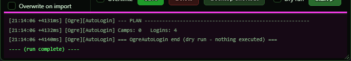](../assets/autologin/status.png "Click for full size")

| Control | What it does |
|---|---|
| **Title bar close (X)** | Closes the window. A run that has already started keeps going in InnerSpace. *Unsaved changes are lost.* |

## What the window shows

- Profiles (left): every saved profile, in name order. The number in brackets is how many characters it has. Green outline = the one open on the right. Red with a warning sign = a profile file that could not be read.
- The note under the name is a reminder that profiles hold no usernames or passwords.
- The log (bottom): green lines are things that worked, red lines are problems. During a Start it shows the run as it happens, between "run output" and "run complete" lines.
- The log stops following a run if nothing new appears for 90 seconds, or after 10 minutes.

## Good to know

- Saving changes to an existing profile needs Overwrite ticked, even if it is the profile you just opened.
- Start runs the SAVED profile. Save first if you changed anything.
- Rows on another PC are run from this PC: it connects to that PC and drives its sessions there. That PC needs Ogre installed and the characters in its own saved account list - passwords never leave the PC they are saved on.
- Profiles are saved as files in Scripts\OgreSave\EQ2\AutoLogin\Profiles. They hold no passwords, so they are safe to copy or share.
- Characters must be in your saved account list so their account can be found when the profile runs.
- Opening the window again while it is open does nothing, so the profile you are editing stays.

## Scrolled down

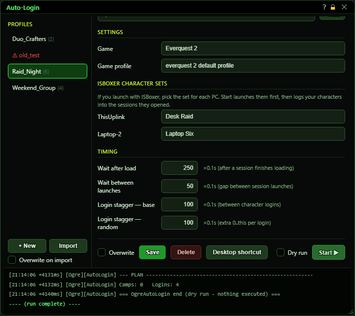

The right side scrolls. At the size the window opens at, **Start** is below the fold.

## Pick-or-type lists

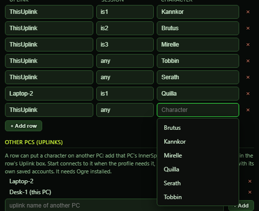

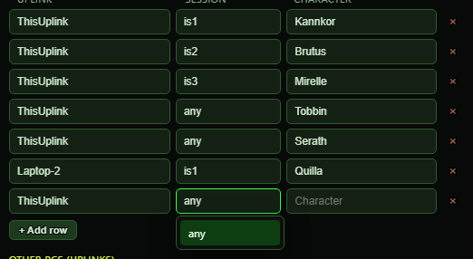

Click a field for its list, or type: typing narrows the list, and you may type a value that is not in it.

## Deleting

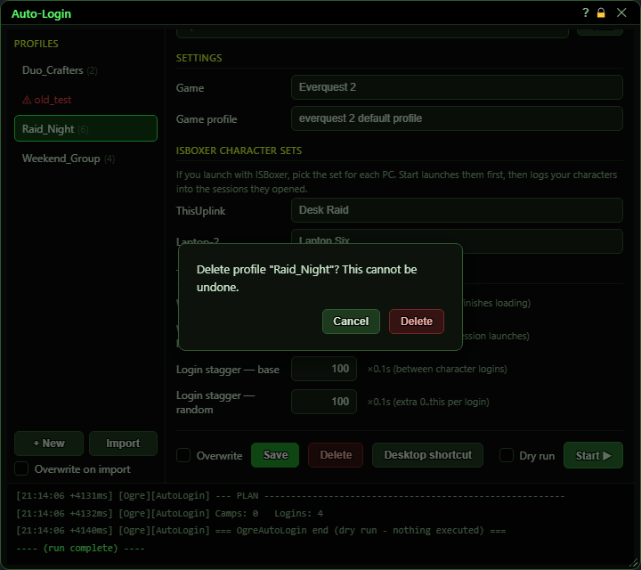

## First open

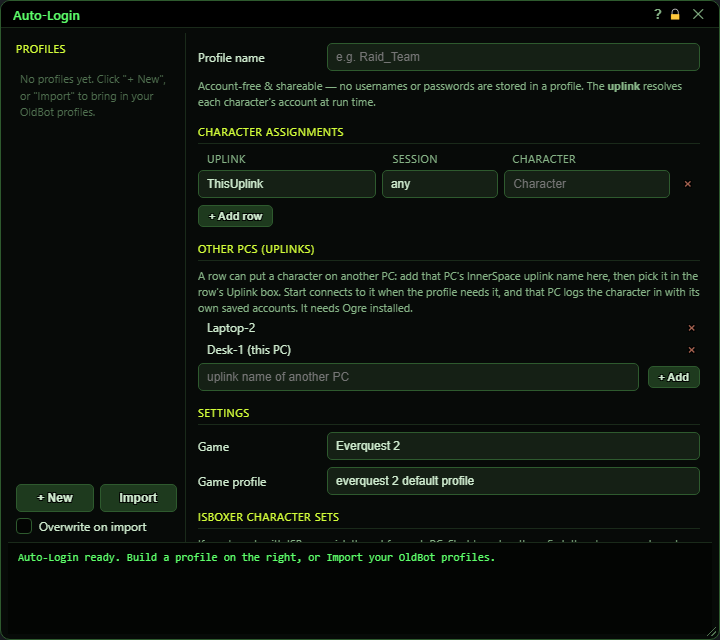

With nothing saved yet, build a profile on the right and click **Save**, or click **Import** to bring over the profiles from the old OgreBot.

