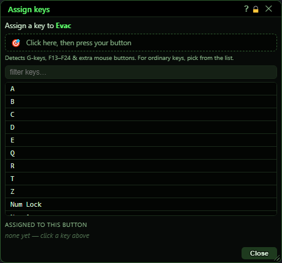
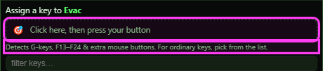
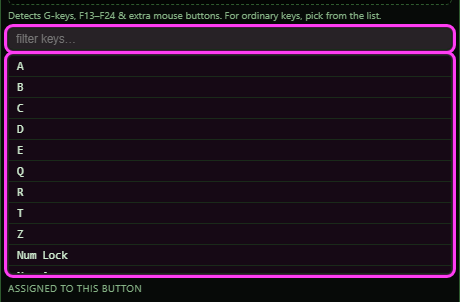
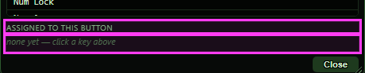
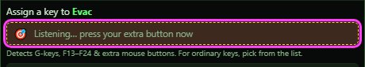
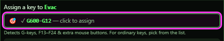
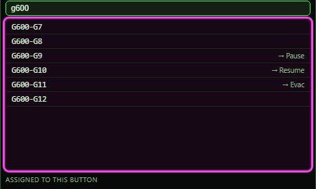

# Assign keys

**OgreBot is in beta testing.** Looking for OgreBot Classic? [Click here](../../index.md).

> **:bulb: In game - the ? button on this window says**
>
> Links a key, G-key or extra mouse button to one MCP button. Pressing it does what clicking the button does.
>
> **What you can do here**
>
> - **Key detector** - click the box, press your G-key or side mouse button, then click the box again to assign it.
> - **Click a key** in the list to assign it. Keys already in use show which button they fire.
> - **x** on a tag under Assigned to this button removes that key.
>
> **Good to know**
>
> - Keys work with the MCP closed, on every character on this PC.
> - A key belongs to the button: move the button or its page and the key still presses it. Clearing the button, or deleting its page, removes its keys.
> - One key can fire several buttons if you assign it more than once.

**Open it:** In the Master Control Panel, right-click a button and pick **Assign to key…**.

## What it is for

Assign keys links a key - a keyboard key, a Logitech G-key, a gamepad button or an extra mouse button - to one MCP button. Pressing the key does exactly what clicking the button does, including its For Who. Keys keep working when the MCP window is closed, and they are set up on every character on this PC.

## Key detector

The easy way to find the name of an unusual key, such as a G-key or a side mouse button.

| Control | What it does |
|---|---|
| **Click here, then press your button** | Click it, then press the key within 20 seconds. The box shows the key it caught (for example '✓ G600-G12 — click to assign'). Click the box again to assign that key to this button. *It only catches G-keys (G600/G510), gamepad buttons, mouse buttons 4 and up and F13-F24. For any other key, click it in the list.* |

## Key list

| Control | What it does | Default |
|---|---|---|
| **filter keys… (placeholder)** | Shows only keys whose name contains the text. Escape closes the window. | empty |
| **Click a key** | Assigns that key to this button straight away. It is saved and working at once. *A key that already fires another button (shown on the right) now fires both.* |  |

## Assigned to this button

| Control | What it does |
|---|---|
| **✕ (on a key tag)** | Removes that key from this button. It stops working at once on every character on this PC. |
| **Close** | Hides the window (and stops a key detector that is still listening). |

## What the window shows

- 'Assign a key to Evac': the button this window is working on.
- Key list: each key's InnerSpace name; '→ Pause' on the right = that key already fires the Pause button. The current button's name is highlighted and its keys are shaded.
- Detector box: dashed while waiting, 'Listening… press your extra button now' while it listens, a green tick and the key name once caught. 'key list still loading — try again in a second' means the list of keys was not ready yet.
- Assigned to this button: one tag per key, or 'none yet — click a key above'.

## Good to know

- Keys are saved in Scripts/OgreSave/EQ2/OgreMCPBinds.json and set up on every character on this PC. They work even with the MCP closed.
- A key is tied to the button itself, not to where it sits. Move the button, or move its page, and the key still presses it. Clearing the button, or deleting its page, removes its keys. Pasting over a button keeps its keys, so they now press what you pasted.
- A key fires the button as it is saved right now, so editing the button changes what the key does - no need to assign it again.
- Keys from the window fire when pressed. A key that fires on release can only be made with the command `ISXOgreEQ2.MCP:AddBind[<key>,<button id>,<name>,release]`; such keys show ⭜ on their tag.
- `ISXOgreEQ2.MCP:ListBinds` lists every saved key, `ISXOgreEQ2.MCP:Buttons` lists every button with the id to use in AddBind (such as `btn:bmfk2x1a0` - not the button's name). An id like `static:0_0` or `page:2:0_1` still works; it names a slot and is switched to that slot's button the next time the MCP saves.

### Waiting for a key, and a key caught

### Filtering the list

