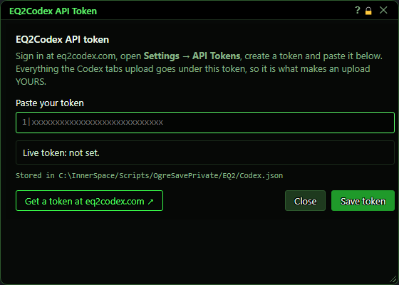
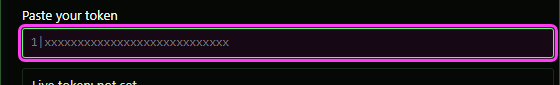
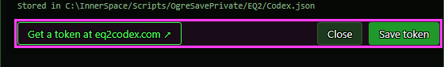
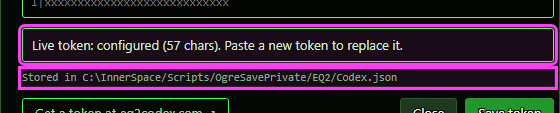
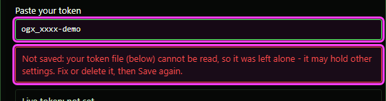

# EQ2Codex API Token

**OgreBot is in beta testing.** Looking for OgreBot Classic? [Click here](../../index.md).

> **:bulb: In game - the ? button on this window says**
>
> Where you give the bot your eq2codex.com API token. It ties the Codex tabs' uploads to your account.
>
> **What you can do here**
>
> - **Get a token at eq2codex.com** opens the site in your browser. Sign in, then go to Settings, API Tokens.
> - **Paste your token** in the box.
> - **Save token** saves it, replacing any old token, and closes the window. Enter does the same.
> - **Close** leaves without saving.
>
> **Good to know**
>
> - Your saved token is never shown here, only whether one is set.
> - If a save fails, the window stays open, says why in red, and keeps your token in the box.

**Open it:** In OgreBot, open the **Codex Inspect** or **Codex Toons** tab and click **Setup API Token**.

## What it is for

This is where you give the bot your eq2codex.com API token. The Codex tabs upload character gear and raid rosters to eq2codex.com, and the token is what ties those uploads to your account. You create the token on the website (Settings → API Tokens), paste it here and save. The window never shows your saved token - only whether one is set and how long it is.

## Pasting your token

| Control | What it does | Default |
|---|---|---|
| **Paste your token** | Paste the API token you created on eq2codex.com. Pressing Enter in the box is the same as Save token. *The token leaves the screen with the window when a save works. If a save fails, the token stays in the box so you can try again.* | empty |

## Buttons

| Control | What it does |
|---|---|
| **Save token** | Saves the token as your live eq2codex.com token, replacing any token you had before, makes it the token the bot uses, and closes the window. The Codex tabs then show the token as configured. *With an empty box nothing is saved and a red message says so.* |
| **Get a token at eq2codex.com ↗** | Opens eq2codex.com in your web browser, outside the game. Sign in there and go to Settings → API Tokens. |
| **Close** | Closes the window without saving. |
| **Title bar close (X)** | Closes the window without saving, the same as Close. |

## When a token is already saved

The status box gets a green border and says how many characters the saved token has. Paste a new token and save to replace it.

## What the window shows

- Status box: 'Live token: not set.' when you have no token yet, or 'Live token: configured (57 chars). Paste a new token to replace it.' when you do. The token itself is never shown.
- Stored in ... - the file your token is saved in: OgreSavePrivate\EQ2\Codex.json in your InnerSpace Scripts folder (your private settings folder - do not share it).

## Good to know

- The window closes by itself after a successful save. If the save fails, the window stays open with a red message saying why (for example, your token file cannot be read), and your token is still in the box.
- Saving replaces only the live token and makes it the one the bot uses. Anything else in Codex.json is kept.
- If Codex.json is damaged (cannot be read), the save is refused so nothing in it is lost. Fix or delete the file, then save again.

A save that could not be done - the red message says why, and the token you pasted is still in the box:

