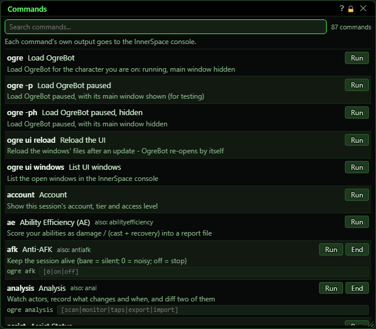
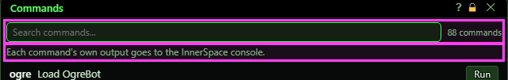
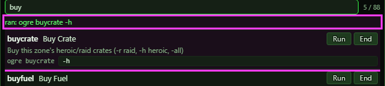
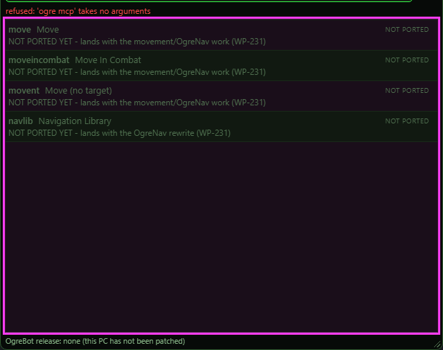

**OgreBot is in beta testing.** Looking for OgreBot Classic? [Click here](../../index.md).

# Commands

> **:bulb: In game - the ? button on this window says**
>
> Every `ogre` command you can use, in one list. Open it with `ogre ?`, `ogre help` or `ogre commands`.
>
> **What you can do here**
>
> - The first rows are `ogre` itself: loading OgreBot (`ogre`, `ogre -p`, `ogre -ph`) and `ogre ui reload` / `ogre ui windows` / `ogre ui report` (copies a report of the windows to paste when someone asks for one).
> - **Search** finds a command by its name, its other names, or any word in its description.
> - **Run** is `ogre <command>`; **End** is `ogre end <command>`, shown when the command has one.
> - A command that takes arguments has a box after its name: type them as you would after `ogre <command>`, then **Run** (or press Enter). The grey text in the box shows what it accepts.
>
> **Good to know**
>
> - The list shows only the commands your access level allows. If you lower your level, the list follows at once.
> - Greyed rows are commands that have not been ported to the new bot yet.
> - The line under the search box says what was sent. Each command's own messages still go to the InnerSpace console.
> - For the exact arguments a command takes, see its documentation.
> - The bottom line names the OgreBot release you are on (the name the What's new page uses) and when the core was built. `ogre version` prints the same.

**Open it:** Type `ogre ?` (or `ogre help`, or `ogre commands`). `ogre end commands` closes it.

## What it is for

Every `ogre` command you can use, in one searchable list. Each row is one command: its name, any other names it answers to, what it does and, when it takes them, what you can type after it. Run does exactly what typing `ogre <command>` does, and End does what `ogre end <command>` does. Each command's own messages still go to the InnerSpace console; this window only tells you what it sent.

## Search and the result line

The count on the right is how many commands you can use. The line under the search box says what the last Run or End sent, or why it was not sent.

| Control | What it does |
|---|---|
| **Search commands...** | Narrows the list as you type. It matches a command's name, its other names, its title, what it takes and its description. While you search, the count shows how many match out of the total. |
| **Result line** | Shows what was sent - for example `ran: ogre perf 10` in green - or, in red, why nothing was sent. *It does not show the command's own output. Look in the InnerSpace console for that.* |

## A command row

| Control | What it does |
|---|---|
| **Run** | Runs the command, exactly as typing `ogre <command>` would - with whatever is in its box after it. |
| **End** | Stops or closes the command, exactly as typing `ogre end <command>` would. Only shown for commands that have something to end. |
| **Argument box (ogre <command> [ ... ])** | For a command that takes something after its name. Type it as you would after `ogre <command>`, then press Run or Enter. The grey text in the empty box shows what the command accepts. *What you type is sent as typed - text with `${` in it is refused rather than worked out. For the exact meaning of each option, see that command's own page.* |

## Not ported yet

Greyed rows marked NOT PORTED are commands the old bot had that the new bot does not have yet. They are listed so you can see what is still to come; they have no buttons.

## What the window shows

- The first rows are `ogre` itself - loading OgreBot (`ogre`, `ogre -p`, `ogre -ph`) and `ogre ui reload` / `ogre ui windows` / `ogre ui report` (copies a report of the windows to paste when someone asks for one). They have Run only.
- Bold name = the command (`ogre <name>`). Next to it, its title.
- also: = other names that work the same way, for example `ogre fps` for `ogre perf`.
- The grey line under a row is what the command takes after its name, when it takes something.
- The count = how many commands you can use; while searching, how many match out of that.

## Good to know

- The list only shows the commands your access level allows. If you lower your access level (for testing), the list changes straight away.
- Run is the same as typing the command, so a command that opens a window opens it, and one that prints something prints it in the InnerSpace console - not here.

