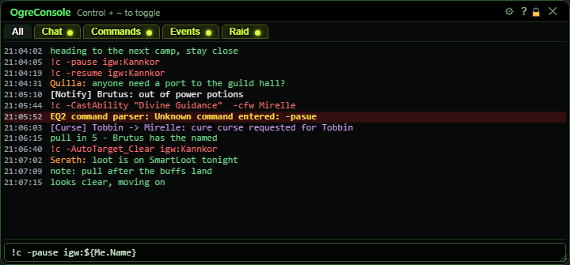
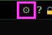
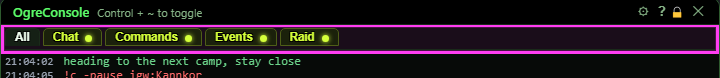
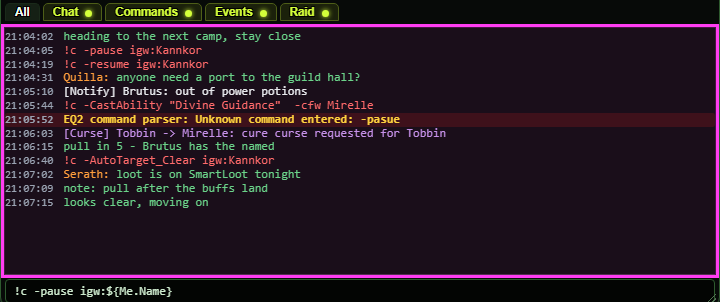
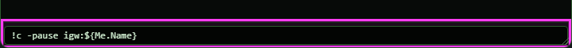
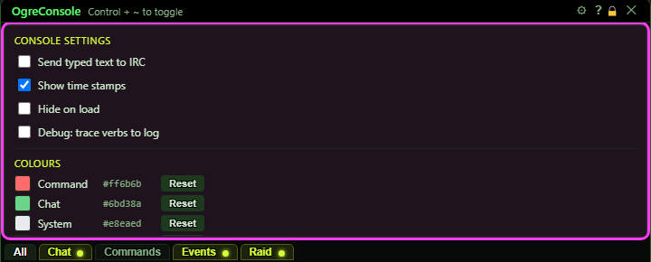
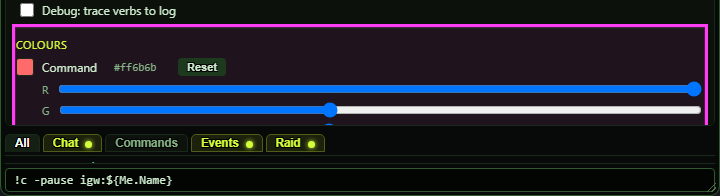
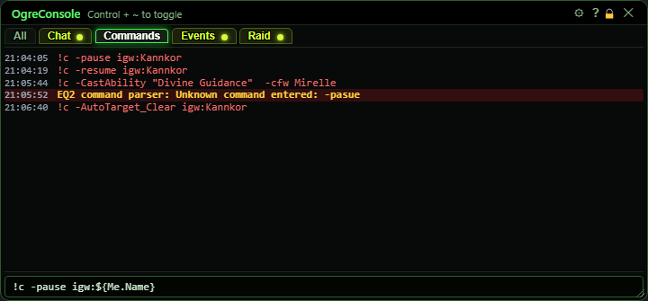
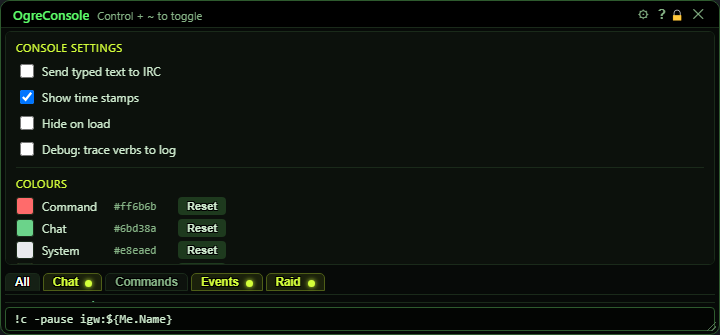

# OgreConsole

**OgreBot is in beta testing.** Looking for OgreBot Classic? [Click here](../../index.md).

> **:bulb: In game - the ? button on this window says**
>
> Where your sessions talk to each other, and where the bot tells you things. Ctrl + ~ shows or hides it.
>
> **What you can do here**
>
> - **Type and press Enter** to send to every OgreBot session on this PC. Plain text is chat.
> - **Start a line with** `!c` to make every session run it as a command, e.g. `!c -pause igw:${Me.Name}`.
> - **Click a tab** (Chat, Commands, Events...) to see only those lines. A glowing dot means new lines.
> - **The gear** opens settings: time stamps, hide on load, line colours, and Clear text.
>
> **Good to know**
>
> - `ogre` commands go in the InnerSpace console, not here. `oc <text>` there is the same as typing here.
> - Red = command, green = chat, white = bot message, bold yellow on a red band = error, purple = fleet event. Change any of them in the gear's Colours.
> - An orange name at the start of a line is who said it on IRC.
> - **Send typed text to IRC** (gear): what you type here goes to IRC instead, like `irc <text>`, and comes back to your sessions with your IRC name.

**Open it:** Press **Ctrl + ~** (the key left of 1) to show or hide it, or type `ogre console` in the InnerSpace console (if it is already open, that does nothing). It opens by itself when the bot loads unless **Hide on load** is ticked.

## What it is for

OgreConsole is where your sessions talk to each other. Anything typed in the box at the bottom goes to every OgreBot session on this PC: plain text is chat, and a line starting with `!c` is a command that every session runs. It also shows what the bot has to tell you - alerts, unknown commands, and the commands other sessions sent. Lines are sorted into tabs so you can look at just one kind.

## Title bar

| Control | What it does |
|---|---|
| **⚙ (gear)** | Opens and closes the settings drawer at the top of the window. *While the drawer is open it takes the place of the lines; if it does not fit, scroll it (or drag the window's bottom edge to make it taller). Click the gear again to close it.* |
| **Title bar close (X)** | Closes the window. The console keeps collecting lines in the background, and they are all there when you open it again. |

## Tabs

Click a tab to see only its lines. A tab appears the first time a line for it arrives.

| Control | What it does | Default |
|---|---|---|
| **All** | Every line, in the order it arrived. | selected |
| **Chat** | Plain text typed by you or another session (and lines relayed from IRC). |  |
| **Commands** | `!c` commands sent by any session, plus the bot's replies about them (for example an unknown command). |  |
| **Events** | Fleet requests such as a cure-curse call, one line each, showing who asked, who it was for and what for. *Only appears when the OgreBot Debug option CommsEventsDebug is on.* |  |
| **Any other tab (e.g. Raid)** | A line sent with `-tab <name>` at the front also shows in a tab of that name. |  |
| **Glowing dot on a tab** | New lines arrived in that tab while you were looking at another one. Clicking the tab clears it. |  |

## The lines

Each line's colour tells you what kind of line it is (the colours below are the defaults).

| Control | What it does |
|---|---|
| **Line list** | The last 2000 lines. It stays at the bottom as new lines arrive, unless you have scrolled up to read, then it stays where you are. *Right-click to Copy or Select All.* |

## Typing and sending

| Control | What it does |
|---|---|
| **Input line (message, or !c <cmd> ... (Enter to send))** | Press Enter to send the line to every OgreBot session on this PC, including this one. Plain text is chat. A line starting with `!c` is a command that every session runs. `!ci` runs it too but the line is not shown. Anything like `${Me.Name}` is filled in with this character's value before it is sent. *Put `-tab <name>` right after `!c` to also show the line in that tab, or `-cfw <who>` to have only that character (or group of characters) run it.* |

## Settings drawer

Open it with the gear. Settings are saved straight away and are shared by every character on this PC.

| Control | What it does | Default |
|---|---|---|
| **Send typed text to IRC** | When ticked, what you type in the input line goes to IRC instead of only this PC - exactly like typing `irc <text>` in the InnerSpace console. It comes back to your sessions with your IRC name in front. `oc <text>` is not affected. *Needs IRC connected (`ogre irc`). A `!c` line sent this way runs on every session that reads the IRC channel.* | off |
| **Show time stamps** | Shows the time each line arrived at the start of the line. *Display only - changes what you see, not what the bot does.* | on |
| **Hide on load** | When ticked, the console does not pop up when the bot loads. It still collects every line, so opening it later with Ctrl + ~ shows what you missed. | off |
| **Debug: trace verbs to log** | For troubleshooting. Writes one line per command this session receives to the bot's log file, saying whether it ran. Nothing extra shows in the console. *Leave it off in normal play.* | off |
| **Colour square (Command, Chat, System, Error, Event, Timestamp)** | Click a colour square to open R, G and B sliders for it. The colour changes as you drag and is saved when you let go. |  |
| **Reset** | Puts that colour back to its default. |  |
| **Clear text** | Wipes every line from this session's console, removes all tabs except All, and closes the drawer. Only your console is cleared, and the lines cannot be brought back. |  |

## Colours

| Control | What it does |
|---|---|
| **R / G / B sliders** | Red, green and blue for the colour you clicked. Only one colour's sliders are open at a time. |

## What the window shows

- Red line: a command (`!c ...`) sent by any session.
- Green line: chat.
- White line: a message from the bot itself, such as a `[Notify]` alert. Most of these show only on the All tab (a note that a command did nothing here also shows on Commands).
- Bold yellow line on a dark red band: an error, for example a command nobody knows (`Unknown command entered: -pasue`).
- Purple line: a fleet request on the Events tab.
- Orange name at the start of a chat or command line: who said it, for lines that came in over IRC. Only real IRC lines get it - a line you type that starts with `word: ` does not.
- `-cfw <who>` at the end of a command line: that command was meant only for those characters.
- Grey time at the start of each line (when Show time stamps is on).

## Good to know

- `ogre ...` commands are typed in the InnerSpace console, not here. Typed into this box, `ogre smartloot` is just sent to everyone as chat.
- Typing `oc <text>` in the InnerSpace console does exactly the same as typing `<text>` into this box: it goes to every session.
- `!c` commands run on every session, including the one you typed on. Use `-cfw <who>` or a for-who inside the command (such as `igw:${Me.Name}`) to aim it.
- Only the last 2000 lines are kept.
- All console settings live in OgreSave\Common\OgreConsole.json and apply to every character on this PC.

## One tab selected

With **Commands** selected only command lines show. The other tabs glow when something new lands in them.

## The settings drawer open

