

**OgreBot is in beta testing.** Looking for OgreBot Classic? [Click here](../../index.md).

# Ogre Craft 3

> **:bulb: In game - the ? button on this window says**
>
> The crafting bot. It crafts a queue of recipes, runs writs, levels tinkering or a new crafter, and casts the reaction arts for you.
>
> **What you can do here**
>
> - **Recipes** tab: filter your recipe book, pick a recipe, set a Quantity and **Add Recipe** (or double-click).
> - **Start Queue** crafts the setup queue. **Stop** ends any run. **Pause** holds it.
> - **Queues** tab: change amounts, and save or load named queues.
> - **Crafting Options** and **Navigation**: quality, power, buying, movement.
> - **Writs**, **Auto Tinkering** and **Low Level Leveling** tabs each have their own Start button.
>
> **Good to know**
>
> - Settings save by themselves a second after a change.
> - `ogre end craft` stops everything crafting is doing, not just this window.
> - The list shows at most 200 recipes - use the filters to narrow it.

**Open it:** Type `ogre craft` (also `ogre craft2`). `ogre end craft` closes the window AND ends all crafting: the run, craft's own movement, a summoned station and Craft Lite.

[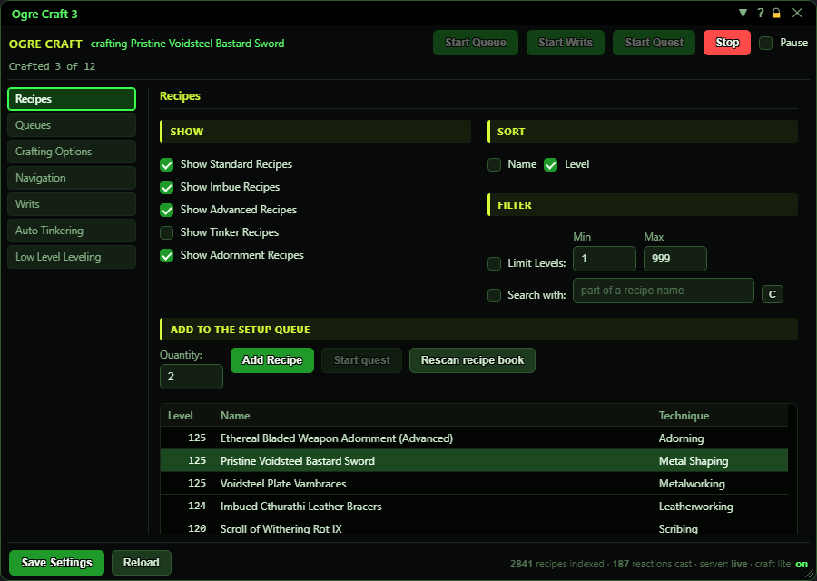](../assets/craft/window.png "Click for full size")

## What it is for

The crafting bot. Pick recipes from your recipe book into a queue and craft them; or let it run rush-order writs, level tinkering, level a new crafter from 1 to 19, or craft the steps of a crafting quest. It walks to the right station, buys missing fuel, and while crafting it casts the reaction arts for you. Opening the window also turns on Craft Lite (the part that casts the reaction arts); the footer shows whether it is on. Settings save by themselves.

## Run controls (top of the window)

Always visible. The green text next to OGRE CRAFT is what the bot is doing right now. Under it: 'Crafted N of M' for the current (or last) run, plus 'Writ N of M' during a writ run or 'Quest: <name>' during a quest run.

[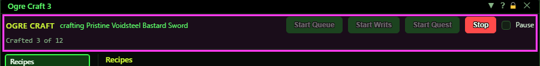](../assets/craft/header.png "Click for full size")

| Control | What it does | Default |
|---|---|---|
| **Start Queue** | Crafts everything in the setup queue (Queues tab). The setup queue moves into the Active queue, the bot works out the resources, buys missing fuel, walks to each station and crafts. *Refused if the setup queue is empty. Needs at least 2 free bag slots. The queue you started is also saved as 'LastRecipeQueue' so you can load it again.* |  |
| **Start Writs** | Runs rush-order writs using the settings on the Writs tab. Same as the Start Writs button on that tab. *Needs tradeskill level 20 or higher.* |  |
| **Stop** | Stops whatever is running (queue, writs, quest, tinkering or leveling). A walk in progress stops too. *Stop also cancels a Pause. After a writ or quest run your own setup queue is put back.* |  |
| **Pause** | Holds the run where it is without ending it: a craft already begun finishes, nothing new starts and craft's walking stands still. Untick to carry on. *A pause with nothing running is dropped when the next run starts.* | off |

## Save and Reload (bottom of the window)

The grey text on the right: how many recipes are in your recipe book, how many reaction arts were cast, which server type (live or Origins), and whether Craft Lite is on (green) or off (red).

| Control | What it does |
|---|---|
| **Save Settings** | Writes the settings to disk now. You rarely need it: every change saves by itself about a second later. *Settings live in OgreSave/EQ2/Craft/settings.json.* |
| **Reload** | Re-reads the settings from disk, throwing away any change that has not been saved yet. |
| **Tab list (left)** | Switches between the seven tabs. Display only. |

## Recipes tab - Show, Sort and Filter

These decide which recipes from your book appear in the list below. They are also what Auto Tinkering and Low Level Leveling pick from when their Auto Sort box is off.

[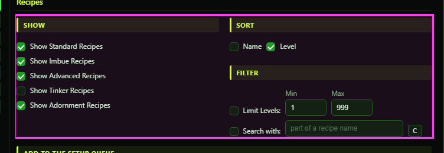](../assets/craft/recipes-filters.png "Click for full size")

| Control | What it does | Default |
|---|---|---|
| **Show Standard Recipes** | Lists normal recipes (anything not advanced, imbued, tinkering or adorning). | on |
| **Show Imbue Recipes** | Lists imbue recipes (the name contains 'imbued' or the technique is imbuing). | off |
| **Show Advanced Recipes** | Lists recipes from advanced or mastercraft recipe books. | off |
| **Show Tinker Recipes** | Lists tinkering recipes. | off |
| **Show Adornment Recipes** | Lists adorning recipes. | off |
| **Name** | Sorts the list A to Z. Ticking it unticks Level. | off |
| **Level** | Sorts the list highest level first (ties A to Z). Ticking it unticks Name. | on |
| **Limit Levels:** | Only lists recipes whose level is between Min and Max (inclusive). | off |
| **Min** | Lowest recipe level shown when Limit Levels is ticked. 1 to 999. *Min and Max can be typed either way round.* | 1 |
| **Max** | Highest recipe level shown when Limit Levels is ticked. 1 to 999. | 999 |
| **Search with:** | Only lists recipes whose name contains the text in the box. Not case-sensitive. | off |
| **part of a recipe name (search box)** | The text to search for when Search with is ticked. | empty |
| **C** | Clears the search box. |  |

## Recipes tab - adding to the setup queue

[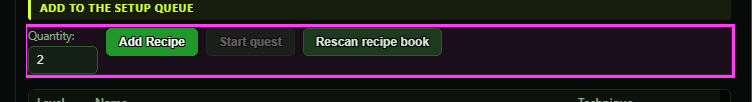](../assets/craft/recipes-add.png "Click for full size")

| Control | What it does | Default |
|---|---|---|
| **Quantity:** | How many to craft when you add a recipe. 1 to 9999. | 1 |
| **Add Recipe** | Adds the highlighted recipe to the setup queue with the Quantity. If it is already queued, the quantity is added on top. *Click a recipe in the list first. Double-clicking a recipe does the same.* |  |
| **Start quest** | Crafts the quest that is selected in your quest journal: one of each recipe the quest's steps ask for, then re-reads the quest and goes again, until no craft step is left. Your setup queue is put aside and given back at the end. *Select the quest in your journal first. Greyed out while anything is running. If a step needs a component you do not have yet (one the quest has you gather), it waits for it, counting again whenever your bags change (at most every 5 seconds); after 60 minutes it stops and says what is still missing.* |  |
| **Rescan recipe book** | Reads every recipe in your recipe book again. Use it after learning new recipes if they do not show up. |  |

## Recipes tab - the recipe list

Level, name and technique of each recipe that passes the filters. Click a row to highlight it; double-click to add it with the current Quantity. Hover a row for its tradeskill. The line under the list says 'Showing X of Y recipes'.

[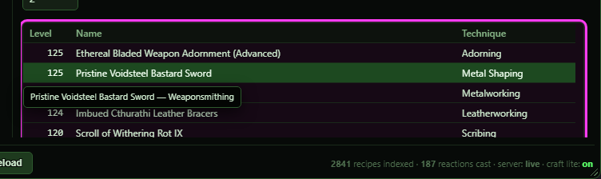](../assets/craft/recipes-list.png "Click for full size")

| Control | What it does |
|---|---|
| **Click / double-click a recipe row** | Click highlights the recipe for Add Recipe. Double-click adds it straight away. |

## Queues tab - the setup queue

The recipes waiting to be crafted by Start Queue.

[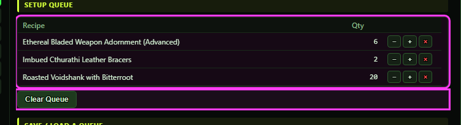](../assets/craft/queues-setup.png "Click for full size")

| Control | What it does |
|---|---|
| **− (one fewer)** | Lowers that row's quantity by 1. At 0 the row is removed. |
| **+ (one more)** | Raises that row's quantity by 1. |
| **× (remove from the queue)** | Removes the recipe from the setup queue. |
| **Clear Queue** | Empties the setup queue. No confirmation. |

## Queues tab - save and load a queue

[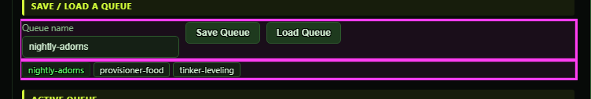](../assets/craft/queues-save.png "Click for full size")

| Control | What it does | Default |
|---|---|---|
| **Queue name** | The name to save the setup queue under, or to load. | empty |
| **Save Queue** | Saves the setup queue to disk under that name (overwrites a queue with the same name). *Queues live in OgreSave/EQ2/Craft/queues. A failed save shows a red message at the top.* |  |
| **Load Queue** | Replaces the setup queue with the saved queue of that name. Recipes this character does not know are left out and named in the console. |  |
| **Saved queue names (buttons)** | One button per saved queue. Click one to put its name in the Queue name box. It does not load it. |  |

## Queues tab - the active queue

What the running (or last) queue is crafting, with 'done / wanted' per recipe. A recipe the bot had to skip says 'skipped'; hover it to see why.

[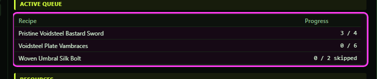](../assets/craft/queues-active.png "Click for full size")

## Queues tab - resources

Built when a queue starts: every component and fuel the queue needs, how many it needs and how many you have. Red rows are short. Rows marked FUEL are bought from the fuel merchant; missing components are only reported - the bot crafts anyway, except in a quest run, which waits for them.

[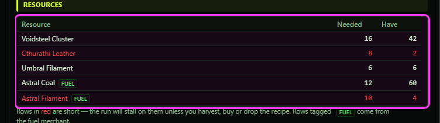](../assets/craft/queues-resources.png "Click for full size")

## Crafting Options tab - craft targets

| Control | What it does | Default |
|---|---|---|
| **Quality Level** | The bot clicks Stop on a craft once its quality climbs past this level. At 4 every craft runs to the end. | 4 |
| **Min. Durability** | When to switch to durability-saving reactions. The value is times 10 on the game's 0-1000 durability scale: at 100 the bot protects durability as soon as it drops below full; at 50 only once it is down to 500. | 100 |
| **Power to craft** | The bot waits before starting each craft until your power is at least this much. The status shows 'waiting for power'. | 40 |
| **Power to save** | Reaction arts that cost power are not used while your power is at or below this, so you keep a reserve. | 20 |

## Crafting Options tab - behaviour

| Control | What it does | Default |
|---|---|---|
| **Buy standard recipes prior to crafting** | During writs and Low Level Leveling: once at the start of the run and again each time your tradeskill level goes up, walk to the recipe merchant and buy the standard recipe books for your level range that you do not know or have in your bags. *Not used by a normal Start Queue.* | off |
| **Buy advanced recipes prior to crafting** | Same as above for the advanced recipe books. | off |
| **Scribe recipes** | On that same recipe-book trip, scribe the books you bought and any other book of your series and level already in your bags. *Only happens when a recipe-book trip happens (one of the Buy boxes on, or tinkering).* | off |
| **Use Mass Production** | On a normal queue craft of 5 or more, if you know Mass Production, set the largest batch size that fits what is left. *Not used for writs, quest or leveling runs.* | off |
| **Use Blueprint** | Ticks the game's Blueprint box on a normal queue craft. Writs and the loops always untick it. | off |
| **If ADORNING is NOT max level, do quality 1 while adorning** | While your adorning skill is not maxed, adorning crafts are stopped as soon as they reach quality 1 (faster skill-ups). | off |
| **If TINKERING is NOT max level, do quality 1 while tinkering** | Same for tinkering crafts while your tinkering skill is not maxed. | off |
| **Do not process resources. Just craft.** | Skips the resource step when a queue starts: no resource tally and no fuel buying. The bot just crafts with what you have. It still looks up which station each recipe needs. | off |
| **Skip Fuel Merchant** | Never walks to the fuel merchant to buy missing fuel. | off |
| **Do NOT load recipes on startup** | Opening the window no longer reads your recipe book automatically. It is read when a run or Rescan needs it. | off |

## Crafting Options tab - commissions and server calls

[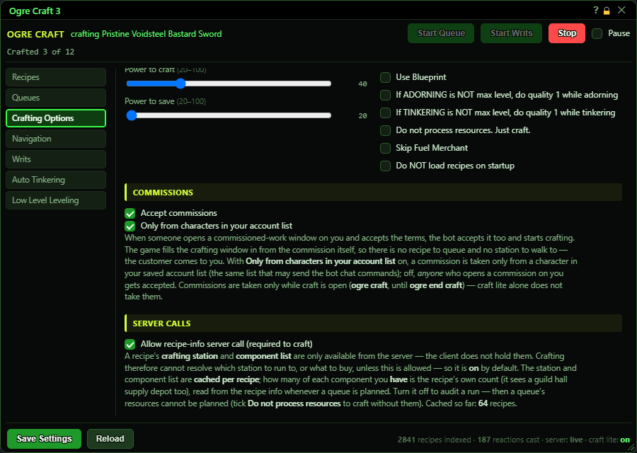](../assets/craft/options-bottom.png "Click for full size")

| Control | What it does | Default |
|---|---|---|
| **Accept commissions** | When someone opens a commissioned-work window on you and accepts the terms, the bot accepts too and crafts it. *Only while the craft window is open (`ogre craft` until `ogre end craft`); Craft Lite alone does not accept.* | off |
| **Only from characters in your account list** | Only accepts commissions from characters in your saved account list (the same list that may send the bot chat commands). Off = anyone who opens a commission on you is accepted. | on |
| **Allow recipe-info server call (required to craft)** | Lets the bot ask the game server for a recipe's station and component list (the station and list are remembered per recipe; how many you have is read each time a queue is planned). Off: a queue stops because it cannot plan resources. With 'Do not process resources' ticked it still crafts, but skips any recipe whose station it has not remembered yet. *Turning it off shows an orange warning at the top of the window.* | on |

## Navigation tab

[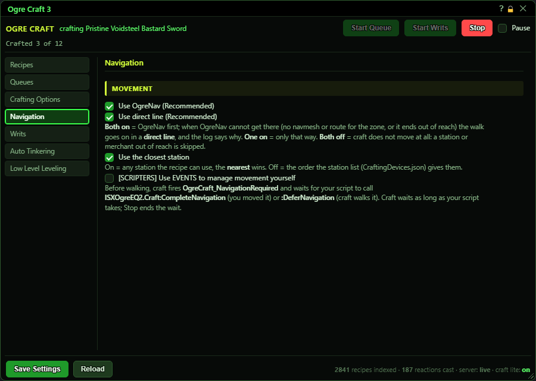](../assets/craft/nav.png "Click for full size")

| Control | What it does | Default |
|---|---|---|
| **Use OgreNav (Recommended)** | Walk to stations and merchants with OgreNav's navigation mesh. *Both boxes on = OgreNav first, then a straight line if OgreNav cannot get there. Both off = the bot never moves and skips anything out of reach.* | on |
| **Use direct line (Recommended)** | Walk in a straight line to the station or merchant. | on |
| **Use the closest station** | On = the nearest station that can make the recipe. Off = the first one in the order the station list gives. | on |
| **[SCRIPTERS] Use EVENTS to manage movement yourself** | For script writers: before walking, craft fires an event and waits for your script to move the character (or hand the walk back). *Leave off unless you have a script that answers it - otherwise craft waits until you press Stop or untick this box.* | off |

## Writs tab

[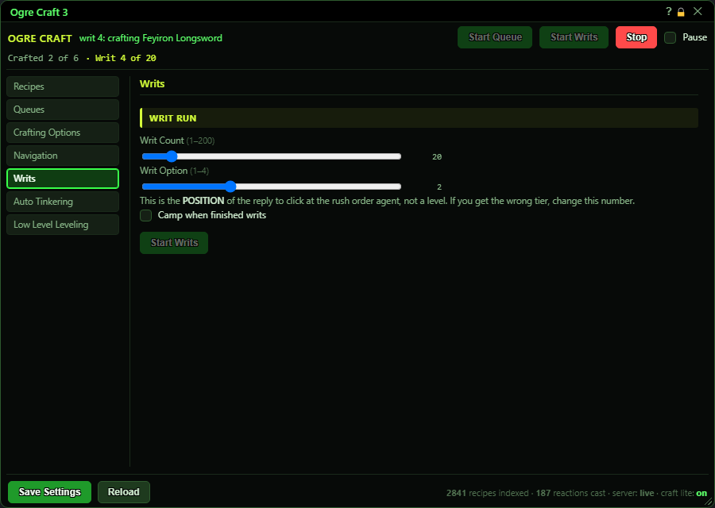](../assets/craft/writs.png "Click for full size")

| Control | What it does | Default |
|---|---|---|
| **Writ Count** | How many rush-order writs to do in one run. 1 to 200. | 10 |
| **Writ Option** | Which reply to click at the rush order agent, counted from the top (1 to 4). It is a position, not a level - if you get the wrong tier of writ, change it. | 1 |
| **Camp when finished writs** | Camps to the desktop when a writ run ends by itself (finished or failed). *Never camps after you press Stop, or after a death.* | off |
| **Start Writs** | Starts the writ run. Your setup queue is put aside during the run and given back at the end. *Greyed out while anything is running. Needs tradeskill level 20+.* |  |

## Auto Tinkering tab

[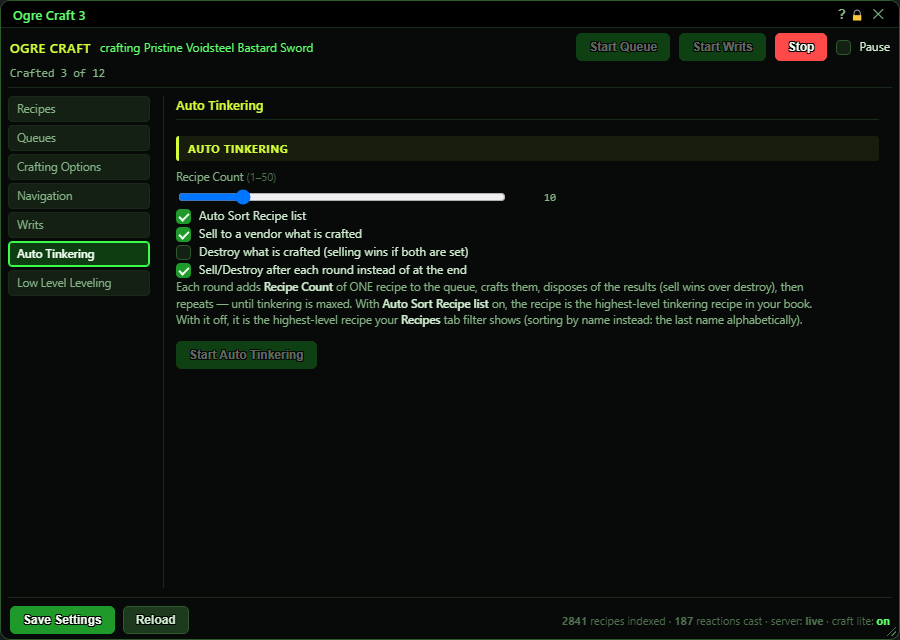](../assets/craft/tinker.png "Click for full size")

| Control | What it does | Default |
|---|---|---|
| **Recipe Count** | How many of the chosen tinkering recipe to craft each round. 1 to 50. | 10 |
| **Auto Sort Recipe list** | On = each round crafts your highest tinkering recipe. Off = it uses your own Recipes-tab filter and crafts its highest-level recipe (with the Name sort ticked: the name last in the alphabet, which is the bottom of the list, not the top). | on |
| **Sell to a vendor what is crafted** | Sells the items the run made. | on |
| **Destroy what is crafted (selling wins if both are set)** | Destroys the items the run made. If Sell is also ticked, they are sold instead. | off |
| **Sell/Destroy after each round instead of at the end** | On = get rid of the items after every round. Off = keep them until the run ends, then sell/destroy them all in one trip. | on |
| **Start Auto Tinkering** | Repeats rounds (buy tinkering books, craft, sell/destroy) until tinkering is maxed. *Greyed out while anything is running.* |  |

## Low Level Leveling tab

[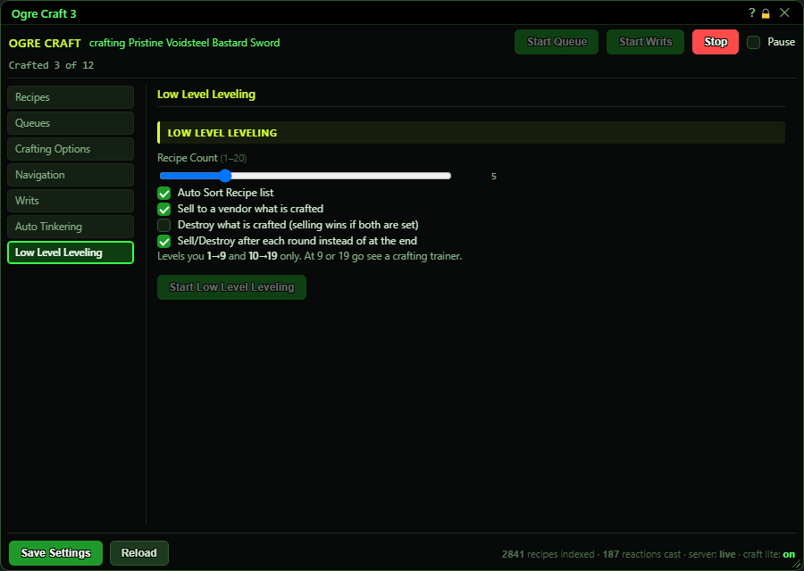](../assets/craft/lll.png "Click for full size")

| Control | What it does | Default |
|---|---|---|
| **Recipe Count** | How many of the chosen recipe to craft each round. 1 to 20. | 5 |
| **Auto Sort Recipe list** | On = each round crafts your highest standard recipe at or below your level. Off = it uses your own Recipes-tab filter and crafts its highest-level recipe (with the Name sort ticked: the name last in the alphabet). | on |
| **Sell to a vendor what is crafted** | Sells the items the run made. | on |
| **Destroy what is crafted (selling wins if both are set)** | Destroys the items the run made. If Sell is also ticked, they are sold instead. | off |
| **Sell/Destroy after each round instead of at the end** | On = after every round. Off = once at the end of the run. | on |
| **Start Low Level Leveling** | Levels a crafter from 1 to 9 and from 10 to 19. It stops at level 9 and at 19 - go see a crafting trainer, then start it again. *Greyed out while anything is running.* |  |

## What the window shows

- Status text (green, top): what the bot is doing, e.g. 'crafting <recipe>', 'waiting for power', 'scanning recipes'; 'idle' when nothing runs.
- Crafted N of M: the running queue's progress, or the last run's totals once it has ended.
- Orange banner 'Recipe info is gated off...': you turned off the recipe-info server call on the Crafting Options tab.
- Red banner 'settings.json is unreadable...': the settings file is damaged; the bot runs on defaults and will not overwrite it.
- Red banner with any other text: the last error, e.g. 'craft queue: the setup queue is empty - add recipes first.'
- Recipe list: at most 200 rows are shown; the line under it says how many recipes match in total.
- Footer: recipes indexed from your book, reaction arts cast, server type (live / Origins), Craft Lite on (green) or off (red).

## Good to know

- `ogre end craft` is not just 'close the window' - it stops the run, craft's movement, a summoned station and Craft Lite.
- Start Queue moves the setup queue into the Active queue, so the setup queue looks empty afterwards. Load 'LastRecipeQueue' to get it back.
- The list shows at most 200 recipes. Narrow it with the filters or the search box if the one you want is missing.
- Clear Queue has no confirmation.
- Buy recipes / Scribe recipes only happen during writs and the two leveling loops, not during Start Queue.
- The [SCRIPTERS] events box makes craft wait for a script before every walk. Without a script, the run just waits until you press Stop or untick the box.
- Accepting commissions with 'Only from characters in your account list' off accepts a commission from anyone.

## Banners

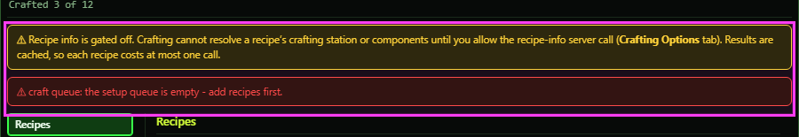

Orange: the recipe-info server call is turned off. Red: the last error the bot hit.

