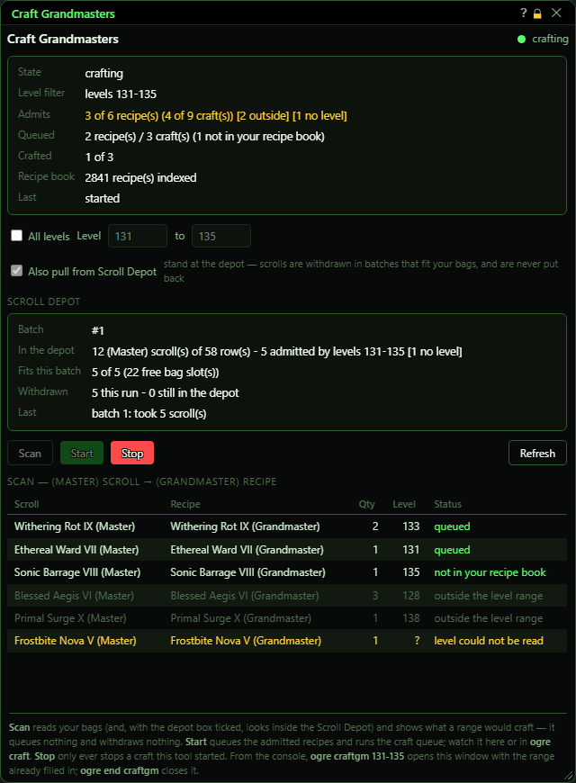
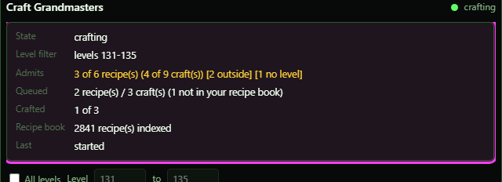
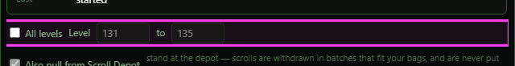
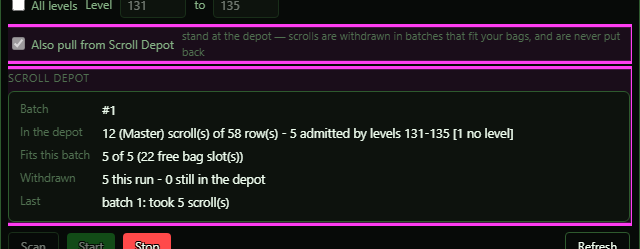
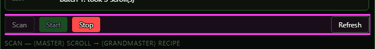
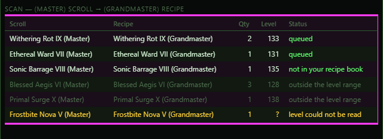
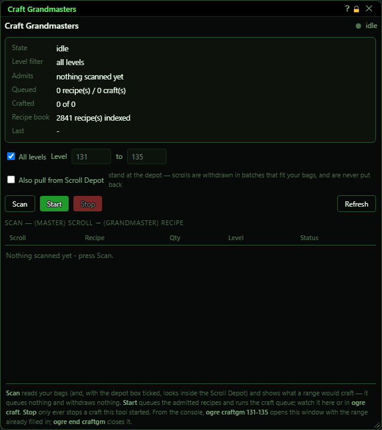

# Craft Grandmasters

**OgreBot is in beta testing.** Looking for OgreBot Classic? [Click here](../../index.md).

> **:bulb: In game - the ? button on this window says**
>
> Turns the (Master) spell scrolls in your bags into (Grandmaster) crafts, one craft per scroll.
>
> **What you can do here**
>
> - **All levels**, or untick it and set a recipe **Level** range.
> - **Also pull from Scroll Depot** withdraws matching scrolls from the depot first, in batches that fit your bags.
> - **Scan** shows what would be crafted. **Start** queues it and crafts it. **Stop** ends the run.
>
> **Good to know**
>
> - Start adds to Ogre Craft's setup queue, so anything already there is crafted too.
> - With the depot box ticked, Scan only looks in the depot; Start withdraws. Withdrawn scrolls are never put back.
> - It never walks - stand at the Scroll Depot for a depot run.
> - Closing the window (the X) or `ogre end craftgm` stops a run, then closes.

**Open it:** Type `ogre craftgm`. `ogre craftgm 131-135` opens it with that level range already filled in (it does not scan). `ogre end craftgm` stops a run and closes the window.

## What it is for

Turns (Master) spell scrolls into (Grandmaster) crafts. It looks through your bags for every spell scroll named '... (Master)', works out the matching '... (Grandmaster)' recipe, and queues one craft per scroll you hold. Then it starts the Ogre Craft queue and watches until it is done. You can limit it to a range of recipe levels, and it can first pull (Master) scrolls out of your Scroll Depot.

## Status readout

State is what it is doing (idle, reading your recipe book, opening / withdrawing from the Scroll Depot, scanning your bags, starting the queue, crafting). Level filter is the range in use. Admits shows how many found recipes the range lets through, e.g. '3 of 6 recipe(s) (4 of 9 craft(s)) [2 outside] [1 no level]' - orange when some levels could not be read. Queued, Crafted and Recipe book are the run's progress; Last is the latest message.

## Level range

| Control | What it does | Default |
|---|---|---|
| **All levels** | Ticked = craft every Grandmaster found, whatever its level. Untick to use the two level boxes. *Nothing is sent when you tick it; the range is used the next time you press Scan or Start.* | on |
| **Level** | The lowest RECIPE level to craft (inclusive). 1 to 999. *Only used when All levels is unticked. Locked while a run is going.* | 131 |
| **to** | The highest recipe level to craft (inclusive). 1 to 999. *A range typed backwards (e.g. 135 to 131) is refused, not swapped.* | 135 |

## Scroll Depot

Once a Scan or Start has run with the box ticked (ticking it alone does not show it), a grey box shows the depot progress: which batch, how many (Master) scrolls the depot holds and how many your range admits, how many fit in your bags this batch, and how many were withdrawn.

| Control | What it does | Default |
|---|---|---|
| **Also pull from Scroll Depot** | Before looking in your bags, withdraw (Master) scrolls that your range admits from the Scroll Depot, as many as fit in your free bag slots. After crafting those it goes back for the next batch, until the depot has none left or nothing more fits. *Stand next to the Scroll Depot - it never walks. Scrolls withdrawn and not crafted stay in your bags; it never puts them back. The setting stays as you left it for the next run.* | off |

## Scan, Start, Stop, Refresh

| Control | What it does |
|---|---|
| **Scan** | Looks through your bags and fills the table with what the range would craft. It queues and crafts nothing. *With Also pull from Scroll Depot ticked, Scan also opens the Scroll Depot and shows what a Start would withdraw - it withdraws nothing.* |
| **Start** | Scans, adds every admitted Grandmaster recipe to the Ogre Craft setup queue (one craft per scroll held), starts the craft queue and watches it to the end. *Refused if an Ogre Craft run is already going. Anything already in the setup queue is crafted too. Recipes you have not learned are skipped and marked 'not in your recipe book'.* |
| **Stop** | Stops the run. If this window started the craft queue, that is stopped too; a craft run somebody else started is left alone. *Only active while a run is going. The window stays open.* |
| **Refresh** | Redraws the window. It changes nothing. |
| **Title bar close (X)** | Stops a run and closes the window, the same as `ogre end craftgm`. |

## The scan table

One row per (Master) scroll found: the scroll, the Grandmaster recipe it becomes, how many you hold (= how many crafts), the recipe's level ('?' if it could not be read from your recipe book), and what happened to it: queued, not in your recipe book, outside the level range, or level could not be read.

## What the window shows

- Dot and phase (top right): green dot = running.
- Orange 'Recipe levels unavailable' note: shown when no level could be read for any scroll found; with a level range set, none of them will be queued.
- Rows marked 'outside the level range' or 'level could not be read' are not queued. With All levels ticked every row is admitted, even one with an unknown level.
- 'Nothing scanned yet - press Scan.' before the first scan; 'No (Master) spell scrolls found in your bags (N carried item(s) scanned).' when there are none.

## Good to know

- Start adds to Ogre Craft's setup queue, so anything already waiting there gets crafted in the same run.
- With the Scroll Depot box ticked, Scan only looks in the depot; Start withdraws. Withdrawn scrolls are never put back.
- Withdrawn scrolls that are not crafted (not learned, out of range) stay in your bags.
- It never walks: stand at the Scroll Depot for a depot run. If it is not nearby the run stops and does nothing (it does not quietly fall back to bags only).
- A range typed backwards (e.g. 135 to 131) is refused - the run does not start. A blank or 0 box is filled in for you instead (Level becomes 1, to becomes the Level value).
- The run has no time limit while crafting; use Stop if it is stuck.

## Before the first scan

The Scroll Depot box only appears once the depot switch is on.

