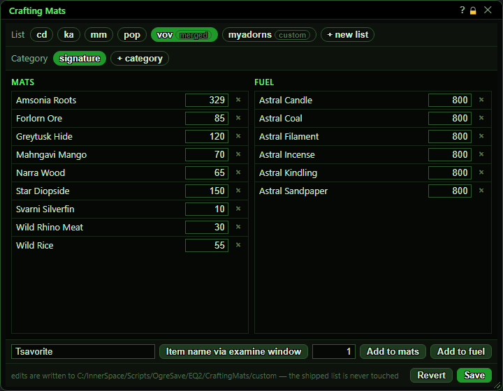
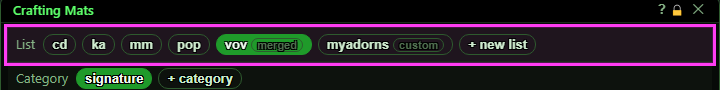
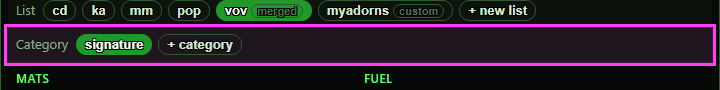
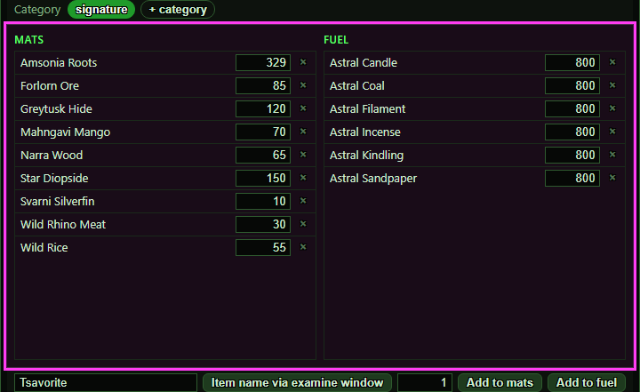
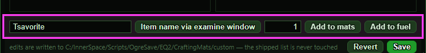
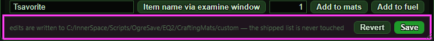
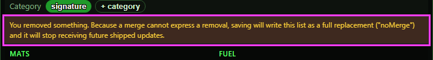
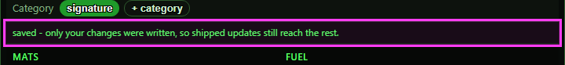

# Crafting Mats

**OgreBot is in beta testing.** Looking for OgreBot Classic? [Click here](../../index.md).

> **:bulb: In game - the ? button on this window says**
>
> Edits the shopping lists `ogre craftingmats` uses: the mats it pulls from the Harvesting Supply Depot and the fuel it buys.
>
> **What you can do here**
>
> - **Pick a list** (one per expansion) and a **category**.
> - **Change an amount** in its box, or remove a row with the x.
> - **Add an item**: type the name (or use **Item name via examine window**), set how many, then **Add to mats** or **Add to fuel**.
> - **+ new list** and **+ category** use the name in the item name box.
> - **Save** writes your changes; **Revert** throws them away (on a new list you never saved, it discards the list).
>
> **Good to know**
>
> - Amounts are how many to be holding, not how many to add.
> - Your changes go in your own folder; the shipped lists are never changed.
> - Removing a row from a shipped list stops that list getting future updates.
> - Closing the window keeps unsaved changes; switching to another list throws them away.

**Open it:** Type `ogre craftingmats` (or `ogre cmats`) with nothing after it. With options (e.g. `ogre craftingmats -sig -vov`) it RUNS instead: pulls those mats out of the Harvesting Supply Depot and buys the fuel. `ogre end craftingmats` closes the window.

## What it is for

Edits the shopping lists that `ogre craftingmats` uses. Each list (one per expansion, e.g. vov = Visions of Vetrovia) has categories such as signature, daily or weekly, and each category has Mats (withdrawn from the Harvesting Supply Depot) and Fuel (bought from the Guild Fuel Merchant), each with the amount you want to be holding. Your edits are saved to your own folder; the shipped lists are never changed, and a Save is used by the very next run.

## Choosing a list

One button per list. A small badge says where it comes from: no badge = the shipped list, 'merged' = the shipped list with your changes on top, 'custom' = a list only you have.

| Control | What it does |
|---|---|
| **List buttons (cd, ka, mm, pop, vov, ...)** | Opens that list for editing. Unsaved changes to the list you were on are thrown away. |
| **+ new list** | Starts a new list of your own. Type its short name in the item name box first - that name is what you will type after `ogre craftingmats` to use it. The new list gets one category, 'all'. *With the name box empty it only shows a message.* |

## Choosing a category

| Control | What it does |
|---|---|
| **Category buttons (signature, daily, weekly, all ...)** | Shows that category's Mats and Fuel below. An 'all' category is always used, whatever categories a run asks for. |
| **+ category** | Adds a category named whatever is in the item name box to this list. *A run can only ask for signature, daily or weekly (and always uses 'all'), so a category with any other name is never used by `ogre craftingmats`. With the name box empty a message says where to type the name; a name the list already has just selects that category.* |

## Mats and Fuel

Left: materials withdrawn from the Harvesting Supply Depot. Right: fuel bought from the Guild Fuel Merchant. The number is how many you want to be HOLDING - a total, not an amount added each time.

| Control | What it does |
|---|---|
| **Quantity box on a row** | Changes that item's amount. It is applied when you press Enter or click away. *0, blank or text is ignored and the old number comes back.* |
| **× (remove this row)** | Removes the item from this category. *Removing something from a shipped list turns your saved copy into a full replacement (see below).* |

## Adding an item

| Control | What it does | Default |
|---|---|---|
| **item name** | The item's name, exactly as the game spells it (capitals do not matter). Also used as the name for + new list and + category. | empty |
| **Item name via examine window** | Copies the item name from the examine window you have open into the name box. *Examine the item in game first; otherwise a red message says no examine window is open.* |  |
| **Quantity (next to the name)** | How many of the item to hold. | 1 |
| **Add to mats** | Adds the item to the Mats side of the selected category. If it is already there, its amount is replaced with the new one. |  |
| **Add to fuel** | Same, on the Fuel side. |  |

## Save and Revert

The grey text shows the folder your edits are written to.

| Control | What it does |
|---|---|
| **Revert** | Throws away unsaved changes and shows the list as it is on disk. On a brand-new list you have not saved yet, there is nothing on disk to go back to: Revert discards the new list and says so. *Only active when there are unsaved changes.* |
| **Save** | Writes your changes to your own folder (OgreSave/EQ2/CraftingMats/custom) and reloads the lists, so the next `ogre craftingmats` run uses them. Only what you changed is written, so later updates to the shipped list still reach the rest. If your changes match the shipped list exactly, your file is deleted. *Only active when there are unsaved changes.* |
| **Title bar close (X)** | Closes the window. Unsaved changes are kept: the next time it opens they are still there, with a reminder to Save or Revert. Without unsaved changes the list is read fresh from disk. *`ogre craftingmats` while the window is already open does nothing.* |

## Removing a row from a shipped list

Your saved file can only ADD to or CHANGE a shipped list. The moment you remove a row (or category) that came with the shipped list, this orange warning appears: Save will then write the whole list as a full replacement ('noMerge'), and that list will no longer pick up future shipped updates.

## What the window shows

- Badges on list buttons: none = shipped, 'merged' = shipped plus your changes, 'custom' = your own list.
- Green line after Save: 'saved - only your changes were written, so shipped updates still reach the rest.' Red when something went wrong or after a replacement save.
- Orange warning: you removed a row, so Save will write a full replacement.

## Good to know

- Plain `ogre craftingmats` opens this window. Add options (like `-sig -vov`) to actually pull mats; `ogre craftingmats help` lists them.
- Amounts are totals to hold, not top-ups.
- Removing any row from a shipped list stops that list getting future shipped updates.
- Switching to another list throws away unsaved changes without asking. Closing and reopening the window keeps them.
- + new list and + category take their name from the item name box. A run only ever uses the signature, daily, weekly and all categories, so a category with another name does nothing.
- A new list is not in the list buttons until you Save it.

## After a Save

