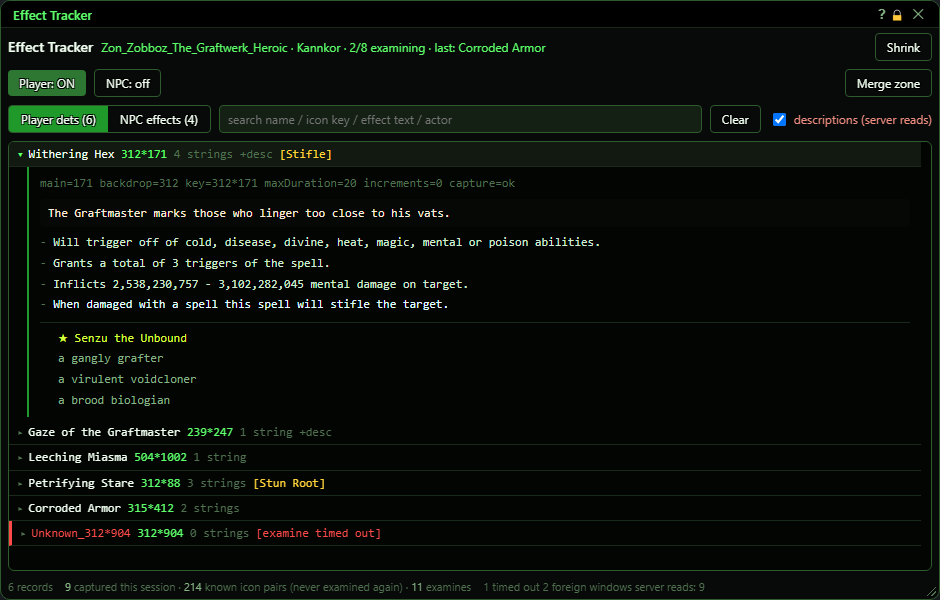
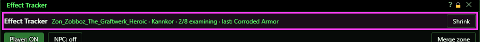
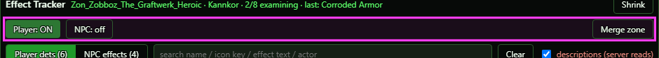
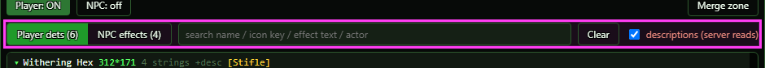
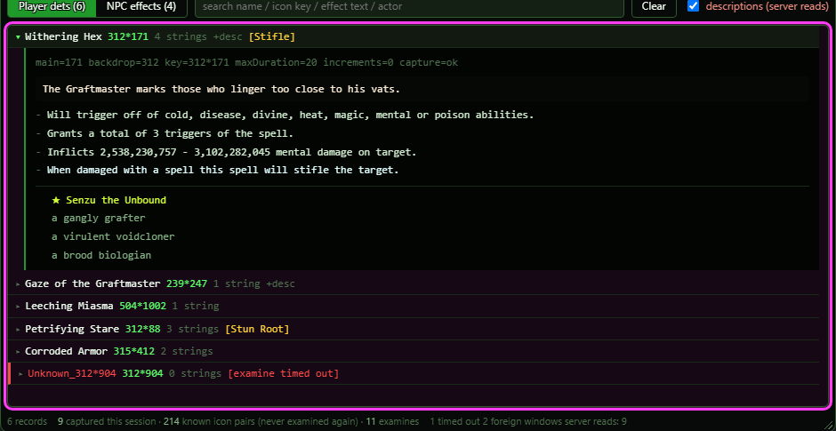
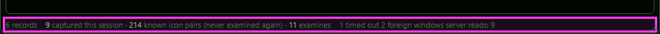
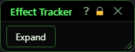
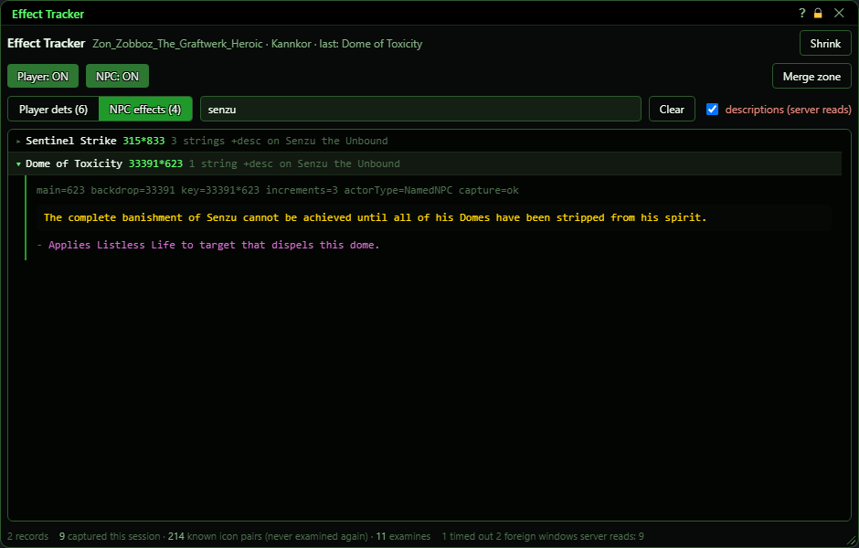
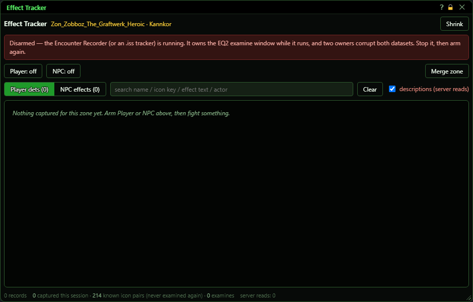
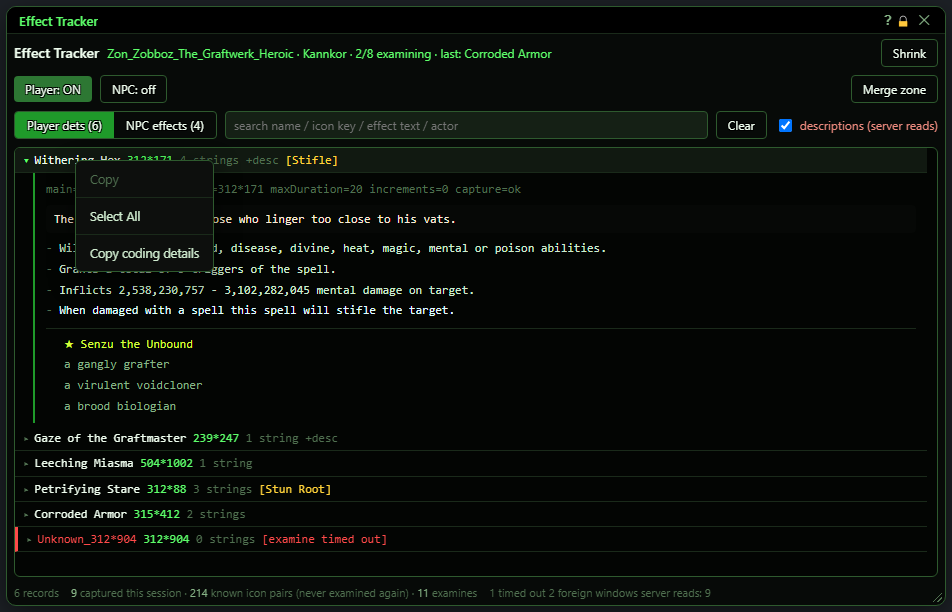

# Effect Tracker

**OgreBot is in beta testing.** Looking for OgreBot Classic? [Click here](../../index.md).

> **:bulb: In game - the ? button on this window says**
>
> Records what effects are called and what they say they do, into a shared per-zone data set for encounter writers.
>
> **What you can do here**
>
> - **Player** - record the detrimentals that land on you.
> - **NPC** - record the effects on NPCs that are fighting.
> - **Merge zone** - combine every character's capture file for the zone you are in into one. It works with Player and NPC off too.
> - **Search** and click a row to read everything recorded for an effect.
> - **Right-click a row** to copy its coding details.
>
> **Good to know**
>
> - Both start off in every new session. The window opens shrunk; click **Expand**.
> - Each effect is examined once, ever, so a zone you ran before may show nothing new.
> - It switches itself off while the Encounter Recorder runs.

**Open it:** Type `ogre effecttracker` (or `ogre oet`). `ogre effecttracker on` turns on the player capture and `ogre effecttracker npc on` the NPC capture; both also open the window. `ogre effecttracker off` turns both off. `ogre end effecttracker` (or the window's X) turns both off and closes the window.

## What it is for

Effect Tracker records what effects are called and what they say they do. With Player on, it records every detrimental that lands on you. With NPC on, it records the effects on NPCs that are fighting. It opens each new effect's examine window, copies its text, and closes it again. Each effect is only looked at once, ever, and the results go into a shared per-zone data set that encounter writers use. This window turns the capture on and off and lets you browse what was captured in the zone you are in.

## Header

The green line shows the zone, your character, how many effects are waiting to be examined, and the name of the last effect captured.

| Control | What it does | Default |
|---|---|---|
| **Shrink / Expand** | Shrink folds the window down to a small title bar with just an Expand button, so it is out of your way. Expand brings it back to the size it was before you shrank it (940 by 600 the first time, because the window opens shrunk). Display only - the capture keeps running while shrunk. *The window always opens shrunk. Click Expand to see the list.* | shrunk (the window opens small) |

## Turning the capture on and off

| Control | What it does | Default |
|---|---|---|
| **Player: off / Player: ON** | Turns on (or off) recording of the detrimentals that land on you. When turned on it also looks at the detrimentals already on you. *Effects already recorded before (by any of your characters) are skipped, so a zone you have done before may capture nothing new. It is not saved: it starts off again in every new session. Turning off the last of Player and NPC saves what was captured straight away.* | off |
| **NPC: off / NPC: ON** | Turns on (or off) recording of the effects on NPCs and named NPCs that have a target (are fighting). Up to 10 effects per NPC. *It only captures during combat, because that is when NPCs carry the effects.* | off |
| **Merge zone** | Combines every character's capture file for the zone you are in into one merged file for the zone. Your own latest captures are saved first, so they are included. The console says how many records were added and updated. *It works whether Player or NPC is on or not. Outside a zone it says 'not in a zone' and does nothing.* |  |

## Browsing what was captured

| Control | What it does | Default |
|---|---|---|
| **Player dets (N)** | Shows the detrimentals your character has recorded in this zone. The number is how many there are. Display only. | selected |
| **NPC effects (N)** | Shows the NPC effects recorded in this zone (shared by all your characters). Display only. |  |
| **search name / icon key / effect text / actor (box)** | Shows only the effects whose name, description, icon key, effect text or mob names contain what you type. Capital letters do not matter. It searches after you stop typing or press Enter. Display only. | empty |
| **Clear** | Empties the search box and shows everything again. Display only. |  |
| **descriptions (server reads)** | When ticked, the tracker also asks the game server for each new effect's description, one effect at a time. When unticked, names and effect text are still captured from the examine window; only the description is missing. *It is not saved: it is ticked again in every new session. The footer shows how many server reads were used.* | on |

## The list

One row per captured effect: its name, its icon key (two numbers), how many lines of text it has, '+desc' if it has a description, 'on <mob>' for NPC effects, any crowd control it causes in yellow, and a red note if the capture failed.

| Control | What it does |
|---|---|
| **Click a row** | Opens the row to show everything recorded for that effect: icon numbers, duration, counters, the description, each line of effect text, and the mobs it was seen with (named mobs are starred). Click it again to close it. Display only. *Dragging across text selects it for copying instead of opening the row.* |
| **Right-click a row > Copy coding details** | Copies the effect's name, icon numbers, duration, the mob it was on, and all its text to the Windows clipboard, ready to paste into an encounter file or a note. *If another program is holding the clipboard, the console says it could not copy.* |

## Footer

Record count (and 'showing N of M' when there are more than 250 matches; the file still has them all), how many effects were captured this session, how many effects are already known and will never be examined again, how many examine windows were opened, any timeouts or windows that were not ours, and how many server reads were used.

## What the window shows

- Header line: zone file name, your character, 'N/8 examining' while effects wait to be read, and 'last:' the last effect captured.
- Red 'Disarmed' bar: the Encounter Recorder or one of the old OgreBot effect tracker scripts is running. They use the same examine window, so the tracker switches itself off and refuses to turn on until they stop.
- Row name in red with '[examine timed out]' (or another reason): the capture failed. An 'Unknown_...' name means the effect could not be named. These are tried again later in the session, up to a limit.
- Yellow brackets such as [Stun Root]: crowd control found in the effect text (Stifle, Stun, Fear, Mez, Root).
- Open row, first line: main and backdrop icon numbers, the key, maxDuration (-1 means it lasts until removed), increments (counters), the actor type and the capture result.
- Open row, bottom: the mobs that were around when it landed. A star marks named mobs.
- Coloured text: some effect lines carry the game's own colour, and the window shows it the same way.
- Empty list: 'Nothing captured for this zone yet' (turn Player or NPC on and fight), 'Armed, and nothing captured yet', or 'Nothing matches' for a search.

## Good to know

- Player and NPC are not saved: both start off in every new session. Turning either on opens this window (shrunk) so you can always see it is running.
- Closing the window turns Player and NPC off (what was captured is saved), the same as `ogre end effecttracker`.
- An effect is examined only once, ever, across all your characters. A zone you already ran may show nothing new; that is normal.
- Starting the Encounter Recorder switches Effect Tracker off. Turn it back on after the recorder stops.
- While the tracker is working, you will see effect examine windows flash open and close. That is how it reads them.
- The list only shows the zone you are in, and only after capture has been turned on (or Merge zone pressed) this session.

### As it opens

The window opens shrunk. Click **Expand**:

### NPC effects, searched

### Blocked by the Encounter Recorder

### Right-click a record

