# Radar

**OgreBot is in beta testing.** Looking for OgreBot Classic? [Click here](../../index.md).

> **:bulb: In game - the ? button on this window says**
>
> A live map of what is around you. You are the ringed dot in the middle; the cyan wedge is the way you face. Click any dot to target it.
>
> **What you can do here**
>
> - **zoom / dim / height** - how far you see, how solid the background is, and hiding other floors.
> - **types** - pick which kinds of things are drawn (saved at once).
> - **verify** - check the radar's list against the game; the answer is in the console.
> - **Gear** - colours, rotation, labels, full screen, click-through, name lists, and **Save**.
> - **auto-hide** (clean mode) - no title bar, controls fade; point at the top-left corner to get them back.
>
> **Good to know**
>
> - Zoom, dim, height and the gear settings only stick if you press **Save**.
> - Stuck behind click-through? `ogre radar settings` or `ogre radar click off`.
> - A line under the title tells you when no data has come in for a while, and who a clicked dot targeted.
> - The X (or `ogre end radar`) turns the radar off. `ogre radar` does nothing if it is already open.

**Open it:** Type `ogre radar` in the console. `ogre end radar` (or the X on its title bar) turns it off again. The OgreBot Load tab boxes "Radar on" / "Radar off" do the same when a profile loads.

[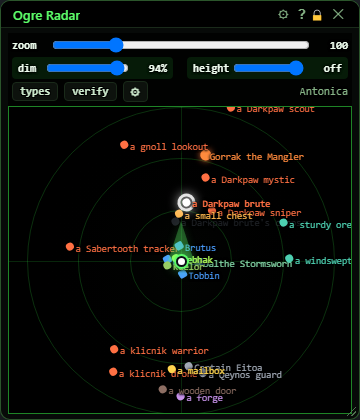](../assets/eq2radar/window.png "Click for full size")

## What it is for

A live map of everything around you: mobs, players, pets, corpses, chests, doors and more, each drawn as a coloured dot around you in the middle. Click a dot to target it. It only shows things; it never moves or fights for you, and it keeps working while OgreBot is paused. The title bar reads Ogre Radar. Your look (zoom, colours, lists, and so on) is saved to one file shared by every character on this PC.

## Toolbar

The strip across the top. The zoom, dim and height sliders change only what you see; they do not change what the bot reads.

[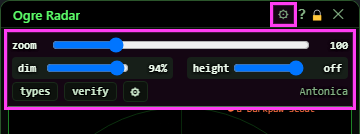](../assets/eq2radar/toolbar.png "Click for full size")

| Control | What it does | Default |
|---|---|---|
| **zoom** | How far the radar reaches, in game units from you to the nearer edge of the window. Drag left to zoom in, right to see further (10 to 400). Display only - changes what you see, not what the bot does. *Only kept for good if you press Save in the settings.* | 100 (the radar radius) |
| **dim** | How solid the radar's background is. 100% is a solid panel, 0% is see-through so only the dots are drawn over the game. The same setting as background in the settings. *Only kept for good if you press Save in the settings.* | 94% |
| **height** | Hides things more than this many units above or below you, so in a tower or a building you see your own floor. Shows ±N when on. Either end of the slider means off. *Only kept for good if you press Save in the settings.* | off |
| **types** | Opens the Radar Types window, where you pick which kinds of things are drawn. Press again to close it. |  |
| **verify** | Checks the bot's list of nearby things against a fresh read of the game and prints the result in the console. If the list had gone wrong it is rebuilt. *The answer is in the console, not on the radar.* |  |
| **⚙ (gear, in the toolbar)** | Opens and closes the settings drawer over the radar. |  |
| **⚙ (gear, in the title bar)** | The same as the toolbar gear: opens and closes the settings drawer. |  |
| **Title bar close (X)** | Turns the radar off and closes it and the Radar Types window. Same as `ogre end radar`. |  |

## The scope

You are the white dot with the cyan ring in the middle; the cyan wedge shows which way you face. The rings mark a third, two thirds and all of the zoom distance. In the top right of the toolbar is the zone name.

[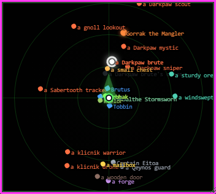](../assets/eq2radar/scope.png "Click for full size")

| Control | What it does |
|---|---|
| **Click a dot** | Targets that actor. It works while OgreBot is paused, and it takes priority over the bot's own targeting for that click. *Dots stay clickable even when click-through is on. For 4 seconds the line at the top of the radar says what you targeted (name, level, distance, health, type), whether or not the readout is switched on.* |

## Settings - Display

Open with either gear. The drawer covers the radar; Close (at the bottom) or the gear puts it away. While it is open the radar always takes the mouse, even if click-through is on.

[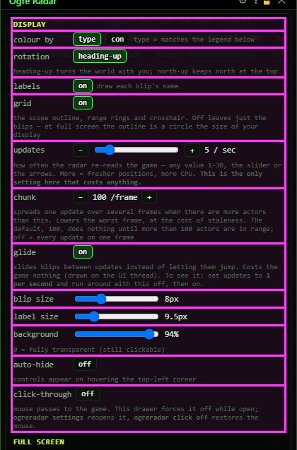](../assets/eq2radar/settings-display.png "Click for full size")

| Control | What it does | Default |
|---|---|---|
| **colour by: type** | Colours each dot by what it is (npc, named, player, pet...), using the Colours - by type list. | on |
| **colour by: con** | Colours each dot by its con colour (grey, green, blue, white, yellow, orange, red) using the Colours - by con list. Things with no con keep their type colour. | off |
| **rotation (heading-up / north-up)** | heading-up turns the map with you, so straight ahead is always up. north-up keeps north at the top and turns the facing wedge instead. | heading-up |
| **labels** | Writes each dot's name beside it. | on |
| **grid** | The outline, range rings and crosshair. Off leaves only the dots. | on |
| **updates: −** | Reads the game one time fewer per second. |  |
| **updates (slider)** | How many times a second the radar re-reads the game, 1 to 30. More gives fresher positions but costs more game time. This is the only setting in the drawer that costs anything. *Not saved by Save: it goes back to 5 when the extension reloads.* | 5 / sec |
| **updates: +** | Reads the game one time more per second (up to 30). |  |
| **chunk: − / +** | Steps through off, 25, 50, 100, 150, 250, 400. When more actors are around than this number, one update is spread over several game frames, which smooths out the worst frame but makes positions a little older. *Not saved by Save. With 100 things or fewer around, the default 100 does nothing, so there is no need to turn it off. The hint next to it says the same.* | 100 /frame |
| **glide** | Slides dots smoothly between updates instead of letting them jump. Costs the game nothing. | on |
| **blip size** | Size of each dot, 4 to 18 pixels. Named mobs are drawn 3 pixels bigger. | 8px |
| **label size** | Size of the name text, 7 to 20 pixels. | 9.5px |
| **background** | The same setting as dim on the toolbar: 0% is fully see-through (the radar is still clickable), 100% solid. | 94% |
| **auto-hide** | Turns clean mode on or off. In clean mode the title bar is removed and the toolbar fades out; hover the top-left corner of the radar to bring the controls back. See Clean mode below. | off |
| **click-through** | When ON, your mouse clicks go through the radar to the game, except on the dots and the toolbar, which still work. *If you get stuck, `ogre radar click off` gives the mouse back and `ogre radar settings` opens this drawer.* | off |

## Settings - Full screen

[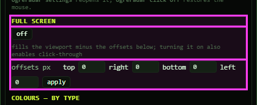](../assets/eq2radar/settings-fullscreen.png "Click for full size")

| Control | What it does | Default |
|---|---|---|
| **Full screen: on / off** | Stretches the radar over the whole game screen, minus the offsets below. Turning it on also turns click-through on, so you can still play. Turning it off puts the window back where it was. | off |
| **offsets px: top / right / bottom / left** | Pixels to leave free at each edge of the screen when full screen is on (for example to keep your hot bars clear). *Typing a number does nothing until you press apply.* | 0 |
| **apply** | Re-fits the full-screen radar using the offsets you typed. *Only does something while full screen is on.* |  |

## Settings - Colours

One row per kind of thing (by type) and one per con colour. Click a swatch to open the colour picker above the list.

[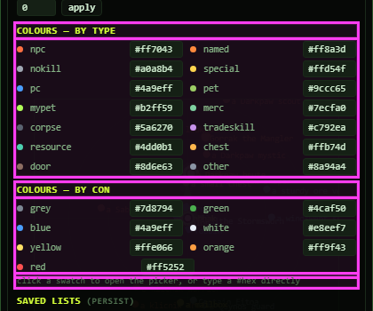](../assets/eq2radar/settings-colours.png "Click for full size")

| Control | What it does |
|---|---|
| **Swatch (coloured dot)** | Opens the colour picker for that row. The picker's heading uses the row's own name (named, tradeskill, nokill...). |
| **#hex box** | Type a colour as # plus six hex digits (for example #ff8a3d). It applies as soon as the text is a valid colour. *Anything else is ignored.* |
| **Picker: #hex box** | The picked colour as text; type a colour here to set it. |
| **Picker: R / G / B sliders** | Mix the colour from red, green and blue (0 to 255). The dots change as you drag. |
| **Picker: preset swatches** | Click one to use that colour. |
| **Picker: done** | Closes the picker. The colour you picked stays. |

## Settings - Lists

Each entry is part of a name and is matched without caring about capitals: 'darkpaw' matches 'a Darkpaw brute'. Saved lists are kept when you press Save. Temporary lists are never saved; they last until the game's UI reloads.

[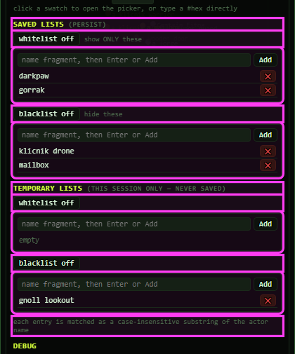](../assets/eq2radar/settings-lists.png "Click for full size")

| Control | What it does | Default |
|---|---|---|
| **whitelist ON / off (saved)** | When ON, only things whose name matches an entry are drawn. *An empty whitelist is ignored rather than hiding everything.* | off |
| **blacklist ON / off (saved)** | When ON, things whose name matches an entry are hidden. | off |
| **whitelist ON / off (temporary)** | Same as the saved whitelist, for this session only. | off |
| **blacklist ON / off (temporary)** | Same as the saved blacklist, for this session only. | off |
| **name fragment, then Enter or Add (placeholder)** | Type part of a name. Enter does the same as Add. | empty |
| **Add** | Adds the typed text to that list (skipped if it is already there). |  |
| **✕ (remove entry)** | Removes that entry from the list. |  |

## Settings - Debug, Save and Reset

The report buttons print to the console, not the radar. They are for tracking down problems.

[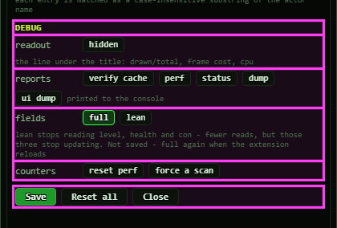](../assets/eq2radar/settings-debug.png "Click for full size")

| Control | What it does | Default |
|---|---|---|
| **readout (shown / hidden)** | Shows a line at the top of the radar: how many things are drawn out of how many were read, and what the radar costs the game (time per frame and share of the CPU). *Messages for you use the same line and show even when the readout is hidden: "no data for N s" when the radar has had nothing from the game for over 3 seconds, and what a clicked dot targeted.* | hidden |
| **verify cache** | Same as the verify button on the toolbar. |  |
| **perf** | Prints the radar's cost report to the console. |  |
| **status** | Prints the radar's current settings and state to the console. |  |
| **ui dump** | Prints the radar window's own drawing numbers to the console. |  |
| **dump** | Prints the first 10 things from the last update (name, type, distance, level, health, con, position) to the console. |  |
| **fields: full** | Reads everything the radar can show, including level, health and con. The lit button is the one in use. | full |
| **fields: lean** | Stops reading level, health and con: fewer game reads, but those three stop updating on the radar. *Not saved. It goes back to full when the extension reloads.* |  |
| **reset perf** | Zeroes the radar's cost counters so the next perf report starts from now. |  |
| **force a scan** | Makes the radar re-read the game once, right away. |  |
| **Save** | Saves the radar's look and lists (everything in this drawer except updates and chunk, plus zoom, dim and height) to OgreSave\EQ2\Radar.json. The next time the radar opens it starts this way. One file for every character on this PC. *The grey text next to Close confirms the save.* |  |
| **Reset all** | Puts every setting in the drawer back to the defaults, including zoom, dim, height, colours, the type choices and the saved lists (they are emptied). Nothing is written until you press Save. *Close and reopen the radar without saving to get your saved settings back.* |  |
| **Close** | Closes the drawer. Unsaved changes stay in effect until the radar closes. |  |

## Clean mode (auto-hide)

With auto-hide on, the radar becomes a clean overlay: the title bar is gone (so no X, lock or ?) and the toolbar fades out. The space stays reserved at the top. A faint corner mark in the top-left shows where to point.

[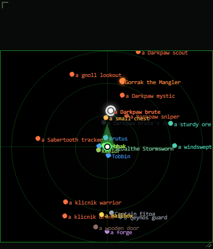](../assets/eq2radar/clean.png "Click for full size")

| Control | What it does |
|---|---|
| **Hot corner (top-left)** | Point the mouse at the top-left corner of the radar (about 130 by 24 pixels) and the toolbar comes back. Move away and it fades again after a moment. *The controls stay up while the settings drawer is open.* |
| **? (beside the gear)** | Opens this help. It only appears in clean mode, because the title bar and its ? are gone. |

## What the window shows

- Your character: the white dot with the cyan ring in the middle. The cyan wedge is the way you face.
- Dot colours (colour by type, the default): npc orange, named orange and bigger with a glow, nokill (guards, merchants) grey, special yellow, players blue, pets light green, your pet bright green, mercenaries teal, corpses dark grey, tradeskill stations purple, resources (harvest nodes) teal-green, chests amber, doors brown, anything else grey. Every colour can be changed in the settings.
- Dot shapes: players and mercenaries are rounded squares; everything else is round. Named mobs are 3 pixels bigger with an orange glow.
- Faded dots: corpses and anything at 0% health.
- Your target: its dot turns white with a white halo and its name goes white and bold.
- Rings: a third, two thirds and all of the zoom distance, measured to the nearer edge of the window. A tall window sees further up and down than sideways.
- Top right of the toolbar: the zone you are in.
- Only the 250 nearest things are drawn.

## Good to know

- Zoom, dim, height and every setting in the drawer are only kept for good if you press Save. Close and reopen the radar without saving and they go back to what you last saved (if you have never saved, your changes last until the game's UI reloads). Exception: choices in the Radar Types window save themselves. Only the type choice is saved - your other changes still wait for Save.
- updates and chunk are not saved at all; they return to 5 per second and 100 when the extension reloads.
- In clean mode there is no title bar and no X. Use the hot corner to get the controls back, or type `ogre end radar` to close it.
- If the radar stops you clicking the game, turn click-through on. If you then cannot reach the radar's settings, type `ogre radar settings`; `ogre radar click off` gives the mouse back, and `ogre radar uireset` puts every radar setting back to default (like Reset all - not saved until you press Save).
- Full screen turns click-through on for you.
- `ogre radar` when the radar is already open does nothing and prints nothing.

## Clean mode, step by step

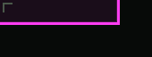

Point at the top-left corner and the controls come back, with a **?** beside the gear:

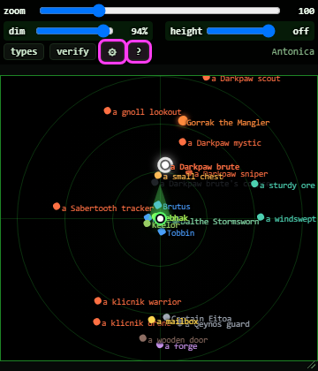

## The readout line

Turn on **readout** in the Debug part of the settings to get a line at the top of the radar: how many things are drawn out of how many were read, and what the radar costs.

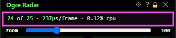

Clicking a dot writes what you targeted there for 4 seconds - even with the readout off:

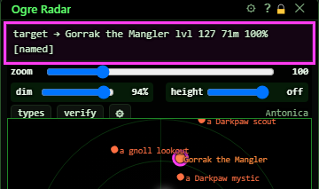

## The colour picker

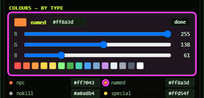

## The whole settings drawer

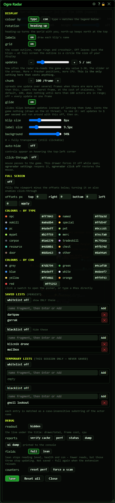

