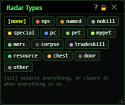
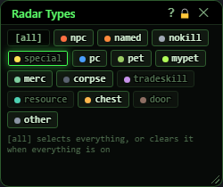
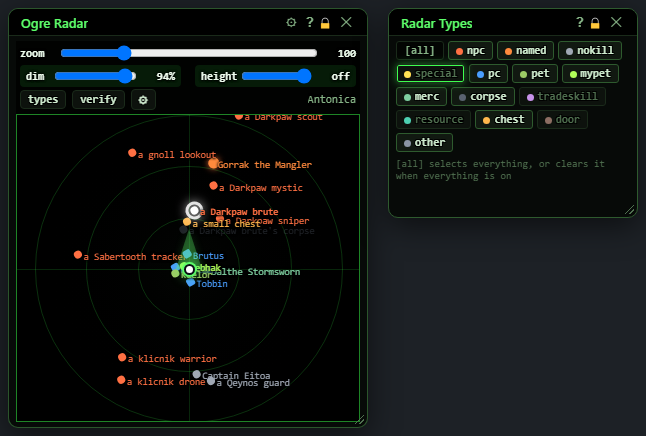

# Radar Types

**OgreBot is in beta testing.** Looking for OgreBot Classic? [Click here](../../index.md).

> **:bulb: In game - the ? button on this window says**
>
> Picks which kinds of things the Radar draws. A lit button is shown; a dim one is hidden.
>
> **What you can do here**
>
> - **Click a type** (npc, named, pc, pet, corpse, chest, door...) to show or hide it.
> - **other** covers anything not in the list.
> - **[all]** shows everything; when everything is on it reads **[none]** and hides everything.
>
> **Good to know**
>
> - Each click is saved straight away. Only the type choice is saved - other radar changes still wait for **Save**.
> - The dot on each button is that type's colour on the radar (change it under the radar's gear).
> - Open and close it with **types** on the radar.

**Open it:** Press **types** on the Radar's toolbar (open the radar first with `ogre radar`). Press types again, or the X, to close it.

## What it is for

Picks which kinds of things the Radar draws: mobs, named, players, pets, corpses, chests, doors and so on. Each button is one kind; lit means shown. Your choices are saved as soon as you click, so they are still there the next time you open the radar. It changes only what the radar shows, never what the bot does.

## Type buttons

The coloured dot on each button is the colour that kind is drawn in on the radar (change it in the radar's settings, Colours - by type).

| Control | What it does | Default |
|---|---|---|
| **[all] / [none]** | If anything is hidden, [all] shows every kind again. If everything is already shown, the button reads [none] and hides every kind, so you can then turn on just the ones you want. |  |
| **npc** | Mobs you can fight. | shown |
| **named** | Named mobs. | shown |
| **nokill** | NPCs you cannot attack, such as guards and merchants. | shown |
| **special** | Objects the game marks as special, usually things you can click. | shown |
| **pc** | Other players. | shown |
| **pet** | Pets that are not yours (your own pet is mypet). | shown |
| **mypet** | Your own pet. | shown |
| **merc** | Mercenaries. | shown |
| **corpse** | Corpses. | shown |
| **tradeskill** | Crafting stations (forges, sewing tables and the like). | shown |
| **resource** | Harvest nodes. | shown |
| **chest** | Treasure chests. | shown |
| **door** | Doors. | shown |
| **other** | Anything that is none of the kinds above. | shown |
| **Title bar close (X)** | Closes this window only. The radar keeps running. |  |

## What the window shows

- A lit button means that kind is drawn on the radar; a dim one means it is hidden.
- The line under the buttons: '[all] selects everything, or clears it when everything is on'.

## Good to know

- Every click saves your type choice straight away. Only the type choice: any other change you made on the radar and did not save yet (zoom, dim, colours...) still waits for the radar's Save.
- You never appear on the radar as a dot you can hide; you are always the marker in the middle.
- Closing the radar (its X or `ogre end radar`) closes this window too.

## Beside the radar

