# Ability Export

**OgreBot is in beta testing.** Looking for OgreBot Classic? [Click here](../../index.md).

> **:bulb: In game - the ? button on this window says**
>
> Makes the ability file OgreBot needs to cast your abilities, by reading your knowledge book one ability at a time.
>
> **What you can do here**
>
> - **Choose what to include**: passives, ascension abilities, a minimum tier or level range, or just a few named abilities.
> - **Merge** into the file you have, write a **Fresh file**, or add **Only abilities I don't have yet** (much faster).
> - **Tradeskill export instead** makes the files Ogre Craft uses.
> - **Run export** starts it. This window steps aside while it runs; the small Exporting Abilities window shows progress and can stop it.
>
> **Good to know**
>
> - A full export takes a while. OgreBot reloads your abilities when it finishes, unless it was a dry run or you ticked **Don't reload OgreBot when finished**.
> - `ogre export -start` runs with the options set here, without opening this window.
> - Your choices are saved as you make them.
> - If none of the abilities in **Just these abilities** is found, nothing is exported and the top line says so.

**Open it:** Type `ogre export` (or `ogre abilityexport`); typing it again while the window is open does nothing. `ogre export -start` runs an export straight away with the options set in this window, without opening it. `ogre export -default -start` does the same with the default options. `ogre end export` closes the window.

[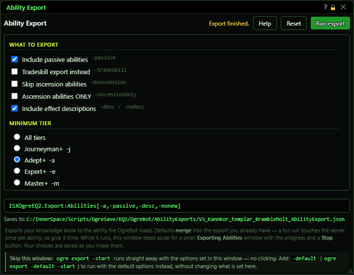](../assets/exportgui/window.png "Click for full size")

## What it is for

OgreBot needs a list of your character's abilities to cast them. This window makes that list: it reads your knowledge book, one ability at a time, and writes the file OgreBot loads. You pick what to include, then press Run export. While it runs, this window steps aside and the small Exporting Abilities window shows progress. When it finishes, OgreBot reloads your abilities and cast stack from the new file (unless you turn that off).

## Top row

The yellow text left of the buttons is the result of the last thing you did (for example 'Export finished.', 'Export stopped - nothing was written.' or 'Options reset to defaults.').

[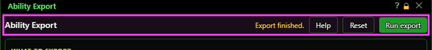](../assets/exportgui/header.png "Click for full size")

| Control | What it does | Default |
|---|---|---|
| **Help** | Shows or hides a short explanation under every option. Display only - changes what you see, not what the bot does. *The explanations are the same plain-language text as this page.* | off |
| **Reset** | Puts every option back to its default and saves that straight away. |  |
| **Run export / Run (dry run) / Run cache action / Running…** | Starts the export with the options shown. The label tells you what will happen: 'Run (dry run)' when nothing will be written, 'Run cache action' when you picked a cache action that does not export. While the export runs this window steps aside; the small Exporting Abilities window shows the progress and has the Stop button. *Greyed out while the red 'can't run' box is showing, and while an export is already running.* |  |
| **Title bar close (X)** | Closes this window. It does not stop an export that is already running. |  |

## What to export

[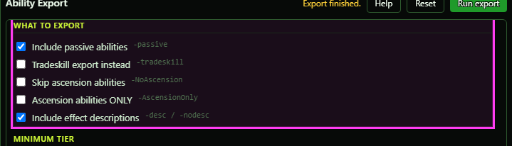](../assets/exportgui/what.png "Click for full size")

| Control | What it does | Default |
|---|---|---|
| **Include passive abilities** | Adds your passive abilities to the file. They are left out unless you tick this. *Has no effect on a tradeskill export.* | off |
| **Tradeskill export instead** | Exports ONLY your tradeskill abilities, for Ogre Craft, instead of your combat abilities. It writes up to three files (your crafting class, plus tinkering and adorning if you have them) into the EQ2OgreCraft TSExports folder. *It opens and closes the Examine window once per ability - leave the game window alone while it runs.* | off |
| **Skip ascension abilities** | Leaves your ascension abilities out of the file. *Cannot be ticked together with 'Ascension abilities ONLY' - the window refuses to run.* | off |
| **Ascension abilities ONLY** | Exports nothing but your ascension abilities. | off |
| **Include effect descriptions** | Keeps each ability's effect text in the file. Untick for a smaller file. OgreBot works out what an ability does either way. | on |

## Minimum tier

Pick one. Only abilities at or above the chosen tier are exported.

[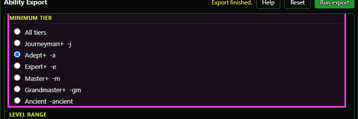](../assets/exportgui/tier.png "Click for full size")

| Control | What it does | Default |
|---|---|---|
| **All tiers** | Exports every tier. | selected |
| **Journeyman+** | Leaves out Apprentice abilities. |  |
| **Adept+** | Keeps Adept and higher. |  |
| **Expert+** | Keeps Expert and higher. |  |
| **Master+** | Keeps Master and higher. |  |
| **Grandmaster+** | Keeps Grandmaster and higher. |  |
| **Ancient** | Keeps only Ancient abilities. *The old bot never actually filtered on Ancient; this one does.* |  |

## Level range

[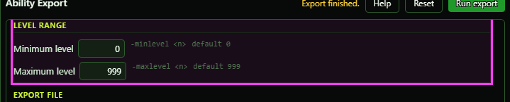](../assets/exportgui/levels.png "Click for full size")

| Control | What it does | Default |
|---|---|---|
| **Minimum level** | Skips abilities whose class level is below this number. 0 means no minimum. *AA and ascension abilities count as level 0, so any minimum above 0 drops all of them (the window warns you).* | 0 |
| **Maximum level** | Skips abilities whose class level is above this number. 999 means no maximum. *Must be a whole number and not below the minimum, or the window refuses to run.* | 999 |

## Export file

[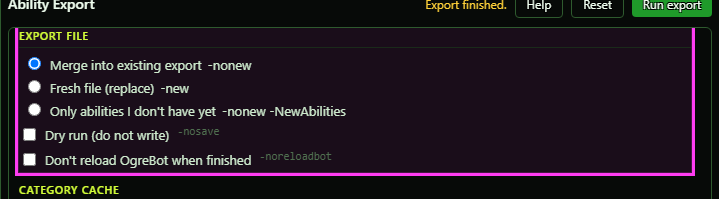](../assets/exportgui/file.png "Click for full size")

| Control | What it does | Default |
|---|---|---|
| **Merge into existing export** | Starts from the file you already have and adds or updates abilities in it. Abilities not rescanned this time are kept. *On a tradeskill export, only the recorded highest tradeskill level carries over - the ability list is rebuilt from this run.* | selected |
| **Fresh file (replace)** | Ignores the file you already have and writes a brand-new one from this run only. |  |
| **Only abilities I don't have yet** | Merges, but skips every ability already in your file without looking it up again. The quick way to add newly learned abilities. *Abilities already in the file are not refreshed.* |  |
| **Dry run (do not write)** | Does the whole scan but writes nothing, and OgreBot is not reloaded. *The category cache (below) is still updated.* | off |
| **Don't reload OgreBot when finished** | Normally, when an export finishes, OgreBot reloads your abilities and cast stack from the new file. Tick this to leave them as they are. | off |

## Category cache

The cache only makes exports faster: it remembers which abilities an export would throw away anyway, so they are not looked up again. It never changes what ends up in the file. Leave it on Normal unless something is wrong.

[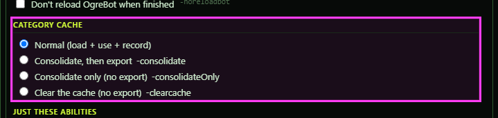](../assets/exportgui/cache.png "Click for full size")

| Control | What it does | Default |
|---|---|---|
| **Normal (load + use + record)** | Uses the shared cache and adds anything new it learns. | selected |
| **Consolidate, then export** | Folds the cache notes your other sessions left into the main cache first, then exports as normal. Normally only the first session (is1) does this. |  |
| **Consolidate only (no export)** | Folds the other sessions' cache notes into the main cache and stops. No export runs. *Run it after your other characters have exported.* |  |
| **Clear the cache (no export)** | Empties the cache and stops. No export runs. The next normal export rebuilds it. *Only needed if the cache has gone bad.* |  |

## Just these abilities

[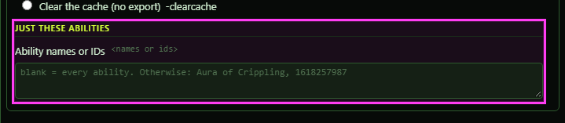](../assets/exportgui/only.png "Click for full size")

| Control | What it does | Default |
|---|---|---|
| **Ability names or IDs** | Leave blank to export everything. Otherwise type ability names (spelled as in your knowledge book) or ability ID numbers, separated by commas or new lines, and only those are exported. With 'Merge' the rest of your file is kept as it was. *Names that are not found are listed on the console. If none of them is in your knowledge book, nothing is exported and the window's top row says so.* | empty |

## What the window shows

- Grey text next to each option (like -passive) is the matching script word, for the command at the bottom. Display only.
- Yellow 'Heads up' box: things worth knowing about the options you picked. You can still run.
- Red 'These options can't run' box: something must be fixed first. Run export is greyed out until it is.
- Green command line: the same export as a one-line script command (ISXOgreEQ2.Export:Abilities[...]). Display only.
- Saves to: where the file will be written - normally OgreSave/EQ2/OgreBot/AbilityExports/V3_<name>_<class>_<server>_AbilityExport.json. For a tradeskill export it shows the folder instead ('up to 3 files in').
- Footer: a reminder that `ogre export -start` skips this window.

## Good to know

- A full export looks up every ability one at a time and takes a while. 'Only abilities I don't have yet' is much faster.
- Every option change is saved as you make it, so the window opens the same way next time.
- `ogre export -start` uses the options set in this window. `ogre export -default` (without -start) shows the defaults here without saving them - they are saved as soon as you change an option or press Run export.
- Stopping an export (Stop, or closing the small progress window) writes nothing - the old file is untouched, and this window's top row says 'Export stopped - nothing was written.'
- If none of the abilities in 'Just these abilities' is in your knowledge book, nothing is exported and the top row says so. Names that are not found are listed on the console.
- Typing `ogre export` while this window is open does nothing.
- Options file: OgreSave/EQ2/OgreBot/AbilityExports/export-gui.json. Delete it to go back to defaults.

### While an export runs

Pressing Run export hides this window and opens the small **Exporting Abilities** window (see its own page). When the export ends, this window comes back with the result in the top row.

### Examples

A combination that cannot run - both ascension boxes ticked:

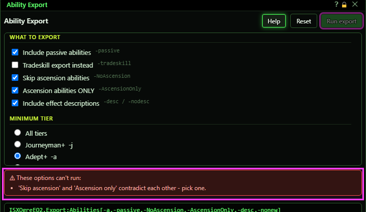

A tradeskill export of two named abilities - it saves to a folder, and the window warns you about what that means:

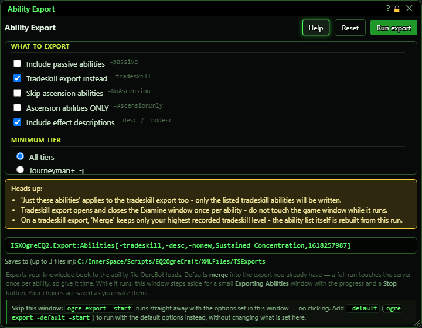

With **Help** on:

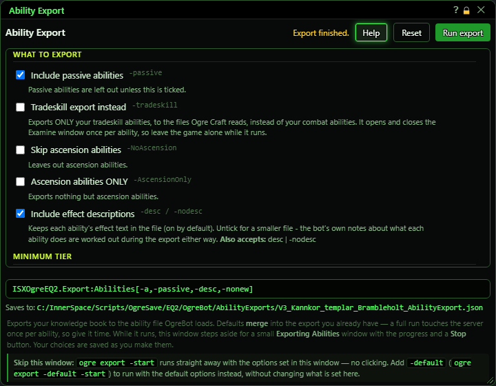
