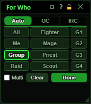
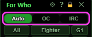
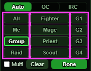
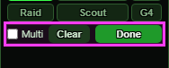
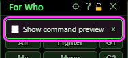
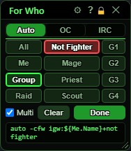
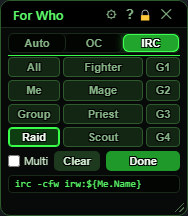
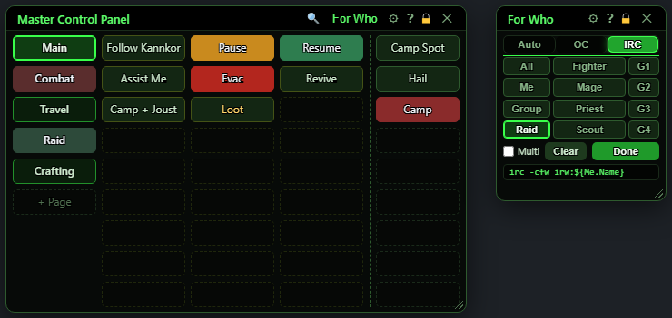

**OgreBot is in beta testing.** Looking for OgreBot Classic? [Click here](../../index.md).

# For Who

> **:bulb: In game - the ? button on this window says**
>
> Picks which characters an MCP button's command goes to, and how it is sent.
>
> **What you can do here**
>
> - **Auto / OC / IRC** - send each button its own way, or force OgreConsole or IRC.
> - **All, Me, Group, Raid** - who gets it. Nothing picked means everyone.
> - **Fighter / Mage / Priest / Scout** - click once for that class, again for "Not" that class.
> - **G1-G4** - a group of your raid.
> - **Multi** - pick several; a character must match all of them (Fighter + G1 = fighters in group 1).
>
> **Good to know**
>
> - Buttons that name their own target ignore the chips (Auto / OC / IRC still applies); Raw buttons run only on you.
> - Me, Group and Raid mean the character that clicked.
> - Each session keeps its own choice: your tank can send to Group while your enchanter sends to Me.
> - The choice is not saved: a new session starts at Auto with nothing picked (everyone).
> - The X hides this window, like Done, so the choice keeps working; the For Who button on the MCP brings it back.
> - **Clear** resets the picks; the command preview setting stays.

**Open it:** Click **For Who** in the Master Control Panel's title bar (click again to hide it). Tick **Open For Who on load** in the MCP's gear to show it every time the MCP opens.

## What it is for

For Who picks which of your characters an MCP button's command goes to: everyone, just you, your group, your raid, a class, or a raid group. It also lets you force how the command travels (OgreConsole or IRC). It applies to every button that leaves its target on the For Who window - which is what a new step in Build command does unless you fill in its who. It applies the same way to a key bound to a button.

## How it is sent (Auto / OC / IRC)

| Control | What it does | Default |
|---|---|---|
| **Auto** | Each button goes the way it was built (OgreConsole or IRC). | on |
| **OC** | Sends every button through OgreConsole, even ones built for IRC. An IRC button's connection target is dropped. Raw buttons are not changed. |  |
| **IRC** | Sends every button through IRC (Raw buttons are not changed). If nothing is picked below, Raid lights up (the old OgreBot behaviour). While IRC is not connected, the command goes through OgreConsole instead. |  |

## Who it goes to

Click a chip to pick it; click it again to un-pick it. With nothing picked the command goes to everyone. Right-click any chip to turn it off straight away.

| Control | What it does |
|---|---|
| **All** | Every character. The same as picking nothing. Turns green when picked. |
| **Me** | Only the character whose MCP you clicked. |
| **Group** | Everyone in the clicking character's group. |
| **Raid** | Everyone in the clicking character's raid. |
| **Fighter / Mage / Priest / Scout** | Each click moves the chip on: blue 'Fighter' = only fighters, then red 'Not Fighter' = everyone except fighters, then off. |
| **G1 / G2 / G3 / G4** | Characters in that group of a raid. Characters who are not in a raid never match. |
| **Right-click a chip** | Turns that chip off in one click (no need to cycle a class chip round). |

## Multi, Clear and Done

| Control | What it does | Default |
|---|---|---|
| **Multi** | Lets you pick more than one chip. A character must match ALL of them - for example Group + Not Fighter = the group's non-fighters. All cannot be combined with anything. Turning Multi off keeps only the first pick. Resting the mouse on Multi says the same. *Fighter + Priest matches nobody (no character is both).* | off |
| **Clear** | Back to the start: Auto, nothing picked (everyone), Multi off. 'Show command preview' stays as it was. |  |
| **Done** | Hides the window. Your choice stays in effect. |  |

## Settings (the gear)

| Control | What it does | Default |
|---|---|---|
| **Show command preview** | Shows a line under the buttons with what gets added to each command, for example 'auto -cfw igw:${Me.Name}+notfighter'. Display only. | off |
| **× (close)** | Closes the settings box. The gear does the same. |  |

## What the window shows

- The lit button in the top row is how commands are sent.
- A lit chip (blue outline) is picked. All is green when picked. A red chip reading 'Not ...' means that class is excluded.
- The preview line (when turned on) shows the route, then '-cfw' and the target that is added to each command. ${Me.Name} is shown as written; it becomes the clicking character's name when sent.

## Good to know

- The chips only apply to buttons that leave their target blank. A button whose every step names a target (Me, fighter, a character name ...) goes to that target whatever chips are picked. Auto / OC / IRC still applies to it.
- Buttons made in Raw mode ignore For Who completely: they run only on the character that clicked.
- Your For Who choice is saved with the MCP buttons and shared by every character on this PC. Changing it on one character changes it on all of them.
- Me, Group and Raid mean the character that clicked (or pressed the bound key), not each character that receives the command.
- Hide the window with Done (or the MCP's For Who button). Done, or closing it with its own X, keeps your choice: it is the same when the window opens again.

### Several chips at once (Multi)

Multi is ticked, Group and Not Fighter are picked, and the preview line is on: the command goes to the non-fighters in your group.

### IRC with nothing picked

### Beside the MCP

