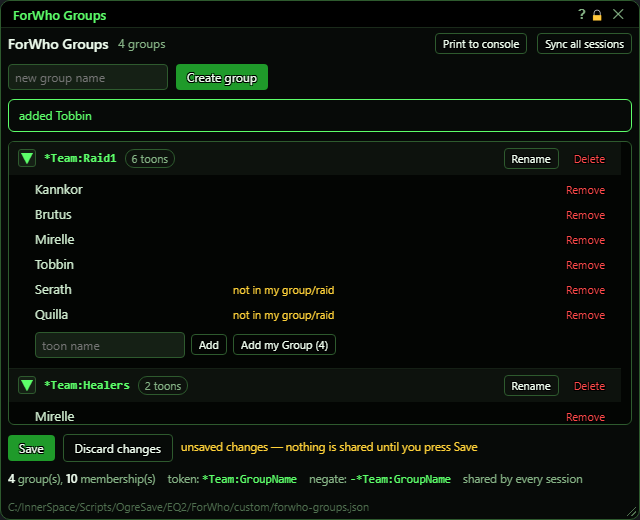
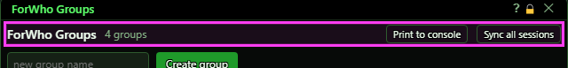
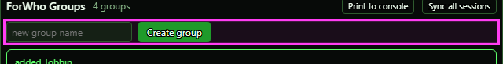
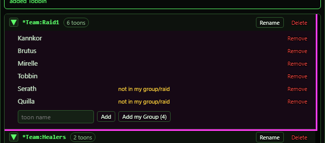
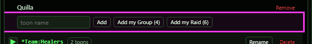
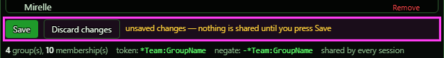
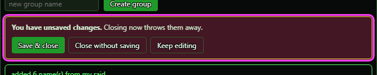
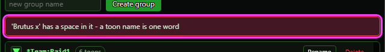
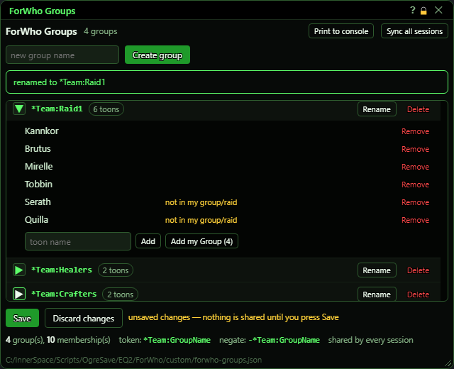
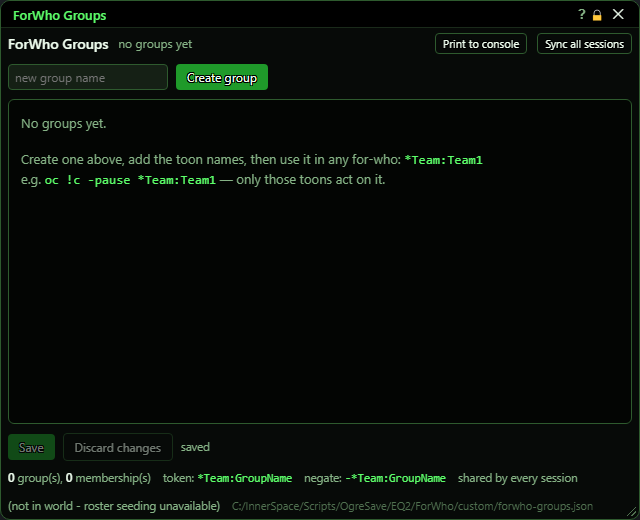

# ForWho Groups

**OgreBot is in beta testing.** Looking for OgreBot Classic? [Click here](../../index.md).

> **:bulb: In game - the ? button on this window says**
>
> Name a set of characters once, then select them all with one for-who word, like `*Team:Raid1`.
>
> **What you can do here**
>
> - **Create group** - type a name in the top box (letters, digits, - and _).
> - **Add characters** - type a name and press Enter, or use **Add my Group** / **Add my Raid**.
> - **Rename** - type the new name in the top box first, then press Rename on the group.
> - **Save** - shares your groups with every session on this PC. **Discard changes** throws your edits away.
> - **Sync all sessions** - use after editing the groups file by hand. Save or discard your own edits first.
>
> **Good to know**
>
> - Nothing counts until you press Save.
> - `-*Team:Raid1` means everyone NOT in Raid1.
> - A misspelled group word quietly matches nobody.

**Open it:** Type `ogre forwhogroups panel` (or `ogre fwg panel`), or press **Team Groups…** on the OgreBot Aliases tab. Plain `ogre forwhogroups` only prints your groups to the console. `ogre end forwhogroups` closes the window.

## What it is for

A team group is a name for a set of characters. Once you make a group called Raid1, the word `*Team:Raid1` can be used anywhere a for-who goes (for example `oc !c -pause *Team:Raid1`), and only the characters listed in Raid1 act on it. This window creates, renames and deletes groups and edits who is in each one. Your edits stay in the window until you press Save. Save writes one file that every session on this PC shares, so the same group means the same characters everywhere.

## Header

| Control | What it does |
|---|---|
| **Print to console** | Prints every group, how many characters it has and their names to the console, plus where the file is. *It prints the SAVED groups. Edits you have not saved yet do not show up.* |
| **Sync all sessions** | Re-reads the groups file in this session and tells every other session on this PC to re-read it too. The list in this window is reloaded as well. Use it after you edit the file by hand. Saving from this window already does this for you. *With unsaved changes it refuses (red message): Save or Discard them first.* |

## Create and rename

| Control | What it does | Default |
|---|---|---|
| **new group name** | Type a group name here, then press Enter or Create group. Also where you type the new name before pressing Rename on a group. *Letters, digits, - and _ only. No spaces. Case does not matter: Raid1 and raid1 are the same group.* | empty |
| **Create group** | Adds a new, empty group with the name in the box. An empty group selects nobody until you add characters. *Refused, with a red message, if the name has a bad character or a group with that name already exists.* |  |

## A group

Each group has a header row and, when unfolded, its list of characters.

| Control | What it does | Default |
|---|---|---|
| **▼ / ▶ (fold a group)** | Click the arrow, or anywhere on the header row, to fold or unfold that group's character list. Display only - changes what you see, not what the bot does. *Folding is forgotten when you close the window.* | unfolded |
| **Rename** | Renames this group to whatever is typed in the 'new group name' box at the top. The characters in it stay. *Type the new name in the top box FIRST. With the box empty you just get a red message telling you to.* |  |
| **Delete** | Removes the whole group. There is no confirmation, but nothing is final until you press Save; Discard changes brings it back. |  |
| **Remove** | Takes that character out of the group. |  |

## Adding characters

The add row sits at the bottom of each unfolded group.

| Control | What it does | Default |
|---|---|---|
| **toon name** | Type one character name and press Enter (or Add). The box stays selected, so you can type the next name and press Enter again. *Letters only, one word. A name with a space, digit or other character is refused with a red message.* | empty |
| **Add** | Adds the name in the box next to it to this group. *A name that is already in the group is refused with a red message, and nothing changes.* |  |
| **Add my Group (n)** | Adds everyone in your current group, including you, to this group. The number is how many are in your group right now. Nobody already in the list is removed, and the message counts only the names that were new. *Shows whenever you are in the world, even on your own: then it reads (1) and adds just you. The number updates by itself as people join or leave.* |  |
| **Add my Raid (n)** | Adds everyone in your raid, including you, to this group. Nobody already in the list is removed, and the message counts only the names that were new. *Only shows while you are in a raid.* |  |

## Save and Discard

Everything you do in this window is only a draft until you press Save. Until then your groups keep working exactly as they were saved.

| Control | What it does |
|---|---|
| **Save** | Writes your groups to the shared file, and every session on this PC starts using them straight away. *Greyed out when there is nothing to save.* |
| **Discard changes** | Throws away every unsaved edit and shows the groups as they were last saved. *Greyed out when there is nothing to discard.* |

## Closing with unsaved changes

If you press the X in the title bar while there are unsaved changes, the window stays open and asks what to do.

| Control | What it does |
|---|---|
| **Title bar close (X)** | Closes the window. With unsaved changes it shows the question below instead of closing. *`ogre end forwhogroups` closes the window without asking, and unsaved edits are lost.* |
| **Save & close** | Saves your changes, then closes the window. *If the save fails, the window stays open with your changes and a red message saying why.* |
| **Close without saving** | Throws away your unsaved changes and closes the window. |
| **Keep editing** | Hides the question and leaves the window open with your changes still there. |

## What the window shows

- Next to the title: how many groups you have, or 'no groups yet'.
- Green line under the Create row: what your last action did (for example 'added Tobbin' or 'saved - every session is now in sync'). Red means it was refused, and says why.
- Group header: the word you type to use the group (e.g. *Team:Raid1) and how many characters are in it. The count turns orange at 0 toons.
- 'not in my group/raid' next to a name: that character is not in your group or raid right now. Only a hint - offline or elsewhere is fine, the name still counts. Not shown while you are out of the world.
- 'no members yet - *Team:X currently selects NOBODY': the group is empty, so using it does nothing.
- Next to Save: 'unsaved changes — nothing is shared until you press Save' (orange), or 'saved' (grey).
- Footer: total groups and memberships, how to type a group (*Team:GroupName) and everyone NOT in it (-*Team:GroupName), 'shared by every session', '(not in world - roster seeding unavailable)' when you are out of the world, and the path of the file your groups are saved in.

## Good to know

- Nothing you do here counts until you press Save. Your groups keep working exactly as last saved until then.
- Groups are shared by every session on this PC, not saved per character. Saving from any session updates them all.
- Rename uses the 'new group name' box at the top: type the new name there first, then press Rename on the group.
- A misspelled group word (e.g. *Team:Riad1) quietly matches nobody. No error is shown, so check the spelling.
- Plain `ogre forwhogroups` prints your groups to the console. Add `panel` to open this window.
- When the window opens it starts from the saved file, so unsaved edits do not survive closing it. Typing the open command while it is already open does nothing (your edits stay).
- If another session saves the groups while you have unsaved changes here, your changes are kept and a red message warns that Save would write over theirs. Discard takes theirs.

### Using a group

Put the group word anywhere a for-who goes. It can be combined like any other for-who word:

- `*Team:Raid1` - only the characters in Raid1.
- `-*Team:Raid1` - everyone who is NOT in Raid1.
- `*Team:Raid1+@Tank` - in Raid1 AND the tank.

### Refused names

A name the window cannot accept is refused with a red message, and nothing changes:

### Folded groups

Fold groups you are not working on to keep the list short:

### No groups yet

The first time you open the window it is empty and explains how to start. Out of the world, the Add my Group / Add my Raid buttons are not offered:

