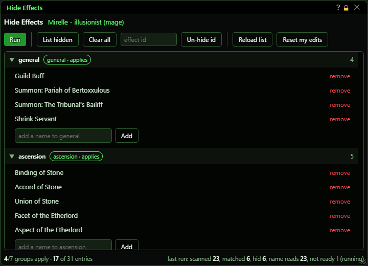
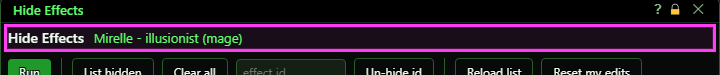
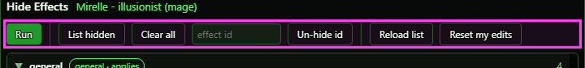
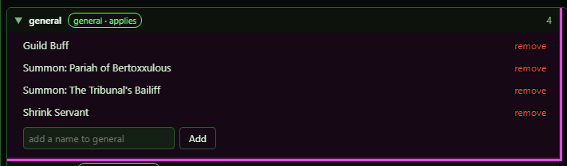
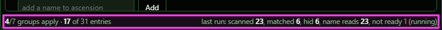
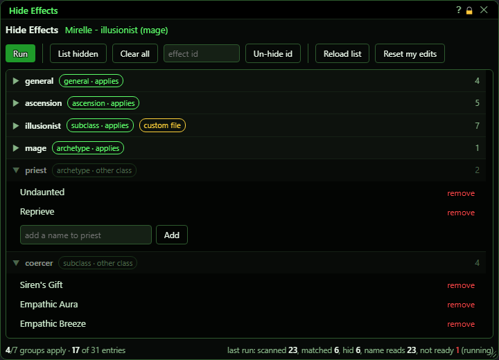
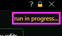
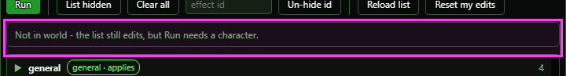

# Hide Effects

**OgreBot is in beta testing.** Looking for OgreBot Classic? [Click here](../../index.md).

> **:bulb: In game - the ? button on this window says**
>
> Hides clutter (guild buffs, pets, always-on class buffs) from your character's effects window, using lists of effect names.
>
> **What you can do here**
>
> - **Run** - check the effects on you and hide every one on a list for your class.
> - **List hidden**, **Clear all**, **Un-hide id** - see what the game is hiding, or show it again.
> - **Add** / **remove** - change the names in a group.
> - **Reset my edits** - undo every Add and remove you made, in all groups.
>
> **Good to know**
>
> - Nothing is hidden until you press **Run**. Effects that land later need another Run.
> - Removing a name does not un-hide it; use **Clear all** or **Un-hide id**.
> - Plain `ogre hideeffects` runs the hide; `ogre hideeffects panel` opens this window.

**Open it:** Type `ogre hideeffects panel`. If the window is already open, this does nothing. Plain `ogre hideeffects` does not open the window: it runs the hide straight away (the same as the Run button). `ogre end hideeffects` (or the window's X) stops a run and closes the window; effects already hidden stay hidden.

## What it is for

Hide Effects clears clutter out of your character's effects window. It keeps lists of effect names that nobody needs to see (guild buffs, pets, always-on class buffs and so on). When you press Run, it looks at every effect on your character and tells the game to hide the ones whose name is on a list that applies to you. The lists are split into groups: some apply to everyone, some only to one class or archetype. Your own additions and removals are kept in a separate file, so bot updates never undo them.

## Header

Shows the character, class and archetype the lists are matched against. 'run in progress…' appears on the right while a run is working.

## Buttons

| Control | What it does | Default |
|---|---|---|
| **Run** | Checks every effect on your character, one at a time, and hides each one whose name is on a list that applies to your class. A list name also matches the same name with a rank after it (for example 'Aspect of Genius' also hides 'Aspect of Genius IV'). The console says what it checked and what it hid. *It only runs when you press it; it does not keep hiding new effects afterwards. If you zone or log out while it is still checking names, the run is dropped - press Run again. Pressing it again during a run only says a run is already going.* |  |
| **List hidden** | Asks the game to print the list of effects it is hiding. The list appears in your EQ2 chat window, with the id of each one. |  |
| **Clear all** | Tells the game to show every hidden effect again. *No confirmation. Press Run to hide them again.* |  |
| **effect id (box)** | The id of one hidden effect, as shown by List hidden. Anything that is not a digit is removed. | empty |
| **Un-hide id** | Tells the game to show that one hidden effect again. Nothing happens if the box is empty. |  |
| **Reload list** | Reads all the hide lists from disk again. Use it after editing a list file by hand. |  |
| **Reset my edits** | Deletes the file that holds your Add and remove changes, so every group loses those changes at once. A list file you put in your own custom folder by hand is not touched. *No confirmation and no undo.* |  |

## The lists

One block per group, with the groups that apply to you first. The tag says what kind of group it is (general, ascension, subclass or archetype) and whether it 'applies' to you or is for an 'other class' (greyed out). A yellow 'custom file' tag means the group comes from a file in your own folder. The number on the right is how many names are in it.

| Control | What it does | Default |
|---|---|---|
| **Group name / arrow** | Click to fold a group away or open it again. Display only - changes what you see, not what the bot does. | open |
| **remove** | Takes this name off the group, so Run no longer hides it. Saved at once in your own file. *It does not show the effect again if it is already hidden. Use Clear all or Un-hide id for that.* |  |
| **add a name to <group> (box)** | Type the name of an effect to add to this group. Capital letters do not matter. | empty |
| **Add** | Adds the typed name to this group and saves it at once in your own file. Nothing happens if the box is empty. *The name is not checked against the game, so a typo is saved and simply never matches.* |  |

## Footer

Left: how many groups and names apply to your character. Right: the last run - how many effects it checked, how many were on your lists, how many it hid, how many effect names it had to look up, and how many it could not read in time ('not ready', in red). The note in brackets says how the run went, for example 'running' while it hides and 'done' when it has finished.

## What the window shows

- Header: character name - class (archetype). '(no character)' before a character is loaded.
- 'run in progress…': a run is still checking names or hiding effects.
- Grey 'Not in world' bar: you can still edit the lists, but Run needs a character in the world.
- Group tag 'applies' (green): this group is used for your character. 'other class' (grey): it is not, but you can still edit it.
- 'custom file' (yellow): the group comes from a list file in your own save folder.
- Footer 'last run': scanned = effects checked, matched = on your lists, hid = hidden, name reads = names looked up, not ready = names the game never supplied in time.
- The window keeps itself up to date: the 'run in progress' marker, the footer and the 'Not in world' bar change on their own as a run goes and when you zone, within about a second.

## Good to know

- Nothing is hidden until you press Run (or type `ogre hideeffects`). New effects that land later are not hidden until you run it again.
- Removing a name from a list does not un-hide it. Use Clear all or Un-hide id.
- If one effect name is in two applying groups, the first group (general, then ascension, then your class, then your archetype) is the one credited.
- Reset my edits undoes all your Add/remove changes in every group at once (a list file you added by hand stays).

### More groups, folded

Groups for other classes are listed after yours, greyed out:

### While a run is working

### Not in the world

