

**OgreBot is in beta testing.** Looking for OgreBot Classic? [Click here](../../index.md).

# Instance Controller

> **:bulb: In game - the ? button on this window says**
>
> Runs zones for your group, one after another: travels in, fights through the zone, and moves on to the next.
>
> **What you can do here**
>
> - **Queue zones**: pick a zone on the left and double-click it (or Add). **Add all** queues every zone the list is showing (this folder, after the search and the variant filter), in its order. Drag rows to reorder.
> - **Sort** (beside the Zones heading): the zones are listed by their number by default (**Sort: #**); click it for **Sort: A-Z**, by zone name. It is remembered, and Add all follows it.
> - **Remove** and **Clear** sit beside the Queue heading. Remove takes out the highlighted row (click a row first; right-clicking the highlighted row does the same), Clear empties the queue. Each is greyed out until there is something for it to do.
> - **Stop after this zone** (shown while a list runs): the zone you are in finishes, then the list stops and the end-of-list actions run (call to the guild hall or home, camp). Run clears it.
> - **Run** starts the list. **Pause** holds the Instance Controller only (OgreBot keeps running). **End** stops the run. While the end-of-list actions run (guild hall, home, camp), End cancels them: nothing more starts, and the client is not closed.
> - **Options** decide what happens in and after each zone: loop the list, reset zones first, call home at the end, and more.
> - **Summon merc if solo** (on by default): once you are inside the zone with nobody else in your group, it summons your mercenary (`merc resume`). On a zone-in that happens as you land, so the mercenary gets the rebuff time too.
> - **Every option is also a command**: `ogre ic -skipshinies` turns one on, `ogre ic -skipshinies=off` turns it off, and one command can carry several. `ogre ic options` lists them all.
> - **Zone file**: IC File Option 1-3 and IC File Args are for the zone you run. The zone file names the options and reads them.
> - **Startup Options** are commands sent at the start of every zone, then undone when the run ends.
>
> **Good to know**
>
> - Closing this window stops a running list, the same as End.
> - If a zone fails, the group stays in that zone and the list stops.
> - Every zone file must say how it leaves the zone (a `zoneOut` step). A zone file with a problem still shows in the list, in red and marked "not valid": click it, and the bar under the list says what to fix. It cannot be queued until it is fixed.
> - While IC travels the group to a zone, OgreBot is paused, so buffs that drop at each zone line are not recast out in the world. A toon that gets attacked on the way is resumed to fight, then paused again. On arrival everyone is resumed and has a few seconds to rebuff before the zone starts.
> - Settings (including Max wait per zone) and the queue are saved, and shared by every character on this PC.

**Open it:** Type `ogre ic` (or `ogre ic panel`) in the console. It opens at 775x460. If the window is already open, the command does nothing.

[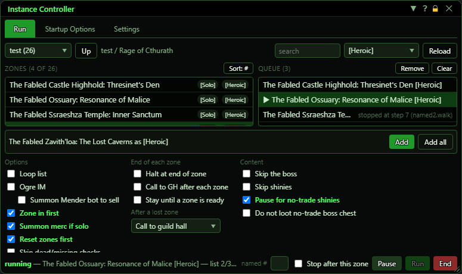](../assets/ic/run.png "Click for full size")

## What it is for

The Instance Controller (IC) runs a list of instanced zones for you, one after another. You browse the zone files, queue the zones you want (each stamped with a variant such as [Heroic]), then press Run. For each row IC travels the group to the zone (resetting it first if asked), applies your Startup Options, walks the zone file's steps (paths, nameds, chests, shinies) and zones out, then moves to the next row. When the list is done it can call the group home, camp out, or loop back to the top.

## Title bar and tabs

[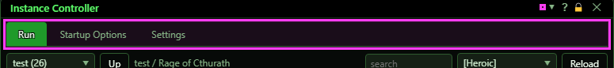](../assets/ic/titlebar.png "Click for full size")

| Control | What it does | Default |
|---|---|---|
| **▼ / ▲ (minimize)** | Minimizes the window to its title bar and a one-line strip showing the run status, Pause and Expand. Clicking again restores it. Double-clicking the title bar does the same. Display only - changes what you see, not what the bot does. *The window keeps its width; it always opens at its normal size.* | normal size |
| **Close (X)** | Closing the window STOPS a running list, exactly like End (the reason shown is 'ended'), and turns IC's pause off. `ogre end ic` does exactly the same. *Closing is not just hiding the window. It does NOT cancel end-of-list actions that are already running (use End for that), so closing the window on the way out never undoes an armed camp.* |  |
| **Run / Startup Options / Settings** | Switches the page you see. Display only. | Run |

## Minimized

[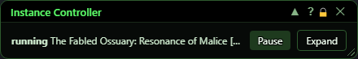](../assets/ic/shrunk.png "Click for full size")

| Control | What it does |
|---|---|
| **Pause / Resume** | Same as the Pause button at the bottom. Turns IC's own pause on or off. OgreBot's pause is not touched. *Only visible while the window is minimized.* |
| **Expand** | Restores the full window. |

## Run tab - choosing zones

[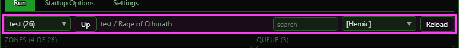](../assets/ic/run-topbar.png "Click for full size")

| Control | What it does | Default |
|---|---|---|
| **Root dropdown (e.g. "test (4)")** | Picks which of the three content roots to browse: default, test or custom. Each shows how many files it has. Picking one goes to that root's top folder and clears the selected file. The choice is saved. *Browse choice only. The roots have no priority order. The count is the files that load; a root can also list files that are not valid (red).* | default; on first ever open it auto-jumps to the first root that has files |
| **Up** | Goes up one folder in the browse list and clears the selected file. *Disabled at a root's top level.* |  |
| **search** | Filters the browse list to files whose zone name or path contains the text. Not case-sensitive. It applies about 0.2 seconds after you stop typing. *Not saved, so it clears when the extension reloads.* | empty |
| **any variant / [Solo] / [Heroic] / ...** | Two jobs. (1) Hides files that do not have this variant. (2) Every zone you queue is tagged with this variant, which decides which instance the zone-in travels to. 'any variant (browse only)' turns the filter off and tags nothing. The choices are every variant found in the loaded zone files. Saved. *With 'any', queuing a file that has 2+ variants pops up a pick-one menu at the row.* | any variant |
| **Reload** | Re-reads every zone file from the three roots. Prints 'N zone(s) from M file(s) - X skipped, Y warning(s)'. The selected file is cleared if it no longer exists. A zone file with a problem (for example one that does not say how it leaves the zone) is not valid: it shows in the list in red, and clicking it says why (see Write your own zone files). *A queued row whose file vanished fails with 'press Reload' when the row starts.* |  |

## Run tab - the zone list

[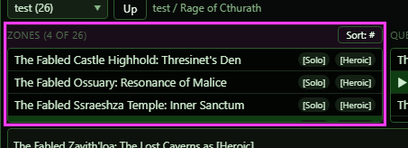](../assets/ic/run-zones.png "Click for full size")

| Control | What it does | Default |
|---|---|---|
| **Sort: # / Sort: A-Z** | Flips the order of the Zones list: by the files' number (Sort: #, the default) or by zone name (Sort: A-Z). The button names the order shown. Add all queues in the same order. Saved. | Sort: # |
| **Folder row (name + file count)** | Single click opens that folder. |  |
| **Zone row (click)** | Selects the file. The add bar then shows its name, and its difficulty menu if it has one. *Zone files marked as disabled are hidden.* |  |
| **Zone row (double-click)** | Adds the zone to the end of the queue, tagged with the chosen variant and the remembered difficulty. With no variant chosen: a file with 0 or 1 variants is added directly; a file with 2 or more opens a pick-one popup at the row. The pick is checked against the zone file; a pick it does not allow is refused, and the error lists the allowed values. The new row becomes the highlighted one. *The popup pick is one-off. It does not change the variant filter. A zone file that is not valid shows in red with a "not valid" chip: a click selects it and the bar under the list gives every reason; it cannot be queued (Add is greyed out, and a double-click says why).* |  |

## Run tab - the queue

[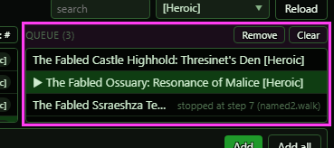](../assets/ic/run-queue.png "Click for full size")

| Control | What it does |
|---|---|
| **Queue row (click)** | Highlights the row. This is the target for Remove and for right-click remove. It does NOT choose where Run starts. |
| **Drag a row** | Press a row and drag it up or down to reorder the queue - anywhere on the row; the drag starts once the mouse moves a few pixels, so a click is never taken for a drag. It is a move, not a swap: rows in between shift one place. The moved row becomes highlighted. Saved. *It works even while a list is running.* |
| **Right-click a row** | Removes the row, but only if it is already the highlighted one. A right-click on any other row does nothing (it is only noted in the log). *The highlight is the confirmation step.* |
| **Remove** | Removes the highlighted queue row (right-clicking the highlighted row does the same). Saved. *Greyed out until a row is highlighted - click one first. Not blocked while a list runs.* |
| **Clear** | Empties the whole queue, with no confirmation. Saved. *Greyed out while the queue is empty. Not blocked while a list runs.* |

## Run tab - adding to the queue

[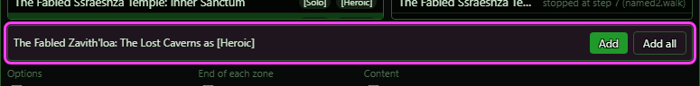](../assets/ic/run-addbar.png "Click for full size")

| Control | What it does | Default |
|---|---|---|
| **Difficulty ('choose…' until set)** | A difficulty that stays chosen while you browse. It is added to rows queued from files that have a difficulty menu, and checked against that file when you add. The bot does NOT use it during a run yet: when the row starts, IC only logs 'the difficulty on this row is recorded but not acted on yet'. *Only shown when the selected file has a difficulty menu (a list of choices). Saved.* | empty |
| **Difficulty number box (e.g. '1-80')** | Same as the Difficulty dropdown, for files that use a number range. It takes effect when you press Enter or click away. Also recorded only, not used yet. *Only shown when the selected file uses a range. The range is checked when you add, not while you type.* | empty |
| **Add** | Queues the selected file exactly like a double-click, including the variant popup. *Disabled until a file is selected.* |  |
| **Add all** | Queues every zone the Zones list is showing (this folder, after the search and the variant filter), in the list's order, each tagged with the variant chosen up top and the remembered difficulty. With no variant chosen, a file with 2 or more variants is left out. One console line says how many were added and why any were left out (already queued, needs a variant, refused). *Greyed out when the list shows no zone files (folders are not zones). A zone already in the queue is not added again.* |  |

## Run tab - options

When the window is too short for every option, the option grid scrolls (the lists and the footer stay on screen). The picture here is the grid as it opens; the next section's picture is the same grid scrolled down. Every tick-box is also a console switch, and `ogre ic options` lists them all.

[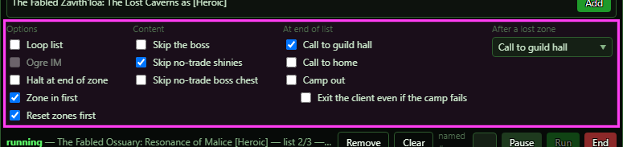](../assets/ic/run-options.png "Click for full size")

| Control | What it does | Default |
|---|---|---|
| **Loop list** | After the last row finishes, the list starts again at row 1. It is read again before each next row, so unticking it during a list ends the list at its last row. When a whole pass only skipped zones (every zone on the list locked), the list waits until the first lockout ends instead of going round again at once. It is turned OFF automatically when a safety check stops the list: fewer than 10 free inventory slots, the group shrank, or a member is dead. *A zone never starts again inside the instance it just finished. If a zone's exit did not take the group out, the list stops and says why; Stop and Run starts it where you stand. Also a console switch: `ogre ic -loop` (`=off` turns it off).* | off |
| **Ogre IM** | Between zones, at most once every 30 minutes, runs the Inventory Manager (`ogre im -destroy -tse`) and the list waits for it. In a guild hall it also uses the depot and sells (`-depot -sell`), then the group repairs. The first one is due 30 minutes after the list starts. One that comes due while you are flying or dead is skipped until the next 30 minutes. *Only after a zone that ran (not one that was skipped), and not when Stop after this zone ends the list. If the IM is still going after 30 minutes, the list goes on without it. Also a console switch: `ogre ic -im` (`=off` turns it off).* | off |
| **Summon Mender bot to sell** | With Ogre IM, outside a guild hall: the IM also sells to a mender bot (`-sell`). A mender bot already within 10 m is used; otherwise, when a Mechanized Platinum Repository of Reconstruction is in your bags and ready, IC uses it to summon one. The bot is targeted so the sell picks it. The sell waits (up to a minute) for the automatic repair at the bot to end, because that repair closes the bot's window. *No item, item not ready, or no bot 15 seconds after the summon: the IM runs without the sell, and the log says why. Does nothing in a guild hall (it has its own merchant) or with Ogre IM off. Also a console switch: `ogre ic -summonMenderToSell` (`=off` turns it off).* | off |
| **Zone in first** | When a row starts and you are not standing in its zone, the travel system takes the whole group there (the queued variant picks the instance), and the file starts on arrival. The group's bots are paused for the trip, so buffs that drop at each zone line are not recast out in the world. On arrival IC waits for the group (up to 2 minutes, then it names who is missing and goes on), resumes everyone and gives 8 seconds to rebuff before the file starts. If there is no route, IC warns and runs where you stand. Off = always runs where you stand. *Zoning in always runs the file from the top; a named # or Resume point is dropped. Zone-in gives up after 20 minutes. Also a console switch: `ogre ic -zoneIn` (`=off` turns it off).* | ON |
| **Summon merc if solo** | Once inside the zone, when nobody else is in your group (your mercenary not out either), IC summons your mercenary (`merc resume`). On a zone-in it happens as the group lands, so the mercenary gets the rebuff time too; when you start already standing in the zone, it happens as the run starts. *A character with no mercenary hired just gets the game's own one-line answer. Also a console switch: `ogre ic -summonMercIfSolo` (`=off` turns it off).* | ON |
| **Reset zones first** | Only during a zone-in. It first checks the lockout table (read again from the Zone Reuse window if the bot's copy is more than 15 minutes old; if it cannot be read within 30 seconds, the zone-in goes ahead without the check). Locked and not resettable: the zone is SKIPPED and the list moves on. Otherwise it runs 'oc !c -ResetZone igw:<you> <zone>' so every member resets, then travels. Off = lockouts are not checked; the group goes into the instance it is locked to. *A locked zone that cannot be reset is skipped, not failed. This option never spends a Force reset charge. Also a console switch: `ogre ic -resetZones` (`=off` turns it off).* | ON |
| **Skip dead/missing checks** | The list does NOT stop when someone has left the group or a member is dead - checked when Run starts and before each next row. The free inventory slots check (at least 10) still stops it. *Without it, either one stops the list, turns Loop list off and runs the end-of-list actions. Also a console switch: `ogre ic -skipGroupChecks` (`=off` turns it off).* | off |
| **Halt at end of zone** | When a zone's steps finish cleanly, IC pauses itself inside the zone, before the exit and zone-out steps. OgreBot keeps running. The Pause button becomes Resume; pressing it runs the zone-out and the list continues. If the group leaves the zone while held, the zone counts as done and IC stays paused until Resume. *A zone file's own zone-out step can do the hold instead. That way also sends an OgreConsole message and speaks '<name> IC' aloud (text-to-speech). Not applied to a failed zone. Also a console switch: `ogre ic -haltAtEnd` (`=off` turns it off).* | off |
| **Call to GH after each zone** | When a zone's steps are done (after any Halt at end of zone), the group is called to the guild hall INSTEAD of zoning out: the group's bots are paused, you run GetToGH and the rest of the group is sent the same, and the bots are resumed when everyone has landed. Nothing of the zone file's exit runs; the next zone starts from the guild hall. A call that fails, or takes more than 180 seconds, ends the zone all the same (a carry-on failure, like a failed exit). *When it is on, Stay until a zone is ready is not used. Also a console switch: `ogre ic -callGHAfterEachZone` (`=off` turns it off).* | off |
| **Stay until a zone is ready** | When a zone's steps are done, before the zone-out, the group waits INSIDE the zone until a zone still on the list can be run: not locked, or resettable. The zone you are in counts too: it is zoned out of, reset and run again. The lockout table is read once; when nothing is ready, it is read again when the first lockout among those zones ends. Untick it to let the group go. *Not used when Call to GH after each zone is on, or when Stop after this zone is ticked (there is no next zone to wait for). Also a console switch: `ogre ic -stayInZoneUntilZoneReady` (`=off` turns it off).* | off |
| **After a lost zone: Call to guild hall / Call to home / nothing** | When a zone is given up because all its wipe-recovery tries are used: everyone is revived first (up to 60 seconds), then this runs. 'Call to guild hall' = go to the guild hall (GetToGH), up to 180 seconds. 'Call to home' = cast Call to Home, up to 90 seconds. 'nothing' = revive only. The list then moves on to the next row. *A zone file with its own after-wipe list replaces this completely. Also a console switch: `ogre ic -afterWipe=callgh` (or `callhome`, `none`).* | Call to guild hall (callgh) |
| **Skip the boss** | A named that the zone file marks as the boss is not fought. It ends as 'skipped - Do NOT Kill Boss is on'. *Only affects nameds the zone file marks as the boss. Also a console switch: `ogre ic -skipBoss` (`=off` turns it off).* | off |
| **Skip shinies** | No shiny is looted at all: every shinies step of the zone file ends at once as 'skipped - the Skip shinies option is on'. *Wins over whatever the zone file says about no-trade shinies. Also a console switch: `ogre ic -skipShinies` (`=off` turns it off).* | off |
| **Pause for no-trade shinies** | In a shinies step, a shiny whose loot window holds a no-trade item is NOT looted: its window is left open for you and IC pauses itself (the group keeps playing), with a console message and a '<name> shiny' text-to-speech. Take the item, then press Resume; the step goes on to the next shiny. Loot everything is turned off for the group while the step runs, so the auto-loot leaves the item too. *A zone file that sets its own no-trade rule on the step overrides this option. Also a console switch: `ogre ic -pauseForNoTradeShinies` (`=off` turns it off).* | off |
| **Do not loot no-trade boss chest** | When the step for a named the zone file marks as the boss begins (before the kill), your Leader Only loot is set to take tradable items and Smart Loot only (not loot everything, no distribution, not in combat); your loot options are put back after the loot step. A Leader Only loot window that still holds a no-trade item is left open for you, with a console message and a '<name> boss chest' text-to-speech, and IC waits until it is gone. *Free For All windows are not touched - each character's own loot options take them. Non-boss chests loot no-trade items as usual unless the zone file says otherwise. The zone file's own no-trade rule overrides this. Also a console switch: `ogre ic -doNotLootNoTradeBossChest` (`=off` turns it off).* | off |

## Run tab - more options (scroll down)

[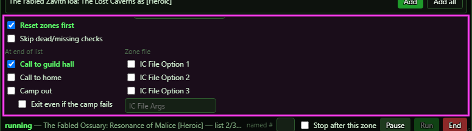](../assets/ic/run-options-more.png "Click for full size")

| Control | What it does | Default |
|---|---|---|
| **Call to guild hall** | When the list ends, pauses the group's bots and runs the go-to-guild-hall command (GetToGH) for you. It also sends 'oc !ci -GetToGH igwbn:<you>' so the rest of the group does the same. Waits up to 180 seconds, then moves on. *Ticking it unticks Call to home (only one can be on). Runs only when the list completes or a safety check stops it: NOT after a failed zone, NOT after End, NOT when a row could not start. Also a console switch: `ogre ic -callGH` (`=off` turns it off).* | off |
| **Call to home** | When the list ends, pauses the group's bots and casts Call to Home for you and the group through a console command. Done when a zone change is seen, or after 90 seconds. *Either/or with Call to guild hall. Same end-of-list triggers. Also a console switch: `ogre ic -callHome` (`=off` turns it off).* | off |
| **Camp out** | After any call to the guild hall or home, camps the whole group: the rest of the group is sent a camp-to-desktop first, then this character camps to the login screen. Each client closes once its character has left the world. If this character's camp is still busy after 120 seconds, or the character is still in the world afterwards, the camp counts as failed. *Same end-of-list triggers as Call to guild hall. The others' camp is their own, with its own retry. Also a console switch: `ogre ic -campAtEnd` (`=off` turns it off).* | off |
| **Exit even if the camp fails** | Only with Camp out on. If this character's camp failed, runs 'exit' and closes the client with the character still in the world, with a loud warning in the log. The rest of the group is also sent an exit with a 90-second countdown along with its camp, so a client whose camp failed is closed too (one whose camp worked is gone by then). *Does nothing without Camp out. Also a console switch: `ogre ic -exitIfCampFails` (`=off` turns it off).* | off |
| **IC File Option 1 / 2 / 3** | Three tick-boxes for the zone file you run: the zone file decides what each one means and reads it (`ISXOgreEQ2.IC.FileOption[n]` in a script, `{{ic.options.fileOption1}}` in the file). Each box shows the name the zone file gives it (its `fileOptions`, or what its running script set with `ISXOgreEQ2.IC:SetFileOptionLabel`), else 'IC File Option 1', 2 or 3. Saved. *The names follow the zone that is running, else the file selected in the Zones list. A zone file that does not use them ignores them. Also console switches: `ogre ic -fileOption1` (2, 3; `=off` turns one off).* | off |
| **IC File Args** | Text for the zone file to read (`ISXOgreEQ2.IC.FileArgs` in a script, `{{ic.options.fileArgs}}` in the file). It is sent and saved when you press Enter or leave the box, not on every key. *Also a console switch: `ogre ic -fileArgs=<text>`.* | empty |

## Run tab - bottom row

[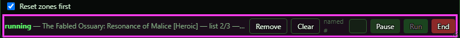](../assets/ic/run-footer.png "Click for full size")

| Control | What it does | Default |
|---|---|---|
| **named #** | Type which named you are on (1, 2, 3...) and press Enter, or just press Run. Only works for the queue row whose zone you are standing in: that row's next run starts at that named's lead-in (its walk and pre-fight steps). The row shows 'start at step N (named X)'. Used once. 1 or blank = from the top. If you are not in a queued zone, it is ignored with a warning. *The box empties once it is used. A file with no such named is refused.* | blank |
| **Stop after this zone** | Shown only while a list runs. The zone you are in finishes as always (its steps, then Halt at end of zone or Call to GH after each zone), then the list stops as if that were its last row - no Ogre IM, no loop wait, no next zone, no Stay until a zone is ready - and the end-of-list actions run. Untick it to carry on. *Run clears it, and so does the list stopping. Not saved. A failed zone still stops the list without the end-of-list actions. Also a console switch: `ogre ic -stopAfterZone` (`=off` turns it off).* | off |
| **Pause / Resume** | Turns IC's own pause on or off. While paused, IC does nothing: no zone steps advance, the zone-in stops, and the list waits. Actions already started keep going. OgreBot's pause is NOT touched. Also releases a Halt at end of zone hold. *The window keeps updating while IC is paused (for example when OgreBot is paused or resumed). Run also clears the pause.* | running |
| **Resume** | Only shown when you stand in a queued zone whose last run was stopped mid-zone. That row restarts at the step where it stopped, then Run fires. *The stop point is not saved to disk.* | hidden |
| **Run** | Starts the list. It starts at the queue row for the zone you are standing in, otherwise row 1, never the highlighted row. It clears IC's pause, checks the row's choices against the zone file again, and runs the safety checks (at least 10 free slots, nobody dead). Each row then runs in turn: zone-in, apply startup options, zone steps, exit. *Greyed out while running, while the end-of-list actions of the last list are still going (press End to cancel them first), with an empty queue, or if OgreBot is not loaded with a profile. Refuses right after a zone-in while the bot is still learning what is around it. A failed zone stops the list and IC stays in the zone.* |  |
| **End** | Stops the run where it stands and clears IC's pause. The current step is cancelled, exit steps do NOT run, and the list stops. The stop step is remembered for Resume, and the startup options are reverted. During a zone-in, IC's travel route is stopped and the group stays put. End-of-list actions are not triggered. For a zone run by a LavishScript (.iss) file, IC stops following it but the script itself keeps running. While the end-of-list actions are running, End cancels them: nothing that has not started yet runs (no camp, no exit), and an unfinished camp is stopped so the client is not closed. A trip to the guild hall or a Call to Home already under way finishes on its own, and the group stays paused - resume OgreBot when you are ready. The console says what was left behind. *Greyed out only when nothing is running and no end-of-list action is running. If the game had already begun the /camp countdown, the camp can still take the character to the login screen; the client stays open.* |  |

## Startup Options tab

[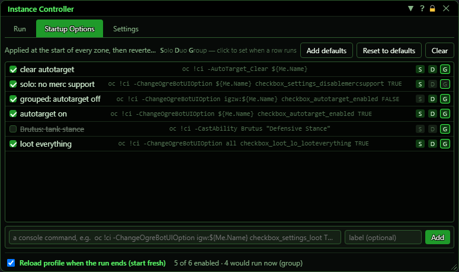](../assets/ic/startup.png "Click for full size")

| Control | What it does | Default |
|---|---|---|
| **Add defaults** | Appends the 22 shipped default rows to your list. Existing rows are kept, so pressing twice gives duplicates. *The very first time (before any IC settings are saved) the list starts with the defaults.* |  |
| **Reset to defaults** | Replaces your whole list with the shipped defaults. The 'Reload profile when the run ends' checkbox is left as is. *No confirmation.* |  |
| **Clear** | Empties the startup list. It stays empty; the defaults are not added back. *No confirmation.* |  |
| **Startup row (click)** | Highlights the row. Display only; you need it before a right-click remove. |  |
| **Checkbox** | Enables or disables the row without deleting it. A disabled row is struck through and never runs. | enabled |
| **S / D / G** | Turns on or off whether the row runs when solo, duo or grouped. Players are counted and mercenaries are not: 1 = solo, 2 = duo, 3+ = group. The mode you are in right now is ringed. You cannot turn off the last lit letter (a warning is shown). | S, D and G all on for a new row |
| **Drag a row** | Press a row (not its tick box or S/D/G chips) and drag it up or down to reorder; the drag starts once the mouse moves a few pixels. It is a move, not a swap. Order matters because rows run top to bottom. |  |
| **Right-click a row** | Deletes the row, but only if it is the highlighted one. *Here the window itself does the check; for the queue the bot does it.* |  |
| **a console command, e.g. oc !ci -ChangeOgreBotUIOption igw:${Me.Name} checkbox_settings_loot TRUE** | The command for a new row. It is run exactly as written, as a console command, at the start of every zone. *${Me.Name} is expanded when the row runs.* | empty |
| **label (optional)** | An optional display name for the new row. If blank, the command itself is shown. | empty |
| **Add** | Adds the typed command as a new row: enabled, runs in solo, duo and group. Refused if the command is blank. *Clears both boxes after adding.* |  |
| **Reload profile when the run ends (start fresh)** | This is how startup options are undone. When a zone run ends for any reason (completed, failed, stopped, skipped) and startup rows were applied, IC reloads your OgreBot profile. If you were not solo, it also sends 'oc !ci -LoadProfile igwbn:<you> Use_UI' so every member reloads its own profile. This also throws away any change you made by hand mid-run. *Skipped if the list is empty or the run ended before the rows went out.* | ON |

## Settings tab

[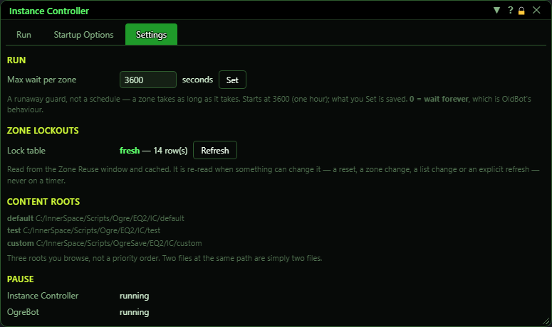](../assets/ic/settings.png "Click for full size")

| Control | What it does | Default |
|---|---|---|
| **Max wait per zone (seconds) + Set** | A safety limit. A zone still running this many seconds after it started is stopped where it stands. 0 = no limit. Text that is not a number changes nothing; a number below 0 is set to 1, and a fraction is rounded up to whole seconds. Applies to normal zone files and to zones run by a LavishScript (.iss) file. *Saved with the other IC settings (panel.json), so it survives a reload. Time IC spends paused or halted, and time spent staying in a finished zone, does not count toward it.* | 3600 (60 minutes) |
| **Refresh** | Marks the bot's copy of the lockout table as out of date. It does NOT read it now: the table is re-read from the Zone Reuse window the next time a zone-in needs it. *The status shows 'stale' until then.* |  |

## What the window shows

- Root dropdown: the root name plus its file count, e.g. "test (4)".
- Breadcrumb: <root> or <root> / <folder>.
- Zones list header: "Zones (shown of total loaded)".
- Zones list folder rows: ▸ name, then the number of files under it.
- Zones list file rows: the zone name (or path) plus chips - one per variant (e.g. [Solo], [Heroic]) or "no variants"; a difficulty chip (a range "1-80" or choices "normal/expert"); ".iss" when the file hands the run to a LavishScript file. Hover shows the zone name and root/path.
- Zones list empty messages tell apart: "no zone files loaded", "this root is empty - try test (4)", "nothing in this folder matches", "nothing matches the filter".
- Queue header: "Queue (n)".
- Queue rows: label (zone name + variant), and grey sub-text - "diff X" when a difficulty is set; "start at step N (named 3)" when a start point is set; otherwise "stopped at step N (stepId)" when there is a Resume point. While a list runs, a ▶ marks the row it is on.
- Add-bar text: "Double-click a zone to queue it", or "<zone> as [Heroic]", or "<zone> — double-click to choose a variant".
- Status line (the first that applies is shown): 1. orange "HELD inside the zone" - zone - press Resume to zone out; 2. orange "Instance Controller is PAUSED"; 3. while running: bold state (zoning in / launching / running), the zone or zone-in destination and current travel hop, "list r/t (loop)", the phase (enter / steps / wipe / exit) with "(wipe recovery w of max[, given up])", "/ stepId", and a note; 4. orange "END OF LIST - <call to guild hall | call to home | camp | exit> in progress"; 5. "completed <zone> - note", orange "completed with failures <zone> - N step(s) did not do their job" (for example a named never spawned), or red "failed <zone> - note"; 6. red "OgreBot is not loaded - IC drives its verbs, so it needs a profile open"; 7. otherwise "N zone(s) loaded". A skipped zone shows as "completed" with the skip reason.
- Shrunk strip: a shorter version of the same status, e.g. "IC idle - N zone(s)".
- Startup Options rows: checkbox, label, grey monospace command, and S/D/G chips (lit = runs in that mode, ringed = your current mode).
- Startup Options status: "E of T enabled · K would run now (solo|duo|group)".
- Settings - Lock table: green "fresh - N row(s)" (read in the last 15 minutes and not marked out of date), or orange "stale", plus "a refresh is armed" while a re-read is waiting.
- Settings - Content roots: default = Scripts/Ogre/EQ2/IC/default, test = Scripts/Ogre/EQ2/IC/test, custom = Scripts/OgreSave/EQ2/IC/custom.
- Settings - Pause: Instance Controller and OgreBot, each "running" or orange "PAUSED".

## Good to know

- Closing the IC window ends the running list, exactly like pressing End. It does not just hide the window.
- Run starts at the queue row for the zone you are standing in, otherwise at row 1. The highlighted row does not decide where Run starts.
- Pausing IC does not pause OgreBot, and pausing OgreBot does not stop IC. A paused OgreBot with IC running is the normal way to move through a zone.
- The Difficulty setting is saved on the row but a run does not use it yet.
- When the window is short, the options scroll: scroll them down for At end of list and Zone file.
- A failed zone stops the list and leaves the group in that zone so it can be looked at. No end-of-list action (guild hall, home, camp) runs.
- A zone lost to a wipe is different: everyone is revived, the After a lost zone choice runs, and the list moves on.
- End-of-list actions run only when the list completes or a safety check stops it (fewer than 10 free bag slots, someone left the group, or someone is dead). Never after End.
- End cancels the end-of-list actions while they run. Anything not yet started never runs and an unfinished camp is stopped (the client is not closed); a trip to the guild hall or a Call to Home already under way finishes on its own. Closing the window does not cancel them.
- Camp out camps the whole group, not just the IC character.
- Zoning in always runs the zone file from the top. A named # or Resume point only applies when you are already standing in that zone.
- Reload profile when the run ends (on by default) reloads the profile of every group member at the end of each zone. It also throws away any change you made by hand during the run.
- The search text is not saved.
- All IC settings (including Max wait per zone), the queue and the startup list live in one file, Scripts/OgreSave/EQ2/IC/panel.json, shared by every character on the PC. Each session loads it once and overwrites it on every change.
- Refresh (Zone lockouts) does not read the lockout table straight away. It is re-read the next time a zone-in needs it.
- Add defaults appends the shipped rows again, so pressing it twice gives duplicates. Reset to defaults and both Clear buttons ask no confirmation.

