# Inventory Manager

**OgreBot is in beta testing.** Looking for OgreBot Classic? [Click here](../../index.md).

> **:bulb: In game - the ? button on this window says**
>
> Tidies your bags: deposit to depots, sell, destroy, transmute or salvage (TSE), restock from depots, trade to players, and fill your quiver.
>
> **What you can do here**
>
> - **Run tab** - Look shows in the console what a mode would do; Run starts it. While something runs, Run becomes Queue.
> - **Sell list / Destroy list** - double-click a left row to add it; right-click a right row to remove it.
> - **TSE, Depot, Restock** - saved options for those modes. Depot saves only when you press Save.
> - **Trade** - queue items for nearby players, then Run the queue.
> - **Stop** stops the work; **Close** only closes the window. The X (or `ogre end im`) does both.
>
> **Good to know**
>
> - The bag boxes on the Destroy list and TSE tabs decide which bags those runs touch.
> - Restock on the Run tab always uses the profile named Default.
> - Quiver refills with the ammo already in your quiver first, then the name on the Quiver tab.

**Open it:** Type `ogre im` (or `ogre inventorymanager`). Any `ogre im` command that starts work (for example `ogre im sell` or `ogre im -depot -sell -end`) also opens it. `ogre end im` stops the work and closes it.

[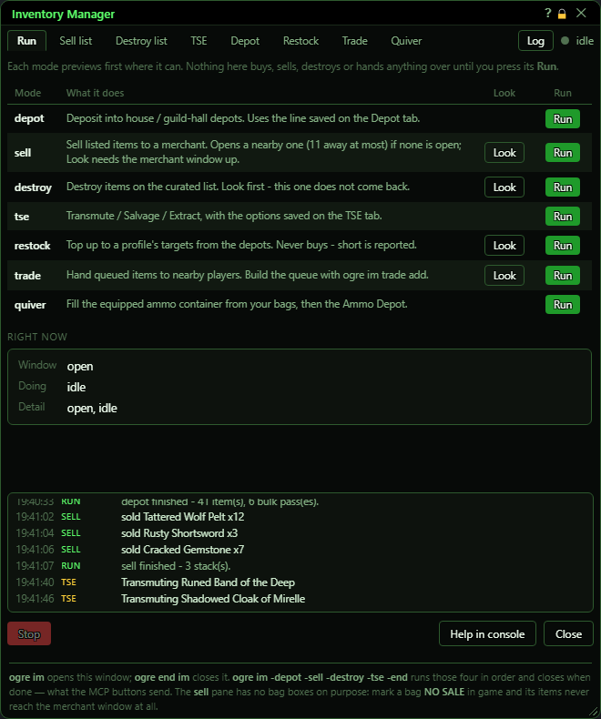](../assets/im/window.png "Click for full size")

## What it is for

The Inventory Manager (IM) tidies your bags. It can deposit into house and guild-hall depots, sell to a merchant, destroy junk, transmute or salvage gear (TSE), top up supplies from the depots (Restock), hand items to other players (Trade), and fill your quiver. The Run tab starts any of these; the other tabs hold each one's saved list or options. Every button sends the same `ogre im ...` command you could type yourself, and the log strip at the bottom shows one line per thing IM actually did.

## Header, tabs and the log settings

The tabs only change what you see. The dot and word on the right say whether IM is working and on what.

[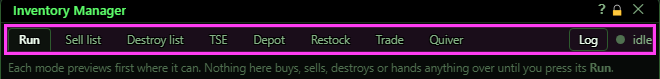](../assets/im/header.png "Click for full size")

| Control | What it does | Default |
|---|---|---|
| **Run / Sell list / Destroy list / TSE / Depot / Restock / Trade / Quiver** | Switches the page. Opening Sell list or Destroy list also rebuilds that tab's left-hand list (the merchant's items, or your bags). Otherwise display only. *Switching to Sell list does not walk to or open a merchant - it only reads a merchant window that is already open.* | Run |
| **Log** | Shows or hides the row of activity-log settings under the header. Display only. | hidden |
| **Always** | The activity log strip is always on screen. Saved. | on (this is the starting choice) |
| **Only while running** | The log strip appears only while a mode is working, and hides again when it is idle. Saved. *Showing and hiding the strip makes the whole window taller and shorter by the strip's height.* | off |
| **Never** | Hides the log strip for good. Saved. Use the Log button to get the setting back. | off |
| **Clear it** | Empties the activity log. |  |

## Run tab - the modes

One row per mode. Look prints what the mode would do in the console and changes nothing. Run starts it. While anything is running, every Run turns into Queue and every Look greys out (see the second picture).

[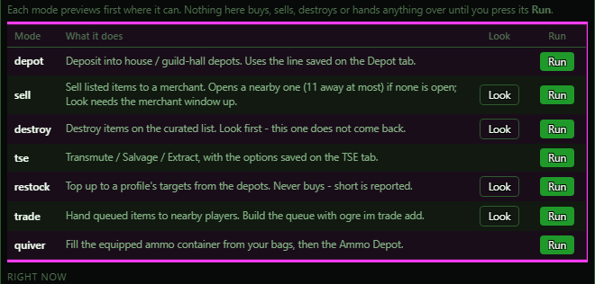](../assets/im/run-modes.png "Click for full size")

| Control | What it does |
|---|---|
| **Run (depot)** | Deposits into your house or guild-hall depots using the line saved on the Depot tab. *Greyed out if nothing is saved on the Depot tab. There is no Look for depot.* |
| **Look (sell)** | Lists in the console which items on your sell list the open merchant would buy. Sells nothing. *Needs a merchant window already open.* |
| **Run (sell)** | Sells every item on your sell list to a merchant, then closes the merchant window. If no merchant window is open, it opens one that is within reach first. *Stand next to a merchant. Bags marked NO SALE in the game are never offered.* |
| **Look (destroy)** | Lists in the console what the destroy run would destroy. Destroys nothing. |
| **Run (destroy)** | Destroys every item on your destroy list found in the bags ticked on the Destroy list tab. Destroyed items do not come back. *Use Look first. It only touches the bags ticked on the Destroy list tab (bags 1 and 2 to start with).* |
| **Run (tse)** | Transmutes, salvages and/or extracts items using the options saved on the TSE tab. *There is no Look for TSE.* |
| **Look (restock)** | Lists in the console what the Default restock profile still needs and which depots are in reach. Pulls nothing. *Always the profile named Default. To look at another profile use Preview on the Restock tab.* |
| **Run (restock)** | Pulls items from your depots until you hold the target amount of each row in the Default profile. It never buys anything; a shortfall is reported. *Always the Default profile. Use 'Run this profile' on the Restock tab for another one.* |
| **Look (trade)** | Walks the trade queue in the console: who is in reach and what would go in the first trade window. Hands nothing over. |
| **Run (trade)** | Hands each queued item to the player it names, one entry at a time. The other player must be nearby and accept the trade. |
| **Run (quiver)** | Fills your equipped quiver or pouch with ammo from your bags, then from the Ammo Depot. |
| **Queue (any mode, while something runs)** | Adds that mode to the waiting line. Queued modes run one after another, in the order you clicked, when the current one finishes. A dot or ×2 beside the mode name shows it is waiting. *Look buttons stay greyed out until everything has finished.* |

## Run tab - Right now

Read-only. Window says whether IM counts its window as open. Doing names the running mode (or idle). Detail shows that mode's current step. Queued (only when something is waiting) lists the modes still to come, in order.

[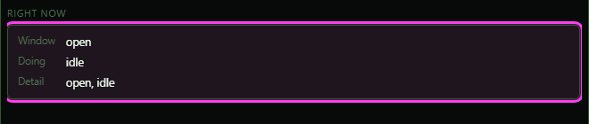](../assets/im/run-now.png "Click for full size")

## Sell list tab

Left: what the open merchant would buy from you (green = already on your sell list, xN = how many stacks). Right: your saved sell list. It fills by itself when you open a merchant window while this tab is showing.

[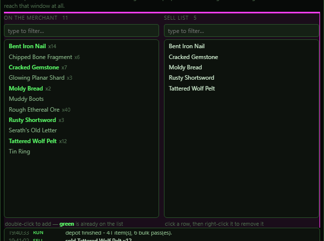](../assets/im/sell-panes.png "Click for full size")

| Control | What it does | Default |
|---|---|---|
| **type to filter… (left)** | Hides left-hand rows whose name does not contain the text. Not case-sensitive. Display only. | empty |
| **Double-click a left row** | Adds that item to the sell list (or destroy list on the Destroy tab) and saves it. The row turns green. *Adding an item that is already there does nothing.* |  |
| **type to filter… (right)** | Hides right-hand rows whose name does not contain the text. Display only. | empty |
| **Right-click a right row** | Removes that item from the list and saves it. |  |
| **Re-open merchant** | Reads the merchant again and refills the left list. If no merchant window is open it opens one within reach first (your last one, your target, or the nearest). Either way it then closes the merchant window. *It closes the merchant window even if you opened it yourself. If no merchant is within reach it says so in the console and the list is left as it was.* |  |

## Destroy list tab

Same two lists as the Sell tab: left is what is in your bags, right is your saved destroy list. Double-click and right-click work the same way.

[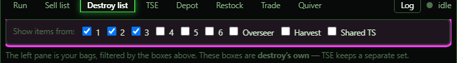](../assets/im/destroy-bags.png "Click for full size")

| Control | What it does | Default |
|---|---|---|
| **1 2 3 4 5 6** | Which of your six bags the destroy list works with: the left list shows their items, and Run destroy (and Look) only touch these bags. Saved. The list rebuilds as you tick. *The same boxes decide the left list and the run, so they always agree.* | 1 and 2 on |
| **Overseer** | Also use items in your Overseer bag, for the list and the run. Saved. | off |
| **Harvest** | Also use items in your Harvest bag, for the list and the run. Saved. | off |
| **Shared TS** | Also use items in your Shared Tradeskill bag, for the list and the run. Saved. | off |
| **Refresh** | Re-reads your bags and rebuilds the left list. |  |

## TSE tab

Everything here is saved, and a plain `ogre im tse` (or Run tse) uses it. Options typed on the command line still win for that one run.

[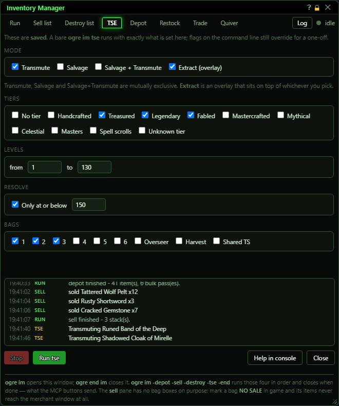](../assets/im/tse.png "Click for full size")

| Control | What it does | Default |
|---|---|---|
| **Transmute** | TSE transmutes the items it picks. Ticking it unticks Salvage and Salvage + Transmute. | on |
| **Salvage** | TSE salvages the items it picks. Ticking it unticks the other two. | off |
| **Salvage + Transmute** | TSE salvages or transmutes each item, whichever applies. Ticking it unticks the other two. | off |
| **Extract (overlay)** | Also extracts, on top of whichever of the three above is ticked. | off |
| **No tier, Handcrafted, Treasured, Legendary, Fabled, Mastercrafted, Mythical, Celestial, Masters, Spell scrolls, Unknown tier** | Which item tiers TSE may use. An item of an unticked tier is left alone. Each box saves as you click. *Treasured also covers Uncommon; Mastercrafted also covers Mastercrafted Legendary and Mastercrafted Fabled. Unknown tier is for a tier the bot has never seen (a new expansion).* | Treasured, Legendary and Fabled on; the rest off |
| **from** | Lowest item level TSE will use. Saved when you leave the box or press Enter. *If 'from' is above 'to', nothing qualifies and a warning shows beside the boxes.* | 1 |
| **to** | Highest item level TSE will use. Saved when you leave the box or press Enter. | 200 |
| **Only at or below** | When ticked, TSE only uses an item whose resolve is at or below the number beside it. When unticked, resolve is not checked at all. | off |
| **Resolve number** | The highest resolve TSE may use when 'Only at or below' is ticked. Saved when you leave the box or press Enter; you can set it before ticking the box. *With the box ticked, 0 means nothing qualifies.* | 0 |
| **Bags 1 2 3 4 5 6** | Which of your six bags TSE looks in. TSE's own set - separate from the Destroy tab's. Saved. | 1 and 2 on |
| **Overseer / Harvest** | Lets TSE also use items in your Overseer bag or your Harvest bag. Each box is for its own bag. | off |
| **Shared TS** | Lets TSE also look in your Shared Tradeskill bag. That bag holds crafting materials, so it rarely has anything TSE can use. | off |

## Depot tab

This builds the depot line a plain `ogre im depot` (and Run depot, and the -depot step of a chain) uses. Nothing is sent until you press Save; the line under 'The line this sends' shows what Save will store.

[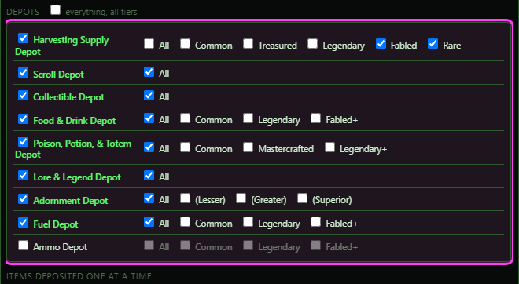](../assets/im/depot-rows.png "Click for full size")

| Control | What it does | Default |
|---|---|---|
| **Nearest** | Use whichever size of each depot is in reach. Ticking it unticks Small and Large. | on |
| **Small** | Use the regular-size depots. Can be on together with Large (it visits both). Unticks Nearest. | off |
| **Large** | Use the large depots. Can be on together with Small. Unticks Nearest. | off |
| **everything, all tiers** | Ticks every depot with All (including Ammo). Unticking it unticks every depot. *This includes the Ammo Depot, so a depot run would put your arrows back in the depot.* | off |
| **Depot name (Harvesting Supply Depot, Scroll Depot, ... Ammo Depot)** | Includes that depot. Ticking a depot with no tier beside it turns on its All. *Ammo is off by default because `ogre quiver` pulls ammo out of that depot.* | every depot on with All except Ammo Depot (off) |
| **All (beside a depot)** | Uses that depot's own Deposit All button: everything the depot accepts. Ticking it clears that depot's single tiers. | on for every depot except Ammo |
| **Tier boxes (Common, Treasured, Legendary, Fabled, Rare, (Lesser), ...)** | Deposit only these tiers into that depot, using the depot's own buttons. Each depot has its own set. Ticking one turns off All for that depot. | off |
| **Commons, Rares, Manas, Infusions, Powders, Fragments** | Deposits these harvested/refined items one at a time by name, into a ticked depot that takes them. This is how you say, for example, 'fragments but not powders'. *They only go into depots that are ticked above.* | off |
| **Arrows, Shurikens** | Deposits arrows or shurikens one at a time by name into the Ammo Depot. *Only works when Ammo Depot is ticked.* | off |
| **Back to saved** | Throws away your unsaved ticks and shows the saved line again. |  |
| **Save** | Saves the line shown above. From now on Run depot, `ogre im depot` and the -depot chain step use it. *Greyed out when no depot is ticked, no container size is ticked, or a ticked depot has nothing it could take (no tier, no All, and no item box that depot accepts - a red note says which).* |  |

## Restock tab

A profile is a list of items with a target amount. Rows that do not apply to this character (by For who) are dimmed. Changes save as you make them.

[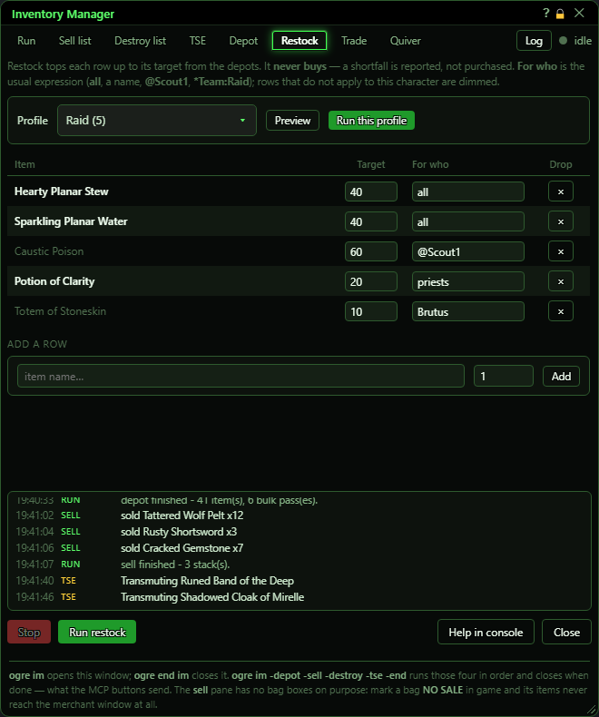](../assets/im/restock.png "Click for full size")

| Control | What it does | Default |
|---|---|---|
| **Profile** | Which profile this tab shows and edits. The number is how many rows it has. Display only. | the first profile (Default) |
| **Preview** | Lists in the console what this profile still needs and which depots are in reach. Pulls nothing. |  |
| **Run this profile** | Pulls items from your depots until you hold each row's target (only the rows meant for this character). Never buys. *Greyed out while IM is running something.* |  |
| **Target** | How many of that item to hold. Saved when you leave the box or press Enter. 0 removes the row. |  |
| **For who** | Which characters this row is for: all, a name, @Scout1, a class word such as priests, *Team:Name and so on. Saved when you leave the box or press Enter. Other characters skip the row. | all |
| **× (Drop)** | Removes that row from the profile and saves. |  |
| **item name…** | The exact name of the item for a new row. | empty |
| **Amount (next to item name)** | The target for the new row. | 1 |
| **Add** | Adds the row (for 'all') to the profile shown and saves. If the item is already there, its target is replaced. |  |

## Trade tab

A list of hand-overs: which item, how many, to whom. The list lives only until the game or the bot is restarted.

[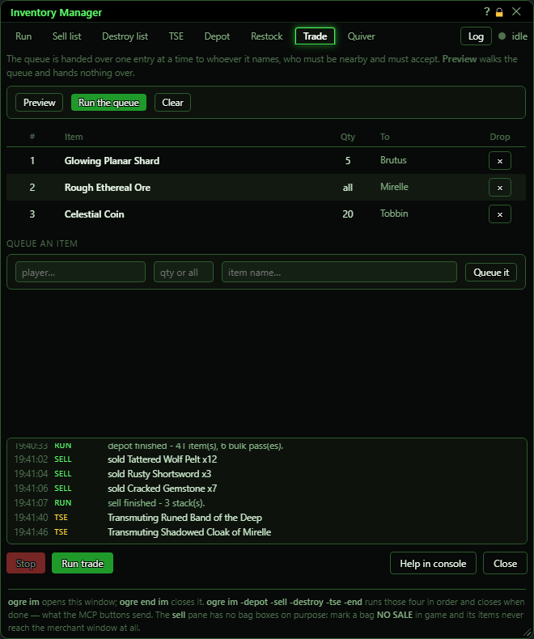](../assets/im/trade.png "Click for full size")

| Control | What it does | Default |
|---|---|---|
| **Preview** | Walks the list in the console: whether each player is in reach and what would go in the first trade window. Hands nothing over. *Greyed out when the list is empty.* |  |
| **Run the queue** | Opens a trade with each named player in turn and hands over the item. They must be nearby and accept. *Greyed out when the list is empty or IM is already running.* |  |
| **Clear** | Empties the whole list. |  |
| **× (Drop)** | Removes that one entry. The entries below it move up a number. |  |
| **player…** | Who gets the item. | empty |
| **qty or all** | How many to hand over. Empty or 'all' means every one you have. | empty (all) |
| **item name…** | The item to hand over. | empty |
| **Queue it** | Adds the entry to the end of the list. Needs a player and an item. |  |

## Quiver tab

[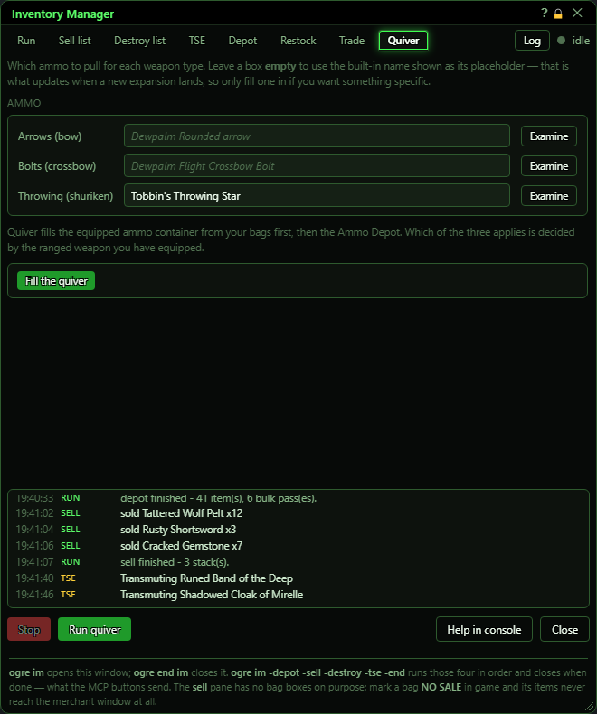](../assets/im/quiver.png "Click for full size")

| Control | What it does | Default |
|---|---|---|
| **Arrows (bow) / Bolts (crossbow) / Throwing (shuriken)** | The ammo name to refill with. Filling the quiver uses the ammo already in your quiver first, then this name, then the built-in name shown in grey. | empty (built-in name) |
| **Fill the quiver** | Fills your equipped quiver or pouch with ammo from your bags first, then from the Ammo Depot. The kind of ammo follows your ranged weapon and what is already in the quiver. |  |

## Button row and closing

[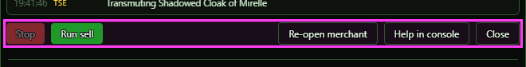](../assets/im/controls.png "Click for full size")

| Control | What it does |
|---|---|
| **Stop** | Stops whatever IM is doing: the running mode, the whole waiting line, and any depot pull still going. The window stays open. *Greyed out when nothing is running.* |
| **Run <tab> / Queue <tab>** | Starts the mode for the tab you are on - the same as that mode's Run on the Run tab (or Queue while something is running). *On the Restock tab this runs the Default profile, not the one you picked - use 'Run this profile' for that. Not shown on the Run tab.* |
| **Help in console** | Prints the list of `ogre im` commands in the console. |
| **Close** | Closes the window. A mode that is running keeps running. Cancels a pending -end, and closes a merchant window IM left open. *To stop the work and close, use `ogre end im`.* |
| **Title bar close (X)** | Stops the work and closes the window, the same as `ogre end im`. Also cancels a pending -end and closes a merchant window IM left open. |

## What the window shows

- Status dot and word (top right): grey and 'idle' when nothing runs; green and the mode's name while one runs.
- Yellow '-end is armed' notice: this window will close itself a moment after all the work finishes (started with `-end`, e.g. `ogre im -depot -sell -end`).
- Run tab, mode row highlighted with a dot: that mode is running now; its 'What it does' text is replaced by what it is doing.
- Run tab, dot or ×N after a mode name: that mode is waiting in the queue (N times).
- Sell and Destroy lists: green on the left = already on your list; xN = how many stacks of it there are.
- Restock rows in dim grey: not meant for this character (For who does not match).
- Activity log: one line per thing actually done - a stack sold, an item destroyed or transmuted, a depot emptied - plus a 'finished' line per mode. The coloured word is which mode did it.

## Good to know

- Restock's Look and Run on the Run tab (and 'Run restock' at the bottom) always use the profile named Default. Use the buttons on the Restock tab for another profile.
- Quiver refills with the ammo already in your quiver first, then the name on the Quiver tab.
- The Close button does not stop a running mode. The X (or `ogre end im`) stops it and closes the window; Stop stops it and keeps the window.
- The Depot tab saves nothing until you press Save.
- The trade list is not saved; it is lost when the game or bot restarts.

### While something is running

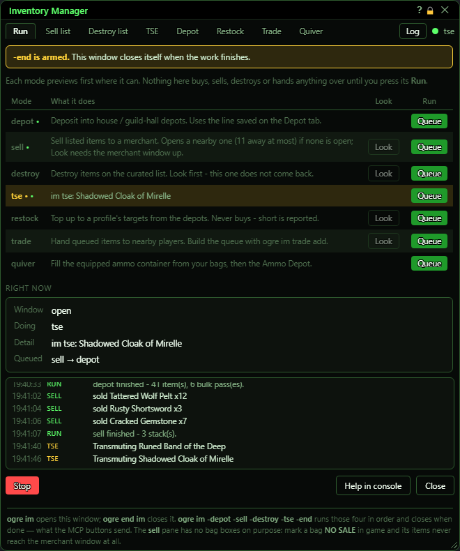

Every Run becomes **Queue** and the Look buttons grey out. Here TSE is running, sell and depot are waiting (Right now > Queued), and `-end` will close the window when all three are done.

### The activity log settings

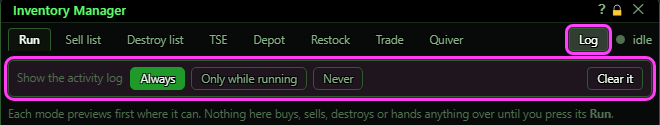

### Sell list and Destroy list

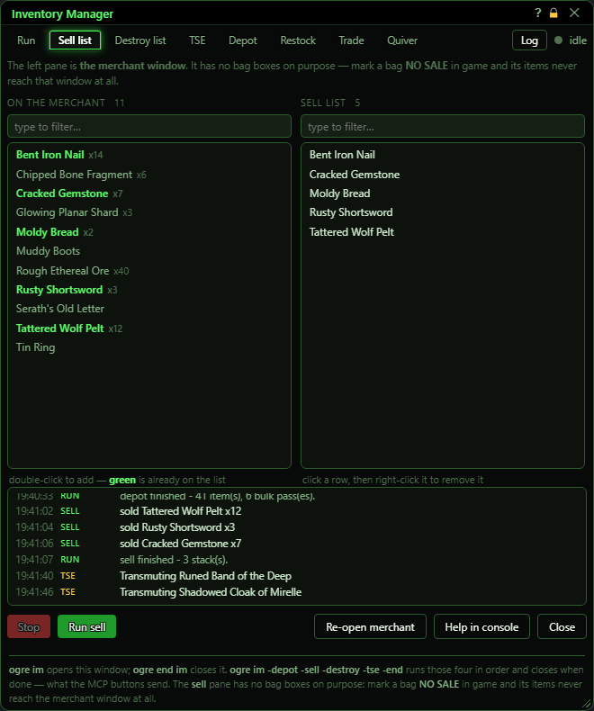

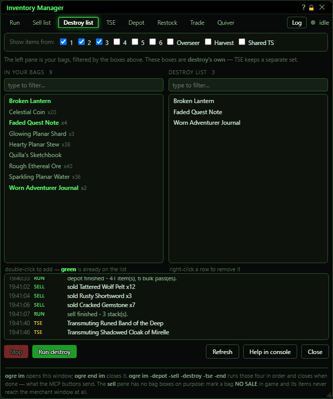

### Depot: a depot with nothing ticked

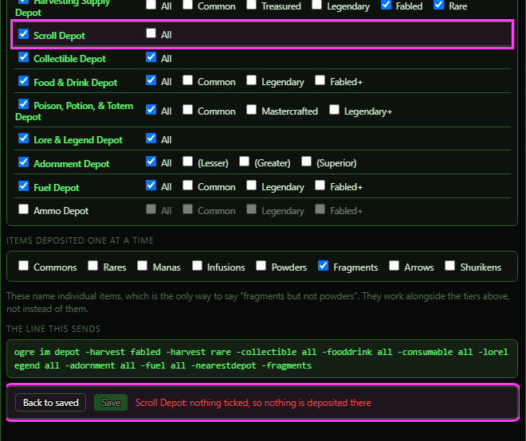

A depot that is ticked with nothing beside it would deposit nothing, so Save greys out and a red note names it.

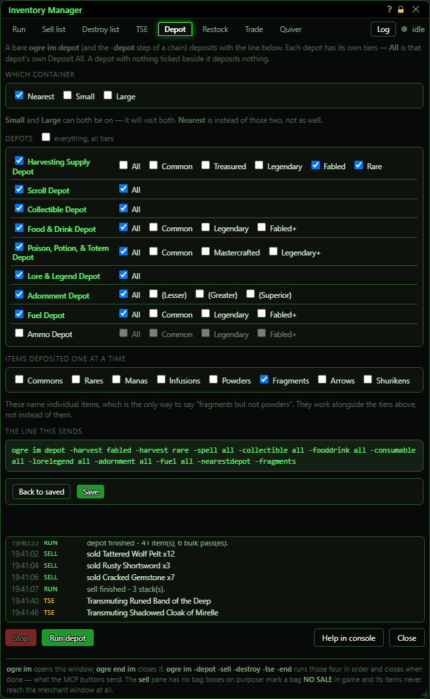
