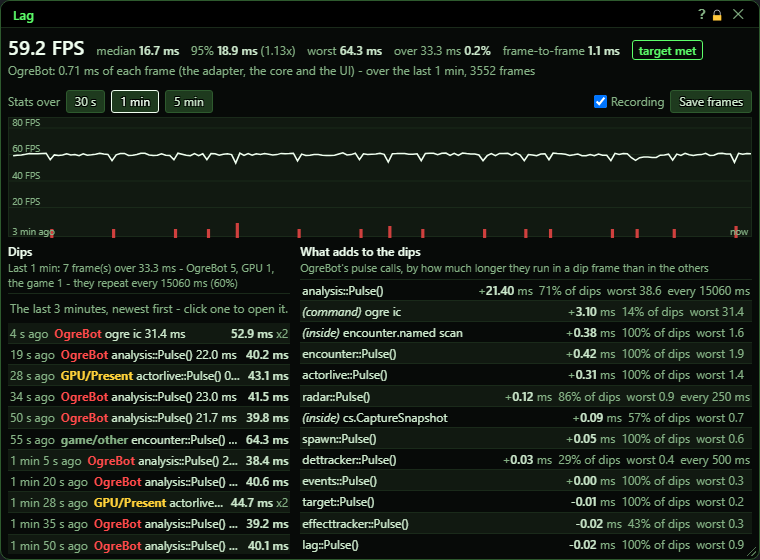
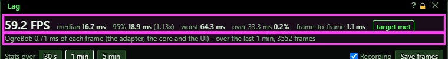
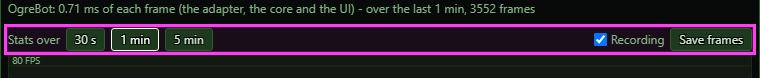
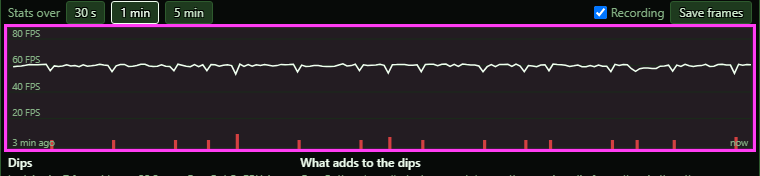
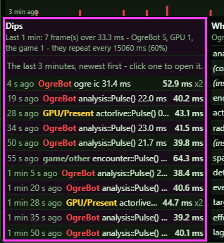
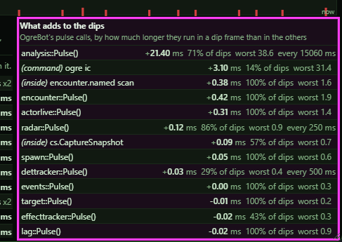
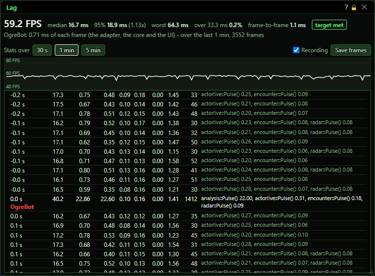
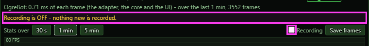
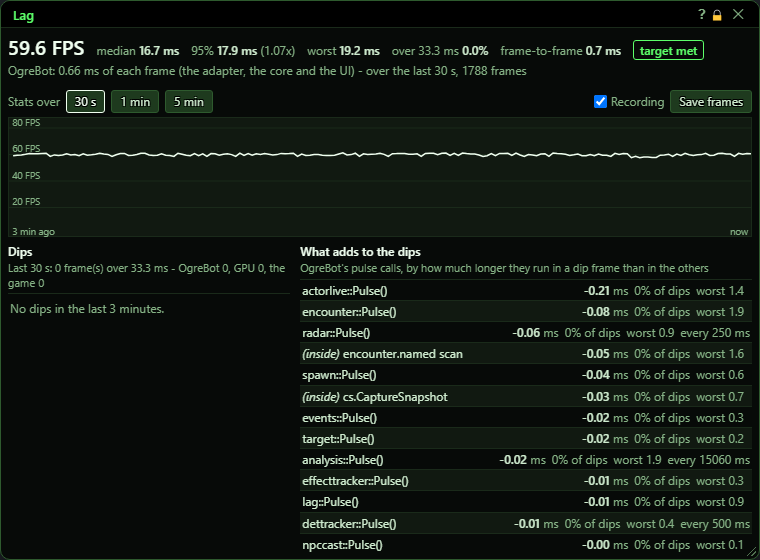

# Lag

**OgreBot is in beta testing.** Looking for OgreBot Classic? [Click here](../../index.md).

> **:bulb: In game - the ? button on this window says**
>
> Records every frame of the last few minutes - how long it took and what ran in it - so when your FPS drops you can open that moment and see why.
>
> **What you can do here**
>
> - **The line** is your FPS, one point a second, for the last 3 minutes. A red tick marks a second with a frame over the budget (33 ms = under 30 FPS).
> - **Dips** lists those moments, newest first, with what caused the worst frame: **OgreBot**, the **GPU** (the game waiting on the graphics card), or **the game** itself. Click one to open its frames.
> - **What adds to the dips** ranks OgreBot's calls by how much longer they run in a dip than in a normal frame, and how often they run.
> - **Stats over** picks the window the numbers at the top use (30 s, 1 min, 5 min).
> - **Save frames** writes every recorded frame to a file under `OgreSave\EQ2\OgreBot\` to send to us.
>
> **Good to know**
>
> - It is always recording, even with this window closed. Its own cost is `ogre lag overhead`.
> - The target is: 95% of frames under 1.5 x your typical frame, and under 2% of frames over 33 ms.
> - `ogre lag report` prints the same numbers to the console; `ogre lag off` stops recording.
> - It holds the last 5 minutes by default. `ogre lag minutes 30` holds 30 (about 23 MB) - use it before a long session you want to save.

**Open it:** Type `ogre lag`. `ogre end lag` (or `ogre lag close`) closes it. If the window is already open, typing `ogre lag` again does nothing.

## What it is for

A recorder for frame rate drops. The bot writes down every frame the game draws - how long it took, how much of that time was the bot's own work, and which parts of the bot ran in it - and keeps the last few minutes. When your FPS drops, open this window and click that moment to see the frames around it and what caused the slow one: OgreBot, the graphics card, or the game itself. It records all the time, even with the window closed, so you can look after the drop has happened. Most players only need it when the game stutters and they want to know whether the bot is the reason.

## The numbers at the top

Read-only. All of these use the period picked under Stats over (1 minute to start with). Frames while zoning or on a load screen are left out.

| Control | What it does |
|---|---|
| **FPS (the big number)** | Your average frames per second over the period. |
| **median, 95%, worst** | How long frames took, in milliseconds. Median is a typical frame. 95% means 95 frames in 100 were faster than this; the number in brackets is that time divided by the median (1.00x would mean every frame is even). Worst is the slowest single frame. |
| **over 33.3 ms** | The share of frames slower than 33.3 ms - that is, frames that drop you under 30 FPS. These slow frames are what this window calls dips. |
| **frame-to-frame** | How much one frame's time differs from the next, on average. A low number means smooth play, even if the FPS is not high. |
| **target met / target not met** | Green when the period was smooth: 95 frames in 100 took less than 1.5 times the median frame, and fewer than 2 in 100 frames were over 33.3 ms. Red when either is not true. Not shown when there are no frames yet. |
| **OgreBot: … ms of each frame** | How much of each frame, on average, was the bot's own work: all parts of the bot, drawing its windows, and any bot commands that ran between frames. Then the period and how many frames it covers. |
| **Warning line (yellow)** | Shows 'Recording is OFF' when recording is turned off. It can also say the window system loaded in your game is too old to report its time - the UI and GPU numbers then read 0 until you restart the game client. |

## Stats over, Recording and Save frames

| Control | What it does | Default |
|---|---|---|
| **Stats over: 30 s / 1 min / 5 min** | Picks the period used by the numbers at the top, the counts under Dips, the What adds to the dips list, and the 'typical frame' used to judge what caused each dip. The picked button is outlined. Display only - changes what you see, not what the bot does. *The FPS line and the list of dips always cover the last 3 minutes, whichever button is picked.* | 1 min |
| **Recording** | Turns the recorder on or off. Off: nothing new is recorded, but the frames already recorded are kept. The choice is saved and applies to every character on this PC. *While Recording is off the window stops updating, even after you click something. Close and reopen it to see the current state.* | on |
| **Save frames** | Saves every frame the recorder is holding (the last 5 minutes, unless you changed that) to a file in OgreSave/EQ2/OgreBot/, named lag- plus the session name and the date and time. The console says how many frames were saved and where. Send the file to us when you report lag. *Saving takes a moment, so the frame you saved in shows up as a dip itself. The console line says how long it took.* |  |

## The FPS line

Read-only. Your FPS, one point a second, for the last 3 minutes - newest on the right. Grey lines mark every 20 FPS. A red tick along the bottom marks a second that had a frame over 33.3 ms; the taller the tick, the more slow frames in that second. Hover a tick to see how many and the worst one.

## Dips

Every slow moment of the last 3 minutes, newest first. Slow frames that come within a tenth of a second of each other are one entry. The line at the top counts the slow frames in the Stats over period and how many each cause had. When the dips come at a steady beat it adds 'they repeat every … ms' and how many of the gaps match - a steady beat usually means something on a timer.

| Control | What it does |
|---|---|
| **Click a dip** | Opens the frames around that dip (see below). Each entry shows how long ago it was, the cause of its worst frame, the biggest bot call in that frame with its time, the worst frame's time, and 'x2', 'x3' … when more than one frame was slow. |

## What adds to the dips

Read-only. The bot's calls over the Stats over period - up to 14 - with the one that adds most to the slow frames first. A call that runs no longer in a slow frame than in a normal one is listed after those, by how long it takes on average. Hover a row for more: how often it ran in slow and in normal frames, its average time per frame, and how long it takes 95 times in 100.

## The frames around a dip

Opens over the two lists when you click a dip. One row per frame, from half a second before the dip to a second and a half after it. Slow frames are bright and carry their cause. 'typical frame' at the top is the median frame of the Stats over period.

| Control | What it does |
|---|---|
| **Back** | Closes the frame list and shows the two lists again. |
| **Title bar close (X)** | Closes the window. The recorder keeps recording. |

## What the window shows

- Dip causes: OgreBot (red) - the bot's own work covers at least half of the extra time over a typical frame. GPU/Present (yellow) - the game handing its picture to the graphics card covers at least half of it. game/other (grey) - neither: the game itself, or something else on the PC the recorder cannot see.
- What adds to the dips - +… ms: how much longer the call runs in a slow frame than in a normal one, on average. A minus means it runs shorter in slow frames.
- What adds to the dips - % of dips: in how many of the slow frames the call ran. worst: its slowest single run, in ms. every … ms: shown when it runs on a steady timer.
- (command) in front of a name: an `ogre` command or a script call into the bot (for example one sent from another session), not part of the bot's regular work each frame.
- (inside) in front of a name: a step that runs inside another call on the list, so its time is already part of that call's time.
- Frame list - when: seconds from the start of the dip. frame: how long the frame took, in ms.
- Frame list - OgreBot: all of the bot's time in that frame (adapter + core + UI + cmds). adapter: the EverQuest 2 part of the bot. core: the shared part of the bot (with '(… panel)' when clicks from the bot's windows were handled in that frame). UI: drawing the bot's windows. cmds: bot commands that ran between frames.
- Frame list - GPU: time the game spent handing its picture to the graphics card. reads: how many values the bot read from the game in that frame. biggest calls: the bot's slowest calls in that frame, up to 8, in ms.
- Calls that take less than 0.01 ms in a frame are not named for that frame - their time is still counted in OgreBot's total.
- The window updates itself about once a second while you are in the game.

## Good to know

- It is always recording, even with the window closed. `ogre lag off` (or unticking Recording) stops it.
- It holds the last 5 minutes by default. `ogre lag minutes 30` holds 30 (about 23 MB of memory) - do that before a long session you want to save. Changing it throws away what was already recorded.
- A dip marked GPU/Present or game/other had no bot work big enough to explain it. Graphics settings, other programs or the game itself are the better place to look.
- The list of dips always covers 3 minutes, but the count above it covers only the Stats over period - so the count can be smaller than the list.
- Recording, the budgets and the minutes to hold are saved to OgreSave/EQ2/OgreBot/lag.json and apply to every character on this PC. Stats over is not saved - it is back to 1 min after the bot is reloaded.

Opened while Recording is off, the frames already recorded are still shown, with a warning above the buttons:

A calm stretch - no frame over 33.3 ms in the last 3 minutes. The list on the right then simply shows the bot's costliest calls:

Console: `ogre lag report` prints the same numbers for the last minute (`ogre lag report 300` for 5 minutes). `ogre lag dump` is the Save frames button. `ogre lag clear` throws away what was recorded. `ogre lag overhead` prints what the recorder itself costs. `ogre lag budget <ms> <ms>` changes the limits: the second number is the 33.3 ms that marks a dip, and it must be larger than the first (25 ms to start with; the first number is not shown in this window).
