# Master Control Panel

**OgreBot is in beta testing.** Looking for OgreBot Classic? [Click here](../../index.md).

> **:bulb: In game - the ? button on this window says**
>
> A grid of buttons that send commands to your characters. Pick a page on the left; the static buttons stay the same on every page.
>
> **What you can do here**
>
> - **Click a button** to send its command to the characters picked in **For Who**.
> - **Right-click a button** to build its command, rename it, colour it, copy or paste it, or assign it to a key.
> - **Right-click a page** to rename or colour it; **+ Page** adds one.
> - **Drag** buttons and pages to rearrange them.
> - The **magnifier** finds a button by name or command; the **gear** changes button size and options.
>
> **Good to know**
>
> - Buttons are shared by every character on this PC and saved as you go.
> - **Alt** + the backtick key opens and closes this window.
> - A key assigned to a button follows it when you move the button or its page. Clearing the button removes its keys.
> - A colour is kept however you close the picker; **Reset** takes a custom colour off.
> - A button needs a name - use **Clear button** to remove one.

**Open it:** Press **Alt** and the backtick key together to open or close it, or type `ogre mcp` (close with `ogre end mcp`). `ogre mcp` does nothing if the MCP is already open. Tick **Enable OgreMCP** (OgreBot, Settings tab, On Load) to open it every time a profile loads.

[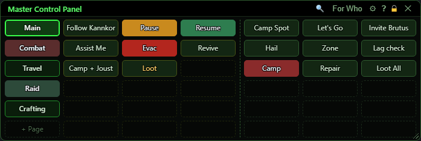](../assets/mcp/window.png "Click for full size")

## What it is for

The Master Control Panel (MCP) is a grid of buttons that send commands to your characters: follow, pause, camp, evac, cast an ability, travel, and anything else the bot's command list offers. Buttons are organised into pages (the left column). A block of static buttons stays the same on every page, and the rest of the grid changes with the page you pick. The For Who window decides which characters a button's command goes to. Every change is saved at once and shows up live in the MCP of every other character on the same PC.

## Title bar

The buttons in the title bar. The **?**, the lock and the X are on every window.

[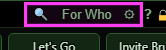](../assets/mcp/titlebar.png "Click for full size")

| Control | What it does |
|---|---|
| **Magnifier (Find)** | Opens or closes the Find drawer, to search every button on every page by its name or its command. |
| **For Who** | Shows or hides the For Who window, which picks the characters a button's command goes to. The text turns green while For Who is showing. |
| **Gear (Settings)** | Opens or closes the Layout drawer (button size, spacing, font size and the options below). |
| **Title bar close (X)** | Closes the MCP, and with it the For Who, Build command and Assign keys windows. *Key binds still work with the window closed.* |
| **Alt + backtick key (keyboard)** | Opens the MCP if it is closed, closes it if it is open. |

## Pages (left column)

Each page is its own set of buttons for the right-hand block. The static block does not change when you switch pages.

[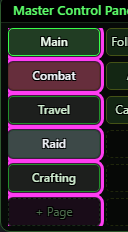](../assets/mcp/pages.png "Click for full size")

| Control | What it does | Default |
|---|---|---|
| **Click a page** | Switches the right-hand block to that page's buttons. *Each character has its own page: switching here does not switch any other MCP. An edit made on another character keeps you on your page.* |  |
| **+ Page** | Adds a new empty page called 'Page N' at the bottom and switches to it. |  |
| **Drag a page** | Moves the page up or down the list. A line shows where it will land. You stay on the same page. *Keys assigned to buttons follow the buttons, so moving pages does not change what a key presses.* | on (needs Allow moving) |
| **Right-click a page > Switch to this page** | Same as clicking the page. |  |
| **Right-click a page > Rename…** | Opens a small box to type the page name (up to 40 letters). An empty name becomes 'Page N'. |  |
| **Right-click a page > Set colour…** | Opens the colour picker for the page selector's background. Reset takes the colour off again. |  |
| **Right-click a page > Set text colour…** | Opens the colour picker for the page name's text. Auto goes back to a colour that reads well on the background. |  |
| **Right-click a page > Delete page…** | Asks you to type the page's exact name, then removes the page, all its buttons and any keys assigned to them. You stay on the page you were on. *Only shown when 'Allow deleting pages' is ticked and there is more than one page.* |  |

## Static buttons

The first block of button columns (3 by default). These buttons are the same whichever page you are on - a good place for Follow, Pause, Resume and Evac.

[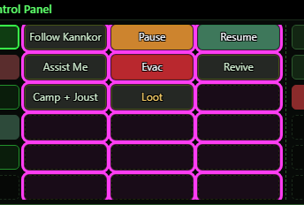](../assets/mcp/static.png "Click for full size")

| Control | What it does | Default |
|---|---|---|
| **Click a button** | Sends the button's command. It goes to the characters picked in For Who, unless the button names its own target in every step (for example 'fighter' or 'Me'), in which case it goes to that target. A button made in Raw mode runs only on the character that clicked it. The button flashes; an empty button does nothing. |  |
| **Drag a button** | Drop it on another slot to swap the two (or move it, if the slot is empty). You can drag between the static block and the page block. *Letting go over empty space cancels the move. A key assigned to the button moves with it.* | on (needs Allow moving) |

## Page buttons

The block to the right of the dashed line. It shows the buttons of the page you picked. Grow the window wider for more columns, taller for more rows.

[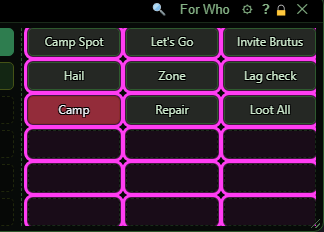](../assets/mcp/pagebuttons.png "Click for full size")

| Control | What it does |
|---|---|
| **Drag a button onto a page** | Moves the button to that page: into the same spot if it is free, otherwise the first free spot. When it lands on a page other than the one you are on, a message names that page. *A key assigned to the button moves with it.* |

## Right-click a button

Right-click any button slot for this menu. On an empty slot, Assign to key and Copy button are not shown.

[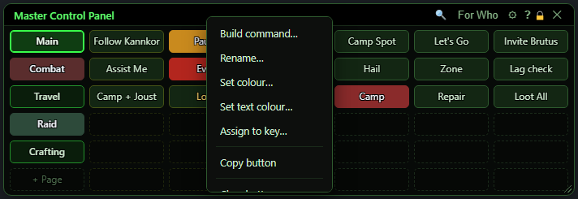](../assets/mcp/menu-button.png "Click for full size")

| Control | What it does |
|---|---|
| **Build command…** | Opens the Build command window to make or change what this button sends, and its label. |
| **Rename…** | Changes the text on the button (up to 40 letters). Renaming an empty slot makes a button with just a label. *A button needs a name: an empty name is refused and the box says so. To remove a button, use Clear button.* |
| **Set colour…** | Opens the colour picker for the button's background. The text colour adjusts itself to stay readable unless you set one. Reset takes the colour off again. |
| **Set text colour…** | Opens the colour picker for the button's text. Auto goes back to the automatic readable colour. |
| **Assign to key…** | Opens the Assign keys window for this button, to fire it from a keyboard key, a G-key or an extra mouse button. The key belongs to the button: move the button, or move its page, and the key still presses it. *Only shown on a slot that has a button. Clearing the button, or deleting its page, removes its keys.* |
| **Copy button** | Remembers the button (label, command and colours) for pasting, and puts a code for it on your Windows clipboard so you can share it. The code starts with OGREMCP1. *Only shown on a slot that has a button.* |
| **Paste "<name>" [over "<name>"]** | Puts the copied button into this slot. The menu names the button, and the one it would replace. *The copied button is shared by every character on this PC, so you can copy on one and paste on another. Pasting over a button keeps that button's keys, so they now press what you pasted.* |
| **Paste "<name>" from clipboard** | Shown when your Windows clipboard holds a button code (for example one someone sent you). Puts that button into this slot. A code can only make a button; it never runs anything. |
| **Clear button** | Empties the slot: the command, label, colours and any keys assigned to the button are removed. Asks first. |

## Colour picker

Used by every Set colour and Set text colour. The button changes while you drag, and the colour is kept however you close the picker (Done, Escape, or a click on the grid).

[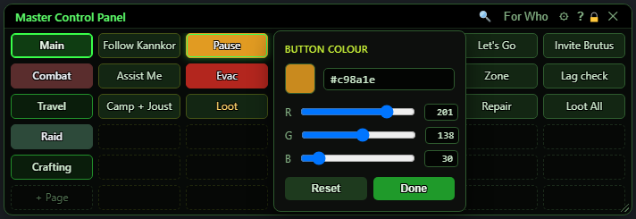](../assets/mcp/colour.png "Click for full size")

| Control | What it does |
|---|---|
| **Colour box (#rrggbb)** | Type a colour as #rrggbb, #rgb or r,g,b (numbers 0-255). A red border means it is not a colour and is ignored. |
| **R / G / B sliders and numbers** | Red, green and blue from 0 to 255. Drag a slider or type a number; the button updates as you go. |
| **Reset / Auto** | For a background it reads Reset and takes the custom colour off, so the button or page goes back to the theme's colour. For text it reads Auto and goes back to the automatic readable colour. |
| **Done** | Closes the picker. The colour is already on the button and is saved. |

## Rename

[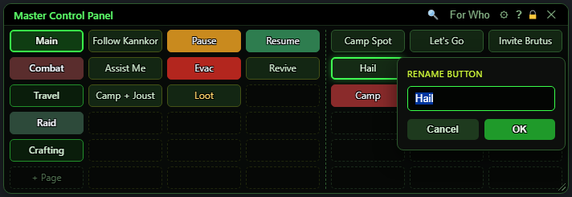](../assets/mcp/rename.png "Click for full size")

| Control | What it does |
|---|---|
| **Name box** | The new name. Enter = OK, Escape = Cancel. |
| **OK** | Saves the name. For a button, an empty name is refused with a note in red - use Clear button to remove a button. |
| **Cancel** | Closes without changing anything. |

## Clear and paste-over warning

The same small box asks before Clear button, and before a paste that would replace a button. Pasting into an empty slot never asks.

[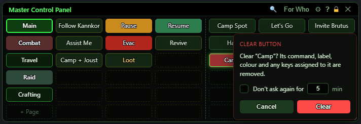](../assets/mcp/clear.png "Click for full size")

| Control | What it does | Default |
|---|---|---|
| **Don't ask again for [5] min** | Tick it and set the minutes (1-999) to stop this question for that long. Clears and paste-overs are snoozed separately. *Only for this window: reopening the MCP asks again.* | off, 5 minutes |
| **Clear / Paste** | Goes ahead. |  |
| **Cancel** | Leaves the button as it was. |  |

## Delete page

[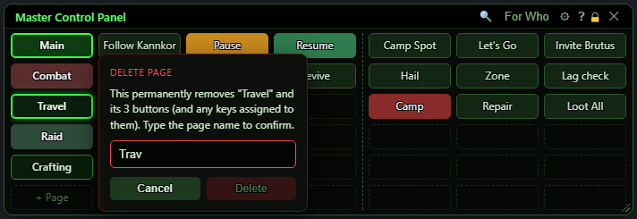](../assets/mcp/deletepage.png "Click for full size")

| Control | What it does |
|---|---|
| **Type the page name** | Delete stays greyed out until this matches the page name exactly (capitals count). |
| **Delete** | Removes the page, every button on it and any keys assigned to those buttons. |
| **Cancel** | Keeps the page. |

## Find

Opened by the magnifier. Searches every button, static ones first, then page by page.

[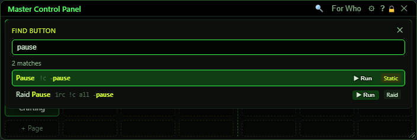](../assets/mcp/find.png "Click for full size")

| Control | What it does | Default |
|---|---|---|
| **name or command… (search box)** | Type part of a button's name or of the command it sends. Names that start with the text come first. Up/Down moves through the results, Enter jumps to the highlighted one, Escape closes. | empty |
| **Click a result** | Switches to that button's page and rings the button for a couple of seconds. It does not press it. If the button is outside the window, a message says its page, row and column. |  |
| **▶ Run** | Sends that button's command right away, the same as clicking it, and keeps the Find drawer open. |  |
| **x (close)** | Closes Find. Clicking anywhere outside it also closes it. |  |

## Settings (the gear)

The Layout drawer. Changes show at once and are saved. They change the buttons, not the window size.

[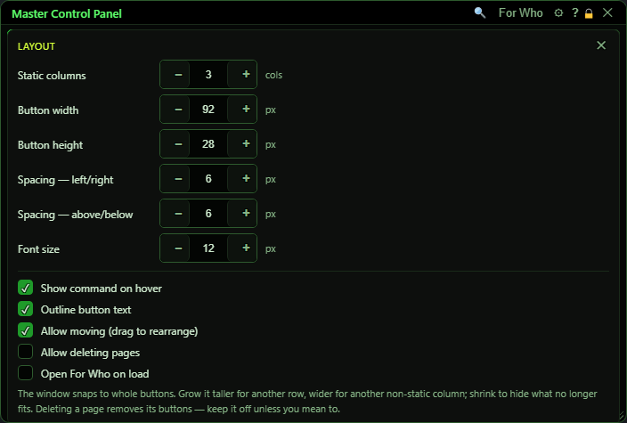](../assets/mcp/settings.png "Click for full size")

| Control | What it does | Default |
|---|---|---|
| **Static columns** | How many columns form the static block (0-99). If the window is too narrow, fewer show. | 3 |
| **Button width** | Width of every button, 24-400 pixels. The - and + step by 2; hold to repeat. | 92 px |
| **Button height** | Height of every button and page selector, 16-200 pixels (steps of 2). | 28 px |
| **Spacing — left/right** | Space between columns, 0-40 pixels. | 6 px |
| **Spacing — above/below** | Space between rows, 0-40 pixels. | 6 px |
| **Font size** | Size of the button text, 8-40 pixels. | 12 px |
| **Show command on hover** | Resting the mouse on a button for a moment shows the command it sends. | on |
| **Outline button text** | Draws a thin outline round button text so it reads on any colour. Display only. | on |
| **Allow moving (drag to rearrange)** | Lets you drag buttons and pages around. Turn it off to stop accidental moves; clicking still works. | on |
| **Allow deleting pages** | Adds Delete page… to a page's right-click menu. | off |
| **Open For Who on load** | Shows the For Who window whenever the MCP opens. | off |
| **x (close)** | Closes the drawer. The gear does the same. |  |

## What the window shows

- Page selectors (left column): the active page has a bright outline. '+ Page' sits under the last page.
- Static block: a slightly tinted border marks static buttons. A dashed line separates them from the page block.
- Empty slots: dashed outlines with no text. Right-click one to build a button there.
- Colours: a button or page with its own colour shows it; otherwise it uses the theme colours.
- A red button showing the first 4 letters of its name and a countdown (for example 'Resc 14.2') is an ability still on cooldown. It goes back to normal when the ability is ready. This only happens for buttons that cast an ability, and only for abilities on the OgreBot Ability Tracker tab with 'Enable Ability Tracker' ticked (Settings). The longest cooldown among your characters is shown.
- A button with a glowing ring is the one Find jumped to, or the one you just pasted.
- A small message at the bottom confirms things like 'Copied "Evac" - the code is on your clipboard' or 'Moved to "Travel"'.
- A menu or box that would not fit in a short window is kept inside it and scrolls.

## Good to know

- Your buttons and pages are one file shared by every character on this PC: Scripts/OgreSave/EQ2/OgreMCP.json. A change to them on one character shows up in every open MCP at once. The page you are looking at and your For Who choice are each character's own.
- Changing button size or spacing does not resize the window. Nudge the window edge and it snaps to fit whole buttons again.
- The page column shows only as many pages as there are rows. With more pages than rows, make the window taller (Find still reaches buttons on hidden pages).
- A button that names its own target in every step ignores For Who. If any step is left on the For Who window (blank), For Who decides.
- In a command, ${Me.Name} means the character that clicked the button.
- A button set to go over IRC is sent through OgreConsole instead while IRC is not connected; the console says so once each time IRC drops.
- A key assigned to a button follows the button: move the button, or move its page, and the key still presses it. Clearing the button or deleting its page removes the key.
- If OgreMCP.json is damaged, the MCP opens with a few sample buttons and leaves the file alone so you can repair it. Fix or restore it before changing anything in the MCP - any change saves over it.
- Buttons from the old OgreBot MCP can be brought over from the Migration window ('Migrate your MCP buttons').

### Switching pages

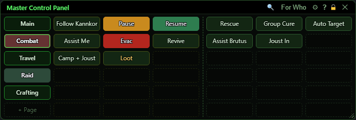

The Combat page is picked: the static block (Follow Kannkor to Loot) stays, the right-hand block shows Combat's buttons.

### An ability on cooldown

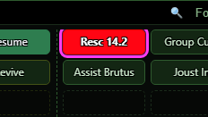

### The command on hover

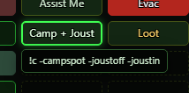

### Right-click a page

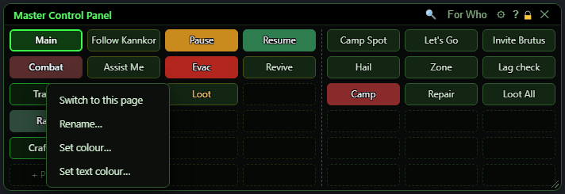

### Copy and paste

After **Copy button**, the right-click menu offers to paste it, naming both buttons. Pasting over a button asks first:

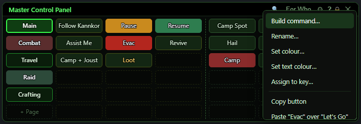

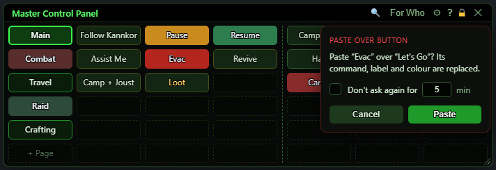

