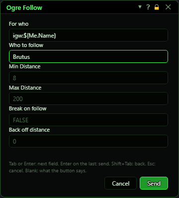
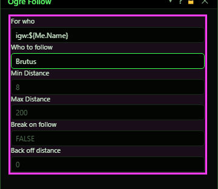
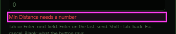

# Ask

**OgreBot is in beta testing.** Looking for OgreBot Classic? [Click here](../../index.md).

> **:bulb: In game - the ? button on this window says**
>
> Asks for an MCP button's values before it sends. Each field shows the button's own value greyed in it.
>
> **What you can do here**
>
> - **Type** to change a value for this press only; leave a field **blank** to keep the button's.
> - **Tab** or **Enter** goes to the next field; **Enter** on the last one sends. **Shift+Tab** goes back. **Esc** cancels.
> - **me** in a field about a character means the one pressing the button.
>
> **Good to know**
>
> - The cursor starts in the first field, so you can type straight away; sending gives the keyboard back to the game.
> - A red line says why a press was refused, and the cursor goes to that field.

**Open it:** Press an MCP button that has **Ask when pressed** ticked (in [Build command](mcpbuild.md)), or a key [assigned](binds.md) to one. The **Inputs** page of a new MCP is full of them.

## What it is for

Asks for a button's values before it sends: who it is for, who to assist or follow, a distance, a zone name. Each field shows the button's own value greyed in it; leave a field blank to keep that value, or type to change it for this press only. The button itself is not changed.

## The fields

One field per setting of each command on the button, in order, under the command's name when the button has more than one. Starred fields need a value.

| Control | What it does |
|---|---|
| **For who** | Which characters it is for: all, a name, a class, igw:${Me.Name} for your group, or anything the For Who window takes. Blank keeps the button's, and auto means the For Who window. |
| **me** | Typed in a field about a character (for who, assist who, follow who), me means the character pressing the button. |
| **Numbers and TRUE / FALSE** | A number field takes only a number, and a TRUE / FALSE field takes true, false, yes, no, on, off, 1 or 0. |
| **Send** | Sends the button with your answers and closes the window. |
| **Cancel** | Closes the window. Nothing is sent. |

## No mouse needed

The cursor starts in the first field, so you can type straight away.

| Control | What it does |
|---|---|
| **Tab / Shift+Tab** | The next field, or the one before. From the last field Tab goes back to the first. |
| **Enter** | The next field. On the last field it sends. |
| **Esc** | Closes the window without sending. |
| **The red line** | Says why a press was refused - a number field holding text, or a starred field left empty - and the cursor goes to that field. |

## Good to know

- Sending gives the keyboard back to the game.
- Typing off in Ogre Follow's For who turns following off, as the OgreFollow Off button does.

