# Build command

**OgreBot is in beta testing.** Looking for OgreBot Classic? [Click here](../../index.md).

> **:bulb: In game - the ? button on this window says**
>
> Makes or changes what one MCP button sends.
>
> **What you can do here**
>
> - **Label** - the text on the button (required).
> - **Send via** - OgreConsole (normal), IRC, or Raw (a command run as typed, only on you - unless it starts with oc, irc or !c, which go through OgreConsole / IRC).
> - **Pick a command** on the left, fill in its settings, then **+ Add to stack**. Stacked commands go out together, in order.
> - **Click a step** to edit it; the arrows reorder it and x removes it.
> - **Save to button** writes it to the button; **Cancel** changes nothing.
>
> **Good to know**
>
> - Leave a **who** box empty to use the For Who window.
> - A command you picked is not on the button until it is added; Save asks about it.

**Open it:** In the Master Control Panel, right-click any button slot and pick **Build command…**.

[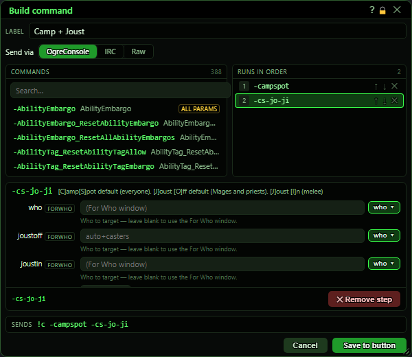](../assets/mcpbuild/window.png "Click for full size")

## What it is for

Build command makes or changes what one MCP button does. You name the button, choose how it is sent, then pick commands from the bot's command list and fill in their settings. Several commands can be stacked: they all go out together, in order, as one line. Save to button puts the result on the button you right-clicked.

## Label and how it is sent

[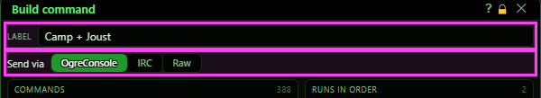](../assets/mcpbuild/head.png "Click for full size")

| Control | What it does | Default |
|---|---|---|
| **Label** | The text shown on the button. Required. | the button's current label |
| **OgreConsole** | The command goes through OgreConsole to your characters (the normal choice). | on |
| **IRC** | The command is sent over IRC instead of OgreConsole. While IRC is not connected it goes through OgreConsole instead. *If the For Who window is set to OC or IRC (not Auto), that choice wins over this one for OgreConsole and IRC buttons.* |  |
| **Conn** | IRC only: which IRC connection(s) should act on it. Leave empty for every connection. *Ignored when the command ends up going through OgreConsole.* | empty (all) |
| **Raw** | Swaps the lists for a text box. Whatever you type runs exactly as written, only on the character that clicks the button - for example `ogre perf`. For Who does not apply. *Switching Send via drops a command you picked but did not add yet.* |  |

## Commands (the list)

[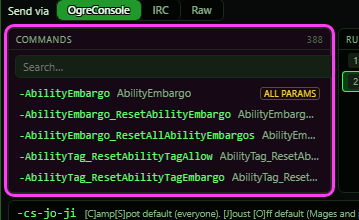](../assets/mcpbuild/catalog.png "Click for full size")

| Control | What it does | Default |
|---|---|---|
| **Search…** | Narrows the list to commands whose name, short name, description or alias contains the text. The count shows how many match. | empty |
| **Click a command** | Picks it and shows its settings below, ready to add. It is not on the button until you add it. |  |

## Runs in order (the stack)

The commands the button will send, in order, all on one line.

[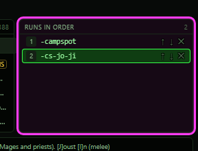](../assets/mcpbuild/stack.png "Click for full size")

| Control | What it does |
|---|---|
| **Click a step** | Shows that step's settings below. Changes apply to the step straight away. |
| **↑ / ↓** | Moves the step up or down. |
| **✕** | Removes the step. |

## The command's settings

One row per setting of the picked command, with its type and a hint underneath. A newly picked command starts with its default values already filled in. A grey value in an empty box is the default that is used if you leave the box empty.

[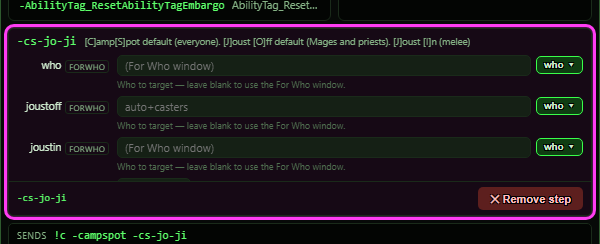](../assets/mcpbuild/config.png "Click for full size")

| Control | What it does | Default |
|---|---|---|
| **who (FORWHO) box** | Which characters this step is for. Leave it empty to use the For Who window. Type a target, or use who ▾. *If every step names a target, the button ignores For Who.* | empty (For Who window) |
| **who ▾** | Quick picks for the who box: Auto (the For Who window), All, Me, Group, Raid, Fighter, Mage, Priest, Scout, G1-G4. Me, Group and Raid are worked out from the character that clicks the button: that character, its group, its raid. |  |
| **pick ▾** | Shown on settings that have a fixed list of choices: pick one, or type your own. |  |
| **Text and number boxes** | Type the value. Number boxes accept only digits, a dot and a minus. |  |
| **TRUE / FALSE box** | Click to switch between TRUE and FALSE. |  |
| **＋ Add to stack** | Adds the picked command, with these settings, to the end of the stack. |  |
| **✕ Remove step** | Shown instead of Add when you are editing a step: removes that step. |  |

## Preview, Cancel and Save

[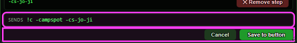](../assets/mcpbuild/footer.png "Click for full size")

| Control | What it does |
|---|---|
| **Sends** | The exact line the button will send. Display only. |
| **Cancel** | Closes the window. The button is not changed. |
| **Save to button** | Puts the label and the command on the button and closes the window. The MCP saves it at once. *With no label it refuses: 'A label is required - name the button first.'* |

## Save with a command not added

If you picked and filled in a command but never pressed Add to stack, Save asks what to do with it.

[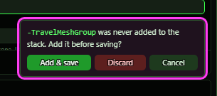](../assets/mcpbuild/saveask.png "Click for full size")

| Control | What it does |
|---|---|
| **Add & save** | Adds the command to the stack, then saves. |
| **Discard** | Saves without that command. |
| **Cancel** | Goes back to editing; nothing is saved. |

## Raw mode

[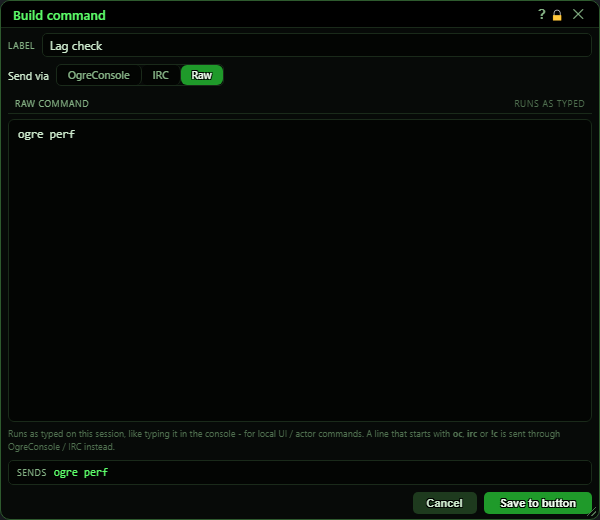](../assets/mcpbuild/raw.png "Click for full size")

| Control | What it does | Default |
|---|---|---|
| **Raw command** | The command to run, exactly as typed, on the character that clicks the button. Useful for local things such as `ogre perf`. *Text that starts with 'oc ', 'irc ' or '!c' is not run locally - it is sent through OgreConsole or IRC.* | empty |

## What the window shows

- Commands header: 'Commands' and the count (or 'shown / total' while searching).
- An 'ALL PARAMS' tag on a command means it takes everything typed after it. If another step follows it, the end marker -endargs is added for you (the step then shows 'all params +endargs').
- Runs in order: each step as it will be sent, numbered. The picked step is highlighted.
- Settings rows: the setting's name, its type (for example FORWHO, STRING, FLOAT, BOOL or ALL PARAMS) and a hint line.
- The step preview (bottom-left of the settings area) and the Sends line update as you type. Settings left at their default are left off the end of the line.

## Good to know

- Nothing is saved to the button until Save to button. Cancel or the window's X leaves the button as it was.
- A command you click in the list is only a draft until '+ Add to stack'. Save asks about it rather than losing it.
- A button pasted from a code, with only a command, opens with its command split back into steps. If it cannot be split it opens in Raw, unchanged.
- Saving an empty stack keeps the label but removes the command - the button then does nothing when clicked.

### Picking a new command

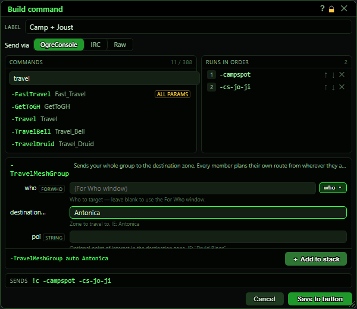

-TravelMeshGroup is picked and its destination filled in; it is not on the button until **+ Add to stack**.

### The who ▾ quick picks

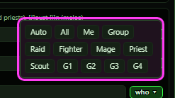

### Sending over IRC

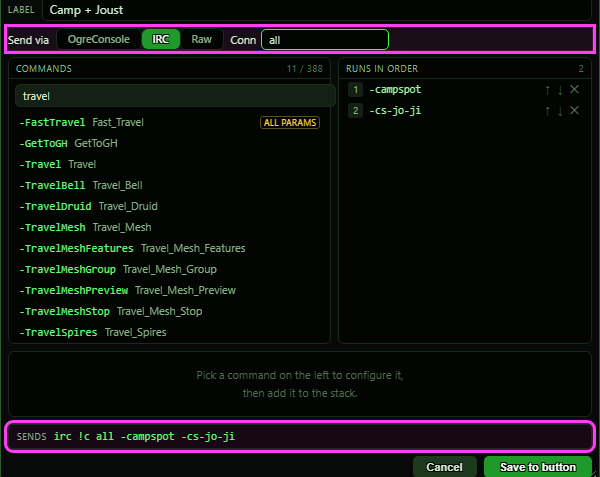

### No label

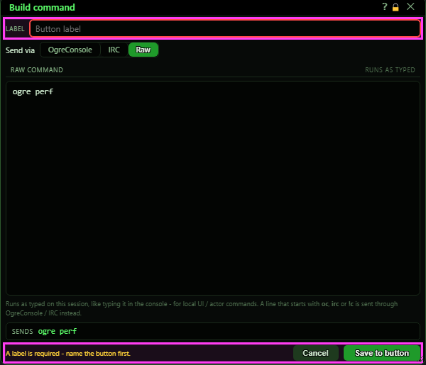

