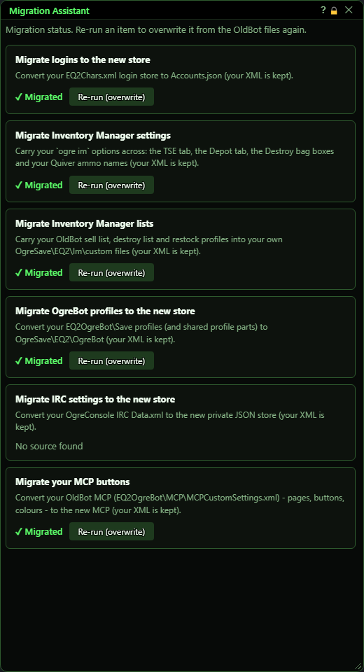
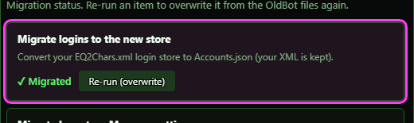
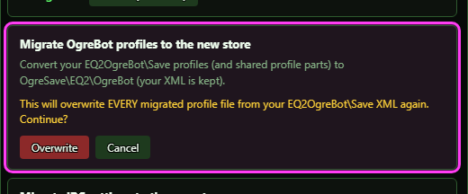
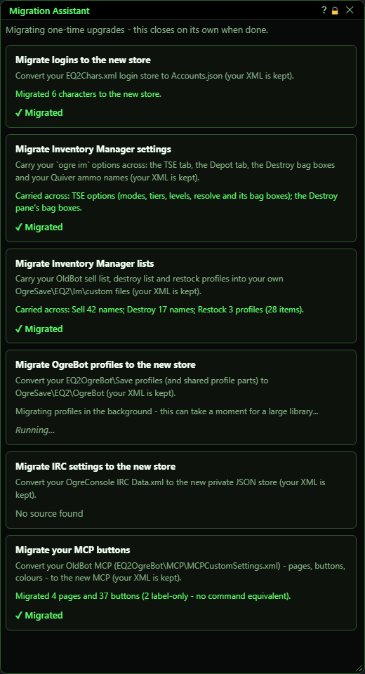

# Migration Assistant

**OgreBot is in beta testing.** Looking for OgreBot Classic? [Click here](../../index.md).

> **:bulb: In game - the ? button on this window says**
>
> Copies your OgreBot Classic settings into the new bot: logins, Inventory Manager settings and lists, OgreBot profiles, IRC settings and MCP buttons. It also adds an InnerSpace game profile, **Everquest 2 ISXOgreX**, under Everquest 2 / EverQuest II - launch a session with it and the new bot loads by itself.
>
> **What you can do here**
>
> - **Nothing, usually** - at load, anything not copied yet is copied for you, and this window shows the progress, then closes.
> - **Check the status** of each item with `ogre migrate`: Migrated, No source found, Nothing to migrate, or Not migrated (a copy that failed - the message says why).
> - **Re-run (overwrite)** copies an item again from Classic, replacing what the new bot has. It asks first: **Overwrite** or **Cancel**.
>
> **Good to know**
>
> - Your Classic files are only read, never changed.
> - The InnerSpace profile is the one thing it adds outside the bot: a copy of your EverQuest 2 Client profile whose startup runs `timedcommand 10 ext isxogrex`. Your other profiles are not touched, and a backup of InnerSpace's GameConfiguration.XML is kept next to it (GameConfiguration.before-ISXOgreX.XML).
> - Each item is copied automatically only once. After that, only Re-run (overwrite) copies it again.
> - Problems are listed in ISXOgreEQ2.log.

**Open it:** Type `ogre migrate`. It also opens by itself once, a few seconds after the bot loads, when it finds Classic settings that have not been copied yet.

## What it is for

The Migration Assistant copies your Classic settings into the new bot: logins, Inventory Manager settings and lists, OgreBot profiles, IRC settings and MCP buttons. You do not have to do anything. When the bot loads, every item that has Classic files but nothing in the new bot yet is copied automatically, and this window pops up to show the progress, then closes itself. Your old Classic files are only read, never changed. Open it yourself with `ogre migrate` to see the status of each item and to copy an item again, replacing what the new bot has.

## The item boxes

Each box shows one thing that can be copied from Classic and where it stands right now. The status is worked out from your files every time the window opens.

| Control | What it does |
|---|---|
| **Re-run (overwrite)** | Asks to copy this item from your Classic files again, replacing what the new bot already has. Nothing is copied yet - the box changes to an Overwrite / Cancel question first. *Only shown when you opened the window with `ogre migrate`, and only for items that have Classic files to copy.* |
| **Overwrite** | Copies the item again from your Classic files and replaces what the new bot has. For profiles, every copied profile file is rewritten. When it finishes, the box shows what was copied. *Anything you changed in the new bot for that item since the first copy is lost.* |
| **Cancel** | Backs out of the Overwrite question. Nothing is copied. |
| **Title bar close (X)** | Closes the window. Copying that is already running keeps going. *The automatic progress view closes by itself about 4 seconds after everything is done.* |

## Asking to overwrite

After Re-run (overwrite), the box asks before it replaces anything. This is the only question the assistant ever asks.

## The automatic run at load

When the bot loads and finds Classic files for an item that the new bot does not have yet, it copies them without asking and shows this view. There are no buttons here. Profiles can take a moment for a big library and show Running... until they are done. When every item is finished the window closes by itself.

## What the window shows

- ✓ Migrated (green) - the new bot already has this item. It may have been copied just now, automatically, or in an earlier session.
- No source found (grey) - you have no Classic files for this item, so there is nothing to copy.
- Nothing to migrate (grey) - you have Classic files for this item but the new bot has nothing yet, and no copy was tried this session.
- Not migrated (red) - this session tried to copy the item and could not. The message above it says why.
- Running... - the item is being copied right now (profiles only).
- Green message - what was copied, e.g. 'Migrated 6 characters to the new store.'
- Orange message - a warning or a question, e.g. a few profile files were skipped, or 'overwrite it?'.
- Red message - the copy failed. The details are in ISXOgreEQ2.log.
- Grey message - the item is still being copied (profiles, which can take a moment).

## Good to know

- Your Classic files are never changed or deleted. You can keep using Classic alongside.
- An item is copied automatically only once: as soon as the new bot has that item's file, it is treated as done. To copy it again you must use Re-run (overwrite).
- Opening the window with `ogre migrate` first copies anything that is still waiting, without asking - the same as the automatic run.
- Profiles: files that were missing or could not be read are skipped and counted in the orange message. Running it again copies the same set, so re-running will not fix them - check ISXOgreEQ2.log for which files.
- Inventory Manager lists (sell, destroy, restock) go into your own custom files. A list you already have is kept, not replaced, unless you use Re-run (overwrite).
- The first time the bot loads, the New User Tour runs first. The automatic copy starts a few seconds after the tour is finished or skipped.
- Typing `ogre migrate` while the window is open does nothing.

