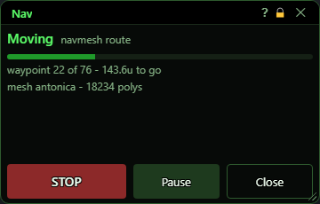
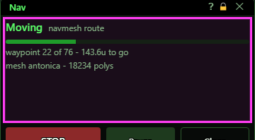
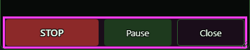
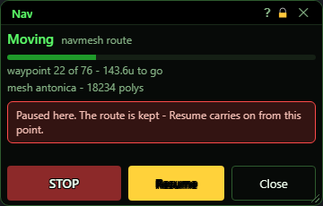
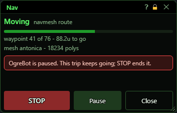
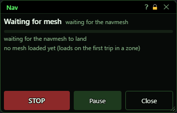
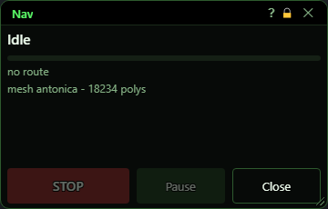

# Nav

**OgreBot is in beta testing.** Looking for OgreBot Classic? [Click here](../../index.md).

> **:bulb: In game - the ? button on this window says**
>
> The stop button for navigation. It pops up whenever the bot walks or flies your character somewhere, and closes when the trip ends.
>
> **What you can do here**
>
> - **STOP** - end the trip where you are. Safe to press at any time.
> - **Pause / Resume** - hold the trip and keep the route; Resume carries on from here.
> - **Close** - hide the window; the trip keeps going.
> - Watch the progress bar, waypoint count and distance left. **Waiting for mesh** means the zone's map is still loading; the trip starts by itself when it is ready.
>
> **Good to know**
>
> - Pausing OgreBot does not stop a trip - use STOP (or `ogre nav stop`).
> - While nav is paused nothing else will move your character until you Resume or STOP.
> - `ogre nav -nopanel` stops it popping up; `ogre nav panel` opens it by hand.

**Open it:** It opens by itself whenever your character starts a navigation trip, whoever started it (you, Instance Controller, the travel router...), and closes when the trip ends. To open it by hand type `ogre nav panel`. `ogre nav -nopanel` stops it popping up; `ogre nav -panel` turns that back on and opens it.

## What it is for

The stop button for navigation. While the bot walks or flies your character somewhere along the navigation map, this small window shows how far along it is and gives you a big STOP and a Pause. Navigation keeps going while OgreBot is paused, so this window is how you stop it.

## Status

The top line is the state (Moving in green, Failed in red, Arrived highlighted, Stopped plain) and why. The bar and the line under it show the waypoint you are on out of the whole route, and the distance still to go. The next line names the navigation map loaded for this zone. A red note appears when the trip is paused, nav is switched off, or OgreBot is paused.

## Buttons

| Control | What it does |
|---|---|
| **STOP** | Ends the trip right where you are. The route is thrown away. It is safe to press at any time: if something else has since taken over moving your character, STOP leaves that alone. *Greyed out when no trip is running.* |
| **Pause / Resume** | Pause stops walking but keeps the route, so Resume carries on from where you stopped without planning again. While paused, nav still holds the character: follow or the camp spot will not move it until you Resume or STOP. *Greyed out when no trip is running. Turns yellow and reads Resume while paused.* |
| **Close** | Closes the window. The trip carries on. The window comes back on the next trip (unless you turned that off with `ogre nav -nopanel`). |
| **Title bar close (X)** | Hides the window, like Close. It comes back on the next trip. |

## What the window shows

- State word: Moving, Planning (the route is being worked out, a little at a time so the game never freezes; the character waits until it is ready), Landing (coming down from flight), Waiting for mesh (the navigation map for this zone is still downloading; the trip starts by itself when it is ready), Arrived, Stopped (something ended the trip on purpose: you pressed STOP, or the bot that started the walk ended it), Failed (navigation could not get there, for example stuck or no route), or Idle.
- Reason, next to the state: why the trip is doing what it does, for example 'navmesh route', 'waiting for the navmesh', 'stuck', or 'OgreBot closed'.
- Bar and 'waypoint X of Y - N u to go': how far along the route you are, and the distance left in game units. 'waiting for the navmesh to land' while the map is still coming; 'no route' when idle.
- 'mesh <zone> - N polys': the navigation map in use. 'no mesh loaded yet (loads on the first trip in a zone)' is normal before your first trip in a zone.
- Red notes: 'Paused here. The route is kept - Resume carries on from this point.' / 'Nav is switched OFF - `ogre nav -on`' / 'OgreBot is paused. This trip keeps going; STOP ends it.'

## Good to know

- Pausing OgreBot does NOT stop a navigation trip. Use STOP here, or type `ogre nav stop` (also `ogre end nav`).
- The window closes itself as soon as a trip ends, so you rarely see Arrived, Stopped or Failed in it. The console says how the trip ended.
- While nav is paused it keeps control of your character, so nothing else (follow, camp spot) will move it until you Resume or STOP.

## Other states

Paused with the Pause button:

OgreBot paused while a trip runs:

Waiting for the zone's navigation map:

Opened by hand with no trip running:

