# NPC Cast Monitoring

**OgreBot is in beta testing.** Looking for OgreBot Classic? [Click here](../../index.md).

> **:bulb: In game - the ? button on this window says**
>
> Two tabs. **Monitor** writes down every spell a mob casts, with its name and spell number. **Watch list** watches the mobs listed for your current zone, and when one starts a listed spell, the bot can interrupt it or run your commands.
>
> **Monitor**
>
> - **Start** / **Stop** - turns the log on and off. It keeps running while you fight, zone or die, until you press Stop.
> - **my target + its target** - logs your target and your target's target. These are the only spells that come with a **name**, because the name is read off your cast bars. Target the mob, or target the tank the mob is attacking.
> - **+ named NPCs nearby** / **+ every NPC nearby** - also logs other casters within 100 metres. Their spells show a spell number but no name, unless you have seen that spell on your cast bar before.
> - **Copy** - puts the whole list on your clipboard, ready to paste.
> - **Clear** - empties the list for this zone.
> - Each zone has its own list, saved to the file named under it. Send that file, or paste the copied list, to whoever asked for it.
>
> **Watch list**
>
> - **Add the spell my target is casting** - press it while your target's cast bar is up.
> - **Add by hand** - type a mob name and a spell number.
> - **interrupt** - the bot interrupts that spell with an interrupt you have ready.
> - **label** / **commands** - opens a small editor under the spell. Type, then **Save** or **Cancel**.
> - **remove** / **remove mob** - stop watching a spell or a whole mob here.
>
> **Good to know**
>
> - The Watch list only works when **NPC Cast Monitoring** is ticked on OgreBot's Settings tab. While it is off, a red bar tells you when a button cannot do anything. Interrupts and commands also need OgreBot open and not paused. The Monitor needs none of that.
> - **Scan radius** takes 5 to 500. Leave it empty to use the default.
> - Your changes go in your own list, so updates never remove them. **Reset my edits** deletes them all for this zone, with no undo.

**Open it:** Type `ogre npccast` (also `ogre npccastmonitoring`, `ogre npccast panel` or `ogre npccast config`). If the window is already open, this does nothing. `ogre npccast status` prints the watch status in the console instead.

[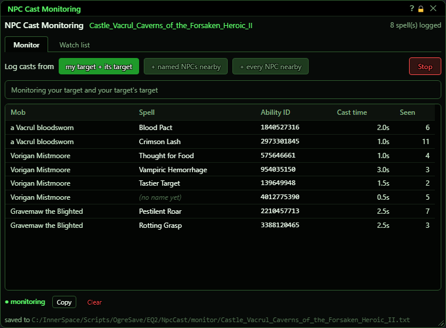](../assets/npccast/window.png "Click for full size")

## What it is for

This window has two tabs. **Monitor** writes down every spell a mob casts, with the spell's name and its ability id, so you can copy the list or send the file to whoever asked for it. It only records; it never makes the bot do anything. **Watch list** watches the mobs listed for the zone you are in, found by their exact name. When a watched mob starts casting one of the listed spells, the bot can interrupt it, run your own commands, or both. Each zone has a shipped list that comes with the bot, and your own list on top of it. Everything you change on the Watch list goes into your own list, so a bot update never removes it. The window opens on the Monitor tab.

## Header and tabs

The top line shows the zone and a count. On the Monitor tab the count is how many spells are in the log. On the Watch list tab it is how many mobs and spells are listed and how many mobs are being watched right now.

[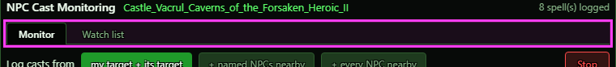](../assets/npccast/tabs.png "Click for full size")

| Control | What it does | Default |
|---|---|---|
| **Monitor** | Shows the Monitor tab: the log of what mobs cast. Display only - changes what you see, not what the bot does. *The window always opens on this tab.* | shown |
| **Watch list** | Shows the Watch list tab: the mobs and spells watched in this zone, and what the bot does about them. Display only - changes what you see, not what the bot does. |  |

## Monitor: what to log, Start and Stop

Pick whose spells to log, then press Start. One of the three buttons is always lit. Your target and your target's target are logged in every choice.

[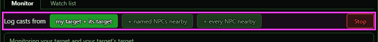](../assets/npccast/mon-controls.png "Click for full size")

| Control | What it does | Default |
|---|---|---|
| **my target + its target** | Logs the spells of your target and of your target's target. Players are left out. These are the only spells that come with a name, because the name is read off your cast bars. Target the mob, or target the tank the mob is attacking. *Your choice is not saved. After you restart the game it is back to this one.* | on |
| **+ named NPCs nearby** | Also logs every named NPC within 100 meters of you. Their spells show the ability id but no name, unless that spell was once named from your cast bars. *Changing this while the Monitor runs takes effect at once.* | off |
| **+ every NPC nearby** | Also logs every NPC within 100 meters of you, named or not. Their spells show the ability id but no name, unless that spell was once named from your cast bars. | off |
| **Start / Stop** | Start begins logging and the button turns into a red Stop. It checks four times a second and keeps going while you fight, zone or die, until you press Stop. Stop saves the log and stops; the list stays on screen. *Closing the window does not stop it. It also runs while OgreBot is closed or paused, and with NPC Cast Monitoring unticked.* |  |

## Monitor: the log

One row per mob and spell, in the order they were first seen. A grey bar above the log says what your last button press did. With either of the 'nearby' choices, a second grey bar explains why some spells have no name.

[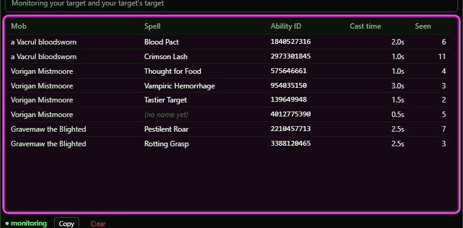](../assets/npccast/mon-log.png "Click for full size")

## Monitor: Copy, Clear and the file

Under the log: whether the Monitor is running ('monitoring') or 'stopped', the two buttons, and the file the log is saved to.

[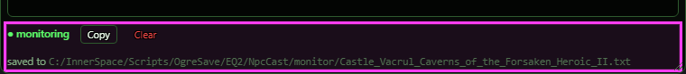](../assets/npccast/mon-foot.png "Click for full size")

| Control | What it does |
|---|---|
| **Copy** | Puts the whole log on your clipboard as text, ready to paste: a line with the zone name, a line naming the columns, then one line per row (mob \| spell \| ability id \| cast time \| seen). The grey bar says how many lines were copied. *Greyed out while the log is empty.* |
| **Clear** | Empties the log for this zone, and its saved file too. Spell names already learned are kept. *No confirmation and no undo. Greyed out while the log is empty.* |

## Watch list tab

The Watch list always shows the zone you are in right now. Everything below is on this tab.

[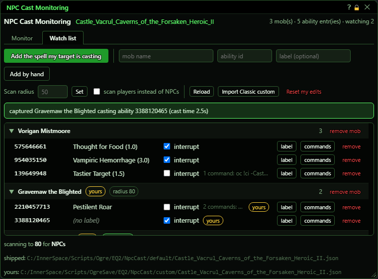](../assets/npccast/watch.png "Click for full size")

## Watch list: header

On this tab the zone name is the name of the zone's list file. The counts on the right say how many mobs and spells are listed and how many mobs are being watched right now.

[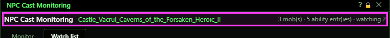](../assets/npccast/header.png "Click for full size")

## Watch list: adding spells

[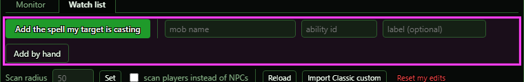](../assets/npccast/add.png "Click for full size")

| Control | What it does | Default |
|---|---|---|
| **Add the spell my target is casting** | Target a mob while its cast bar is up and press this. The mob's name and the spell it is casting are added to your list for this zone. The result shows in a green (worked) or red (did not work) bar under the buttons. *The spell is added with no label and no action, so nothing happens yet. Tick interrupt or add commands afterwards.* |  |
| **mob name (box)** | The name of the mob to add, exactly as the game shows it. Capital letters do not matter. *This box is not cleared after adding (the number and label boxes are), so you can add several spells for the same mob.* | empty |
| **ability id (box)** | The spell's number (its ability id). Anything that is not a digit is removed. Cleared after adding. | empty |
| **label (optional) (box)** | A name you give the spell so you know what it is. Only shown in this window. Cleared after adding. | empty |
| **Add by hand** | Adds the typed mob and spell number to your list for this zone. Nothing happens if the mob name or the number is empty. *If that mob already has that spell in your list, nothing changes (the label is not updated).* |  |

## Watch list: zone settings and files

[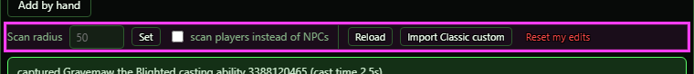](../assets/npccast/zone.png "Click for full size")

| Control | What it does | Default |
|---|---|---|
| **Scan radius (box)** | How far away (in meters) mobs are watched in this zone. The grey number is the value in use when the box is empty. | empty (50) |
| **Set** | Saves the scan radius into your list for this zone. It must be from 5 to 500. An empty box or 0 removes your value, so the shipped value (or 50) is used again. *A number outside 5-500 is refused: a red bar says so and nothing is saved. Check the footer's 'scanning to' number for the value in use.* |  |
| **scan players instead of NPCs** | When ticked, this zone watches players instead of NPCs. Saved into your list for this zone at once. *Only useful for testing in a guild hall with other players casting.* | off |
| **Reload** | Reads the lists for the zone you are in again from disk. Use it after you edit a list file by hand. |  |
| **Import Classic custom** | Copies the converted custom lists from OgreBot Classic into your own list folder. A zone you already have your own list for is skipped, never overwritten. The console says how many files were copied and skipped. *This works even when NPC Cast Monitoring is turned off.* |  |
| **Reset my edits** | Deletes your own list for this zone, so only the shipped list is left. Everything you added, removed or changed in this zone is gone, including the scan radius and the players setting. *There is no confirmation and no undo.* |  |

## Watch list: messages

Bars under the buttons tell you what happened. Green or red is the result of your last capture or edit: when something you pressed could not be done (monitoring is off, no zone is loaded, a scan radius out of range, a list file that cannot be read or written), a red bar says why. Other red bars are problems with a list file. Grey bars are notes.

[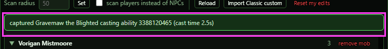](../assets/npccast/banners.png "Click for full size")

## Watch list: the list

One block per mob. Under each mob is one row per spell. A yellow 'yours' tag means the mob or spell comes from your own list. 'radius N' is a distance set just for that mob. 'watch only' means the mob has no spells listed. A long list of commands is cut short on its row; hold the mouse over it to read all of it.

[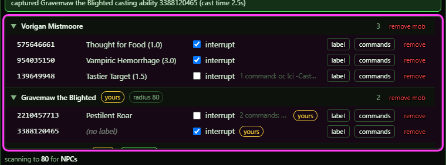](../assets/npccast/list.png "Click for full size")

| Control | What it does | Default |
|---|---|---|
| **Mob name / arrow** | Click to fold a mob's spells away or show them again. Display only - changes what you see, not what the bot does. *Folds are forgotten when the window is reopened.* | open |
| **remove mob** | Stops watching this mob in this zone. A mob from your own list is deleted from it. A mob from the shipped list is switched off in your list, so it stays off after updates. *No confirmation. To get a shipped mob back, use Reset my edits (which undoes all your edits in this zone).* |  |
| **interrupt** | When ticked and this mob starts casting this spell, the bot targets that mob and casts an interrupt spell that is ready right now. Saved at once. *Nothing is cast if you have no interrupt ready, or while OgreBot is closed or paused.* | as the list says |
| **label** | Opens a small editor right under this spell's row, with a box holding its current name. Type a new name and press Save. Cancel closes the editor without saving. *Saving an empty box removes the name you gave it. A spell from the shipped list then shows its shipped name again.* |  |
| **commands** | Opens a small editor right under this spell's row, with the commands the bot runs each time this mob starts this spell, one per line. The row shows how many commands are set and what they are. *Commands only run while OgreBot is open and not paused.* |  |

## Watch list: editing a label or commands

Pressing label or commands opens this editor under the spell's row.

[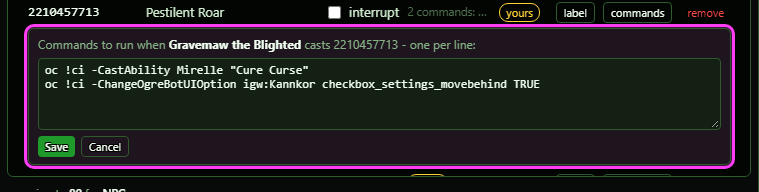](../assets/npccast/editor.png "Click for full size")

| Control | What it does |
|---|---|
| **Editor box** | The name or the command lines you are editing. What you type is kept while the list refreshes. Only one editor is open at a time; opening another one drops what you had not saved. *Pressing Enter does not save. Use the Save button.* |
| **Save** | Saves the editor's text into your own list for this zone and closes the editor. For commands, empty lines are skipped, and saving an empty box removes your commands; a spell from the shipped list then uses its shipped commands again. |
| **Cancel** | Closes the editor. Nothing is saved. |
| **remove** | Removes this spell from the mob. A spell from your own list is deleted. A shipped spell is switched off in your list. *Removing the last spell of a mob you added removes that mob too. A mob from the shipped list stays watched.* |

## Watch list: footer

Shows how far the bot scans and for what (NPCs or players), and where the shipped list and your own list for this zone are stored on disk.

[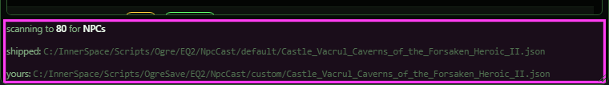](../assets/npccast/footer.png "Click for full size")

## What the window shows

- Monitor header: the zone the log belongs to - the same name the Watch list tab shows - and 'N spell(s) logged', the number of rows in the log.
- Monitor log columns: Mob, Spell (its name, or a grey '(no name yet)'), Ability ID, Cast time (seconds, from the latest cast) and Seen (how many times that mob cast it). One cast counts once, even though the Monitor sees it several times while the cast bar is up. Casting the same spell again counts again.
- Monitor grey bars: the result of your last Start, Stop, Copy or Clear. With either 'nearby' choice, a second bar says that casts from mobs that are not your target (or your target's target) only get an ability id.
- Monitor footer: 'monitoring' in green while it runs, 'stopped' when it does not, and 'saved to' the log file for this zone.
- Zone name (both tabs): the file name used for the zone, for example Castle_Vacrul_Caverns_of_the_Forsaken_Heroic_II. '(no zone)' when nothing is loaded.
- 'N mob(s) · N ability entr(ies) · watching N': how many mobs and spells are listed, and how many mobs the scan is watching right now.
- Green bar: your last capture worked (or that spell was already in your list). Red bar: your last capture or edit did not work, with the reason (no target, not casting, monitoring off, radius out of range, and so on).
- Red 'OFF' bar: NPC Cast Monitoring is turned off on OgreBot's Settings tab. The list is empty and nothing is watched.
- Grey 'OgreBot is closed' bar: mobs are still watched, but nothing is interrupted and no commands run until OgreBot is open.
- Grey 'Per-cast logging is off' bar: shows until you tick NPCCastDebug on OgreBot's Debug tab.
- Red file bars: the shipped list or your list for this zone cannot be read, your file uses the old 'nomerge' spelling, or some spell numbers in it are not valid and were skipped.
- Grey 'REPLACES' bar: your file is set to replace the shipped list instead of adding to it.
- Mob tags: 'yours' = from your list, 'radius N' = a distance set just for that mob, 'watch only' = no spells listed.
- Spell rows: the spell number, its label ('(no label)' if none), the interrupt box, how many commands it runs, and a 'yours' tag when it comes from your list.
- Watch list footer: 'scanning to N for NPCs/players' is the widest distance in use (the zone radius or the biggest per-mob radius). 'shipped:' and 'yours:' are the two list files for this zone.

## Good to know

- The Monitor and the Watch list are separate. The Monitor only writes down what mobs cast; it never interrupts or runs anything, and it needs neither the NPC Cast Monitoring checkbox nor OgreBot open.
- Spell names in the Monitor only come from your cast bars (your target and your target's target), and only when the cast lasts longer than about a quarter of a second. Once a spell's name is known, it shows for that spell everywhere, in every zone and next time too.
- Each zone keeps its own Monitor log. Zone while it runs and the old zone's log is saved and the new zone's saved log comes back. Send the file named under the log, or paste what Copy gives you.
- The Monitor keeps running after you close the window. Press Stop (or type `ogre npccast monitor off`) to end it. The console can also start it: `ogre npccast monitor`, `ogre npccast monitor named` or `ogre npccast monitor all`.
- The Watch list is switched by the 'NPC Cast Monitoring' checkbox on OgreBot's 'Settings' tab. While it is off, the list is empty and capturing, reloading, adding, removing and editing are refused with a red bar saying so. Only Import still works.
- Entering a zone that has a list (shipped or yours) ticks that checkbox for you, once per zone. If you untick it, it stays off until you next enter a zone that has a list, or your profile is loaded again.
- A watched mob starting a spell that is not listed (or a 'watch only' mob) does not interrupt or run anything. It only lets encounter scripts know the mob is casting.
- Interrupts and commands only happen while OgreBot is open and not paused.
- Reset my edits deletes all your Watch list edits for this zone at once, with no confirmation.
- The Watch list only covers the zone you are standing in. To edit another zone's list, go there or edit its file.
- With NPC Cast Monitoring off, an empty Watch list says so and asks you to turn it on - adding needs it on.

### The Monitor with named NPCs nearby

With **+ named NPCs nearby** picked, a second grey bar explains the missing names. The named NPC at the bottom was never on your cast bars, so its spells have no name yet:

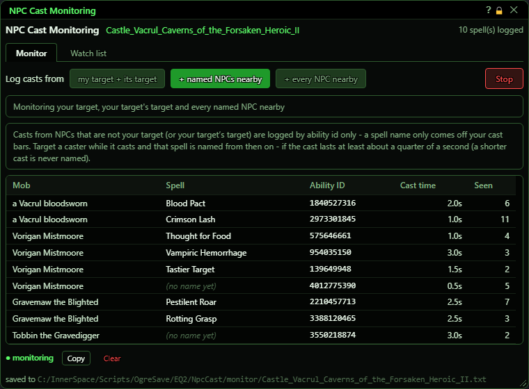

### The Monitor before you start

Nothing logged yet, so Copy and Clear are greyed out:

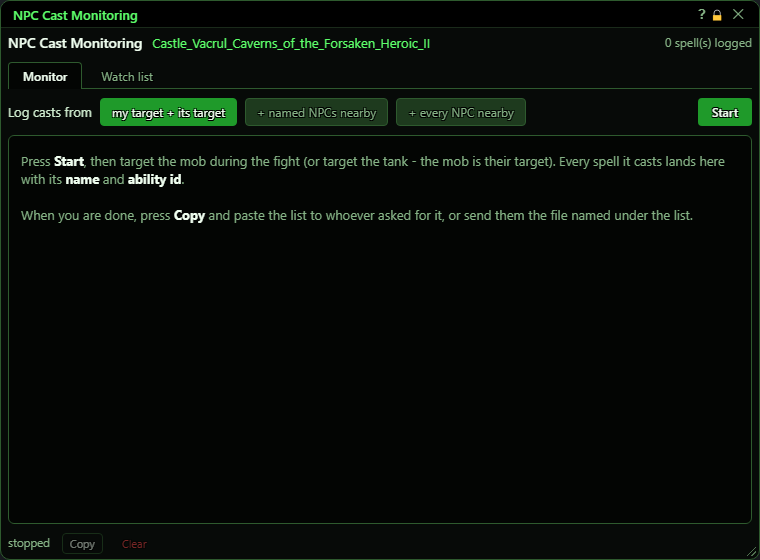

### Watch list: a mob folded away

The first mob is folded shut. The last mob has no spells listed, so it is 'watch only':

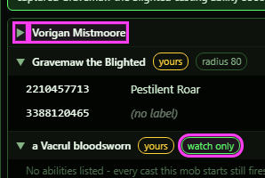

### Watch list: no list yet, and switched off

A zone with nothing listed, after a capture that failed (the target was not casting), with OgreBot closed and debug logging off:

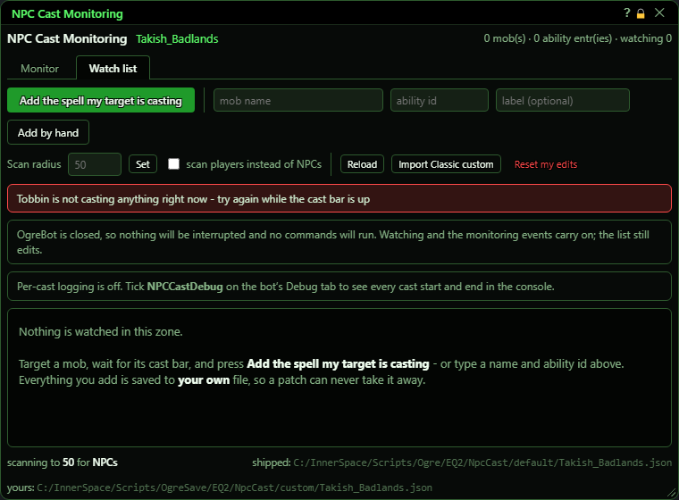

With the NPC Cast Monitoring checkbox turned off in OgreBot:

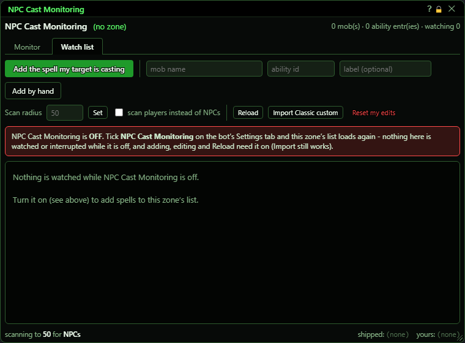
