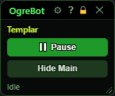
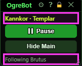
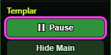
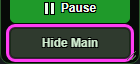
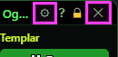
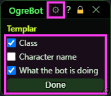
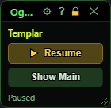

**OgreBot is in beta testing.** Looking for OgreBot Classic? [Click here](../../index.md).

# OgreBot

> **:bulb: In game - the ? button on this window says**
>
> The small OgreBot window: a quick remote for pausing the bot and showing or hiding the main OgreBot window.
>
> **What you can do here**
>
> - **Pause / Resume** - Pause stops the bot acting on its own (casting, following, camp spot, looting, Auto-Hunt). The button turns yellow and reads Resume.
> - **Hide Main / Show Main** - hides or shows the main OgreBot window. The bot keeps running.
> - **The top line** shows your class. The **cog** in the title bar lets you choose what this window shows: your class, your character's name, and a line saying what the bot is doing. Tick what you want and press Done.
> - **What the bot is doing** (the bottom line) - Paused, the ability it is casting (Cast: ...) or item it is using (Item: ...), Campspot active (a camp spot outranks following - while one is on, the bot is not following), who it is following, or Idle.
>
> **Good to know**
>
> - The X on this window stops OgreBot completely, the same as the X on the main window and `ogre end bot`. Unsaved changes are lost.
> - Unsaved changes show as a yellow star (*) on the main OgreBot window only, not on this one.
> - Your choices from the cog are kept for next time.
> - Pause only affects this character. Commands you send still work while paused.

**Open it:** It opens by itself whenever OgreBot loads (type `ogre`), next to the main OgreBot window. `ogre end bot` closes both. Opening it again while it is open does nothing (typing `ogre` reloads the whole bot instead).

## What it is for

The small OgreBot window is a remote for the bot and a quick look at what it is doing. The top line shows your class. Pause stops the bot from acting on its own and Resume starts it again. Hide Main hides the big OgreBot window and Show Main brings it back. The bottom line says what the bot is doing right now. The cog in the title bar picks which of the two lines you see. OgreBot normally loads with the big window hidden, so this small window is what you see.

## The top line and the status line

Both lines update by themselves while the bot runs. Here the character name is turned on in the cog, and the bot is following someone.

| Control | What it does | Default |
|---|---|---|
| **Top line** | Shows your class, for example Templar. If you tick Character name in the cog, your name comes first: Kannkor · Templar. If neither is ticked, the line goes away and the buttons get the room. | your class |
| **Status line (bottom)** | What the bot is doing right now. Only the first of these that is true shows: Paused, then Cast: and the ability the bot is casting, then Item: and the item it is using, then Campspot active (a camp spot holds the character, so following waits), then Following and who it follows, and otherwise Idle. *Cast: and Item: show only what the bot itself casts or uses, not what you click.* | shown |

## Pause and Resume

| Control | What it does | Default |
|---|---|---|
| **Pause / Resume** | Pause stops this character's bot from acting on its own, for example: no new casts from the cast stack, no following, no pulling back to the camp spot, no looting, no auto-targeting, no Auto-Hunt. Commands you send still work. The button turns yellow and reads Resume. Click it to start the bot again. *Only this character pauses, not the group. If something else pauses or resumes the bot, the button updates by itself.* | running (Pause shown) after `ogre`; paused after `ogre -p` or `ogre -ph` |

## Show / Hide the main window

| Control | What it does | Default |
|---|---|---|
| **Hide Main / Show Main** | Hides the big OgreBot window, or shows it again. The bot keeps running either way. Only the window is hidden. | Show Main (the big window starts hidden after `ogre`) |

## Title bar

Besides the usual ? (help) and lock, the title bar has the cog, which picks what this window shows (see below), and the X. The title is cut short to keep the window small. Unsaved changes show only on the big OgreBot window.

| Control | What it does |
|---|---|
| **Title bar close (X)** | Shuts OgreBot down completely, the same as the X on the big window and `ogre end bot`. Both windows close, movement and HUDs stop, the profile is unloaded, and unsaved changes are thrown away. *To just get the big window out of the way, use Hide Main.* |

## Choosing what the window shows

The cog in the title bar opens a short list in place of the buttons. Tick what you want to see and press Done.

| Control | What it does | Default |
|---|---|---|
| **Title bar cog** | Opens the list. The window gets bigger while the list is open and goes back to its own size when it closes. Click the cog again to close it without saving. |  |
| **Class** | Shows your class on the top line. | on |
| **Character name** | Shows your character's name on the top line, in front of the class. | off |
| **What the bot is doing** | Shows the status line under the buttons. | on |
| **Done** | Saves your ticks, closes the list and brings the buttons back. The choice is kept for next time. |  |

## What the window shows

- Top line: your class, with your name in front when it is picked in the cog.
- Pause (green) = the bot is running. Resume (yellow) = the bot is paused.
- Show Main = the big window is hidden. Hide Main = it is on screen.
- Bottom line: Paused, Cast: ..., Item: ..., Following ..., Campspot active, or Idle.

## Good to know

- The X on this small window stops OgreBot. It is not a minimize.
- Pause only stops what the bot decides by itself. Commands from you or your group still run.
- The cog's choice is saved for the whole computer, not for each character.

## Paused, with the main window hidden

