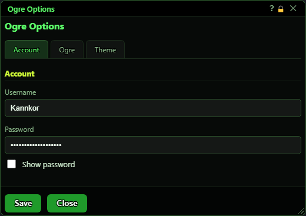
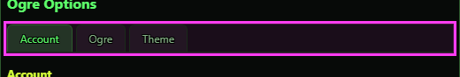
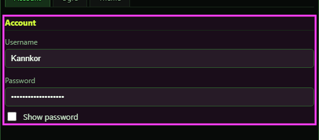
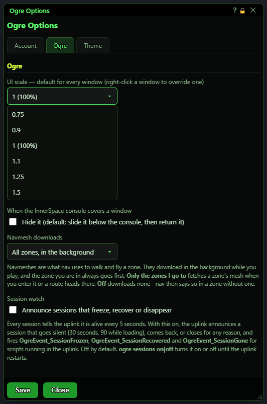
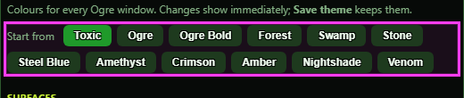
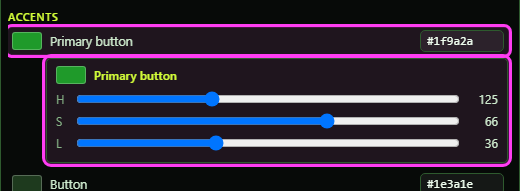
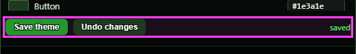
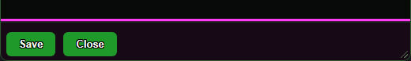
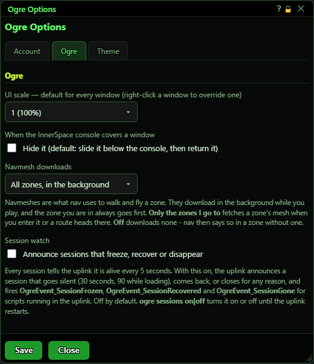
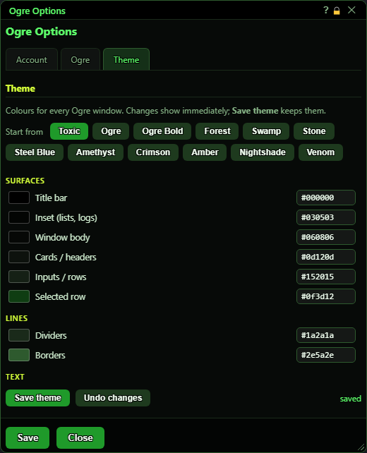

# Ogre Options

**OgreBot is in beta testing.** Looking for OgreBot Classic? [Click here](../../index.md).

> **:bulb: In game - the ? button on this window says**
>
> Settings for Ogre itself, shared by every character on this PC. Open it with `ogre config`.
>
> **What you can do here**
>
> - **Account** - your Ogre login. Saving it while logged out tries to log in again.
> - **Ogre** - the size of every window (UI scale); whether windows hide or slide down when the InnerSpace console covers them; navmesh downloads (all zones, only the zones you go to, or none); and the **Session watch**: the uplink announces a session that freezes, recovers or disappears, and fires an event for uplink scripts (off by default).
> - **Theme** - pick a colour scheme, or change any colour. Changes show at once.
>
> **Good to know**
>
> - Nothing is kept until you press **Save**, which saves every tab. Closing undoes unsaved theme colours.
> - The UI scale, the InnerSpace console choice and the Session watch take effect when you press Save.
> - `ogre config` while this window is open does nothing - what you typed stays.
> - A window you scaled yourself (right-click its title bar) ignores the UI scale until you pick Scale: use default.

**Open it:** Type `ogre config` (or `ogre options` / `ogre info`) in the InnerSpace console. If it is already open, that does nothing - what you typed in it stays. It also opens by itself on the Account tab when your Ogre login is missing or wrong.

## What it is for

Ogre Options holds the settings that belong to Ogre itself rather than to one character's bot: your Ogre account login, how big every window is drawn, what happens when the InnerSpace console opens over a window, the colour theme, how navmeshes are downloaded, and whether the uplink watches for frozen sessions. Everything here is shared by every session on this PC. Nothing is kept until you press Save (the Theme tab also has its own Save theme button).

## Tabs

| Control | What it does | Default |
|---|---|---|
| **Account / Ogre / Theme** | Switches the page. Save saves every tab at once, not just the one you are looking at. | Account |

## Account tab

| Control | What it does | Default |
|---|---|---|
| **Username** | Your Ogre account name - the login OgreBot checks when it loads. *Saving a blank box does not erase the saved name.* | empty on a first install |
| **Password** | Your Ogre account password. If you are not logged in when you press Save, Ogre tries to log in again straight away ('Saved - logging in...'). If you are already logged in, a new password is used the next time the bot loads. *Saving a blank box does not erase the saved password.* | empty on a first install |
| **Show password** | Shows the password as text instead of dots so you can check it. *Display only - changes what you see, not what the bot does.* | off |

## Ogre tab

| Control | What it does | Default |
|---|---|---|
| **UI scale — default for every window (right-click a window to override one)** | How big every Ogre window is drawn: 0.75, 0.9, 1 (100%), 1.1, 1.25 or 1.5. Applies to all windows as soon as you press Save. A window you scaled yourself (right-click its title bar, Scale + / Scale −) keeps its own size until you pick Scale: use default on it. *The list opens inside the window and pushes the setting below it down, so every size is in view.* | 1 (100%) |
| **Hide it (default: slide it below the console, then return it)** | What happens to an Ogre window that the InnerSpace console covers when you open it. Off: the window slides down below the console and moves back when the console closes. On: the window is hidden while the console is open. *Like the UI scale, it takes effect when you press Save.* | off (slide it below) |
| **Navmesh downloads** | Navmeshes are the zone maps the bot uses to walk and fly. **All zones, in the background**: every zone's mesh downloads while you play, the zone you are in first. **Only the zones I go to**: a zone's mesh downloads when you enter it or a route heads there. **Off**: nothing downloads, and nav tells you when a zone has no mesh. *Takes effect as soon as you press Save. It is the same setting as `ogre patch mesh all\|ondemand\|off`.* | All zones, in the background |
| **Announce sessions that freeze, recover or disappear** | Every session tells the uplink it is alive every 5 seconds. With this on, the uplink announces a session that goes silent (30 seconds, 90 while loading), comes back, or closes for any reason, and fires OgreEvent_SessionFrozen, OgreEvent_SessionRecovered and OgreEvent_SessionGone for scripts running in the uplink. *Saved for the whole PC; Save also tells the uplink at once. `ogre sessions on\|off` turns it on or off until the uplink restarts.* | off |

## Theme tab - presets

The colours of every Ogre window. Changes show at once on every open window; they are kept only when you save.

| Control | What it does | Default |
|---|---|---|
| **Start from: Toxic, Ogre, Ogre Bold, Forest, Swamp, Stone, Steel Blue, Amethyst, Crimson, Amber, Nightshade, Venom** | Paints every window in that ready-made colour scheme. Any colour you change below is changed on top of the scheme you started from. The lit button is the scheme you are on; none is lit once you have changed a colour. | Toxic |

## Theme tab - colours

Each row is one colour used across all windows. Click the square to open Hue / Saturation / Lightness sliders under that row, or type a colour code (like #3f7f2b) in the box on the right.

| Control | What it does |
|---|---|
| **Title bar** | The bar at the top of every window. |
| **Inset (lists, logs)** | Sunken areas such as lists, logs and the console's input box. |
| **Window body** | The main background of every window. |
| **Cards / headers** | Boxes and header strips inside a window. |
| **Inputs / rows** | Text boxes, dropdowns and list rows. |
| **Selected row** | The highlight on the row you picked in a list. |
| **Dividers** | Faint lines between sections. |
| **Borders** | Outlines around boxes and inputs. |
| **Text** | Normal text. |
| **Bright text** | Stand-out text, and the text on buttons. A light colour here gives the text on buttons and tabs a thin black outline so it stays readable. |
| **Dim text** | Labels and hints. |
| **Faint text** | The least important text, such as 'nothing here' messages. |
| **Primary button** | The main button in a window, such as Save. |
| **Button** | All other buttons. |
| **Grid buttons (MCP, For Who)** | The button grids in the Master Control Panel and the For Who picker. |
| **Focus / hover ring** | The outline on the box you are typing in or hovering over. |
| **Titles / links** | Window titles, links and the selected tab. |
| **Headings** | Section headings inside windows. |
| **Good** | Good news, such as 'Saved.' |
| **Warning** | Warnings, such as 'unsaved changes'. |
| **Bad** | Errors and problems. |
| **Colour square (opens H / S / L sliders)** | Opens sliders for that colour right under its row; the colour changes as you drag. Click the square again to close them. |
| **Colour code box (e.g. #1f9a2a)** | Type a colour code (#rgb or #rrggbb). It applies as soon as it is valid; an invalid code turns the box's border red. |

## Theme tab - saving

| Control | What it does |
|---|---|
| **Save theme** | Keeps the colours you see now. The main Save button at the bottom saves them too. *Other sessions on this PC pick up the new theme the next time their windows reload.* |
| **Undo changes** | Goes back to the last saved theme. |
| **saved / unsaved changes** | Tells you whether what you see has been saved. |

## Save and Close

| Control | What it does |
|---|---|
| **Save** | Saves every tab: your login, UI scale, the console setting, navmesh downloads, and the theme if you changed it. The UI scale and console setting apply right away. The text beside it shows 'Saving…', then 'Saved.', 'Saved - logging in...' or 'Save FAILED'. |
| **Close** | Closes the window without saving. Unsaved theme changes are undone. |
| **Title bar close (X)** | Same as Close. |

## What the window shows

- Every option here is for the whole PC, not one character. They live in OgreSave\Common\OgreOptions.json (UI scale), OgreSave\Common\OgreConsole.json (the console setting), OgreSave\Common\UIState.json (the theme) and OgreSave\patcher.json (navmesh downloads). The login is kept separately in OgreSavePrivate\Common\ISXOgre.json.
- The text to the right of Close is the result of your last Save.

## Good to know

- Nothing is kept until you press Save. Closing the window throws away unsaved changes, including theme colours you were trying out.
- Save saves all four tabs at once.
- A window you scaled yourself ignores the UI scale here. Right-click its title bar and pick Scale: use default to make it follow again.
- The InnerSpace console setting is about the InnerSpace console (the one you type `ogre` commands in), not OgreConsole.
- A new password is only used right away if you were not logged in. Otherwise it takes effect the next time the bot loads.

## Ogre tab

## Theme tab

