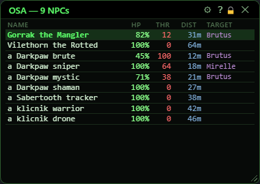
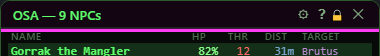
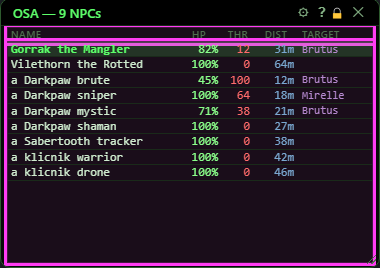
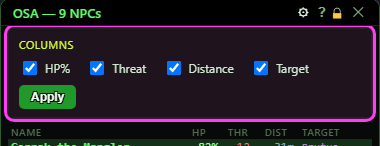
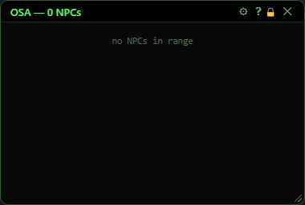

# OSA

**OgreBot is in beta testing.** Looking for OgreBot Classic? [Click here](../../index.md).

> **:bulb: In game - the ? button on this window says**
>
> The On Screen Assistant: the NPCs around you with health, your threat, distance and who they are attacking. Named first, then nearest first - up to 35 rows, and every named in range comes before any other NPC.
>
> **What you can do here**
>
> - **Click a row** to target that NPC. The green row is the one you are fighting.
> - **Gear** - choose the columns (HP, Threat, Distance, Target), then **Apply**.
> - Set how far it looks, "targets only" and Clip Y Axis in OgreBot, HUDs tab, OSA section.
>
> **Good to know**
>
> - It opens and closes with **Use On Screen Assistant (OSA)** on OgreBot's Settings tab; `ogre osa` also opens it (and does nothing if it is already open).
> - THR is your threat in percent; at 100 it shows your lead over the next player.
> - Clip Y Axis hides NPCs 8 or more above or below you - the floors over and under you.

**Open it:** Tick **Use On Screen Assistant (OSA)** on OgreBot's Settings tab - it opens at once, opens every time that profile loads, and closes when you untick it. You can also type `ogre osa`.

## What it is for

A compact list of the NPCs around you: name, health, your threat, distance, and who each one is attacking. Named mobs are listed first, then the rest nearest first. Click a row to target that NPC. How far it looks, whether it hides NPCs that are not fighting and whether it hides NPCs on other floors are set in OgreBot, on the HUDs tab (OSA section).

## Title bar

The title shows how many NPCs are listed, for example OSA — 9 NPCs.

| Control | What it does |
|---|---|
| **⚙ (gear)** | Opens and closes the column picker at the top of the window. |
| **Title bar close (X)** | Closes the window. The OgreBot box stays ticked; type `ogre osa` to bring it back. *To turn OSA off for good, untick the box in OgreBot.* |

## The list

| Control | What it does |
|---|---|
| **Click a row** | Targets that NPC. |

## Column picker

Opened with the gear. Name is always shown.

| Control | What it does | Default |
|---|---|---|
| **HP%** | Shows the HP column: the NPC's health in percent. | on |
| **Threat** | Shows the THR column: your threat on that NPC in percent. When you are at the top of its hate list (100), it shows how far ahead of the next player you are instead. | on |
| **Distance** | Shows the DIST column: how far away the NPC is, in metres. | on |
| **Target** | Shows the TARGET column: the name of whoever that NPC is targeting. Empty means it is not targeting anyone. | on |
| **Apply** | Uses the ticked columns, closes the picker, and remembers the choice for next time. *Ticking a box does nothing until you press Apply.* |  |

## What the window shows

- Rows: NPCs and named NPCs only - no players, pets, corpses or objects. Named first, then everyone else, each group nearest first. At most 35 rows - every named in range is listed before any other NPC, so a far-away named is never the one cut.
- Green row with bold green name: the NPC you are fighting - your target, or your target's target if you have a friend targeted.
- HP: health in percent. THR: your threat in percent, or your lead over the next player once you are at 100. DIST: distance in metres. TARGET: who that NPC is targeting.
- 'no NPCs in range' when nothing is inside the scan radius.
- It refreshes 5 times a second.

## Good to know

- Scan Radius, Display NPCs with Targets Only and Clip Y Axis (OgreBot, HUDs tab) only apply while the Use On Screen Assistant box is ticked. If you open OSA with `ogre osa` and the box is not ticked, it looks 50 metres out and lists every NPC on every floor.
- Scan Radius is capped at 200 metres.
- Clip Y Axis (only show mobs on the same floor as you), in the same OgreBot section, hides every NPC whose height differs from yours by 8 or more.
- `ogre osa` when OSA is already open does nothing and prints nothing.

## Empty

