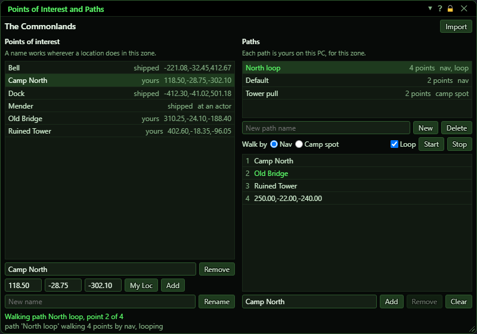
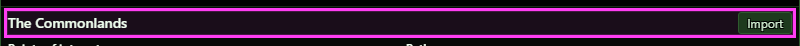
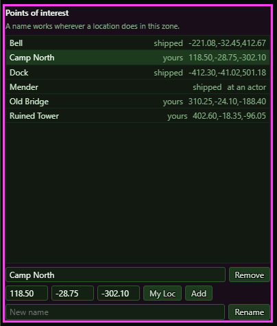
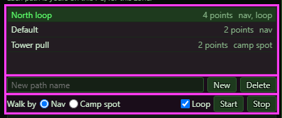
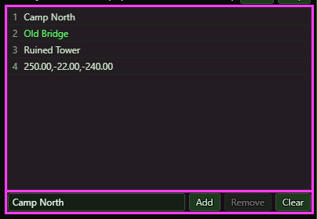
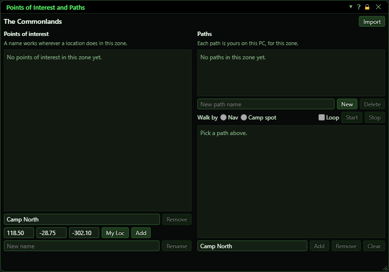

**OgreBot is in beta testing.** Looking for OgreBot Classic? [Click here](../../index.md).

# Points of Interest and Paths

> **:bulb: In game - the ? button on this window says**
>
> Names spots in the zone you are in, and saves walks through them. They are kept on this PC, for every toon.
>
> **What you can do here**
>
> - **Add** - save a point of interest at x, y, z. Leave those blank to use where you stand. **My Loc** fills them in for you.
> - **Remove / Rename** - change a point of interest of your own.
> - **New / Delete** - make or drop a path. A zone can hold as many as you like.
> - **Add / Insert / Remove / Clear** under the point list - build the path. Add goes on the end, Insert goes above the selected point. A point is a point of interest or x,y,z.
> - **Drag a point** to move it in the list.
> - **Nav / Camp spot** - how the toon walks that path. **Loop** starts it over after the last point.
> - **Start / Stop** - walk the path on this box.
> - **Import** - bring this zone's old AutoHunt path across from OgreBot Classic.
>
> **Good to know**
>
> - A point of interest's name works wherever a location does in this zone: `-ChangeCampSpot`, `-TravelMesh`.
> - A shipped point of interest cannot be removed or renamed. Adding your own of that name overrides it.
> - Start stops with a line if a point cannot be found, before anything moves. Zoning ends a walk.
> - The first time you enter a zone with an old AutoHunt path, it comes across by itself as a path called Default. Nothing you already have is overwritten, and what you delete does not come back unless you press **Import**.
> - The Auto-Hunt tab picks one of these paths to walk between pulls, and its **Edit** button opens that path here. So does `ogre paths <path>`.
> - A walk under way keeps the points it had when it started. Stop and Start walks the new order.

**Open it:** Type `ogre paths`. To open it on one path, type `ogre paths <path>` or press **Edit** beside the path picker on the Auto-Hunt tab of OgreBot. `ogre end paths` or the window's X closes it. A path being walked goes on.

## What it is for

This window holds the named spots and the saved walks of the zone you are in. A point of interest is a name for a spot: the name then works wherever a location does in this zone, such as `-ChangeCampSpot`, `-NavTo` and `-TravelMesh`. A path is a list of points that a toon walks in order, and a zone can hold as many paths as you like. Both are kept on this PC, for every toon, and everything here also has a command for scripts.

## Zone and Import

The top line names the zone everything below belongs to. While you are zoning, or while the travel data loads, it says why the lists are empty.

| Control | What it does |
|---|---|
| **Import** | Brings this zone's saved Auto-Hunt route across from OgreBot Classic, even if that was done before. A name or path already here is never overwritten. *This also happens by itself, once, the first time you enter a zone that has an old route.* |

## Points of interest

Click a row to fill in the name, the x, y, z boxes and the path's Point box.

| Control | What it does |
|---|---|
| **Name (box)** | The name of the point of interest to add. It cannot be empty, hold a comma or read as a number, because it would then read as a location. |
| **x / y / z (boxes)** | Where the point of interest is. Leave all three blank to use where you stand. |
| **My Loc** | Fills x, y and z from where you stand, so you can change them before you add. |
| **Add** | Saves the point of interest in this zone. A name you already have moves to the new spot. A name the bot ships with is overridden by yours, and it stays yours until you remove it. |
| **Remove** | Removes the selected point of interest of yours. If it was overriding a shipped one, the shipped one is back. *Greyed out for a shipped point of interest.* |
| **New name (box)** | The new name for Rename. |
| **Rename** | Renames the selected point of interest of yours. A name another point of interest here holds is refused, and a path that used the old name does not follow it. *Greyed out for a shipped point of interest.* |

## Paths

Click a path to select it. Its points show in the list under these buttons.

| Control | What it does | Default |
|---|---|---|
| **New path name (box)** | The name of the path to make. |  |
| **New** | Makes an empty path in this zone. It walks by Nav and does not loop until you change it. A name already here is refused, so a slip cannot empty a path. |  |
| **Delete** | Deletes the selected path. *No confirmation.* |  |
| **Walk by Nav / Camp spot** | How the toon walks this path. Nav goes to each point on the navigation map. Camp spot moves the camp spot to each point and lets the leash bring the toon. | Nav |
| **Loop** | Starts the path over at the first point after the last, until something stops it. A path of one point goes there and finishes, and so does a loop whose points are all where you stand. | off |
| **Start** | Walks the selected path on this box, in place of any walk under way. Every point is checked first: one that cannot be found stops it with a line, before anything moves. *It runs while OgreBot is paused, and OgreBot must be open.* |  |
| **Stop** | Stops the walk on this box. The toon stands where it is. |  |

## Points of the path

The selected path's points, in the order they are walked. Drag a row to move that point: a line shows where it lands, the points between shift one place, and a plain click still selects the row.

| Control | What it does |
|---|---|
| **Point: a name, or x,y,z (box)** | The point to add: the name of a point of interest, or x,y,z. A name is looked for when the path starts, so its point of interest can come later. |
| **Add** | Adds the point to the end of the selected path. |
| **Insert** | Puts the point in above the selected point, which moves down one. The new point is then the selected row. *Greyed out until a point is selected.* |
| **Remove** | Removes the selected point. A path that passes the same point twice keeps the other one. |
| **Clear** | Takes every point off the selected path. The path stays, with its Walk by and Loop settings. *No confirmation.* |

## What the window shows

- 'shipped' or 'yours' beside a point of interest: shipped ones come with the bot and cannot be removed or renamed.
- 'at an actor' in place of a location: a shipped point of interest that names an actor, not a spot. It has no location of its own, so a path or a location verb cannot use it.
- Green text: the path being walked and the point it is walking to, with a line under the lists saying the same. After an edit the line still reads the walk, and no row is green if the list no longer holds that point at that place.
- The last line of the window: the last thing the bot said about a point of interest or a path, a refusal included.

## Good to know

- Everything here is for the zone you are in. Another zone has its own points of interest and paths.
- Zoning ends a walk, with a line. So does a point the toon cannot get to, and closing OgreBot.
- A walk waits while something else has the toon and goes on from the same point: a fight, a death until a res or a revive in the same zone, a pull of Auto-Hunt, a movement block, the Pause of the Nav window. The last line of this window says what it is waiting for.
- The first time you enter a zone that has an old OgreBot Classic route, it comes across by itself as a path called Default, and one line says how many points came and which did not. What you delete afterwards does not come back unless you press Import.
- A camp spot walk needs 'Allow Camp Spot' on for that toon. A walk that finishes leaves the camp spot at its last point, and the camp spot you had before does not come back. Stop clears the camp spot, and the toon stands where it is.
- The Auto-Hunt tab picks one of these paths to walk between pulls, and it only walks: it never flies one. Start here walks a path with no hunting, and that walk may fly. Hunting does not end that walk, and the walk waits while Auto-Hunt works a pull. Auto-Hunt pulls nothing in the air, so a walk that flies is never held for one.
- A walk under way keeps the points it had when it started. Change the path as you like: Stop and Start walks the new order, and so does the next pick on the Auto-Hunt tab.
- A move or an insert is refused with a line if another box changed the list since you saw it, so a point never lands in the wrong place.
- A path or a point of interest saved on one box shows on every other box on this PC within a second or so.

### For scripts

The same things have commands: `OgreBotAPI.POI` for points of interest and `OgreBotAPI.Paths` for paths. In OgreConsole, `-POI_Add` saves a point of interest, `-Path` walks a path and `-PathStop` stops it. The verbs that change a path take a for-who first: paths are shared by every box on the PC, so name one box and one line changes the path once. `OgreBotAPI.Paths:InsertPoint` and `MovePoint` take a place counted from 1. `ISXOgreEQ2.Paths:Open` opens this window, on a path if you name one (`ISXOgreEQ2.Paths:Open[North Loop]`): any panel or script that wants a path edited calls that.

### A zone with no points of interest yet

