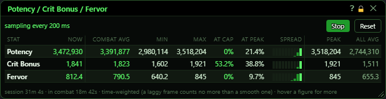
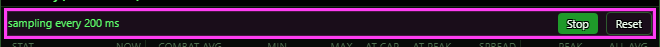
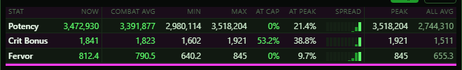
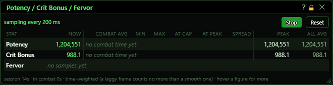
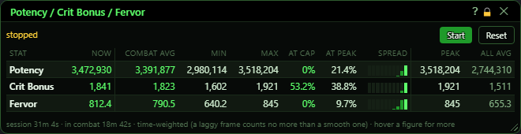

# Potency / Crit Bonus / Fervor

**OgreBot is in beta testing.** Looking for OgreBot Classic? [Click here](../../index.md).

> **:bulb: In game - the ? button on this window says**
>
> Records your Potency, Crit Bonus and Fervor during fights and shows averages, lows, highs and time at cap. It only measures; it changes nothing.
>
> **What you can do here**
>
> - **Stop / Start** - pause and carry on recording. The numbers are kept.
> - **Reset** - throw away every number and start the session over.
> - **Hover** a figure for more detail.
>
> **Good to know**
>
> - **At cap** is when the game says the stat is capped. **At peak** is time at your best value this session.
> - Closing the window does not stop recording; use **Stop** or `ogre potcb off`.

**Open it:** Type `ogre potcb` (or `ogre cbpot`). This opens the window and starts recording. `ogre potcb off` (or `ogre end potcb`) stops recording and closes it.

## What it is for

This window records your Potency, Crit Bonus and Fervor several times a second and shows how they behaved during your fights: the average, lowest and highest value in combat, how much of the time the game said the stat was capped, and how much of the time you were at your best value. It is a measuring tool only; it does not change what the bot does. All the averages are weighted by time, so a slow frame does not count more than a smooth one.

## Start, Stop and Reset

The green text on the left says 'sampling every 200 ms' while recording, or 'stopped'.

| Control | What it does | Default |
|---|---|---|
| **Start / Stop** | Stop pauses the recording. Start carries on from where it stopped; the numbers so far are kept. The time while stopped is not counted. | Stop (recording starts when the window is opened) |
| **Reset** | Throws away every number and starts the session over. Recording keeps going if it was on. *No confirmation.* |  |

## The table

One row per stat. Hover most numbers for more detail.

## What the window shows

- Now: the value right now.
- Combat avg: your average while in combat (hover for how long you have been in combat). Out of combat you are usually unbuffed, so combat is what matters.
- Min / Max: the lowest and highest value seen in combat.
- At cap: the share of combat time the game's own tooltip said the stat had reached its cap.
- At peak: the share of combat time you were at (or within 0.1% of) the highest value seen this session. When a new highest value appears, this starts again from zero, so it is optimistic early on.
- Spread: a small bar chart of your combat time split into ten steps from 0% to 100% of your peak. The right-most (green) bar is time spent near your peak. Hover a bar for its exact share. Like At peak, it starts again when a new peak appears.
- Peak: the highest value seen this session, in or out of combat (hover for how long ago it was set).
- All avg: the average over the whole session, in and out of combat (hover for the overall min and max).
- 'no combat time yet': recording, but you have not been in combat. 'no samples yet': the stat has not been read yet.
- Footer: how long the session has been recording and how much of it was in combat.

## Good to know

- Closing the window with the X does not stop the recording. Use Stop, or `ogre potcb off`.
- Opening the window with `ogre potcb` always starts recording.
- Zoning is not counted as time, so a long zone-in does not inflate 'At peak'.
- The numbers are lost when the bot is unloaded; nothing is saved to a file.

### Just started, before any combat

### Stopped

