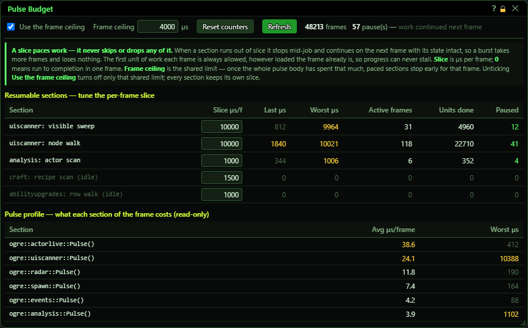
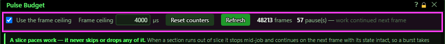
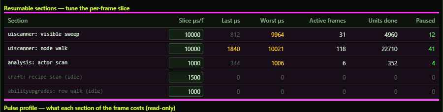
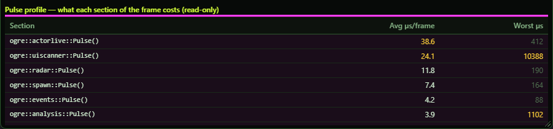
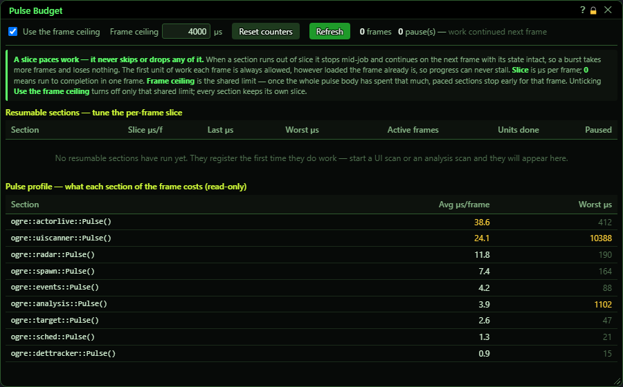

# Pulse Budget

**OgreBot is in beta testing.** Looking for OgreBot Classic? [Click here](../../index.md).

> **:bulb: In game - the ? button on this window says**
>
> A performance window. A few big jobs are spread over several frames so the game does not freeze; this shows how much time each may use per frame, and what every part of the bot really costs.
>
> **What you can do here**
>
> - **Slice** on a row: how long that job may run each frame, in microseconds. Lower it if the game stutters while the job runs. 0 runs it all at once.
> - **Frame ceiling**: a shared limit for the bot's work each frame. Untick **Use the frame ceiling** to turn off just that limit - each job keeps its own slice.
> - **Reset counters** and **Refresh** to measure again.
>
> **Good to know**
>
> - A slice never skips work - a job just takes more frames to finish.
> - Most players never need to change anything here.
> - A row marked (idle) has not run yet this session. Its slice can still be changed, and is used when it runs.

**Open it:** Type `ogre pulse` (or `ogre pulsebudget`). `ogre end pulse` closes it.

## What it is for

A performance window. The bot does its work in small steps, once every frame the game draws. A few big jobs - scanning a UI window, scanning all the actors for Analysis, walking a recipe book, walking the ability-upgrade list - would freeze the game for a moment if done in one go, so they are spread over several frames. This window shows how much time each of those jobs may take per frame, and how much time each part of the bot is really using. Most players never need to touch it. If the game stutters while one of these jobs runs, lower that job's slice; if a job takes too long and your PC has room to spare, raise it.

## Top row

On the right: how many frames have been counted, and how many times a job paused and carried on in the next frame. A pause never loses work.

| Control | What it does | Default |
|---|---|---|
| **Use the frame ceiling** | Turns the Frame ceiling on or off. Only the shared ceiling - each job's own slice still applies either way. *Despite the name, unticking it does not make jobs run in one go - set a job's slice to 0 for that.* | on |
| **Frame ceiling … µs** | A shared limit, in microseconds (millionths of a second), for the bot's whole work each frame. Once the bot has used this much in a frame, the paced jobs stop early for that frame and carry on in the next. 0 = no ceiling. *Saved when you press Enter or click away. Each job always gets at least one step per frame, however busy the frame is.* | 4000 µs (4 ms) |
| **Reset counters** | Sets the frame count, pause counts, Active frames, Units done and Worst back to zero, so you can measure from now. Slices are not changed. |  |
| **Refresh** | Updates the numbers. The window does not update by itself. |  |
| **Title bar close (X)** | Closes the window. Your slices and ceiling stay in force. |  |

## Resumable sections

One row per job that can be spread over frames. A job only appears after it has run once this session; jobs saved from earlier sessions are listed greyed out with '(idle)' - you can still set their slice, and it is used as soon as the job runs.

| Control | What it does | Default |
|---|---|---|
| **Slice µs/f (the box on each row)** | How long that job may run each frame, in microseconds, before it pauses and carries on in the next frame. 0 = run the whole job in one frame. Saved when you press Enter or click away. *On an '(idle)' row the new slice is saved and handed to that job the first time it runs.* | craft: recipe scan 1500, analysis: actor scan 1000, abilityupgrades: row walk 1000 |

## Pulse profile

Read-only. Every part of the bot that runs each frame, costliest first, with its average and worst time per frame. Parts using less than half a microsecond on average are left out. Useful for spotting what is slowing the game down.

## What the window shows

- Section: the job's name - what it belongs to, then what it does.
- Last µs: how long the job ran the last frame it had work. Yellow at 1000 µs (1 ms) or more.
- Worst µs: its longest single frame since the last reset. Yellow at 1000 µs or more.
- Active frames: how many frames it did any work in.
- Units done: how many steps of work it got through.
- Paused: how many times it ran out of time and carried on in the next frame (green when above 0 - that is pacing working, not a problem).
- (idle): a job with a saved slice that has not run yet this session.
- Pulse profile - Avg µs/frame: yellow at 20 µs or more. Worst µs: yellow at 1000 µs or more.
- When no job has run yet, the table is replaced by a note saying so.

## Good to know

- A slice never skips work. A small slice only makes a job take more frames to finish.
- 1000 µs is 1 millisecond. At 60 frames a second a whole frame is about 16,600 µs.
- Settings are saved to OgreSave/EQ2/OgreBot/pulse-budget.json and apply to every character on this PC.
- The numbers are a snapshot - press Refresh to see new ones.

Straight after loading, before any paced job has run (and with no saved settings), the table is empty:

Console: `ogrepulsebudget report` prints the same table; `ogrepulsebudget slice <section or number> <µs>` and `ogrepulsebudget ceiling <µs>` set values.
