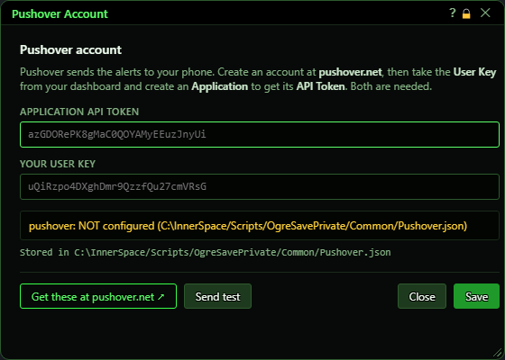
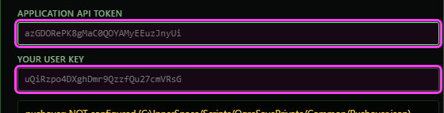
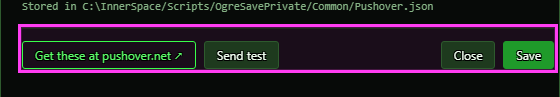
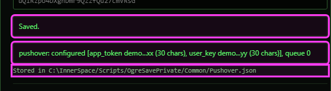

# Pushover Account

**OgreBot is in beta testing.** Looking for OgreBot Classic? [Click here](../../index.md).

> **:bulb: In game - the ? button on this window says**
>
> Where you enter your two Pushover keys, so the bot can send alerts to your phone.
>
> **What you can do here**
>
> - **Get these at pushover.net** opens the site in your browser.
> - **Application API token** - from an application you create on pushover.net.
> - **Your user key** - from your Pushover dashboard.
> - **Save** stores both keys and clears the boxes. Both are needed - if one is missing, or the save fails, it says so in red and keeps what you typed.
> - **Send test** sends a test alert to your phone. The console says if it is on its way, or why not.
>
> **Good to know**
>
> - Your saved keys are never shown in full.
> - Which alerts are sent is set on the OgreBot Pushover tab. Its Disable boxes also block the test.

**Open it:** In OgreBot, open the **Pushover** tab and click **Set up Pushover account**.

## What it is for

Pushover is a phone app that the bot can use to send you alerts (for example, a tell, or a loot window left open). This window is where you enter your two Pushover keys: the API token of an application you create on pushover.net, and your own user key from your Pushover dashboard. Both are needed. The window never shows your saved keys in full - only their first 4 and last 2 characters.

## Your keys

| Control | What it does | Default |
|---|---|---|
| **Application API token** | Paste the API token of the application you created on pushover.net. Pressing Enter is the same as Save. *The grey text in an empty box is only an example of what a key looks like.* | empty |
| **Your user key** | Paste your user key from your pushover.net dashboard. Pressing Enter is the same as Save. | empty |

## Buttons

| Control | What it does |
|---|---|
| **Save** | Saves both keys, replacing any you had before, and the bot starts using them straight away. A green 'Saved.' appears, both boxes are cleared and the status box shows the keys as configured (in green). The window stays open. *Both boxes must be filled - with one empty nothing is saved, a red message says which one is missing, and what you typed stays in the boxes. If the file cannot be written, a red message says so and your text stays too.* |
| **Send test** | Sends a test alert to your phone: 'Test from OgreBot. If you can read this, your Pushover details are working.' The console says whether it is on its way, or why it was not sent. *It obeys the Pushover tab: with 'Disable ALL Pushover Messages' or 'Disable Normal Pushover Messages' ticked, the test is not sent.* |
| **Get these at pushover.net ↗** | Opens pushover.net in your web browser, outside the game. |
| **Close** | Closes the window. Anything typed but not saved is thrown away. |
| **Title bar close (X)** | Closes the window without saving, the same as Close. |

## After saving

The status box shows the first 4 and last 2 characters of each key, their length, and how many alerts are waiting to be sent.

## What the window shows

- Status box: 'pushover: NOT configured (...)' in yellow when either key is missing, or 'pushover: configured [app_token abcd...xy (30 chars), user_key abcd...xy (30 chars)], queue 0' in green when both are saved. 'queue' is the number of alerts waiting to go out.
- Stored in ... - the file your keys are saved in: OgreSavePrivate\Common\Pushover.json in your InnerSpace Scripts folder (your private settings folder - do not share it).

## Good to know

- Which alerts are sent is set on the OgreBot Pushover tab, not here.
- Save keeps the other settings in Pushover.json (default title, priority and so on); it only replaces the two keys.

