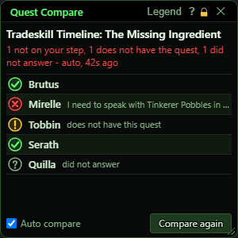
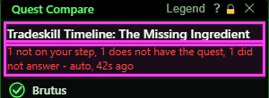
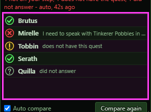
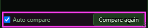
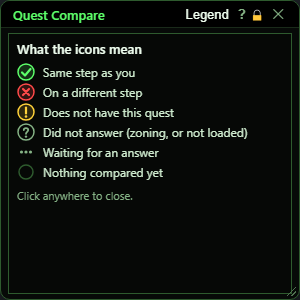
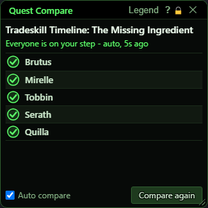
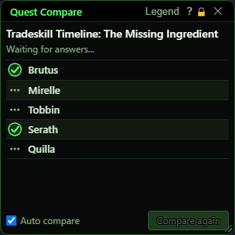
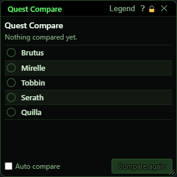

# Quest Compare

**OgreBot is in beta testing.** Looking for OgreBot Classic? [Click here](../../index.md).

> **:bulb: In game - the ? button on this window says**
>
> Shows whether each member of your group is on the same step of a quest as you.
>
> **What you can do here**
>
> - **Auto compare**: every time one of your quests updates, the group is asked to compare it. Turn it on for one character per group.
> - **Compare again** asks about the last quest again, right now.
> - **Legend** (title bar) shows what each icon means.
>
> **Good to know**
>
> - Green tick = same step. Red cross = different step (their line is shown). Orange ! = does not have the quest. Grey ? = did not answer.
> - Ticking Auto compare here unticks it on the rest of your group.
> - The window pops up by itself when an automatic compare finds someone out of step.

**Open it:** Type `ogre questcompare` (or `ogre qc`). It also opens by itself when you tick Auto compare / Enable Quest Compare, and when an automatic compare finds someone out of step. `ogre end questcompare` closes it.

## What it is for

Checks whether everyone in your group is on the same step of a quest as you. One character is the reference. When its quest updates, it asks the rest of the group to compare their step with its own, and this window shows the answer: one row per group member with an icon. The comparison happens on each member's own session, so the character that is out of step also says so in its own console.

## Quest and summary line

The top line is the quest that was compared last. Under it is a one-line summary, for example 'Everyone is on your step' in green, or '1 not on your step, 1 does not have the quest' in red, followed by 'auto' if the compare was automatic and how long ago it happened.

## The member rows

One row per group member (not you). A member on a different step shows the first line of their quest step that differs from yours. See the Legend section for what each icon means.

## Auto compare and Compare again

| Control | What it does | Default |
|---|---|---|
| **Auto compare** | The same setting as OgreBot's Enable Quest Compare. On: every time one of YOUR quests updates (and then stays quiet for 1.5 seconds), the bot asks the group to compare that quest. Ticking it here also unticks it on everyone else in the group, so there is one reference per group. *Solo there is nobody to ask, so nothing happens. An automatic compare stays quiet in the console when everyone is in step, and pops this window up when someone is not.* | off |
| **Compare again** | Asks the group to compare the quest shown at the top again, right now. *Greyed out until something has been compared once, and while a compare is still waiting for answers.* |  |
| **Legend** | Shows or hides the icon legend over the window. Click anywhere on the legend to close it. |  |
| **Title bar close (X)** | Closes the window. Auto compare keeps working and will reopen the window if it finds a problem. |  |

## Legend - what the icons mean

Press **Legend** in the title bar to see this. Green tick = on the same step as you. Red cross = on a different step (the row shows their line). Orange ! = does not have this quest at all. Grey ? = did not answer in time (zoning, or the bot is not loaded on that character). Three dots = still waiting for an answer. Empty ring = nothing compared yet.

## What the window shows

- Summary line: 'Reading your journal...' and 'Waiting for answers...' while a compare runs; 'Could not compare: <reason>' in orange when your own journal could not be read (for example 'not in your quest journal' or 'no active step to compare'); 'Waiting for your next quest update.' when Auto compare is on and nothing has been compared yet; 'Nothing compared yet.' otherwise; 'Not in a group' when a compare finished and you have no group members (the list then says 'No group members to compare with').
- Rows: your group members only (up to 5). Raid members outside your group are not asked.
- A different-step row shows the first line of THEIR step that differs from yours. Hover it to read the whole line.

## Good to know

- Only one character per group should have Auto compare on. Ticking it on one character unticks it on the rest of the group automatically.
- The first compare has to come from a quest update (Auto compare) or from the `-CompareQuest` console command. Compare again only repeats the last quest.
- To read its step, each character makes that quest the current one in its quest journal, so the quest selected in your journal changes.
- A member who is zoning or does not have the bot loaded shows the grey ? - it is not the same as being out of step.
- Completing a quest also counts as an update; the automatic check stays quiet about a quest that is gone.

## Other states

  

Left to right: everyone in step, a compare still waiting for answers, and a fresh window before anything was compared.

