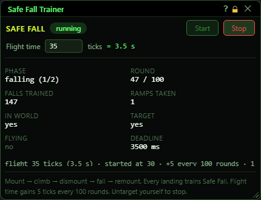
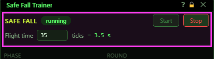
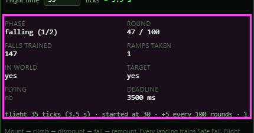
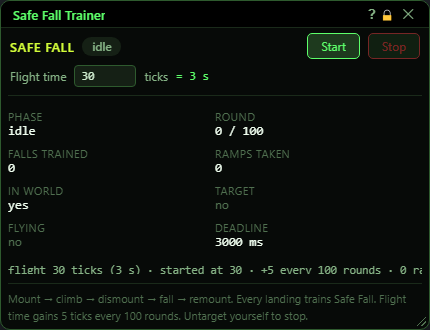
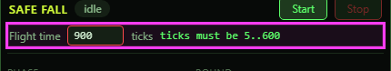

# Safe Fall Trainer

**OgreBot is in beta testing.** Looking for OgreBot Classic? [Click here](../../index.md).

> **:bulb: In game - the ? button on this window says**
>
> Trains Safe Fall for you: mount, fly up, dismount, fall, land, remount, repeat. Every landing is a skill-up chance.
>
> **What you can do here**
>
> - **Flight time** - how long each climb lasts, in ticks (10 ticks = 1 second, 5 to 600).
> - **Start** - target yourself, mount up and begin. It is dimmed, and does nothing, while a run is going or you are not in the world.
> - **Stop** - end training where you are.
> - Watch the phase, rounds, falls trained and ramps as it runs. "started at" is the flight time this run began with.
>
> **Good to know**
>
> - Clear your target to stop it; any target (even a mob) keeps it going.
> - Every 100 rounds the flight grows by half a second, up to 25 seconds.
> - Zoning ends the run. Do not mix it with follow, nav or a camp spot.

**Open it:** Type `ogre safefall panel`. `ogre safefall on` (or `ogre safefall on 45` for a 4.5 second flight) starts training without the window, `ogre safefall off` stops it, `ogre end safefall` (or the window's X) stops it and closes the window, and a bare `ogre safefall` prints its status in the console.

## What it is for

Trains your Safe Fall skill for you. It targets you, mounts up, then repeats: fly straight up for the flight time, dismount so you fall, wait until you land, remount, and go again. Every landing is a Safe Fall skill-up chance. Every 100 rounds the flight gets half a second longer so the falls get higher. It runs until you stop it, untarget yourself, or leave the world.

## Start, Stop and flight time

| Control | What it does | Default |
|---|---|---|
| **Start** | Starts training with the flight time in the box: targets you, mounts up, waits 7 seconds, then begins the climb-and-fall loop. *Dimmed, and does nothing, while training runs or while you are not in the world. To change the flight time, press Stop first.* |  |
| **Stop** | Stops training and stops the climb. You stay wherever you are (mounted or not). *Dimmed, and does nothing, when nothing is running.* |  |
| **Flight time (… ticks)** | How long each climb lasts, in ticks: 1 tick is 0.1 second, so 30 is 3 seconds (shown to the right). Allowed 5 to 600. *A number outside 5 to 600 turns the box red and Start refuses. The box follows the running value until you type in it; empty it to hand it back.* | 30 ticks (3.0 s) |

## Status

Read-only. It updates four times a second.

## What the window shows

- Pill next to SAFE FALL: 'running' (green), 'idle', or 'not in world' (red).
- Phase: what it is doing now - starting, flying up, stopping climb, dismounting, falling (1/2), falling (2/2), landed, remounting, idle.
- Round: how many rounds since the last flight-time increase, out of 100.
- Falls trained: completed climb-and-fall rounds since you pressed Start.
- Ramps taken: how many times the flight time has grown this run.
- In world / Target / Flying: yes or no. Target means you have something targeted (training stops when you have nothing targeted). Flying means you are flying on your mount.
- Deadline: the current flight time in milliseconds. It never goes above 25000 (25 seconds), even if the ticks keep growing.
- The long line: flight ticks and seconds, the flight time this run started at ('not started yet' before the first Start), the ramp rule, ramps so far and falls so far.
- The note box: the last thing that happened, for example 'dismounted - falling', 'self-target lost', 'left the world'.

## Good to know

- The quickest way to stop is to clear your target: training ends as soon as you have nothing targeted. Clicking a mob does not stop it - any target keeps it going.
- Zoning, camping or going to character select ends the run; it does not pick up again afterwards.
- It does not check whether something else is moving your character. Do not run it together with other movement (follow, nav, camp spot).
- Typing `ogre safefall on` while training is running starts over from round 0 (the Start button is dimmed then, so it cannot do this by accident).
- `ogre safefall panel` when the window is already open does nothing and prints nothing.
- Closing the window stops training, the same as `ogre end safefall`. Stop stops it and keeps the window open.

## Before you start

A flight time outside 5 to 600 ticks turns the box red:

