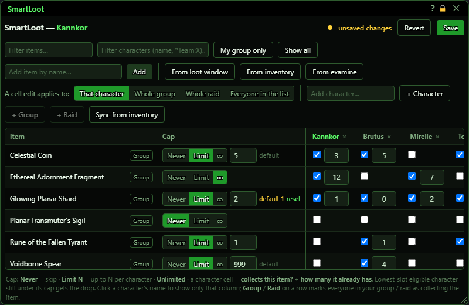
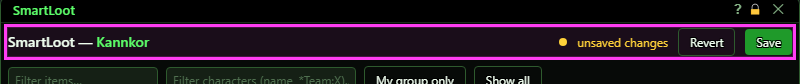
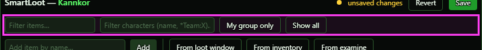
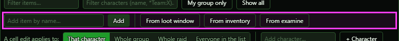
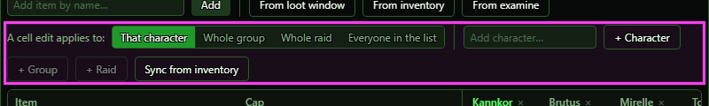
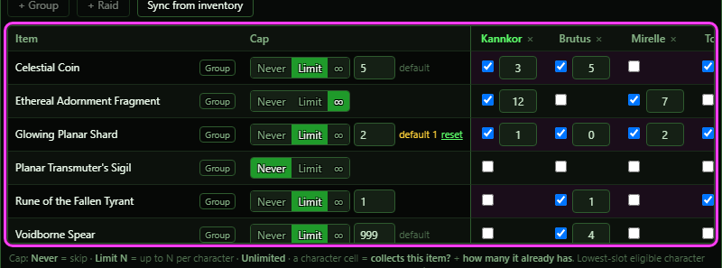
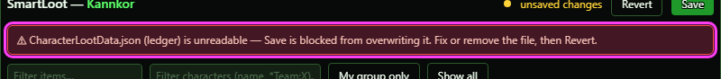

# SmartLoot

**OgreBot is in beta testing.** Looking for OgreBot Classic? [Click here](../../index.md).

> **:bulb: In game - the ? button on this window says**
>
> Decides who gets each drop from a Leader Only loot window. You list the items, a cap for each, and which characters collect them.
>
> **What you can do here**
>
> - **Add items** by name, or from the loot window, your bags, or an examine window.
> - **Set a cap** per item: Never, a Limit (up to N each), or unlimited.
> - **Tick a character** to say they collect an item; the number is how many they already have.
> - **+ Character** adds one column by name; **+ Group** and **+ Raid** add a column for everyone in your group or raid who does not have one yet (mercenaries left out). The number on the button is how many it would add.
> - **Save** writes your changes. **Revert** throws them away. Running `ogre smartloot` again while this is open changes nothing.
>
> **Good to know**
>
> - A drop goes to the lowest group or raid slot that collects it and is still under the cap.
> - It only runs on a Leader Only loot window, and only when the OgreBot Loot tab has both **Enable options below** (Leader Only) and **Smart Loot** ticked.
> - The x on a character column deletes that character's whole entry when you Save.

**Open it:** Type `ogre smartloot` or `ogre sl`. If the window is already open, this does nothing, and your unsaved changes stay. Scripts can use `OgreBotAPI.Loot:Config[all]` to open it and `OgreBotAPI.Loot:Config[all,close]` to close it.

## What it is for

SmartLoot hands out drops from a Leader Only loot window. It decides who gets each item from per-item caps and a per-character list of what each character collects and how many they already have. This window edits that data: the caps and, for each character, a checkbox plus a have-count. When a Leader Only window opens, SmartLoot goes through the raid (or group), lowest slot first. It gives the item to the first character who collects it and is still under the cap, then adds 1 to their have-count.

## Save and Revert

| Control | What it does |
|---|---|
| **Revert** | Throws away every unsaved edit and reloads the caps and the character list from disk. Items added this session and empty character columns disappear. *Greyed out when there are no unsaved changes. Also use it after you fix a damaged file (see the red banner).* |
| **Save** | Saves only what changed: custom caps go to ItemLootCustomData.json, the character list goes to CharacterLootData.json. Your edits are combined with the file as it is now, so have-counts SmartLoot added while the window was open are kept. SmartLoot then starts using the new data right away. *Greyed out when there is nothing to save. If a file cannot be read, it is not saved and the changes stay unsaved.* |

## Filters (what you see)

| Control | What it does | Default |
|---|---|---|
| **Filter items…** | Hides item rows whose name does not contain the text. Not case-sensitive. Display only; nothing is sent to the bot. *Resets when the window is reopened.* | empty |
| **Filter characters (name, *Team:X)…** | Hides character columns. Separate terms with commas. A term is part of a name, a saved for-who team as *Team:Name, or a bare team name. A column shows if any term matches. Display only. *Typing here cancels the single-column view you get by clicking a name. An unknown team shows 'no team named "X"' in the info text. Teams come from the saved for-who groups.* | empty |
| **My group only** | Toggle. Shows only the columns of characters in your current group (mercenaries excluded). When you are solo it shows just you. Display only. *Highlighted when on. Info text says 'not grouped - showing you' when solo.* | off |
| **Show all** | Clears the character filter box, turns off My group only, and clears a clicked-on single column. Display only. *Does not clear the item filter box.* |  |

## Adding items

| Control | What it does | Default |
|---|---|---|
| **Add item by name…** | Text box for an item name. Pressing Enter does the same as Add. | empty |
| **Add** | Adds a row for the typed item name. If the item has no base or custom cap yet, it gets a custom cap of Limit 1. Nobody is marked as collecting it. *The name is not checked against the game, so a typo makes a row that never matches loot. Matching is not case-sensitive. The box clears after you add.* |  |
| **From loot window** | Adds a row for every item in the open loot window, without colour codes in the names. Items with no existing cap get Limit 1. *With no loot window open it adds nothing and the console shows 'add from loot window: 0 item(s)'.* |  |
| **From inventory** | Adds a row for every distinct item in your bags. Items with no existing cap get Limit 1. *Can add a lot of rows at once. Does nothing when you are not in the game world. The console shows 'add from inventory: N new item(s) of M in bags'.* |  |
| **From examine** | Reads the item name from whichever EQ2 examine window is open and adds it as a row (Limit 1 if it has no cap). *With no examine window open it adds nothing and the console shows 'add from examine: no examine window is open - open one (or type the name).'* |  |

## Who a change applies to, and characters

| Control | What it does | Default |
|---|---|---|
| **That character** | A checkbox or have-count edit in a cell changes only that cell's character. *This choice is not saved. It resets to That character every time the window opens.* | selected (on) |
| **Whole group** | A cell checkbox or have-count edit is applied to every non-mercenary member of your current group, whichever column you clicked. *If you are not in a group, nothing changes and the console says 'You are not in a group - nothing was changed.' Checking a box can add new columns for group members.* | off |
| **Whole raid** | Same as Whole group, but for every non-mercenary raid member. *If you are not in a raid, nothing changes.* | off |
| **Everyone in the file** | A cell edit is applied to every character column the window knows. That is you, everyone in the loot file, and columns added this session. *It ignores the column filters, so hidden columns are changed too.* | off |
| **Add character…** | Text box for a character name. Pressing Enter does the same as + Character. | empty |
| **+ Character** | Adds an empty column for the typed character. Nothing is marked as unsaved. *An empty column is only saved once it has at least one checked item. Revert or reopen drops it. The same name in any letter case is treated as the same character.* |  |
| **Sync from inventory** | For your current character only: for every item that has a base or custom cap, if you hold it (bag stacks summed plus equipped copies), your have-count is set to that number and you are marked as collecting it. Items you do not hold are left alone. *This also marks you as collecting every capped item you hold, including base-list items capped at Never, and the tooltip says so. It never lowers a count for an item you no longer hold.* |  |

## The grid

| Control | What it does | Default |
|---|---|---|
| **<character name>** | Click to show only this character's column. Click again to show all. Display only. *Your own name is highlighted.* |  |
| **× (remove column)** | Removes the character's column. On Save it deletes their whole SmartLoot entry: every item they collect and every have-count. *It is not a hide. There is no confirmation. Your own column comes back empty after reopen.* |  |
| **Group** | Marks every non-mercenary member of your group as collecting this item. Anyone who was not already collecting it starts with a have-count of 0. *Disabled with the tooltip 'You are not in a group' when you are solo. It ignores the scope row.* |  |
| **Raid** | Marks every non-mercenary raid member as collecting this item. *Only shown while you are in a raid.* |  |
| **Never** | Sets the item's cap to 0. SmartLoot will never assign it to anyone. *If the base cap is already 0, the custom override is removed.* | cap comes from the custom file, else the base file, else 0 (Never) |
| **Limit** | Sets a numeric cap: each character collects up to N. It keeps the current N, or uses 1 when switching from Never or ∞. |  |
| **∞** | Sets the cap to -1 (unlimited). Every character who collects the item always qualifies. *The footer calls this 'Unlimited'.* |  |
| **Number box (Limit only)** | The N for Limit. It takes effect as you type. Values below 1 become 1. *A value equal to the base cap removes the custom override. If nobody collects the item and it was not added this session, its row can then disappear from the grid.* | 1 |
| **reset** | Removes the custom cap, so the shipped base cap applies again. *Only shown (next to an orange 'default N') when a custom cap overrides a known base cap. If no one collects the item and it was not added this session, the row disappears (it only lives in the base list).* |  |
| **Checkbox (per character)** | Checked means the character collects this item, starting with a have-count of 0. Unchecking removes the item and its have-count for that character. Follows the scope row. *SmartLoot only considers checked characters.* | unchecked unless the ledger has an entry |
| **Number box (per character)** | How many of this item the character already has. It takes effect as you type. A negative number becomes 0. Follows the scope row. *Hidden while the checkbox is off. It is ignored for characters who do not collect the item. SmartLoot adds 1 each time it gives the character this item.* | 0 |
| **× (remove item)** | Removes the row. It deletes the custom cap and unmarks every character from collecting the item (their have-counts are lost on Save). *A base cap from the shipped list (ItemLootData.json) stays, because that file is never changed. No confirmation.* |  |

## What the window shows

- Title 'SmartLoot — X': X is the character this session is logged into. That column's header is highlighted and is always the first column.
- Dot and 'unsaved changes': orange means some edit is not saved yet. Save and Revert are enabled only then.
- Red banner: appears when a loot file could not be read. It reads '⚠ CharacterLootData.json (ledger) / ItemLootCustomData.json (custom caps) is unreadable — Save is blocked from overwriting it. Fix or remove the file, then Revert.'
- Info text: 'showing X of Y characters' when any column filter is on, plus notes such as 'only Brutus (click the name again to show all)', 'not grouped - showing you', or 'no team named "X"'.
- Rows: items with a custom cap, plus every item any character collects, plus items added this session. It never shows the whole base list. Rows are sorted by name, ignoring case.
- Item column: the item name (hover for the full name), plus the Group and Raid mini buttons.
- Cap column: the segmented control shows the effective cap (custom, else base, else 0). A grey 'default' means the value comes from the base file. An orange 'default N' plus a 'reset' link means a custom value overrides base N (an unlimited base shows as ∞). Nothing extra appears for a custom-only item.
- Character cells: the checkbox means 'this character collects this item'. The number is its have-count.
- How SmartLoot uses it: only on a 'Leader Only' loot window, and only when both OgreBot Loot tab options 'Enable options below' (Leader Only) and 'Smart Loot' are on. It goes through the raid (or group), lowest slot first, checking the item and then its adornments. The first member who collects it, whose cap is not 0, and who is under the cap (or the cap is unlimited) gets it. Their have-count goes up by 1. An item with no cap in either file counts as Never.

## Good to know

- The × on a character column deletes that character's whole SmartLoot entry when you Save: every item they collect and every have-count. It is not a hide, and there is no confirmation.
- The × on an item row unmarks every character from collecting that item. If the item is in the shipped base list, its base cap still applies.
- The scope row (That character / Whole group / Whole raid / Everyone in the file) changes who every checkbox and have-count edit hits. It resets to 'That character' each time the window opens. 'Everyone in the file' also changes characters hidden by the column filters.
- A group or raid edit made while you are not grouped or not in a raid changes nothing. The only message is in the console.
- The per-row Group and Raid buttons always act on your group or raid, whatever the scope row says.
- Sync from inventory only updates the character this session is logged into. It also marks you as collecting every capped item you hold, and never lowers a count for an item you no longer have.
- A newly added character column is not saved until at least one item is checked for it.
- An item with no cap anywhere counts as Never, so nobody gets it even if their box is checked.
- Using reset, or typing a Limit equal to the base cap, can make a row disappear if nobody collects the item.
- Messages from Add, From loot window, From inventory, From examine and group/raid edits go to the console, not the window.
- SmartLoot only hands out items when the OgreBot Loot tab has both 'Enable options below' (Leader Only) and 'Smart Loot' ticked. If they were never set they count as off; the Instance Controller ticks them for the group when it runs a zone.

## When a loot file cannot be read

If a SmartLoot file on disk is damaged, a red banner names it and **Save** will not overwrite it. Fix or remove the file, then press **Revert**.

