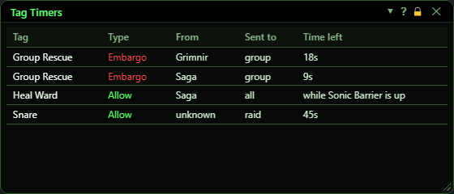
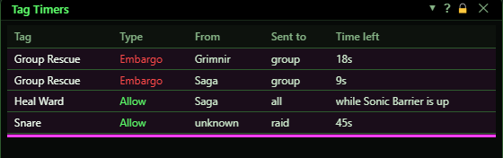

**OgreBot is in beta testing.** Looking for OgreBot Classic? [Click here](../../index.md).

# Tag Timers

> **:bulb: In game - the ? button on this window says**
>
> Shows every Embargo and Allow tag on this character right now, so you can see why an ability is being held back or let through.
>
> **What you can do here**
>
> - Tick **Show Tag Timers window** on the Tags tab to have it open with the profile, or use `ogre tags` to open it once.
> - Drag the edges to resize it, like any other Ogre window.
>
> **What each column means**
>
> - **Tag**: the tag's name.
> - **Type**: Embargo holds an ability back, Allow lets it through.
> - **From**: the character who set the tag. Two characters holding one tag show as two lines.
> - **Sent to**: who the tag went to: all, group, raid, me, or a character's name.
> - **Time left**: counts down. A tag coupled to a buff says "while <buff> is up" and ends when the buff does.
>
> **Good to know**
>
> - **unknown** means the tag came from a command or a script that did not name anyone.
> - The window only shows tags. It changes nothing.

**Open it:** Tick **Show Tag Timers window** on the [Tags tab](../ogrebot/tags.md) to have it open with the profile, or type `ogre tags`. `ogre end tags` closes it.

## What it is for

Shows every Embargo and Allow tag on this character right now, so you can see why an ability is being held back or let through. It only shows tags: it changes nothing.

## The list

One line per holder. Two characters holding the same tag show as two lines, and the tag stays on until the last of them lets go. The lines stay sorted by tag name, so they do not jump about as the clocks run.

| Control | What it does |
|---|---|
| **Tag** | The tag's name. |
| **Type** | Embargo holds an ability back, Allow lets it through. |
| **From** | The character who set the tag. **unknown** means a command or a script armed it without naming anyone. |
| **Sent to** | Who the tag went to: all, group, raid, me, or a character's name. |
| **Time left** | Counts down. A tag coupled to a buff says while that buff is up, and ends when the buff does. |

