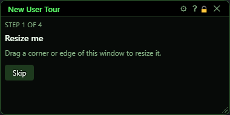
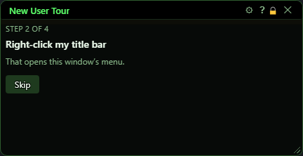
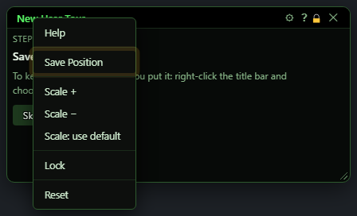
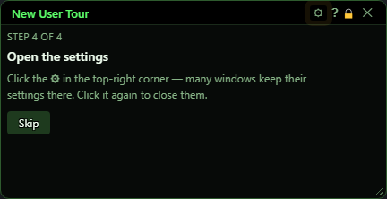
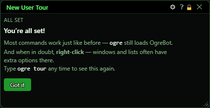

# New User Tour

**OgreBot is in beta testing.** Looking for OgreBot Classic? [Click here](../../index.md).

> **:bulb: In game - the ? button on this window says**
>
> A quick hands-on tour of the new Ogre windows. Each step moves on by itself as soon as you do it.
>
> **What you can do here**
>
> - **Step 1** - drag the right edge, bottom edge or bottom-right corner to resize the window.
> - **Step 2** - right-click the title bar to open its menu.
> - **Step 3** - choose **Save Position** so the window opens in the same spot next time.
> - **Step 4** - click the gear to open the settings, then click it again (or its X) to close them.
> - **Skip** ends the tour at any step. **Got it** closes it at the end.
>
> **Good to know**
>
> - Your other Ogre windows are hidden during the tour and come back when it ends.
> - Type `ogre tour` to see it again any time.

**Open it:** Opens by itself the first time the new bot loads. Type `ogre tour` to see it again any time (typing it while the tour is open does nothing).

## What it is for

A short hands-on tour of the new Ogre windows, for players coming from Classic. It starts with a short cartoon (the Welcome to OgreBot window), then teaches four things you do on the tour's own window: resize it, right-click its title bar, save its position, and open its settings gear. Each step moves on by itself as soon as you do it, and a pulsing outline shows you where to click. While the tour is up, your other Ogre windows are hidden; they come back when it ends.

## Step 1 - Resize me

Drag the right edge, the bottom edge or the bottom-right corner of the tour window (only those can be dragged). They pulse to show where. As soon as the size changes, the tour moves to step 2.

| Control | What it does |
|---|---|
| **Skip** | Ends the tour now. It counts as seen, so it will not open by itself again. Your hidden windows come back. *Every step has Skip. `ogre tour` brings the tour back later.* |
| **Title bar close (X)** | Closing the tour window is the same as Skip: the tour counts as seen and your hidden windows come back. |

## Step 2 - Right-click my title bar

Right-click the title bar (the bar with the window's name). Its menu opens and the tour moves to step 3. Every Ogre window with a title bar has this menu.

## Step 3 - Save this window's spot

In the title-bar menu, choose Save Position (it pulses). That makes the window open in the same place and size next time. Once you save, the tour moves to step 4.

| Control | What it does |
|---|---|
| **Save Position (title-bar menu)** | Saves where this window is and how big it is, so it opens there next time. On the tour this also finishes step 3. *If the menu closes without saving, right-click the title bar again.* |

## Step 4 - Open the settings

Click the gear (⚙) in the top-right corner. Many windows keep their settings behind a gear like this. Close the settings again (gear or its X) to finish.

| Control | What it does |
|---|---|
| **⚙ (Settings)** | Opens and closes a small example settings panel inside the tour window. On step 4, closing it finishes the step. *The example settings do nothing and save nothing.* |
| **x (close settings)** | Closes the example settings panel, the same as clicking the gear again. |
| **A toggle option / A slider / A colour** | Examples only, to show what a settings panel looks like. Nothing here saves or changes anything. |

## All set

The last page reminds you that most commands work like before (`ogre` still loads OgreBot), and that right-clicking windows and lists often shows extra options.

| Control | What it does |
|---|---|
| **Got it** | Closes the tour. It counts as seen and will not open by itself again. Your hidden windows come back. |

## What the window shows

- Step label - which step you are on (Step 1 of 4 to Step 4 of 4, then All set).
- Pulsing yellow outline - the thing to click or drag for the current step (the right and bottom edges and the bottom-right corner, the title bar, the Save Position menu row, or the gear).

## Good to know

- While the tour is open, every other Ogre window is hidden so you can focus. They all come back when the tour ends (Got it, Skip or closing it).
- If the InnerSpace console is open when the tour starts, it is closed so it does not push the tour out of the way.
- On the very first load, the Migration Assistant waits for the tour: your Classic settings are copied a few seconds after you finish or skip the tour.
- Whether you have seen the tour is saved in OgreSave\EQ2\TourState.json. Delete that file to have the tour open by itself again.

