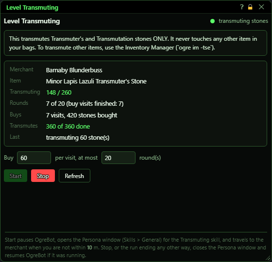
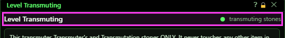
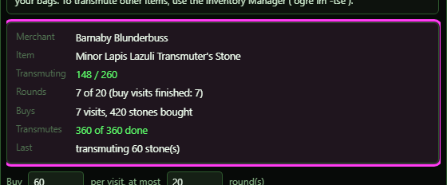
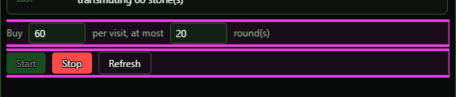
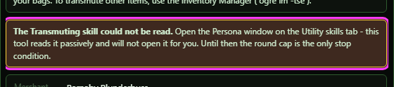
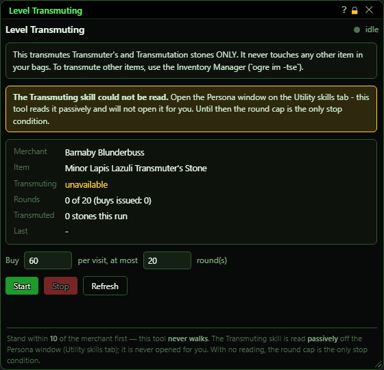

# Level Transmuting

**OgreBot is in beta testing.** Looking for OgreBot Classic? [Click here](../../index.md).

> **:bulb: In game - the ? button on this window says**
>
> Levels your Transmuting skill: buys cheap transmuter's stones from Barnaby Blunderbuss in Butcherblock and transmutes them, round after round.
>
> **What you can do here**
>
> - **Buy** sets how many stones to hold after each visit. Leftover stones are used first.
> - **round(s)** is the most visits one run makes. The run also stops when your skill is capped.
> - **Start** begins the run. **Stop** ends it. **Refresh** redraws the window.
> - **Buys** shows the merchant visits and how many stones they really added.
> - **Transmutes** shows how many stones were tried and how many really got used up. If any failed, it says why: the cast was refused, the ability never became ready, or the stone was still there afterwards.
>
> **Good to know**
>
> - Start pauses OgreBot for the run. When the run ends it resumes OgreBot, unless OgreBot was already paused.
> - Start opens the Persona window on Skills > General to read your skill. It closes it again when the run ends, however it ends.
> - Not next to Barnaby? The window tells you, and Start travels to him first, even with OgreBot closed. Stop ends the trip.
> - Each stone costs 1 Gnomish Currency Exchange, not coin. Without any, the buy adds nothing and the run stops and says so.
> - Only items named "Transmuter's Stone" or "Transmutation Stone" are ever transmuted.
> - A round that buys nothing, or transmutes nothing, stops the run, so a problem never repeats for every round.
> - Closing this window stops a run, the same as `ogre end leveltransmuting`. Stop stops it and keeps the window open.

**Open it:** Type `ogre leveltransmuting` (or `ogre lt`). Typing it again while the window is open just refreshes it. `ogre lt status` prints the status to the console instead. `ogre end leveltransmuting` (or the window's X) stops a run and closes the window; Stop stops it and leaves the window open.

## What it is for

A skill-up grinder for the Transmuting tradeskill. The bot buys Minor Lapis Lazuli Transmuter's Stones from Barnaby Blunderbuss in Butcherblock Mountains, transmutes them, and repeats until your Transmuting skill is capped or the round limit is reached. You do not have to stand next to him: if you are not within 10 of Barnaby, Start travels to him first, from another zone too. OgreBot is paused for the run, and the Persona window is opened on Skills > General to read your skill; when the run ends, however it ends, the window is closed again and OgreBot resumes if it was running. It only ever transmutes items whose name contains "Transmuter's Stone" or "Transmutation Stone" - nothing else in your bags is touched.

## Header and the stones-only notice

The dot is green while a run is going. Next to it is what the bot is doing right now.

## The readout

Merchant and Item are fixed - the tool only works with Barnaby and the Minor Lapis Lazuli Transmuter's Stone. Transmuting is your skill as last read from the Persona window (Start reads it, then it is read again at the start of each round, so it shows unavailable until a run has read it). Rounds counts the rounds started out of the most you allowed. Buys shows the visits to Barnaby and how many stones your bags really gained. Transmutes shows how many stones were tried and how many really got used up. Last is the latest thing that happened.

## Quantity and round limit

| Control | What it does | Default |
|---|---|---|
| **Buy** | How many stones you want to be holding when each visit to Barnaby is done. The bot only buys the difference, so stones left over from the last round are used first. 1 to 800. *Locked while a run is going. It is a total to hold, not an amount added every round.* | 60 |
| **per visit, at most ... round(s)** | The hard stop: the most rounds one run will make. Each round is one visit to Barnaby. The run also stops earlier if the Transmuting skill is readable and capped. 1 to 500. *If the skill cannot be read, the run cannot tell when you are capped and goes on until this limit.* | 20 |

## Start, Stop, Refresh

| Control | What it does |
|---|---|
| **Start** | Starts a run with the two numbers above. It pauses OgreBot and opens the Persona window on Skills > General to read your Transmuting skill. Then, each round: read the skill and stop if it is capped; travel to Barnaby if he is not within 10; buy up to the Buy amount; then transmute every stone in your bags (at most 200 per round), one at a time, waiting 2 seconds after each. *Greyed out while a run is going. The run can also stop by itself - see Good to know below.* |
| **Stop** | Stops the run straight away, even in the middle of buying, travelling or transmuting. It closes the Persona window and resumes OgreBot if it was running before you pressed Start. *Only active while a run is going.* |
| **Refresh** | Redraws the window with the latest numbers. It does not change anything, and it does not read the skill. |
| **Title bar close (X)** | Stops a run that is going, then closes the window. The Persona window is closed and OgreBot resumes, as with Stop. *The same as `ogre end leveltransmuting`. Stop stops the run and keeps the window open.* |

## When the skill cannot be read

The bot reads your Transmuting skill from the Persona window, Skills > General, which Start opens itself. It reads it once when the window opens and again at the start of every round. If the window is closed during a run, the next round opens it again. If the Transmuting row still does not read, Transmuting shows 'unavailable' in orange and a note appears; the run then cannot tell when you are capped and goes on until the round limit, unless a trip, a buy or a transmute fails first and stops it. Before your first run the skill has not been read yet, so the window shows 'unavailable' and a note saying it is read when you press Start.

## What the window shows

- Dot and phase text (top right): green dot = running. Phase is one of idle, waiting for the world, opening the Persona window, travelling to the merchant, reading the Transmuting skill, looking for the merchant, buying, transmuting stones, BLOCKED - cannot transmute, stopped.
- Box at the top: always there. It says the tool transmutes Transmuter's and Transmutation stones only, and that other items are transmuted by the Inventory Manager (`ogre im -tse`).
- Note about Barnaby (only while stopped): shown when you are not within 10 of him. It says you are not in Butcherblock Mountains, how far you are from him, or that he is not in view - and that Start will travel or walk to him first.
- Transmuting: 'current / max' in green from the last read of the Persona window's Skills > General page; 'unavailable' in orange when it could not be read, or before any run has read it.
- Rounds: 'N of M (buy visits finished: B)' - rounds started out of your limit, and how many visits to Barnaby finished their buy.
- Buys: 'N visits, S stones bought' - S is how many stones your bags really gained. It adds 'X added nothing' and turns orange when a visit added no stones.
- Transmutes: 'D of T done' - stones tried, and stones that really left your bags. Green once one is done. When any failed it turns orange and says why: cast refused, never ready, or not used up.
- Last: the latest step or the reason the run stopped, for example 'transmuting 60 stone(s)' or 'Transmuting is at its cap for this level'.
- Footer: a reminder that Start pauses OgreBot, opens the Persona window (Skills > General) and travels to Barnaby when you are not within 10, and that Stop, or the run ending any other way, closes the Persona window and resumes OgreBot if it was running.

## Good to know

- You do not have to stand next to Barnaby Blunderbuss. Start travels to him in Butcherblock Mountains when you are not within 10, even with OgreBot closed. Stop ends the trip. If two trips still leave him out of reach, or one trip takes over 20 minutes, the run stops.
- Start opens the Persona window on Skills > General itself and closes it again when the run ends, however it ends. You do not need to open it first.
- Start pauses OgreBot for the run. When the run ends it resumes OgreBot, unless OgreBot was already paused.
- Each stone costs 1 Gnomish Currency Exchange, not coin. Without any, the buy adds nothing and the run stops and says so.
- Before your first run, Transmuting shows unavailable - the skill is first read when you press Start, and Refresh does not read it.
- Buy is a target to hold, not an amount per round. If stones were left over, the next visit buys fewer (or none).
- Any item in your bags whose name contains "Transmuter's Stone" or "Transmutation Stone" is transmuted, not just the ones this tool bought.
- The run stops by itself when a visit's buy adds no stones, when a round uses up none of the stones it tried, when the merchant window fails 3 rounds in a row, or when you do not have the Transmuting ability (the stones it bought stay in your bags).
- Closing the window stops a run, the same as `ogre end leveltransmuting`. Stop stops it and keeps the window open.
- `ogre lt` opens the window; `ogre lt status` prints the status to the console instead.

## Before the first run

Before your first run the skill has not been read, so Transmuting reads **unavailable** and the note says it is read when you press Start: Start opens the Persona window on Skills > General itself. If the Transmuting row still cannot be read during a run, the run cannot tell when you are capped and goes on until the round limit, unless a trip, a buy or a transmute fails first and stops it.

