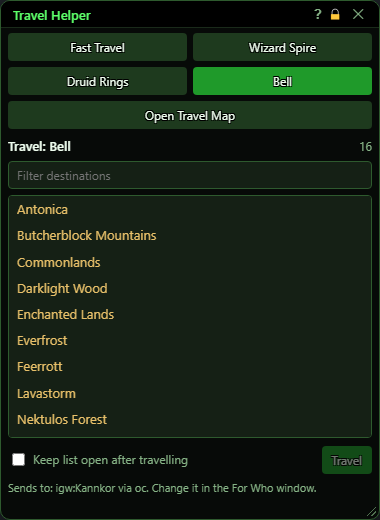
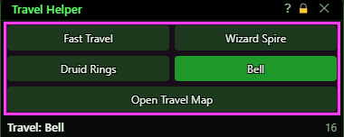
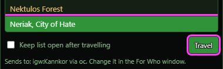
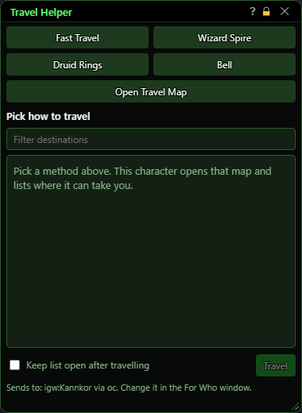
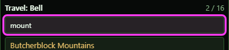
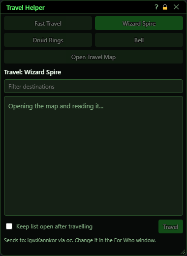
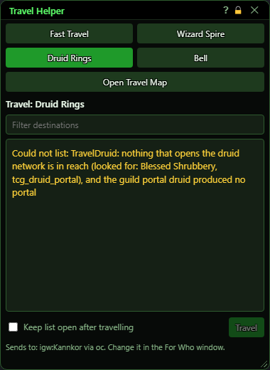

# Travel Helper

**OgreBot is in beta testing.** Looking for OgreBot Classic? [Click here](../../index.md).

> **:bulb: In game - the ? button on this window says**
>
> Lists where a travel map can take you, then sends your group to the one you pick.
>
> **What you can do here**
>
> - **Fast Travel, Wizard Spire, Druid Rings, Bell** - this character opens that map (standing by the spire, ring or bell for those three), reads every destination and lists them. The map closes again.
> - **Open Travel Map** - lists the travel map you already have open, and leaves it open.
> - **Double-click a destination**, or select it and press **Travel** - everyone in the Master Control Panel's For Who window travels there. Each opens their own map and clicks that exact destination.
> - **Filter** - type part of a name to shorten the list.
> - **Keep list open after travelling** - leave this window up after you pick.
>
> **Good to know**
>
> - If the For Who window was never set, everyone travels.
> - Spire, ring and bell travel needs that object within reach of every character you send.
> - With Open Travel Map, everyone you send must have their own map open too.

**Open it:** Type `ogre travel`. Add a method to open it straight on that list: `ogre travel fast`, `ogre travel spire`, `ogre travel druid`, `ogre travel bell` or `ogre travel map`. A Master Control Panel button migrated from the old bot's Travel Helper opens it too.

## What it is for

The Travel Helper sends your group somewhere without anyone typing a zone name. Pick how to travel and this character opens that travel map, reads every destination it offers and lists them here. Double-click one and every character in the For Who window travels there: each opens its own map and clicks that exact destination. It is the old bot's Travel Helper window, rebuilt.

## Choosing how to travel

Each button makes this character open that kind of travel map and list it. The map closes again once it has been read, except for Open Travel Map.

| Control | What it does |
|---|---|
| **Fast Travel** | Opens the Fast Travel map and lists its destinations. Works anywhere you can fast travel from. |
| **Wizard Spire** | Clicks the wizard spire next to you and lists where it goes. You must be standing by a spire. *Nothing is cast: it uses the spire in the world, the same as the old bot.* |
| **Druid Rings** | Clicks the druid ring next to you, or in a guild hall the portal druid, and lists where it goes. |
| **Bell** | Clicks the bell or globe next to you and lists where it goes. |
| **Open Travel Map** | Lists the travel map you already have open, and leaves it open. *Everyone you send to must have their own travel map open too - this one opens nothing for them.* |

## Picking a destination

The list shows every destination the map offers, in the map's order. Type in the filter box to narrow it.

| Control | What it does |
|---|---|
| **Filter destinations** | Shows only the destinations whose name contains what you type. |
| **Destination list** | Click a destination to select it. Double-click it to travel there. |
| **Travel** | Sends everyone in the For Who window to the selected destination. *Each character opens its own map and clicks exactly that destination - the whole name, not part of it.* |
| **Keep list open after travelling** | Leaves this window open after you send the group. Off, it closes once you pick. |

## What the window shows

- Sends to: who a pick goes to and how, read from the Master Control Panel's For Who window.
- Opening the map and reading it...: this character is opening the map. The buttons are greyed out until it finishes.
- Could not list: why the map could not be read, for example nothing to click is in reach.
- The line under Sends to: what the last pick sent, and to whom.

## Good to know

- The For Who window decides who travels. If it was never set, everyone travels.
- Wizard Spire, Druid Rings and Bell need the spire, ring or bell within reach of every character you send. Anyone too far away stays where they are.
- Picking a destination with several drop-off points or instances uses the same choice as the travel commands: the last one offered.

### Before anything is listed

### Filtering

### While it reads the map

### When nothing can be opened

