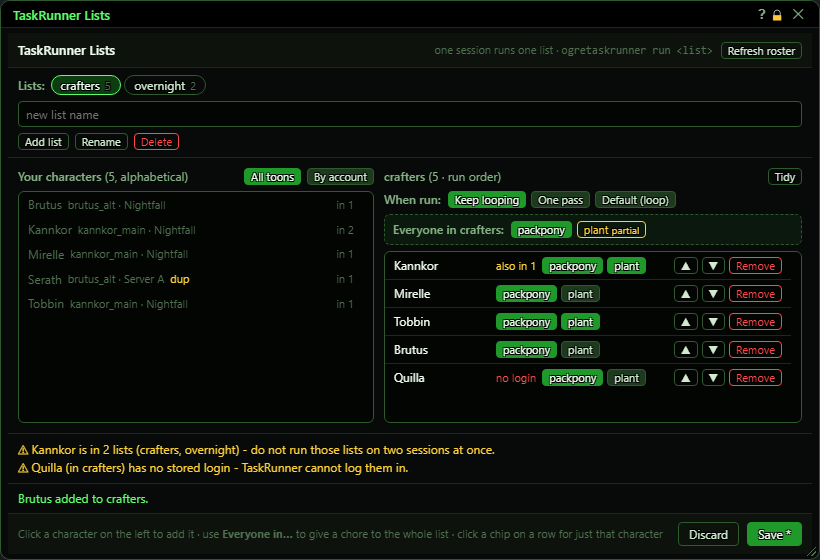
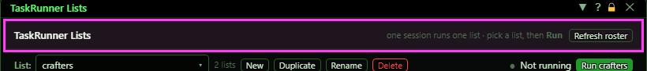
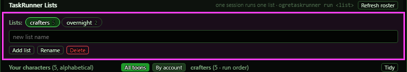
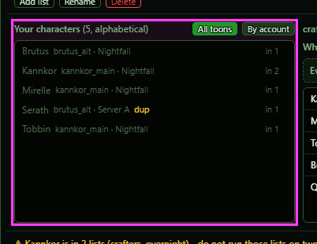
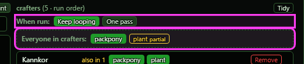
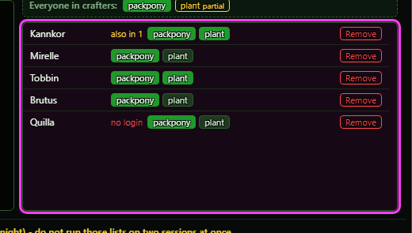
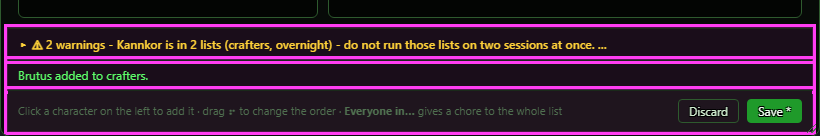
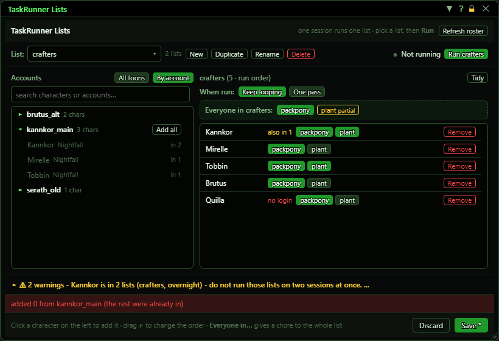
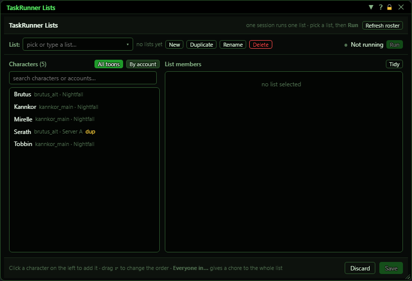

# TaskRunner Lists

**OgreBot is in beta testing.** Looking for OgreBot Classic? [Click here](../../index.md).

> **:bulb: In game - the ? button on this window says**
>
> Builds the lists TaskRunner works through: which characters it logs in, in what order, and which timed chores each one does. Run a list with `ogre taskrunner -list <list>` (`run <list>` works too).
>
> **What you can do here**
>
> - **Run** - starts the selected list on this session (save first). The bar shows what it is doing: which character, which chore, and the last result. **Stop** stops it and leaves the character where it is.
> - **List** - click the box and type to find a list (they are in alphabetical order). Type a name that is not a list yet and pick **+ New list** (or press Enter) to make it.
> - **New / Duplicate / Rename / Delete** act on the selected list. Duplicate copies the members, their order and the run mode.
> - **Click a character** on the left to add it to the selected list. Use the **search** box to find a character or account. In **By account**, right-click an account and pick **Add all toons** (or open it and press **Add all**) to add the whole account - anyone already in the list is skipped.
> - **Drag a member row** up or down to change the order the list runs in.
> - **Chore buttons** on a row turn a chore on or off for that character. The **Everyone in** row does it for the whole list.
> - **When run** - **Keep looping** (stays running and picks chores up as they come due - leave it overnight) or **One pass** (does what is due now, then stops).
> - **Stagger start** - each session waits before its first login (is2 30 seconds, is3 60 seconds, and so on). Leave it on when one command starts lists on every session, or the server turns some logins away.
> - **Chore options** - one row per chore. **Guild hall first** travels to the guild hall unless the character is already in one or in a house. **Harvest depot after** puts all harvests into the nearest harvest depot afterwards. **Destroy list after depot** then destroys the items on your IM destroy list - the excess the depot would not take. It only runs with Harvest depot after on, and only when the depot finished. **Bushels** (Plant): the harvest gives a bushel - leave it packed, take the latest reward (a new expansion is picked up on its own), or a chosen reward number. A bushel is lore, so the plant is never harvested while one is still in the bags - with "leave it packed" that character skips the plant until you unpack it. (Pack Pony always loads OgreBot first - it reads its answers from your profile.)
> - **Save** writes your changes (what you set by hand in your own TaskRunner files is kept). **Discard** throws them away and reads the files again.
>
> **Good to know**
>
> - Never run two lists that share a character on two sessions at once.
> - A character's chores are the same in every list they are in.
> - **Overseer** never logs a character in by itself: it runs when the character is logged in for another chore (the pack pony). Its status says "next login" while it waits.
> - A character in a raid is never logged out: the run stops and leaves everyone where they are.
> - A character that cannot do a chore at all (no Pack Pony) is marked with an error and skipped until you clear it: `ogre taskrunner clear <name>`.
> - Closing the window loses unsaved changes without asking.

**Open it:** Type `ogre taskrunner panel` (or `ogre tr panel`). `ogretaskrunner panel`, `gui` or `config` also open it.

## What it is for

TaskRunner logs your characters in one after another and does their timed chores, such as the Artisan's Pack Pony and the Goblin House Plant. This window builds the named lists it works through. Pick characters from the ones you have a stored login for, put them in a list, and choose which chores each one does. Then run a list in one session with `ogre taskrunner run <list>`. Nothing is written until you press Save.

## Header

| Control | What it does |
|---|---|
| **Refresh roster** | Reads your stored logins again, so characters you have added since the window opened show up on the left. *Your unsaved list edits are kept.* |

## Lists

Each list name is a button showing how many characters are in it. The highlighted one is the list you are editing.

| Control | What it does | Default |
|---|---|---|
| **<list name> (list button)** | Picks which list you are editing on the right. | the first list |
| **new list name (placeholder)** | Type a name here for Add list or Rename. Pressing Enter does the same as Add list. *One word, no spaces or quotes, up to 40 characters: you type it after `ogre taskrunner run`.* | empty |
| **Add list** | Makes a new, empty list with the typed name and selects it. *A name that is already used (in any letter case) is refused with a red message.* |  |
| **Rename** | Renames the selected list to the name typed in the box. *Does nothing if the box is empty.* |  |
| **Delete** | Deletes the selected list. The characters keep their chore choices. *No confirmation, but nothing is written until Save; Discard brings it back.* |  |

## Your characters (left side)

Every character you have a stored login for, with its account and server. 'in 2' means the character is already in two lists; those rows are dimmed.

| Control | What it does | Default |
|---|---|---|
| **All toons** | Shows every character in one alphabetical list. Display only. | on |
| **By account** | Groups the characters under their accounts. Display only. | off |
| **Click a character** | Adds that character to the end of the selected list. A character new to TaskRunner starts with every chore turned on. *A character already in the list gets a red 'already in' message. With no list yet you are told to make one first.* |  |
| **Click an account (By account view)** | Opens the account to show its characters. Click again to close it. Display only. | all closed |
| **Add all** | Adds every character on that account to the selected list. Characters already in it are skipped. *Only shown on an opened account.* |  |

## How the list runs, and chores for everyone

| Control | What it does | Default |
|---|---|---|
| **Keep looping** | When this list runs, it keeps going: it does everything due, then waits and picks up chores as they come due again. For leaving it on overnight. |  |
| **One pass** | When this list runs, it does what is due right now for each character, then stops. |  |
| **Default (loop) / Default (once)** | The list follows the general TaskRunner setting. The word in brackets is what that setting is now. *Typing `ogre taskrunner run <list> once` or `... loop` still overrides this for that run.* | selected (the shipped setting is loop) |
| **<chore> (Everyone in <list>: row)** | Gives that chore to every character in the list. If everyone already has it (lit up), a click takes it away from everyone instead. 'partial' means only some have it. *The message line says how many characters actually changed.* |  |

## List members (right side)

The characters in the selected list, in the order they are logged in.

| Control | What it does | Default |
|---|---|---|
| **<chore> (on a character row)** | Turns that chore on (lit up) or off for just this character. *A character's chores are the same in every list they are in.* | on for a newly added character |
| **▲** | Moves the character one place earlier in the login order. |  |
| **▼** | Moves the character one place later in the login order. |  |
| **Remove** | Takes the character out of this list. Their chore choices are kept in case you add them again. |  |
| **Tidy** | Forgets the chore choices of characters that are no longer in any list. *Nothing is written until Save.* |  |

## Warnings, messages, Save and Discard

| Control | What it does |
|---|---|
| **Save / Save *** | Writes your lists and chore choices to OgreSave/EQ2/TaskRunner/custom/lists.json, and TaskRunner starts using them straight away. Only what differs from your other TaskRunner files is written, and anything you set by hand for a character there (a chore's own timer, or switching the character off) is kept. 'Save *' means there are unsaved changes. *Greyed out when nothing changed. If a list is running right now, the new lists are used when that batch ends.* |
| **Discard** | Throws away every unsaved change and reads the lists again from the files on disk (so a hand edit made while the window was open shows up). |
| **Title bar close (X)** | Closes the window. Unsaved changes are lost: opening it again reads the saved lists. *There is no 'unsaved changes' prompt.* |

## What the window shows

- List buttons: the list name and how many characters are in it. The highlighted one is being edited.
- Left side: your characters with account and server. 'in N' = in N lists already (row dimmed). A yellow 'dup' = that name is on more than one account, and TaskRunner cannot tell which one you mean.
- Right side heading: the list name, how many characters, and 'run order' - characters are logged in top to bottom.
- Character row badges: yellow 'also in N' = the character is in other lists too (hover to see which). Red 'no login' = there is no stored login for that name, so TaskRunner cannot log it in.
- Chore buttons: lit up (the theme colour, green by default) = the character does that chore, plain = it does not. Each button shows the chore's name, e.g. Artisan's Pack Pony and Goblin House Plant (the shipped ones).
- Yellow warnings above the footer: a character in two lists, an empty list, a character with no stored login, or a character with every chore turned off.
- The message line: green for what your last click did, red when it was refused and why.

## Good to know

- Never run two lists that share a character on two sessions at the same time. The window warns you, but nothing stops it.
- Chore choices belong to the character, not the list: turning a chore off for Kannkor in one list turns it off in every list Kannkor is in.
- Nothing is saved until you press Save. Closing the window loses unsaved changes without asking. Typing the open command again while the window is open does nothing (your edits stay).
- The left side only lists characters with a stored login. If it is empty, set up your logins first, then press Refresh roster.

## By account

Click **By account**, then click an account to open it. **Add all** puts every character on that account into the selected list.

## Before your first list

Type a name in the box and press **Add list**, then click characters on the left to fill it.

