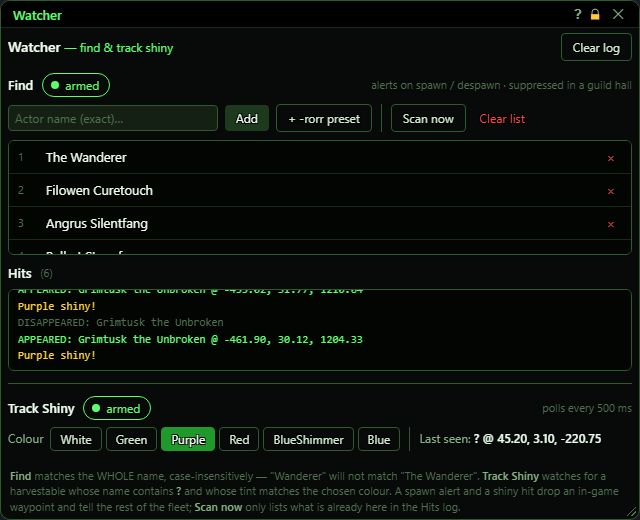
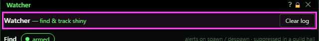
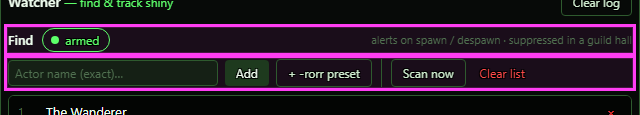
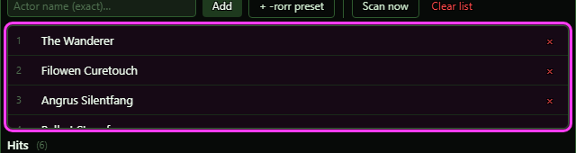
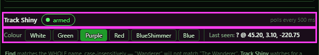
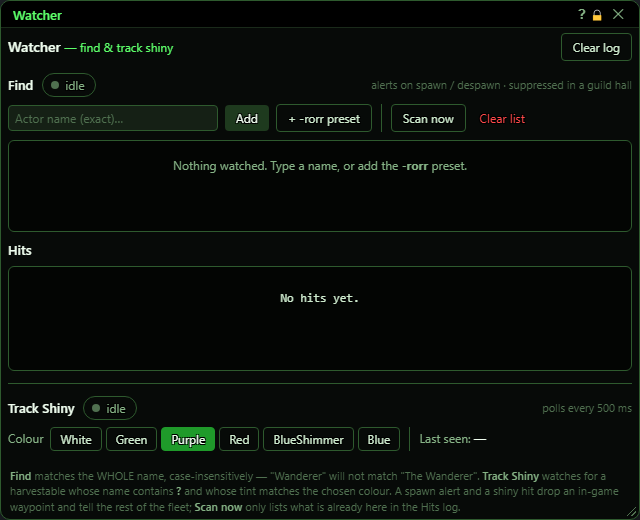

**OgreBot is in beta testing.** Looking for OgreBot Classic? [Click here](../../index.md).

# Watcher

> **:bulb: In game - the ? button on this window says**
>
> Two small alert tools. **Find** tells you when a named creature or NPC shows up in your zone. **Track Shiny** tells you when a shiny of one colour appears near you. When one turns up it drops a waypoint and tells your other sessions.
>
> **What you can do here**
>
> - **Add** a name to watch, or add the **-rorr** preset (the four epic ability researchers).
> - **Click the idle pill** next to Find or Track Shiny to turn it on or off.
> - **Scan now** checks the zone once for every name on the list and writes what it finds in Hits (no waypoint).
> - **Colour**: click the shiny colour to track. Purple is chosen to start with.
> - **Clear log** empties the Hits list.
>
> **Good to know**
>
> - Names must match exactly: "Wanderer" will not find "The Wanderer". Find is silent in a guild hall.
> - Closing the window does not stop either tool. Set them back to idle, or type `ogre end find` / `ogre end trackshiny`.
> - Open this window with `ogre watcher`.

**Open it:** Type `ogre watcher`. `ogre find -panel` and `ogre trackshiny -panel` open the same window.

## What it is for

The Watcher has two small tools in one window. **Find** watches for named creatures or NPCs: when one on your list appears in your zone, you get a message, an in-game waypoint on it, and every other session is told. **Track Shiny** looks for a shiny (a harvestable collectible) of one colour within 100 metres of you and does the same when a new one shows up. Both keep working after you close the window.

## Header

| Control | What it does |
|---|---|
| **Clear log** | Empties the Hits list below. It does not change the watch list or turn anything off. |
| **Title bar close (X)** | Closes the window only. Find and Track Shiny keep running if they are armed. *To stop them, click the armed pills to idle first.* |

## Find - the watch list

Names must match the whole name exactly (capital letters do not matter). "Wanderer" will not match "The Wanderer".

| Control | What it does | Default |
|---|---|---|
| **idle / armed (pill next to Find)** | Turns Find on or off. When you turn it on it also checks the zone once for anything already on your list. While on, a listed name that appears gets a message, a waypoint and a note to your other sessions; one that leaves gets a DISAPPEARED line. *With an empty list it stays idle and the console says "nothing to watch - add a name first". The on/off choice is remembered after a restart.* | idle |
| **Actor name (exact)... (placeholder)** | Type a creature or NPC name to watch. Pressing Enter does the same as Add. | empty |
| **Add** | Adds the typed name to the watch list. It does not turn Find on. *A name already on the list is not added twice.* |  |
| **+ -rorr preset** | Adds the four Renewal of Ro researchers (the NPCs that upgrade your epic abilities): The Wanderer, Filowen Curetouch, Angrus Silentfang and Balkot Stonefury. *Only names not already on the list are added. It does not turn Find on.* |  |
| **Scan now** | Checks the zone once, right now, for every name on the list. Each one found is added to Hits as a FOUND line with its location. *Works even while Find is idle. A scan result is a Hits line only: no waypoint and no message to other sessions. It also works in a guild hall.* |  |
| **Clear list** | Removes every name from the watch list and turns Find off. *No confirmation.* |  |

## Find - names and hits

| Control | What it does |
|---|---|
| **x (remove name)** | Removes that one name from the watch list. *Removing the last name turns Find off.* |

## Track Shiny

| Control | What it does | Default |
|---|---|---|
| **idle / armed (pill next to Track Shiny)** | Turns Track Shiny on or off. While on, it looks around you (100 metres) every half second for a shiny of the chosen colour. When it finds a new one it adds a line to Hits, puts a waypoint on it and tells your other sessions. The same shiny is only reported once. The on/off choice is remembered after a restart. | idle |
| **Colour (White / Green / Purple / Red / BlueShimmer / Blue buttons)** | Which shiny colour to look for. Click a colour; the lit one is in use. *Changing the colour clears Last seen. It does not turn tracking on.* | Purple |

## What the window shows

- Hits: the latest 50 alerts, newest at the bottom. FOUND = seen by a scan. APPEARED = a listed name just showed up. Both are green. DISAPPEARED = it left (grey). "Purple shiny!" = a shiny of that colour was found (yellow). The number after Hits is how many lines there are.
- The pills: green 'armed' means that tool is on; grey 'idle' means it is off.
- polls every 500 ms: how often Track Shiny looks around. It can be changed with `ogre trackshiny -interval <ms>` (250 to 30000).
- Last seen: the name and location of the last shiny found.
- The footer is a fixed reminder of how names and shinies are matched.

## Good to know

- Find names must match exactly. "Wanderer" does not find "The Wanderer".
- Find alerts are silenced while you are in a guild hall. Scan now still works there.
- Closing the window does not stop anything. Set both pills to idle to stop watching, or type `ogre end find` / `ogre end trackshiny`. Opening it again while it is already open does nothing.
- The watch list, colour and on/off choices are saved and come back after a restart. The Hits list is not saved.
- Typing `ogre find <name>` in the console REPLACES the whole watch list with that name and turns Find on. Use the Add box to add a name instead.
- Track Shiny only looks 100 metres around you.

## First open

With an empty list both tools are idle. Add a name (or the **-rorr** preset), then click the **idle** pill next to Find to turn it on.

