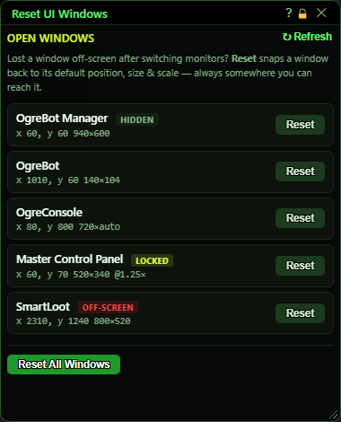
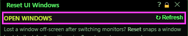
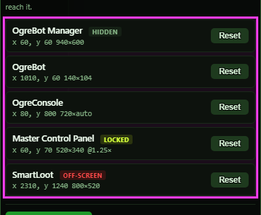
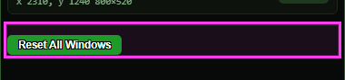
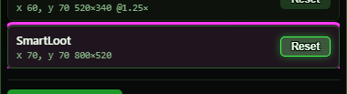
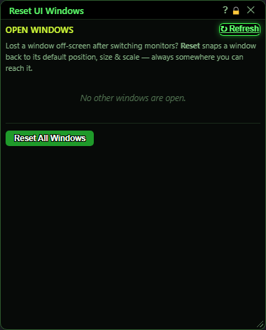

# Reset UI Windows

**OgreBot is in beta testing.** Looking for OgreBot Classic? [Click here](../../index.md).

> **:bulb: In game - the ? button on this window says**
>
> Puts Ogre windows back where they started. Use it when a window is off-screen and you cannot reach its title bar. Open it with `ogre windowreset`.
>
> **What you can do here**
>
> - **Reset** on a row moves that window back to its starting spot and size, at the normal UI scale, unlocked.
> - **Reset All Windows** does that for every window in the list, except help windows and the OgreHUD.
> - **Refresh** re-reads the list after you open or close windows.
>
> **Good to know**
>
> - Reset forgets the window's saved position. Move it where you want and use Save Position again.
> - A hidden window stays hidden; Reset only moves it.
> - Each window's own title-bar right-click menu also has Reset.

**Open it:** Type `ogre windowreset` in the InnerSpace console. It opens in the middle of the screen. If it is already open, that does nothing.

## What it is for

Lists every Ogre window that is open in this session and puts any of them back where it started. Use it when a window has ended up off-screen (for example after switching monitors or changing resolution) and you cannot reach its title bar to drag it back. Reset puts a window back at its starting position and size, returns it to the UI scale set in Ogre Options, unlocks it, and forgets any position you saved for it.

## Header

| Control | What it does |
|---|---|
| **↻ Refresh** | Reads the list of open windows again. The list is taken when this window opens and does not update by itself. |

## The window list

One row per open window (this one is left out).

| Control | What it does |
|---|---|
| **Reset** | Moves that window back to where it first opened, at its starting size and at the UI scale set in Ogre Options, unlocks it, and makes sure its title bar is on the current screen. Any position you saved for it with Save Position is forgotten. *A hidden window stays hidden - Reset only moves it.* |

## Reset everything

| Control | What it does |
|---|---|
| **Reset All Windows** | Does a Reset on every window in the list at once, hidden ones included. Help windows and the OgreHUD are listed but left where they are; use their own Reset button. *No confirmation. Every saved position is forgotten.* |
| **Title bar close (X)** | Closes this window. Nothing else changes. |

## What the window shows

- Each row: the window's title, then its position (x, y), size (width × height, 'auto' when it sizes itself) and its scale if it is not 1.
- OFF-SCREEN (red): the window is open but its title bar is outside the screen.
- HIDDEN (grey): the window exists but is hidden, for example the OgreBot main window after a plain `ogre`.
- LOCKED: the window was locked from its title-bar right-click menu. Reset unlocks it.
- 'No other windows are open.' when there is nothing to reset.

## Good to know

- Every window also has a Reset on its own title-bar right-click menu. This window is for the ones you cannot reach.
- Reset forgets a window's saved position, so it opens at its default spot next time too. Drag it where you want it and use Save Position again.
- Only windows that are open right now are listed. A closed window is not affected.
- The list does not update by itself; press Refresh after opening or closing windows.

## After a Reset

The off-screen SmartLoot window is back at its starting spot and the OFF-SCREEN badge is gone.

## Nothing else open

