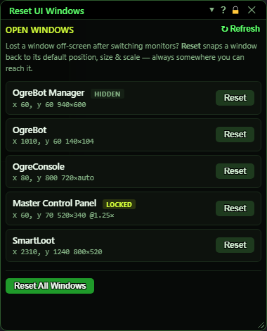
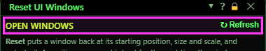
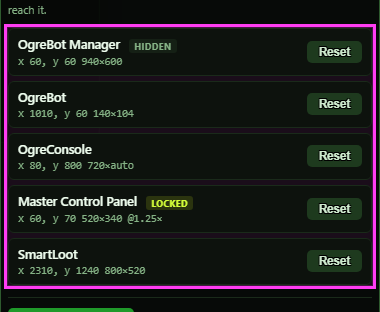
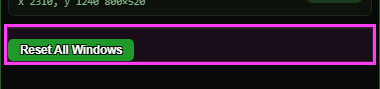
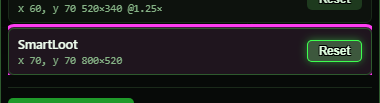
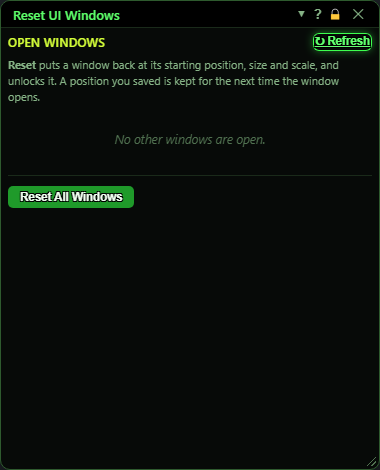

**OgreBot is in beta testing.** Looking for OgreBot Classic? [Click here](../../index.md).

# Reset UI Windows

> **:bulb: In game - the ? button on this window says**
>
> Puts Ogre windows back where they started: position, size, scale and lock. Open it with `ogre windowreset`.
>
> **What you can do here**
>
> - **Reset** on a row moves that window back to its starting spot and size, at the normal UI scale, unlocked.
> - **Reset All Windows** does that for every window in the list, except help windows and the OgreHUD.
> - **Refresh** re-reads the list after you open or close windows.
>
> **Good to know**
>
> - Reset does not save. Reopen the window or log out and back in and it is back at its saved spot. To keep the reset spot, use Save Position.
> - A hidden window stays hidden; Reset only moves it.
> - Each window's own title-bar right-click menu also has Reset.

**Open it:** Type `ogre windowreset` in the InnerSpace console. It opens in the middle of the screen. If it is already open, that does nothing. `ogre end windowreset` closes it.

## What it is for

Lists every Ogre window that is open in this session and puts any of them back where it started. Reset puts a window back at its starting position and size, returns it to the UI scale set in Ogre Options and unlocks it. A position you saved is kept for the next time the window opens.

## Header

| Control | What it does |
|---|---|
| **↻ Refresh** | Reads the list of open windows again. The list is taken when this window opens and does not update by itself. |

## The window list

One row per open window (this one is left out).

| Control | What it does |
|---|---|
| **Reset** | Moves that window back to where it first opened, at its starting size and at the UI scale set in Ogre Options, and unlocks it. The position you saved with Save Position is kept, so after you close the window or log out it opens at the saved spot again. *A hidden window stays hidden - Reset only moves it.* |

## Reset everything

| Control | What it does |
|---|---|
| **Reset All Windows** | Does a Reset on every window in the list at once, hidden ones included. Help windows and the OgreHUD are listed but left where they are; use their own Reset button. *No confirmation. Saved positions are kept.* |
| **Title bar close (X)** | Closes this window, the same as `ogre end windowreset`. Nothing else changes. |

## What the window shows

- Each row: the window's title, then the position it asked for (x, y), size (width × height, 'auto' when it sizes itself) and its scale if it is not 1.
- A window asked to be somewhere the screen does not reach (like SmartLoot in the picture) is drawn at the edge of the screen with its title bar showing. Its row still shows the spot it asked for.
- HIDDEN (grey): the window exists but is hidden, for example the OgreBot main window after a plain `ogre`.
- LOCKED: the window was locked from its title-bar right-click menu. Reset unlocks it.
- 'No other windows are open.' when there is nothing to reset.

## Good to know

- Every window also has a Reset on its own title-bar right-click menu. This window does it from one list, or for every window at once.
- Reset does not save. Reopen the window or log out and back in and it is back at its saved spot. To keep the reset spot, use Save Position.
- Only windows that are open right now are listed. A closed window is not affected.
- The list does not update by itself; press Refresh after opening or closing windows.

## After a Reset

SmartLoot is back at its starting spot.

## Nothing else open

