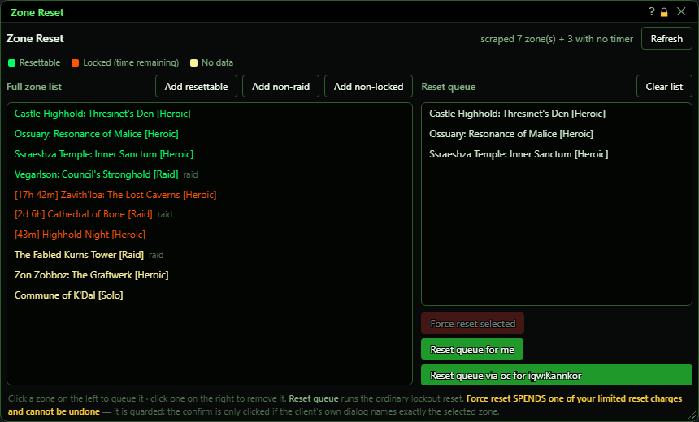
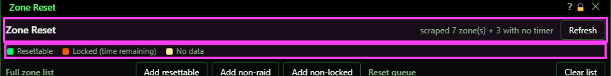
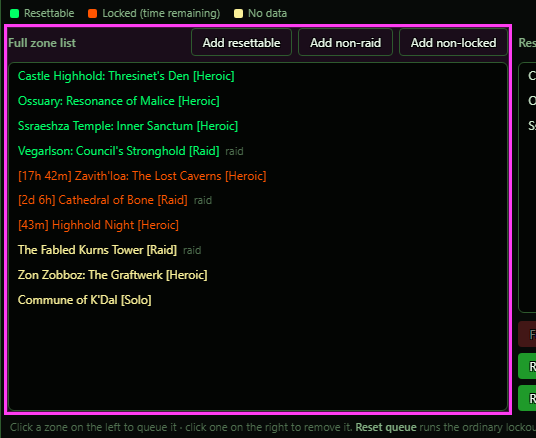
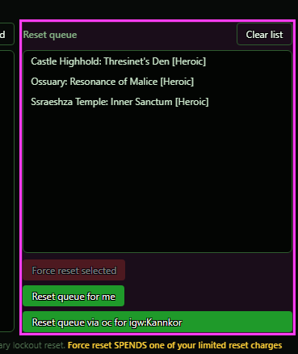
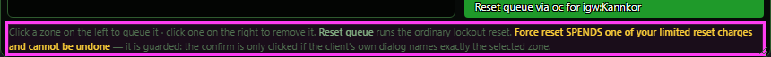
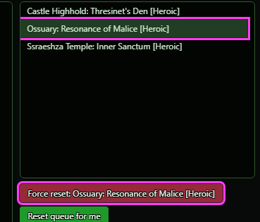
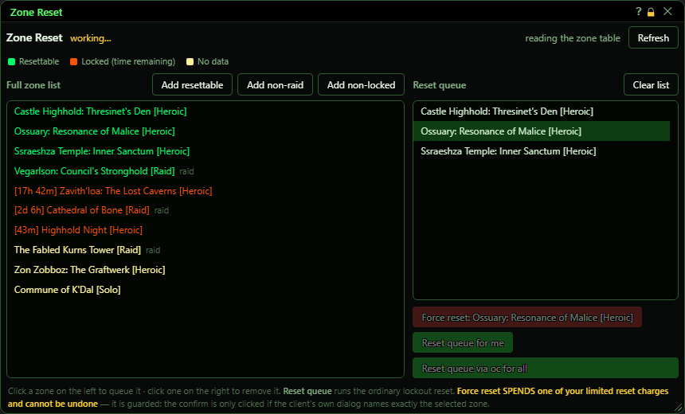
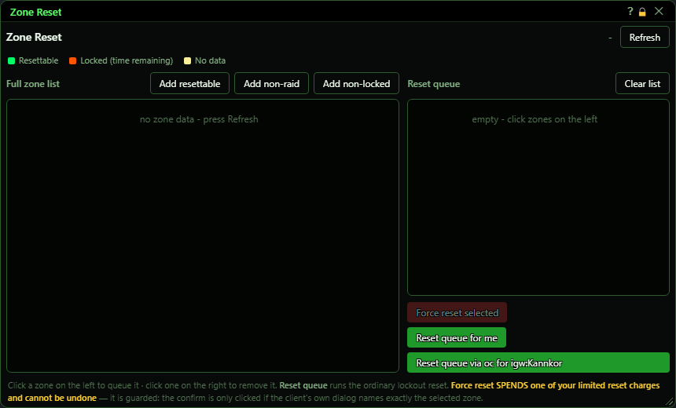

# Zone Reset

**OgreBot is in beta testing.** Looking for OgreBot Classic? [Click here](../../index.md).

> **:bulb: In game - the ? button on this window says**
>
> Shows your zone lockout timers and resets them, for this character or for your group or fleet.
>
> **What you can do here**
>
> - **Refresh** - read the zone list and timers from the game again.
> - **Click a zone** on the left to queue it; click it on the right to remove it. The **Add** buttons queue many at once.
> - **Show** - tick Solo, Heroic, Raid or Other to choose which zones the list shows. **Sort** - by Status (resettable first), Type (solo, heroic, raid) or Name. These only change the view: the **Add** buttons still look at every zone.
> - **Reset queue for me** - reset every queued zone on this character.
> - **Reset queue via ... for ...** - send the reset to the characters in the Master Control Panel's For Who window.
> - **Force reset** - ctrl-click a queued zone, then press it twice: the first press only arms it, a second press within 5 seconds does the reset.
>
> **Good to know**
>
> - Green can be reset, orange is locked (time left in brackets), yellow has no data.
> - **Force reset spends a limited reset charge** and cannot be undone. It only confirms if the game's message names that zone.

**Open it:** Type `ogre zone` (also `ogre reset` or `ogre zonereset`). If the window is already open, this does nothing.

## What it is for

Zone Reset shows your zone lockout timers and resets them for you. It reads the game's Zone Reuse window and lists every zone, coloured by whether it can be reset now, is still locked, or has no data. You pick the zones you want in a reset queue, then reset them on this character, or send the reset to your group or fleet. A separate Force reset button spends one of your limited reset charges on one zone. It needs two clicks, and has a safety check.

## Header and colours

The status text on the right says what the last action did (for example 'scraped 7 zone(s) + 3 with no timer'). 'working…' appears next to the title while it is busy. The colour key explains the zone list: green can be reset, orange is locked with the time left shown in brackets, pale yellow has no data.

| Control | What it does |
|---|---|
| **Refresh** | Reads the zone list and timers again. It briefly opens the game's Zone Reuse window, reads it, and closes it. *Opening this window with no list yet does a Refresh for you. Nothing happens when you are not in the world.* |

## Full zone list

Every zone the game has a lockout record for: resettable first, then locked, then no data. Zones with 'Raid' in the name carry a small 'raid' tag. Hover a row to see the game's own tooltip for it.

| Control | What it does |
|---|---|
| **Click a zone** | Adds that zone to the reset queue on the right. A zone already in the queue is not added twice. |
| **Add resettable** | Adds every green (resettable) zone to the queue. |
| **Add non-raid** | Adds every resettable zone that does not have 'Raid' in its name. |
| **Add non-locked** | Adds every zone that is not locked: the resettable ones and the ones with no data. |

## Reset queue

The zones you picked. The queue is kept while the bot is loaded, even if you close this window, but is not saved to disk.

| Control | What it does | Default |
|---|---|---|
| **Click a queued zone** | Removes it from the queue. |  |
| **Ctrl-click (or Alt-click) a queued zone** | Selects that zone as the Force reset target (it is highlighted). Ctrl-click it again to unselect. Display only until you press Force reset. |  |
| **Clear list** | Empties the reset queue. |  |
| **Force reset selected / Force reset: <zone> / Click again to SPEND a charge on: <zone>** | Spends one of your limited zone reset charges to reset the selected zone right now, even if it is locked. It takes two clicks: the first click only arms the button (its text changes to 'Click again to SPEND a charge on: <zone>'), and a second click within 5 seconds does the reset. The bot then opens the Zone Reuse window, finds the zone, clicks Force Reset, and only clicks the confirm button if the game's confirm message names exactly that zone. If it does not, nothing is clicked, no charge is spent, and the confirm window is left open for you. *Cannot be undone. If you do not click again within 5 seconds, the button goes back to normal and nothing is spent.* | greyed out until a zone is selected (and while the window is busy) |
| **Reset queue for me** | Resets the lockout timer of every queued zone on this character only, one zone every half second. *Greyed out while the window is busy. With an empty queue it just says the queue is empty.* |  |
| **Reset queue via <oc/irc> for <who>** | Sends a reset for every queued zone to the characters picked in the Master Control Panel's For Who window, over the bot console (or IRC if that is what the For Who window says). Each character that receives it resets its own timer for those zones. The button text shows where it will go. *If the For Who window has never been set, this goes to every character (all).* | oc for all (when the For Who window has never been set) |

## Footer

A reminder of how the lists work, and that Force reset spends a limited charge.

## What the window shows

- Green zone: its lockout can be reset now (the game's tooltip says so).
- Orange zone with [time]: locked; the time in brackets is how long is left.
- Pale yellow zone: no timer data (the game knows the zone but shows no timer for it).
- 'raid' tag: the zone name contains 'Raid'. The Add non-raid button skips these.
- Status text (top right): what the last action did, for example 'reset 3 queued zone(s)', 'the reset queue is empty', 'not in world', or 'ABORTED: ...' when the Force reset safety check refused.
- 'working…': a refresh or reset is running. The reset buttons are greyed out until it finishes.

## Good to know

- Force reset spends a real, limited reset charge and cannot be undone. The first click only arms it; the reset happens on a second click within 5 seconds. The ordinary 'Reset queue' buttons do not spend charges.
- The fleet button uses the For Who window from the Master Control Panel, not your group. If that window was never set, it resets for every character.
- Refresh and Force reset briefly open the game's Zone Reuse window. That can cause a short stutter. A queue reset opens it too, but only on a character whose game has not loaded its zone list yet.
- The queue is forgotten when the bot is unloaded.

### Choosing a Force reset target

Ctrl-click a zone in the queue:

### While it works

### Before the first read

